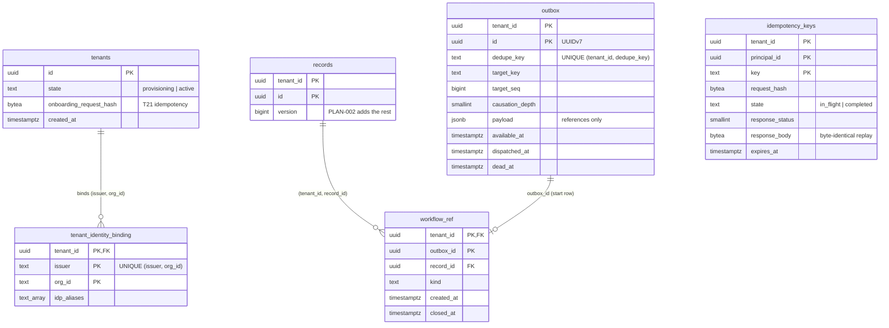

# Platform tables under forced RLS (T09)

Scope: TICK-64. ADR-001 I1, D28 and A.3, PLAN-001 T09. Migration
`db/migrations/00002_platform_tables.sql`, grants in `db/grants.yaml`.
PostgreSQL 16.10.

## Tables



Every table is `ENABLE` + `FORCE ROW LEVEL SECURITY`. Every primary key,
unique key and foreign key leads with `tenant_id`. The exception is
`UNIQUE (issuer, org_id)`, which is global on purpose: one organization, one
tenant.

## Policies

Tenant policies test `tenant_id = NULLIF(current_setting('app.tenant_id', true), '')::uuid`.
With no tenant set, or an empty one, they match no row.

| Table | Tenant policies | Allow-listed (do not test `app.tenant_id`) |
| --- | --- | --- |
| `tenants` | `tenants_tenant` (SELECT, app), `tenants_onboard_select`, `tenants_onboard_insert` (provisioning only), `tenants_activate` (UPDATE provisioning → active, own tenant) (onboard) | none |
| `tenant_identity_binding` | none | `binding_lookup` (SELECT TO nava_app, nava_groupsync), `binding_onboard` (INSERT TO nava_onboard, provisioning tenants visible to it) |
| `records` | `records_select`, `records_insert`, `records_update` (app, worker) | none |
| `outbox` | `outbox_select`, `outbox_insert` (app, worker) | `outbox_relay_select`, `outbox_relay_update` (pending rows only), `outbox_purge_select`, `outbox_purge` |
| `workflow_ref` | `workflow_ref_select`, `workflow_ref_insert` (app, worker), `workflow_ref_update` (worker) | `workflow_ref_purge_select`, `workflow_ref_purge` |
| `idempotency_keys` | `idempotency_select`, `idempotency_insert`, `idempotency_update` (app) | `idempotency_purge_select`, `idempotency_purge` |

Every policy is `FOR` one command and `TO` named roles, never `ALL` or
`PUBLIC` (CI-1). Tenant policies exist only for the commands the grants
allow. No runtime role has `DELETE` on these tables except `nava_purge`, so
no tenant policy is `FOR DELETE`.

`TestT09PolicyAllowList` is the guard. It reads `pg_policies` and fails on
any of these:
- a policy that is `FOR ALL` or `TO PUBLIC`;
- an allow-listed policy whose command, roles or deparsed predicate differ
  from the pinned ones;
- any other policy whose clauses are not exactly the deparsed tenant
  predicate: `USING` for SELECT and DELETE, `WITH CHECK` for INSERT, both
  for UPDATE.

The tenant predicate is `(tenant_id = (NULLIF(current_setting('app.tenant_id'::text, true), ''::text))::uuid)`,
with `id` on `tenants`. `tenants_onboard_insert` and `tenants_activate` add
a state test, so they are pinned exactly.

The guard compares text exactly. `current_setting('app.tenant_id', true) IS NOT NULL`
and `WITH CHECK (true)` both fail, though both mention or sit next to the
setting. `TestT09PolicyAllowListCatchesLeaks` proves it with those two
policies and two more (`… OR true`, `FOR ALL`).

`binding_onboard`
reads `tenants` through `tenants_onboard_select`, so inside `InTenantTx(X)` it
sees only X. That is why a binding for another provisioning tenant Y is
refused.

Column grants narrow what the allow-list opens. `nava_relay` cannot read
`dedupe_key`, `last_error`, `records` or `workflow_ref`, and writes only the
dispatch columns. `nava_purge` reads only key and expiry columns. `nava_onboard`
reads `id`, `state`, `onboarding_request_hash` and `created_at` of `tenants`
as a column list, so a column added later stays unreadable to it until
granted (AR-029, TICK-180).

## Evidence

Measured on 2026-10-24 against this migration, with the per-command
policies. PostgreSQL 16.10 on Docker Desktop, 16 CPUs, 20.8 GB,
`shared_buffers=1GB`. The data has 200 tenants, and tenant 1 holds 40% of
every table. Row counts: `records` 1.0 M, `outbox` 2.05 M (50k pending),
`workflow_ref` 1.0 M, `idempotency_keys` 1.0 M.

Each plan ran as the runtime role that issues the query, with RLS on. The
tenant was set transaction-locally, the way `InTenantTx` does it. Plans taken
as the owner or a superuser would skip RLS, so none were. The full plans are
under [Plans](#plans).

| Query (role) | Plan | Buffers | Time |
| --- | --- | --- | --- |
| Q1 Binding lookup (app, no tenant) | Seq Scan, 200 rows | 4 | 0.239 ms |
| Q2 Idempotency key (app, big tenant) | Index Scan `idempotency_keys_pkey` | 4 | 0.189 ms |
| Q2b Same, RLS as the only tenant filter | Index Scan `idempotency_keys_pkey`, RLS predicate in Index Cond | 4 | 0.089 ms |
| Q3 Dedupe conflict (app) | Index Scan `outbox_dedupe_key` | 4 | 0.234 ms |
| Q4 Record row lock (app) | Index Scan `records_pkey` | 4 | 0.189 ms |
| Q5/Q5b Open workflow_ref (worker, big / small tenant) | Index Scan `workflow_ref_record` | 4 / 4 | 0.368 / 0.213 ms |
| Q6 Relay claim, oldest 100 pending (relay) | Index Scan `outbox_pending_available` | 12 | 0.395 ms |
| Q6b Relay FIFO head of a target (relay) | Index Scan `outbox_pending_target` | 3 | 0.119 ms |

An earlier run before the per-command split had the same plans and buffer
counts, at 0.035–0.175 ms. The split changes which policy applies, not the
predicate.

Every tenant-scoped read is an index scan whose Index Cond leads with
`tenant_id`, including the RLS-only form. The binding lookup seq-scans
200 rows (4 pages), which is cheaper than an index at that size.
`tenant_identity_binding_issuer_org_key` is there for when the table grows.

### Index cost

| Index | Size | Why it exists |
| --- | --- | --- |
| `outbox_pkey` | 131 MB | PK |
| `outbox_dedupe_key` | 152 MB | producer `ON CONFLICT DO NOTHING` (A.3) |
| `outbox_pending_available` | 2.4 MB | relay claim; partial, pending rows only |
| `outbox_pending_target` | 5.5 MB | per-target FIFO; partial |
| `workflow_ref_pkey` | 64 MB | PK |
| `workflow_ref_record` | 95 MB | open-workflow lookup and the FK's index |
| `records_pkey`, `idempotency_keys_pkey` | 64 MB, 76 MB | PK |

Write cost as `nava_app` in one tenant transaction, with all indexes and RLS
checks: 10,000 `outbox` rows took 927 ms (93 µs/row, 4 indexes), and
10,000 `idempotency_keys` rows took 160 ms (16 µs/row). The earlier run
measured 166 ms and 64 ms on the same host. Treat this as a range on a
shared laptop, not a figure, until it runs on dedicated hardware. Both runs
check the same single `WITH CHECK` predicate per row. The two partial
indexes are under 2% of the outbox heap (471 MB), because they hold only the
pending rows.

### Plans

`EXPLAIN (ANALYZE, BUFFERS, COSTS OFF)`. Big tenant = tenant 1, small
tenant = tenant 5 (0.3% of rows).

```text
=== Q1 binding_lookup (A.1 step 4), nava_app, no tenant yet ===
 Seq Scan on tenant_identity_binding (actual time=0.084..0.129 rows=1 loops=1)
   Filter: ((issuer = 'https://kc.example/realms/nava'::text) AND (org_id = 'org-117'::text))
   Rows Removed by Filter: 199
   Buffers: shared read=4
 Planning:
   Buffers: shared hit=110
 Planning Time: 0.905 ms
 Execution Time: 0.239 ms
=== Q2 idempotency key lookup (T22), nava_app, big tenant ===
 Result (actual time=0.114..0.117 rows=1 loops=1)
   One-Time Filter: ((NULLIF(current_setting('app.tenant_id'::text, true), ''::text))::uuid = 'febe0277-53c1-e6ce-9acd-bbd9c80a8407'::uuid)
   Buffers: shared hit=4
   ->  Index Scan using idempotency_keys_pkey on idempotency_keys (actual time=0.100..0.101 rows=1 loops=1)
         Index Cond: ((tenant_id = 'febe0277-53c1-e6ce-9acd-bbd9c80a8407'::uuid) AND (principal_id = '74961400-3e87-3caf-70f0-d97fd88d3315'::uuid) AND (key = 'k500000'::text))
         Buffers: shared hit=4
 Planning:
   Buffers: shared hit=97
 Planning Time: 1.313 ms
 Execution Time: 0.189 ms
=== Q2b same, RLS as the only tenant filter (no tenant_id = $n) ===
 Index Scan using idempotency_keys_pkey on idempotency_keys (actual time=0.047..0.049 rows=1 loops=1)
   Index Cond: ((tenant_id = (NULLIF(current_setting('app.tenant_id'::text, true), ''::text))::uuid) AND (principal_id = '74961400-3e87-3caf-70f0-d97fd88d3315'::uuid) AND (key = 'k500000'::text))
   Buffers: shared hit=4
 Planning Time: 0.168 ms
 Execution Time: 0.089 ms
=== Q3 outbox dedupe-conflict lookup (T29), nava_app, big tenant ===
 Result (actual time=0.135..0.138 rows=1 loops=1)
   One-Time Filter: ((NULLIF(current_setting('app.tenant_id'::text, true), ''::text))::uuid = 'febe0277-53c1-e6ce-9acd-bbd9c80a8407'::uuid)
   Buffers: shared hit=1 read=3
   ->  Index Scan using outbox_dedupe_key on outbox (actual time=0.124..0.125 rows=1 loops=1)
         Index Cond: ((tenant_id = 'febe0277-53c1-e6ce-9acd-bbd9c80a8407'::uuid) AND (dedupe_key = 'd500000'::text))
         Buffers: shared hit=1 read=3
 Planning:
   Buffers: shared hit=94
 Planning Time: 0.597 ms
 Execution Time: 0.234 ms
=== Q4 records row lock + version (T29 Enqueue), nava_app, big tenant ===
 LockRows (actual time=0.121..0.125 rows=1 loops=1)
   Buffers: shared hit=6
   ->  Result (actual time=0.069..0.071 rows=1 loops=1)
         One-Time Filter: ((NULLIF(current_setting('app.tenant_id'::text, true), ''::text))::uuid = 'febe0277-53c1-e6ce-9acd-bbd9c80a8407'::uuid)
         Buffers: shared hit=4
         ->  Index Scan using records_pkey on records (actual time=0.058..0.060 rows=1 loops=1)
               Index Cond: ((tenant_id = 'febe0277-53c1-e6ce-9acd-bbd9c80a8407'::uuid) AND (id = '53433ac7-398a-9dea-51ed-55e25a51d1b3'::uuid))
               Buffers: shared hit=4
 Planning:
   Buffers: shared hit=33
 Planning Time: 0.462 ms
 Execution Time: 0.189 ms
=== Q5 open workflow_ref for a record (ErrNoOpenWorkflow), nava_worker, big tenant ===
 Limit (actual time=0.312..0.313 rows=1 loops=1)
   Buffers: shared hit=4
   ->  Result (actual time=0.309..0.310 rows=1 loops=1)
         One-Time Filter: ((NULLIF(current_setting('app.tenant_id'::text, true), ''::text))::uuid = 'febe0277-53c1-e6ce-9acd-bbd9c80a8407'::uuid)
         Buffers: shared hit=4
         ->  Index Scan using workflow_ref_record on workflow_ref (actual time=0.298..0.299 rows=1 loops=1)
               Index Cond: ((tenant_id = 'febe0277-53c1-e6ce-9acd-bbd9c80a8407'::uuid) AND (record_id = '53433ac7-398a-9dea-51ed-55e25a51d1b3'::uuid) AND (kind = 'approval'::text))
               Filter: (closed_at IS NULL)
               Buffers: shared hit=4
 Planning:
   Buffers: shared hit=146
 Planning Time: 1.245 ms
 Execution Time: 0.368 ms
=== Q5b same, small tenant ===
 Limit (actual time=0.177..0.179 rows=0 loops=1)
   Buffers: shared hit=4
   ->  Result (actual time=0.176..0.176 rows=0 loops=1)
         One-Time Filter: ((NULLIF(current_setting('app.tenant_id'::text, true), ''::text))::uuid = '32e3fdef-02d0-5261-660d-9bb28c277274'::uuid)
         Buffers: shared hit=4
         ->  Index Scan using workflow_ref_record on workflow_ref (actual time=0.168..0.169 rows=0 loops=1)
               Index Cond: ((tenant_id = '32e3fdef-02d0-5261-660d-9bb28c277274'::uuid) AND (record_id = 'b695feff-4dd3-d02a-448e-4781800a8f3e'::uuid) AND (kind = 'approval'::text))
               Filter: (closed_at IS NULL)
               Rows Removed by Filter: 1
               Buffers: shared hit=4
 Planning Time: 0.225 ms
 Execution Time: 0.213 ms
=== Q6 relay claim, one tenant, oldest 100 pending (allow-listed, no tenant set) ===
 Limit (actual time=0.106..0.295 rows=100 loops=1)
   Buffers: shared hit=8 read=4
   ->  Index Scan using outbox_pending_available on outbox (actual time=0.104..0.275 rows=100 loops=1)
         Index Cond: ((tenant_id = 'febe0277-53c1-e6ce-9acd-bbd9c80a8407'::uuid) AND (available_at <= now()))
         Buffers: shared hit=8 read=4
 Planning:
   Buffers: shared hit=208
 Planning Time: 1.410 ms
 Execution Time: 0.395 ms
=== Q6b relay head of each target (FIFO), big tenant ===
 Limit (actual time=0.088..0.089 rows=0 loops=1)
   Buffers: shared read=3
   ->  Index Scan using outbox_pending_target on outbox (actual time=0.086..0.087 rows=0 loops=1)
         Index Cond: ((tenant_id = 'febe0277-53c1-e6ce-9acd-bbd9c80a8407'::uuid) AND (target_key = 'rec:53433ac7398a9dea51ed55e25a51d1b3'::text))
         Buffers: shared read=3
 Planning:
   Buffers: shared hit=11
 Planning Time: 0.739 ms
 Execution Time: 0.119 ms
```

## Not done here (owners)

- The CI-1 catalogue check across all future tables (RLS, FORCE, allow-list):
  T10.
- The identity tables (`principals`, `groups`, …) and their `nava_groupsync`
  grants: T16, in [identity.md](identity.md).
- `records` columns beyond `version`: PLAN-002.
