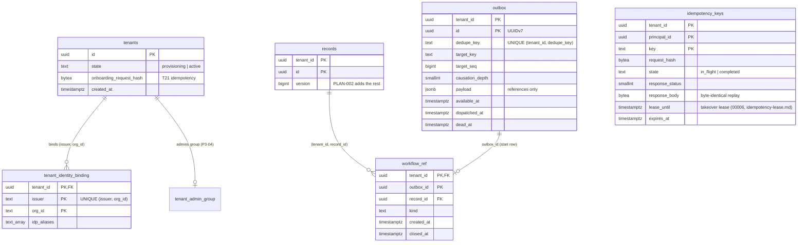
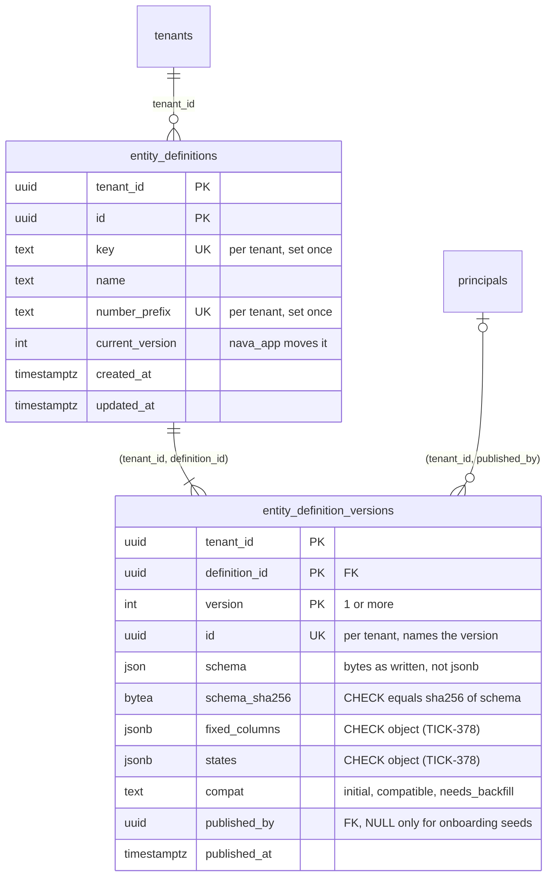
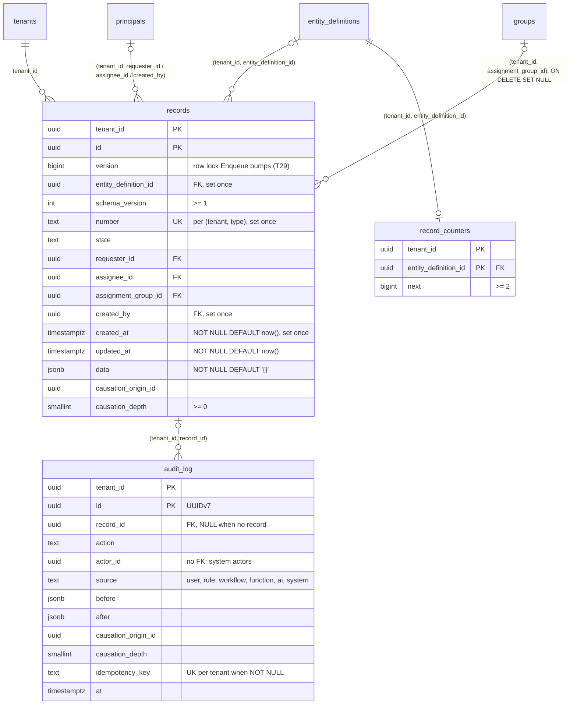

# Platform tables under forced RLS (T09)

Scope: TICK-64. ADR-001 I1, D28 and A.3, PLAN-001 T09. Migration
`db/migrations/00002_platform_tables.sql`, grants in `db/grants.yaml`.
PostgreSQL 16.10.

## Tables



Every table is `ENABLE` + `FORCE ROW LEVEL SECURITY`. Every primary key,
unique key and foreign key leads with `tenant_id`. The exception is
`UNIQUE (issuer, org_id)`, which is global on purpose: one organization, one
tenant.

## Policies

Tenant policies test `tenant_id = NULLIF(current_setting('app.tenant_id', true), '')::uuid`.
With no tenant set, or an empty one, they match no row.

| Table | Tenant policies | Allow-listed (do not test `app.tenant_id`) |
| --- | --- | --- |
| `tenants` | `tenants_tenant` (SELECT, app), `tenants_onboard_select`, `tenants_onboard_insert` (provisioning only), `tenants_activate` (UPDATE provisioning → active, own tenant) (onboard) | none |
| `tenant_identity_binding` | none | `binding_lookup` (SELECT TO nava_app, nava_groupsync), `binding_onboard` (INSERT TO nava_onboard, provisioning tenants visible to it) |
| `records` | `records_select`, `records_insert`, `records_update` (app, worker) | none |
| `outbox` | `outbox_select`, `outbox_insert` (app, worker) | `outbox_relay_select`, `outbox_relay_update` (pending rows only), `outbox_purge_select`, `outbox_purge` |
| `workflow_ref` | `workflow_ref_select`, `workflow_ref_insert` (app, worker), `workflow_ref_update` (worker) | `workflow_ref_purge_select`, `workflow_ref_purge` |
| `tenant_admin_group` | `tenant_admin_group_select` (app, worker, nava_groupsync) | `tenant_admin_group_insert` (onboard, provisioning tenant only); `tenant_admin_group_select_onboard` (onboard, own provisioning tenant, `tenant_id` column only: `Activate` refuses a tenant without the row, TICK-373); onboarding also inserts the admins `groups` row under `groups_insert_onboard` and reads it back under `groups_select_onboard` |
| `idempotency_keys` | `idempotency_select`, `idempotency_insert`, `idempotency_update` (app) | `idempotency_purge_select`, `idempotency_purge` |

Every policy is `FOR` one command and `TO` named roles, never `ALL` or
`PUBLIC` (CI-1). Tenant policies exist only for the commands the grants
allow. No runtime role has `DELETE` on these tables except `nava_purge`, so
no tenant policy is `FOR DELETE`.

`TestT09PolicyAllowList` is the guard. It reads `pg_policies` and fails on
any of these:
- a policy that is `FOR ALL` or `TO PUBLIC`;
- an allow-listed policy whose command, roles or deparsed predicate differ
  from the pinned ones;
- any other policy whose clauses are not exactly the deparsed tenant
  predicate: `USING` for SELECT and DELETE, `WITH CHECK` for INSERT, both
  for UPDATE.

The tenant predicate is `(tenant_id = (NULLIF(current_setting('app.tenant_id'::text, true), ''::text))::uuid)`,
with `id` on `tenants`. `tenants_onboard_insert` and `tenants_activate` add
a state test, so they are pinned exactly.

The guard compares text exactly. `current_setting('app.tenant_id', true) IS NOT NULL`
and `WITH CHECK (true)` both fail, though both mention or sit next to the
setting. `TestT09PolicyAllowListCatchesLeaks` proves it with those two
policies and two more (`… OR true`, `FOR ALL`).

`binding_onboard`
reads `tenants` through `tenants_onboard_select`, so inside `InTenantTx(X)` it
sees only X. That is why a binding for another provisioning tenant Y is
refused.

Column grants narrow what the allow-list opens. `nava_relay` cannot read
`dedupe_key`, `last_error`, `records` or `workflow_ref`, and writes only the
dispatch columns. `nava_purge` reads only key and expiry columns. `nava_onboard`
reads `id`, `state`, `onboarding_request_hash` and `created_at` of `tenants`
as a column list, so a column added later stays unreadable to it until
granted (AR-029, TICK-180).

## Evidence

Measured on 2026-10-24 against this migration, with the per-command
policies. PostgreSQL 16.10 on Docker Desktop, 16 CPUs, 20.8 GB,
`shared_buffers=1GB`. The data has 200 tenants, and tenant 1 holds 40% of
every table. Row counts: `records` 1.0 M, `outbox` 2.05 M (50k pending),
`workflow_ref` 1.0 M, `idempotency_keys` 1.0 M.

Each plan ran as the runtime role that issues the query, with RLS on. The
tenant was set transaction-locally, the way `InTenantTx` does it. Plans taken
as the owner or a superuser would skip RLS, so none were. The full plans are
under [Plans](#plans).

| Query (role) | Plan | Buffers | Time |
| --- | --- | --- | --- |
| Q1 Binding lookup (app, no tenant) | Seq Scan, 200 rows | 4 | 0.239 ms |
| Q2 Idempotency key (app, big tenant) | Index Scan `idempotency_keys_pkey` | 4 | 0.189 ms |
| Q2b Same, RLS as the only tenant filter | Index Scan `idempotency_keys_pkey`, RLS predicate in Index Cond | 4 | 0.089 ms |
| Q3 Dedupe conflict (app) | Index Scan `outbox_dedupe_key` | 4 | 0.234 ms |
| Q4 Record row lock (app) | Index Scan `records_pkey` | 4 | 0.189 ms |
| Q5/Q5b Open workflow_ref (worker, big / small tenant) | Index Scan `workflow_ref_record` | 4 / 4 | 0.368 / 0.213 ms |
| Q6 Relay claim, oldest 100 pending (relay) | Index Scan `outbox_pending_available` | 12 | 0.395 ms |
| Q6b Relay FIFO head of a target (relay) | Index Scan `outbox_pending_target` | 3 | 0.119 ms |

An earlier run before the per-command split had the same plans and buffer
counts, at 0.035–0.175 ms. The split changes which policy applies, not the
predicate.

Every tenant-scoped read is an index scan whose Index Cond leads with
`tenant_id`, including the RLS-only form. The binding lookup seq-scans
200 rows (4 pages), which is cheaper than an index at that size.
`tenant_identity_binding_issuer_org_key` is there for when the table grows.

### Index cost

| Index | Size | Why it exists |
| --- | --- | --- |
| `outbox_pkey` | 131 MB | PK |
| `outbox_dedupe_key` | 152 MB | producer `ON CONFLICT DO NOTHING` (A.3) |
| `outbox_pending_available` | 2.4 MB | relay claim; partial, pending rows only |
| `outbox_pending_target` | 5.5 MB | per-target FIFO; partial |
| `workflow_ref_pkey` | 64 MB | PK |
| `workflow_ref_record` | 95 MB | open-workflow lookup and the FK's index |
| `records_pkey`, `idempotency_keys_pkey` | 64 MB, 76 MB | PK |

The four purge indexes (`outbox_purge_dispatched`, `outbox_purge_dead`,
`workflow_ref_purge_closed`, `idempotency_keys_purge_expires`) came later in
`00005`; their cost and plans are in [purge-indexes.md](purge-indexes.md).

Write cost as `nava_app` in one tenant transaction, with all indexes and RLS
checks: 10,000 `outbox` rows took 927 ms (93 µs/row, 4 indexes), and
10,000 `idempotency_keys` rows took 160 ms (16 µs/row). The earlier run
measured 166 ms and 64 ms on the same host. Treat this as a range on a
shared laptop, not a figure, until it runs on dedicated hardware. Both runs
check the same single `WITH CHECK` predicate per row. The two partial
indexes are under 2% of the outbox heap (471 MB), because they hold only the
pending rows.

### Plans

`EXPLAIN (ANALYZE, BUFFERS, COSTS OFF)`. Big tenant = tenant 1, small
tenant = tenant 5 (0.3% of rows).

```text
=== Q1 binding_lookup (A.1 step 4), nava_app, no tenant yet ===
 Seq Scan on tenant_identity_binding (actual time=0.084..0.129 rows=1 loops=1)
   Filter: ((issuer = 'https://kc.example/realms/nava'::text) AND (org_id = 'org-117'::text))
   Rows Removed by Filter: 199
   Buffers: shared read=4
 Planning:
   Buffers: shared hit=110
 Planning Time: 0.905 ms
 Execution Time: 0.239 ms
=== Q2 idempotency key lookup (T22), nava_app, big tenant ===
 Result (actual time=0.114..0.117 rows=1 loops=1)
   One-Time Filter: ((NULLIF(current_setting('app.tenant_id'::text, true), ''::text))::uuid = 'febe0277-53c1-e6ce-9acd-bbd9c80a8407'::uuid)
   Buffers: shared hit=4
   ->  Index Scan using idempotency_keys_pkey on idempotency_keys (actual time=0.100..0.101 rows=1 loops=1)
         Index Cond: ((tenant_id = 'febe0277-53c1-e6ce-9acd-bbd9c80a8407'::uuid) AND (principal_id = '74961400-3e87-3caf-70f0-d97fd88d3315'::uuid) AND (key = 'k500000'::text))
         Buffers: shared hit=4
 Planning:
   Buffers: shared hit=97
 Planning Time: 1.313 ms
 Execution Time: 0.189 ms
=== Q2b same, RLS as the only tenant filter (no tenant_id = $n) ===
 Index Scan using idempotency_keys_pkey on idempotency_keys (actual time=0.047..0.049 rows=1 loops=1)
   Index Cond: ((tenant_id = (NULLIF(current_setting('app.tenant_id'::text, true), ''::text))::uuid) AND (principal_id = '74961400-3e87-3caf-70f0-d97fd88d3315'::uuid) AND (key = 'k500000'::text))
   Buffers: shared hit=4
 Planning Time: 0.168 ms
 Execution Time: 0.089 ms
=== Q3 outbox dedupe-conflict lookup (T29), nava_app, big tenant ===
 Result (actual time=0.135..0.138 rows=1 loops=1)
   One-Time Filter: ((NULLIF(current_setting('app.tenant_id'::text, true), ''::text))::uuid = 'febe0277-53c1-e6ce-9acd-bbd9c80a8407'::uuid)
   Buffers: shared hit=1 read=3
   ->  Index Scan using outbox_dedupe_key on outbox (actual time=0.124..0.125 rows=1 loops=1)
         Index Cond: ((tenant_id = 'febe0277-53c1-e6ce-9acd-bbd9c80a8407'::uuid) AND (dedupe_key = 'd500000'::text))
         Buffers: shared hit=1 read=3
 Planning:
   Buffers: shared hit=94
 Planning Time: 0.597 ms
 Execution Time: 0.234 ms
=== Q4 records row lock + version (T29 Enqueue), nava_app, big tenant ===
 LockRows (actual time=0.121..0.125 rows=1 loops=1)
   Buffers: shared hit=6
   ->  Result (actual time=0.069..0.071 rows=1 loops=1)
         One-Time Filter: ((NULLIF(current_setting('app.tenant_id'::text, true), ''::text))::uuid = 'febe0277-53c1-e6ce-9acd-bbd9c80a8407'::uuid)
         Buffers: shared hit=4
         ->  Index Scan using records_pkey on records (actual time=0.058..0.060 rows=1 loops=1)
               Index Cond: ((tenant_id = 'febe0277-53c1-e6ce-9acd-bbd9c80a8407'::uuid) AND (id = '53433ac7-398a-9dea-51ed-55e25a51d1b3'::uuid))
               Buffers: shared hit=4
 Planning:
   Buffers: shared hit=33
 Planning Time: 0.462 ms
 Execution Time: 0.189 ms
=== Q5 open workflow_ref for a record (ErrNoOpenWorkflow), nava_worker, big tenant ===
 Limit (actual time=0.312..0.313 rows=1 loops=1)
   Buffers: shared hit=4
   ->  Result (actual time=0.309..0.310 rows=1 loops=1)
         One-Time Filter: ((NULLIF(current_setting('app.tenant_id'::text, true), ''::text))::uuid = 'febe0277-53c1-e6ce-9acd-bbd9c80a8407'::uuid)
         Buffers: shared hit=4
         ->  Index Scan using workflow_ref_record on workflow_ref (actual time=0.298..0.299 rows=1 loops=1)
               Index Cond: ((tenant_id = 'febe0277-53c1-e6ce-9acd-bbd9c80a8407'::uuid) AND (record_id = '53433ac7-398a-9dea-51ed-55e25a51d1b3'::uuid) AND (kind = 'approval'::text))
               Filter: (closed_at IS NULL)
               Buffers: shared hit=4
 Planning:
   Buffers: shared hit=146
 Planning Time: 1.245 ms
 Execution Time: 0.368 ms
=== Q5b same, small tenant ===
 Limit (actual time=0.177..0.179 rows=0 loops=1)
   Buffers: shared hit=4
   ->  Result (actual time=0.176..0.176 rows=0 loops=1)
         One-Time Filter: ((NULLIF(current_setting('app.tenant_id'::text, true), ''::text))::uuid = '32e3fdef-02d0-5261-660d-9bb28c277274'::uuid)
         Buffers: shared hit=4
         ->  Index Scan using workflow_ref_record on workflow_ref (actual time=0.168..0.169 rows=0 loops=1)
               Index Cond: ((tenant_id = '32e3fdef-02d0-5261-660d-9bb28c277274'::uuid) AND (record_id = 'b695feff-4dd3-d02a-448e-4781800a8f3e'::uuid) AND (kind = 'approval'::text))
               Filter: (closed_at IS NULL)
               Rows Removed by Filter: 1
               Buffers: shared hit=4
 Planning Time: 0.225 ms
 Execution Time: 0.213 ms
=== Q6 relay claim, one tenant, oldest 100 pending (allow-listed, no tenant set) ===
 Limit (actual time=0.106..0.295 rows=100 loops=1)
   Buffers: shared hit=8 read=4
   ->  Index Scan using outbox_pending_available on outbox (actual time=0.104..0.275 rows=100 loops=1)
         Index Cond: ((tenant_id = 'febe0277-53c1-e6ce-9acd-bbd9c80a8407'::uuid) AND (available_at <= now()))
         Buffers: shared hit=8 read=4
 Planning:
   Buffers: shared hit=208
 Planning Time: 1.410 ms
 Execution Time: 0.395 ms
=== Q6b relay head of each target (FIFO), big tenant ===
 Limit (actual time=0.088..0.089 rows=0 loops=1)
   Buffers: shared read=3
   ->  Index Scan using outbox_pending_target on outbox (actual time=0.086..0.087 rows=0 loops=1)
         Index Cond: ((tenant_id = 'febe0277-53c1-e6ce-9acd-bbd9c80a8407'::uuid) AND (target_key = 'rec:53433ac7398a9dea51ed55e25a51d1b3'::text))
         Buffers: shared read=3
 Planning:
   Buffers: shared hit=11
 Planning Time: 0.739 ms
 Execution Time: 0.119 ms
```

## Entity types and versions (P3-02)

Scope: TICK-340, PLAN-003 D-3-2 and D-3-4 (groomed on TICK-360, TICK-363).
Migration `db/migrations/20261031150000_entity_definitions.sql`, grants in
`db/grants.yaml`, tests in `internal/db/dbtest/entity_definitions_test.go`.



- **Immutable versions (D-3-4).** No role has `UPDATE` or `DELETE` on
  `entity_definition_versions`, and there is no such policy: every attempt is
  `42501` before RLS is consulted. `entity_definitions` has no `DELETE`
  either; `nava_app` may `UPDATE` only `current_version` and `updated_at`, so
  `key` and `number_prefix` are fixed at create. `key` matches
  `^[a-z][a-z0-9_]{1,40}$` and `number_prefix` `^[A-Z]{2,6}$` (CHECK).
- **`schema` is `json`.** `jsonb` reorders keys, drops duplicates and
  rewrites whitespace. `schema_sha256` is checked against
  `sha256(convert_to(schema::text, 'UTF8'))` on every insert, so the hash and
  the bytes cannot disagree. Go reads `schema` as `[]byte`. Duplicate keys are
  rejected before the insert by P3-03 (TICK-341), not here.
- **Composite foreign keys (D-3-2).** Both references carry `tenant_id`,
  since foreign-key checks run as the owner and ignore RLS. A version naming
  another tenant's type or principal is `23503`.
- **`published_by` is nullable.** Onboarding seeds templates (P3-06) while
  the tenant is still provisioning, before group sync has written any
  principal. A NULL skips the foreign key (MATCH SIMPLE) and names no other
  tenant's row. Nothing in the database stops `nava_app` from writing NULL
  too; the publish path in the service layer must always set it.
- **`compat`.** Version 1, and only version 1, is `initial` (CHECK).
- **`fixed_columns` and `states` are objects (TICK-378).** A CHECK on each
  refuses any other top-level JSON type, `'[]'` and `null` included, because
  the store scans them into a Go map and struct and a bad row could never be
  repaired. Decision and figures:
  [`entity-def-versions-jsonb-check.md`](entity-def-versions-jsonb-check.md).
- **Policies.** One per command, `TO` the granted roles only, each the
  canonical tenant predicate. `nava_onboard`'s two `INSERT` policies add "and
  that tenant is provisioning" and are pinned in
  `catalog.PinnedTenantPolicies` (not the allow-list).

| Role | `entity_definitions` | `entity_definition_versions` |
| --- | --- | --- |
| `nava_app` | SELECT, INSERT, UPDATE (`current_version`, `updated_at`) | SELECT, INSERT |
| `nava_worker` | SELECT | SELECT |
| `nava_onboard` | INSERT, own provisioning tenant only | INSERT, own provisioning tenant only |
| every other role, `nava_purge` included | none | none |

### Evidence (P3-02)

`scratch/entity-definitions-bench/run.sh` (output in `result.txt`):
`postgres:16.10` in Docker Desktop on Windows 11, Intel i7-1260P. 2,000
tenants × 10 types × 5 versions = **20,000 types, 100,000 versions**, each
schema about 1.6 kB of `json`. Queries run as `nava_app` under FORCE RLS
with `app.tenant_id` set, warm cache.

| Query | Plan | Buffers | Execution |
| --- | --- | --- | --- |
| Q1 type by `key`, joined to its current version (record create and read) | Index Scan `entity_definitions_key_key`, then Index Scan `entity_definition_versions_pkey` | 7 hit | 0.102 ms |
| Q2 version by `id` (interpreter, D-3-12) | Index Scan `entity_definition_versions_id_key` | 4 hit | 0.045 ms |
| Q3 a tenant's types, ordered by `key` | Bitmap Index Scan `entity_definitions_number_prefix_key`, sort of 10 rows | 12 hit | 0.145 ms |
| Q4 one type's version history | Index Scan `entity_definition_versions_pkey` | 5 hit | 0.051 ms |

The RLS predicate becomes a one-time filter on the constant tenant, and
every index condition leads with `tenant_id`.

**Index set and cost.** Five B-trees, every one a constraint the contract
requires (two primary keys, three UNIQUE); no index beyond them. At the row
counts above, versions take 43 MB of heap (the schemas compress) plus 7.2 MB
(`pkey`) and 6.5 MB (`id_key`); types take 2.0 MB of heap plus about 1.1 MB
per index. Write amplification is two index entries per version insert and
three per type insert. Both tables are written rarely (a publish, an
onboarding seed), so that cost is negligible next to the reads.

**Left out on purpose.** No index on `(tenant_id, published_by)`: no
runtime role deletes a principal (they are tombstoned, TICK-220), so the
foreign key never scans for referencing rows. Add one, `CONCURRENTLY`, when a
"versions a principal published" query or a principal hard delete appears.
No foreign key from `current_version` to a version: it would be circular (a
deferred constraint on both inserts) for a value only `nava_app`'s publish
path moves; the service layer publishes the version and moves
`current_version` in one transaction.

## Records pipeline: records, audit_log, record_counters (P3-09)

Scope: TICK-353, PLAN-003 D-3-2, D-3-9, D-3-13; ADR-001 I1, I8, I9 (groomed
on TICK-360, TICK-363). Migration
`db/migrations/20261101190000_records_pipeline.sql`, grants and the
`nava_app` role setting in `db/grants.yaml`, tests in
`internal/db/dbtest/records_pipeline_test.go`, isolation seed rows and paths
in `internal/tenancy/isolation`. Index set from P3-01
([`records-list-bench.md`](records-list-bench.md)).



- **Additive, no rewrite.** Every new `records` column is nullable or has a
  constant or stable default (`'{}'`, `now()`), which PG16 stores as the
  column's missing value. `TestP309RecordsNotRewritten` migrates a table of
  1,000 bare rows and checks `pg_class.relfilenode` is unchanged; the bench
  below does the same at 800,000.
- **All-or-none CHECK (TICK-363).** `entity_definition_id`, `schema_version`,
  `number` and `state` are all NULL (a PLAN-001 bare row) or all set. `SET
  NOT NULL` is a later contract step, once no bare row remains; later
  constraints are added `NOT VALID`, then validated.
- **Set once.** `nava_app` and `nava_worker` hold `UPDATE` on every `records`
  column but `tenant_id`, `id`, `entity_definition_id`, `number`, `created_by`
  and `created_at`, so a record's number cannot be rewritten (`42501`, CI-4
  pins the column grants). Nobody holds `DELETE` on any of the three tables.
- **Append-only audit.** `audit_log` is `INSERT, SELECT` only, with no
  `UPDATE` or `DELETE` policy. `record_id` is NULL only for a row with no
  record to name (`cascade_rejected` on a create). `actor_id` has no foreign
  key: a system actor names no principal, and an id without a foreign key
  reaches no other tenant's row.
- **Idempotency key (D-3-13).** `UNIQUE (tenant_id, idempotency_key) WHERE
  idempotency_key IS NOT NULL`. The pipeline puts the key on the primary row
  only. An `ON CONFLICT` target must repeat the predicate: `ON CONFLICT
  (tenant_id, idempotency_key) WHERE idempotency_key IS NOT NULL`.
- **Numbering (D-3-9).** One upsert, `INSERT … VALUES (…, 2) ON CONFLICT
  (tenant_id, entity_definition_id) DO UPDATE SET next = record_counters.next
  + 1 RETURNING next - 1`; `next` is the number the following create gets.
  It needs INSERT, UPDATE (`next`) and SELECT, each under its own policy.
- **Composite foreign keys (TICK-360).** All five carry `tenant_id`. A record
  naming another tenant's type, principal or group, an audit row naming
  another tenant's record, and a counter for another tenant's type are each
  `23503` though the policy passes them.
- **Group delete clears the group.** Group sync deletes a group Keycloak no
  longer has (`internal/groupsync`). With `NO ACTION`, one record naming the
  group would fail that tenant's whole sync, deprovisioning included, so the
  foreign key is `ON DELETE SET NULL (assignment_group_id)` (the column list
  keeps `tenant_id`). The cleared group is not audited and `updated_at` does
  not move: the database cannot write an audit row for it. If the record
  must show the change, group sync (or a pipeline write) has to reassign
  first; that is a service-layer decision, raised on TICK-353.
- **`plan_cache_mode`.** `nava_app` runs with `force_custom_plan`, the P3-01
  verdict condition. It is a role setting in `db/grants.yaml`
  (`settings`), applied and converged by db-roles (the bootstrap superuser):
  the migrator is `NOCREATEROLE` and may not `ALTER ROLE`. db-roles also
  resets any setting not listed and any per-database role setting, which
  would override the role-wide one. `TestP309PlanCacheModeFromDBRoles` checks
  it on a fresh cluster. PgBouncer's server connections log in as `nava_app`,
  so pooled sessions get it too. No JSONB operator is ever marked `LEAKPROOF`.

| Role | `records` | `audit_log` | `record_counters` |
| --- | --- | --- | --- |
| `nava_app`, `nava_worker` | SELECT, INSERT, UPDATE (all but the set-once columns) | SELECT, INSERT | SELECT, INSERT, UPDATE (`next`) |
| `nava_relay` | none (CI-9) | none | none |
| every other role | none | none | none |

### Evidence (P3-09)

`scratch/records-pipeline-bench/run.sh` (output in `result.txt`):
`postgres:16.10` in Docker Desktop on Windows 11 (16 vCPU, 19.4 GiB given to
Docker), the real migration body, prerequisite tables reduced to their keys,
run as the superuser with explicit `tenant_id` (the RLS predicate is the same
equality on a leakproof `uuid` operator, so it gives the same index
conditions). 200 tenants × 4,000 records = **800,000 records**, warm cache.

**The migration on 800,000 bare rows.** `relfilenode` 16408 before and after,
heap 52 MB before and after: no rewrite. The whole migration ran in one
transaction in about **4.3 s**: the `ALTER TABLE` 1,565 ms (the
`records_number_key` build and the five foreign-key validation scans), then
`records_tenant_updated` 1,006 ms, `records_tenant_requester` 1,567 ms and
`records_tenant_group_open` 84 ms (bare rows have a NULL state, so the
partial index is nearly empty). That is an ACCESS EXCLUSIVE window on
`records`. In M1 `records` holds only PLAN-001 test rows, so the window is
milliseconds; were this run on a deployed table with real rows, the three
indexes would move to their own `CREATE INDEX CONCURRENTLY` migration
(`-- +goose NO TRANSACTION`) and the foreign keys would be added `NOT VALID`
and validated separately.

With 800,000 pipeline rows (20 % open) and 4,000,000 audit rows (five per
record, the first keyed):

| Query | Plan | Buffers | Execution |
| --- | --- | --- | --- |
| A record's history, `ORDER BY at, id` | Index Scan `audit_log_record` | 5 read | 0.056 ms |
| Replay lookup by idempotency key (D-3-13) | Index Scan `audit_log_idempotency_key` | 1 hit, 3 read | 0.039 ms |
| Counter upsert (D-3-9), conflicting row | Arbiter `record_counters_pkey`, UPDATE | 9 hit | 0.069 ms |
| The `SET NULL` action for one deleted group, 4,000-record tenant | Bitmap Index Scan `records_pkey` on `tenant_id`, filter on the group, 200 rows updated | 4,529 hit, 3,924 read | 27.6 ms |
| `DELETE FROM groups` for one group, as group sync issues it (warm) | the delete plus the action above | | 9.3 ms |

**Index cost.** Sizes at the row counts above:

| Relation | Size |
| --- | --- |
| `records` heap | 156 MB |
| `records_pkey` | 49 MB |
| `records_number_key` | 93 MB |
| `records_tenant_updated` | 80 MB |
| `records_tenant_requester` | 79 MB |
| `records_tenant_group_open` | 19 MB (open rows only) |
| `audit_log` heap | 481 MB |
| `audit_log_pkey` | 247 MB |
| `audit_log_record` | 390 MB |
| `audit_log_idempotency_key` | 84 MB (keyed rows only) |
| `record_counters` | 16 kB |

A record insert writes five index entries (four for a closed record). Every
pipeline update moves `updated_at`, which `records_tenant_updated` indexes,
so no update is HOT and each writes four or five index entries again; P3-01
measured the write throughput of this set. An audit insert writes two index
entries, three when keyed. The audit table is the biggest consumer: about
300 bytes of heap and indexes per row here, before `before`/`after`
payloads grow. Partitioning stays out (D23).

**Left out on purpose.** No index for the group foreign key's `SET NULL`
action: `records_tenant_group_open` is partial, so the action scans the
tenant's rows through `records_pkey` (27.6 ms at 4,000 records, cold-ish),
and a group delete is rare. Add a full `(tenant_id, assignment_group_id)`
index `CONCURRENTLY` if large tenants make group sync slow. No index for the
principal foreign keys: no runtime role deletes a principal (tombstoned,
TICK-220). No assignee index, no JSONB expression index and no GIN on `data`
(P3-01: unusable under RLS, since `->>` and `@>` are not leakproof). No
`causation_trigger_id` (ADR-001-A5, A5-5).

## Not done here (owners)

- The CI-1 catalogue check across all future tables (RLS, FORCE, allow-list):
  T10.
- The identity tables (`principals`, `groups`, …) and their `nava_groupsync`
  grants: T16, in [identity.md](identity.md).
- The write pipeline over the P3-09 tables: P3-10 (TICK-354); numbering and
  states: P3-11; record listing with the explicit `tenant_id = $1`: P3-31.
