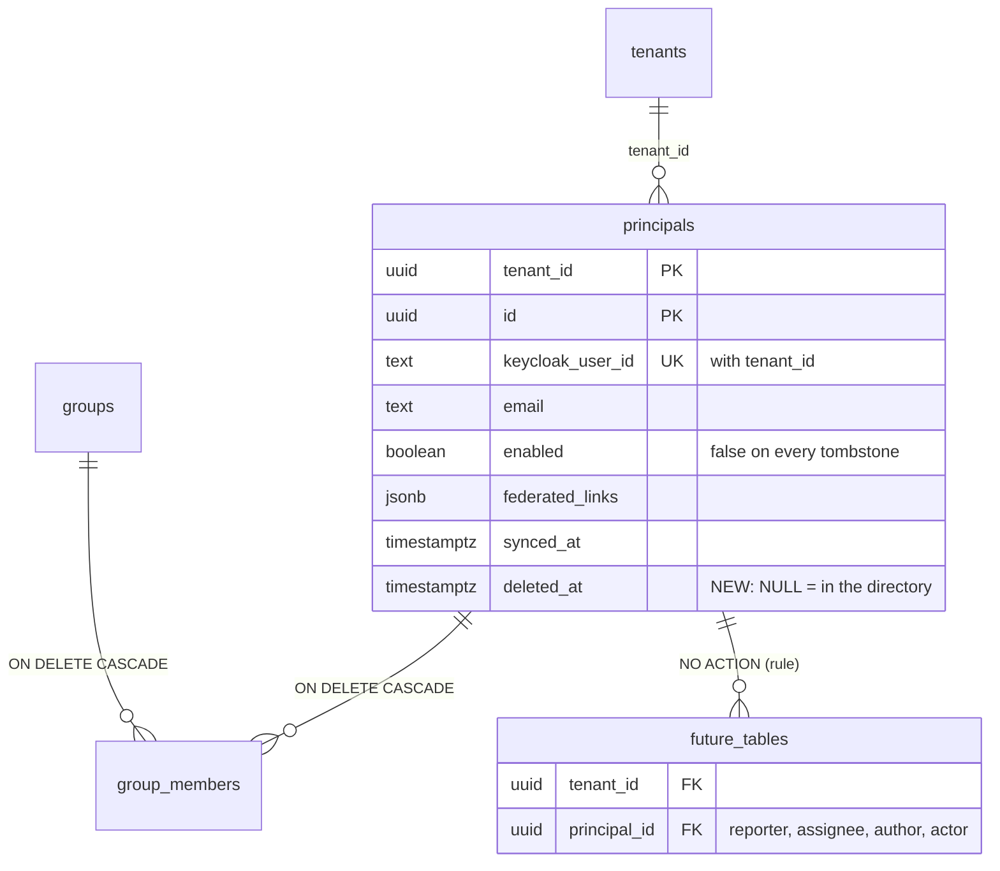

# Removed principals are tombstoned (TICK-220)

Decision: [decision log, 2026-10-27](../delivery/decision-log.md). Schema:
`db/migrations/00006_principal_tombstone.sql`,
`00007_principal_tombstone_validate.sql`. Bench:
`sh docs/data/principal-tombstone-bench/run.sh`.

## Problem

Group sync (T25, `internal/groupsync/apply.go`) runs one transaction per
tenant. It deletes the principals that have left the Keycloak directory. Today
the only table that references `principals` is `group_members`, which uses
`ON DELETE CASCADE`. The first table that references a person with the default
`NO ACTION` (a ticket reporter, a comment author, an audit actor) makes that
`DELETE` fail with `23503`. The tenant's sync then rolls back on every cycle,
and nothing for that tenant syncs again. `TestT220PrincipalTombstone` shows
this failure.

## Model

- `deleted_at` is set when the user leaves the directory. It is NULL while
  they are in it.
- `principals_tombstone_check` is `CHECK (deleted_at IS NULL OR NOT enabled)`.
  A tombstone is always disabled, so the resolver's existing `enabled` test
  (`internal/identity/keycloak/keycloak.go`) refuses it with no new read or
  index.
- A returning user matches on `UNIQUE (tenant_id, keycloak_user_id)`. Sync
  clears `deleted_at`, and the user keeps the same `id`. Their tickets and
  history point at them again.
- Group sync removes a tombstoned principal's memberships, as it does now for
  any user who is not in a group.

## Rule for new tables

- A foreign key to `principals` keeps the default `NO ACTION`. Do not use
  `CASCADE`, which would delete a ticket when its reporter leaves. Do not use
  `SET NULL`, which would erase who did what.
- A query that lists people who can act, such as assignee pickers, filters
  `deleted_at IS NULL`. A query that shows history does not filter.
- Index for that filter only when a measured query needs it. Today none does.

## Evidence

Measured on 2026-10-27 with `sh docs/data/principal-tombstone-bench/run.sh`,
which writes `bin/principal-tombstone-bench-output.txt` (gitignored).
Setup: PostgreSQL 16.10 (`postgres:16.10`) on Docker 29.9.2 under Windows 11,
16 CPUs, 19.4 GiB in the VM, `shared_buffers=1GB`. The host was shared with
about 40 other test containers, so treat the times as upper bounds. The data
is the [identity bench](identity.md#evidence) seed: 200 tenants, **519,000
principals**, 4,158,176 memberships. Tenant `t1` has 50,000 principals.

**Migration (lock held).** Every figure is from a replay on the full table.

| Step | Lock | Time |
| --- | --- | --- |
| 00006: `ADD COLUMN` + `CHECK ... NOT VALID`, commit included | ACCESS EXCLUSIVE | 1.2 + 1.3 + 2.8 ms |
| 00007: `VALIDATE CONSTRAINT` | SHARE UPDATE EXCLUSIVE (reads and writes go on) | 86 ms, 172 ms (two bench runs) |
| Rejected: validated `CHECK` in one step | ACCESS EXCLUSIVE for the whole scan | 124, 127, 95, 143, 129 ms |

The one-step form would block every read of `principals`, and so every
request's tenant resolution, for about 0.1 s now, growing linearly with the
table. Splitting costs one extra migration file.

**Removing 1,000 principals from `t1` in one sync transaction**, as
`nava_groupsync` with RLS on. `EXPLAIN (ANALYZE, BUFFERS)`, with each run
rolled back:

| | Statements | Execution | Buffers hit |
| --- | --- | --- | --- |
| Hard delete (today) | `DELETE principals`, cascading to 8,000 memberships (trigger 86.7 ms) | 95.8 ms | 6,651 + cascade |
| Tombstone (decision) | `UPDATE principals` (52.1 ms), then `DELETE group_members` by `group_members_principal` (38.0 ms) | 90.1 ms | 13,020 + 20,556 |

**Write amplification.** 459 of the 1,000 tombstone updates were HOT. The
seeded pages are full (fillfactor 100), so the other 541 wrote new entries in
both `principals` indexes (`principals_pkey`, `principals_keycloak_user_key`).
No index covers `enabled` or `deleted_at`, so in steady state, with free space
left by vacuum, more of these updates are HOT. This is a once-per-departure
cost. Sync cycles that change nothing write nothing.

**Storage.** `principals` is 84 MB of heap and 83 MB of indexes for 519,000
rows, an average of 171 bytes per row in the heap and about 330 bytes with
both indexes. A tombstone keeps that, so 10,000 departed users cost about
3.3 MB. Their memberships are deleted as before.

**Index set:** unchanged. The resolver still reads by
`principals_keycloak_user_key` with an unchanged plan (R1 in
[identity.md](identity.md#evidence)). It gets `enabled = false` for a
tombstone and returns 401. A partial index `WHERE deleted_at IS NULL` would
help only a query that lists a tenant's active people. None exists yet, so
none is added.

**Constraint.** An enabled tombstone is refused: `new row for relation
"principals" violates check constraint "principals_tombstone_check"`.

## Rollout (expand, then contract)

| Step | Change | Owner |
| --- | --- | --- |
| 1 | 00006 and 00007, plus `deleted_at` in `nava_groupsync`'s `UPDATE` grant. Sync is unchanged and still correct. | This change |
| 2 | `applyPrincipals` tombstones instead of deleting. A revived user clears `deleted_at`. | Senior Software Engineer task |
| 3 | In step 2's PR: revoke `DELETE` on `principals` from `nava_groupsync` and drop `principals_delete`. | Same PR, with Postgres review |

Each step works with the code before it. After step 3, the database itself
stops sync from hard-deleting a principal.
