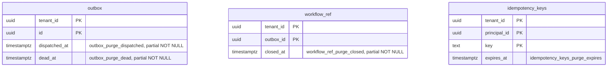

# Purge indexes (T13 follow-up)

Scope: TICK-146, the non-blocking item 2 of the review on PR #51 (T13,
TICK-68). Migration `db/migrations/00005_purge_indexes.sql`. The statements
are in `internal/purge/purge.go`. Benchmark: `docs/data/purge-bench/`
(`sh docs/data/purge-bench/run.sh`). `db/grants.yaml` and every policy are
unchanged.

## Decision

Four partial or plain B-tree indexes, one per purge predicate. The tables were
measured before and after on the same seed.

| Index | Serves | Size | Steady-state run before → after |
| --- | --- | --- | --- |
| `outbox_purge_dispatched` `(dispatched_at) WHERE dispatched_at IS NOT NULL` | `dispatched_at < now() - 7 d` | 21 MB | 3.6–3.8 s → 0.32–0.36 s |
| `outbox_purge_dead` `(dead_at) WHERE dead_at IS NOT NULL` | `dead_at < now() - 30 d` | 40 kB | (same run) |
| `workflow_ref_purge_closed` `(closed_at) WHERE closed_at IS NOT NULL` | `closed_at < now() - 30 d` | 11 MB | 505–898 ms → 19–20 ms |
| `idempotency_keys_purge_expires` `(expires_at)` | `expires_at < now()` | 11 MB | 1.4–1.6 s → 0.95–1.15 s |

`outbox` needs both of its indexes. Its predicate is
`dispatched_at < … OR dead_at < …`, and only a `BitmapOr` of two indexes
serves an `OR`. Without `outbox_purge_dead`, the planner seq-scans. The
partial predicates keep pending outbox rows and open workflows out of the
indexes. The planner proves `col IS NOT NULL` from `col < x`, so the indexes
are usable.

The `idempotency_keys` index gains the least: about a quarter of the
buffers per run. It still meets the requirement. Without it, the last batch
of every run reads the whole heap, at 31,239 buffers here, and that grows
with the table. Batches also cost more as the TTL grows, because a longer TTL
makes the expired rows sparser. T22 has not set the TTL yet.

None of the indexes leads with `tenant_id`, and none should. `nava_purge` is
the one cross-tenant role (D28). Its `*_purge` policies have no tenant
predicate, and every batch covers every tenant. The tenant-scoped reads keep
their `tenant_id`-leading indexes ([platform-tables.md](platform-tables.md)).

## Setup

- PostgreSQL 16.10 (`postgres:16.10`, the `docs/pins.md` pin) on Docker
  Desktop 29.9.2, Windows 11.
- Intel Core i7-1260P laptop, 40 GB RAM; 16 CPUs and 20.8 GB for the Docker
  VM. The host was shared with other tasks' test runs.
- `shared_buffers=1GB`. `synchronize_seqscans=off`, so a scan does not
  resume where the last one stopped. `full_page_writes=off`, so the WAL
  figures are records, not checkpoint page images.
- Two tenants. t1 holds 90% of the rows and t2 holds 10%.

The seed is what the tables look like an hour after the last hourly run,
with the ADR-001 A.3 windows:

| Table | Rows | Past window | Heap |
| --- | --- | --- | --- |
| `outbox` | 1,000,000 (1% pending, 0.3% dead) | 6,206 | 379 MB |
| `workflow_ref` | 500,000 (2% open) | 721 | 54 MB |
| `idempotency_keys` | 500,000 (24 h TTL assumed) | 20,278 | 244 MB |

Rows are placed in the heap in an order unrelated to their age. Freed space
is reused anywhere, so this is how a heap looks after purge and vacuum.

Each plan ran as `nava_purge` with RLS on, using the statement text from
`purge.go`, prepared and rolled back. A "full" batch deletes 1,000 rows. A
"last" batch finds none, and every run ends with one.

## Results

`EXPLAIN (ANALYZE, BUFFERS)` in milliseconds, first run then warm run. The
buffers figure is the `Delete` node's total.

| Statement | Before: plan | Before: ms | Before: buffers | After: plan | After: ms | After: buffers |
| --- | --- | --- | --- | --- | --- | --- |
| outbox, full | Seq Scan, 162k rows filtered | 330 / 289 | 12,749 | BitmapOr of both indexes → Nested Loop on `outbox_pkey` | 56 / 50 | 5,965 |
| outbox, last | Seq Scan, 993,786 rows filtered | 1,789 / 1,860 | 47,620 | same | 20 / 16 | 5,961 |
| workflow_ref, full (= last at 721 rows) | Seq Scan, 499,276 rows filtered | 505 / 898 | 10,284 | Bitmap Index Scan `workflow_ref_purge_closed` | 19 / 20 | 2,176 |
| workflow_ref, last | Seq Scan | 292 / 258 | 6,664 | same | 2.6 / 2.7 | 717 |
| idempotency_keys, full | Seq Scan, 23.6k rows filtered | 59 / 68 | 6,533 | Bitmap Index Scan `idempotency_keys_purge_expires` → Nested Loop on pkey | 55 / 45 | 5,776 |
| idempotency_keys, last | Seq Scan, 479,693 rows filtered | 233 / 251 | 31,239 | same | 44 / 50 | 15,424 |

Timings vary by up to 2x between runs on this host. In an earlier run of
the same harness, before took 183 ms for the outbox full batch and 0.9–1.3 s
for the outbox last batch. The buffer counts are stable across runs.

The after "last" figures for `idempotency_keys` and `outbox` include the
heap pages of the rows that the same transaction had just deleted. In a real
run, those pages are also visited until vacuum removes the dead index
entries.

### Run-level estimate

A run is the number of full batches plus one last batch, warm:

- `outbox`: 6 × 289 + 1,860 ≈ 3.6 s before, and 6 × 50 + 16 ≈ 0.3 s after.
  Buffers fall from 124k to 42k.
- `workflow_ref`: one batch.
- `idempotency_keys`: 20 × 68 + 251 ≈ 1.6 s before, and 20 × 45 + 50 ≈ 0.95 s
  after. Buffers fall from 162k to 131k.

### Backlog (purge outage)

`06_backlog.sql` puts half of every table past its window and commits.

With 50% of rows expired, the planner switches the subquery to Seq Scan,
which is cheaper at that density. It keeps the Nested Loop on the primary
key. Full batches took 62 ms (`idempotency_keys`), 213 ms (`outbox`) and
169 ms (`workflow_ref`), at 6–13k buffers. Each batch touches about one
batch's worth of rows, so draining is linear, not quadratic.

These full-batch figures are pessimistic. The backlog `UPDATE` moved the
expired rows to the end of the heap, so a seq scan reads far before its first
match.

The generic-plan variant ("generic" in `03_plans.sql`) is a Hash Semi Join
over the whole table, at 538–1,765 ms per batch with a backlog. nava-purge
never gets that plan. `cmd/nava-purge/main.go` sets `QueryExecModeExec`, so
every batch is an unnamed statement planned with its parameters. Keep it
that way. In steady state, the generic plans have the same shape as the
custom plans above.

## Index cost

Write cost, as each table's writer runs it, over every row it applies to,
rolled back. WAL is measured in bytes per row.

| Write | Before | After | HOT before → after |
| --- | --- | --- | --- |
| Relay marks 9,970 pending outbox rows dispatched | 690 | 742 (+8%) | 0 → 0 |
| Worker closes 10,000 workflows, packed heap | 448 | 503 (+12%) | 0 → 0 |
| Same, heap with free space (fillfactor 80 copy) | 80 | 376 (4.7x) | 10,000 → 0 |
| App inserts 10,000 idempotency keys | 276 | 316 (+14%) | n/a |

- `outbox`: the dispatch and dead-letter `UPDATE`s were never HOT, because
  the pending partial indexes already name `dispatched_at` and `dead_at`.
  The new index adds one entry per row that is dispatched or dead.
- `workflow_ref`: this is the real cost. Indexing `closed_at` means the
  close `UPDATE` can no longer be HOT. When a page has room, closing a
  workflow goes from no index entries to three (`workflow_ref_pkey`,
  `workflow_ref_record`, and the new index). That is 296 more WAL bytes per
  close, plus the dead index entries vacuum has to clear. That happens once
  per workflow, and it is accepted for a purge that would otherwise read the
  whole table every run.
  BRIN on `closed_at` would keep HOT. It was rejected because a BRIN range
  is widened when freed space is reused, never narrowed, so it degrades to a
  full scan as purge and inserts mix the heap.
- `idempotency_keys`: one entry per insert. The completion `UPDATE` does not
  change `expires_at`, so it can stay HOT. If T22 extends `expires_at` on
  completion, that `UPDATE` stops being HOT, and this table needs measuring
  again.

Storage is 43 MB for 677 MB of heap. The breakdown: 21 MB on `outbox` (5.6%
of its heap), 11 MB on `workflow_ref` (20%), and 11 MB on
`idempotency_keys` (4.5%).

## Migration safety

`00005` is a `NO TRANSACTION` file that uses `CREATE INDEX CONCURRENTLY`, so
writers are not blocked while the indexes are built. On the seeded tables,
the builds took 2.9 s, 0.9 s, 1.0 s and 1.0 s.

A failed `CREATE INDEX CONCURRENTLY` leaves an `INVALID` index under its
name, and `IF NOT EXISTS` would keep that index. To avoid this, each index
is dropped `CONCURRENTLY IF EXISTS` first, so a re-run rebuilds it.
`TestNoTransactionMigrationsAreIdempotent` re-runs the file over a migrated
database.

The change needs no per-tenant DDL, and it is additive. To reverse it, drop
the four indexes.

## Guard

`TestT146PurgeStatementsUseTheirIndexes` (`internal/db/dbtest`) checks that
the plans can use the indexes. It runs `EXPLAIN` on each `purge.Statements`
statement as `nava_purge`, with `enable_seqscan` off, and fails if the plan
has a Seq Scan or lacks its index. If a statement or policy change leaves a
predicate that no index serves, this test fails. The test does not measure
performance; that is what the benchmark above is for.
