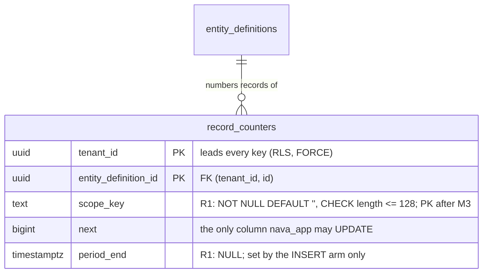

# record_counters scope_key: expand, deploy, contract (runbook)

S17 P6-01 (TICK-665). Design: ADR-005 §4.1 and §4.2
(`docs/adr/ADR-005-record-numbering.md`). Evidence:
`docs/adr/ADR-005/spikes/postgres/counter-scope/`.

`record_counters` goes from one counter per (tenant, type) to one counter per
(tenant, type, scope). The default scope `''` is today's counter, so every
existing row keeps its `next`. No per-tenant DDL, no sequences, no downtime.

## Three releases

| Release | Binary | Schema | ON CONFLICT target | Arbiter index |
|---|---|---|---|---|
| R0 | today | PK `(tenant_id, entity_definition_id)` | `(tenant_id, entity_definition_id)` | `record_counters_pkey` |
| R1 | S17 (this story) | M1 + M2: columns, CHECK, `record_counters_scoped_key`, `record_counters_period_end`; old PK kept | `(tenant_id, entity_definition_id, scope_key)`, writes `''` only | `record_counters_scoped_key` |
| R2 | S18 | M3: PK becomes `(tenant_id, entity_definition_id, scope_key)`, still named `record_counters_pkey` | 3-column | `record_counters_pkey` |

Order: apply M1 and M2 (the migrate job runs before the R1 rollout), roll out
R1 to every API and worker replica, then and only then run M3 with R2.

## Migrations (R1)

| File | Step | Lock | Measured (PG 16.10, 20k rows, spike host below) |
|---|---|---|---|
| `20261111123000_record_counters_scope_columns.sql` | M1: `ADD COLUMN scope_key text NOT NULL DEFAULT ''`, `ADD COLUMN period_end timestamptz NULL`, `CHECK (length(scope_key) <= 128) NOT VALID` | ACCESS EXCLUSIVE, catalogue only, `lock_timeout = 5s` | 12.0 ms, filenode unchanged |
| `20261111123100_record_counters_scope_key_len_validate.sql` | M1: `VALIDATE CONSTRAINT` | SHARE UPDATE EXCLUSIVE | 7.1 ms |
| `20261111123200_record_counters_scoped_key.sql` | M2: `CREATE UNIQUE INDEX CONCURRENTLY record_counters_scoped_key` | none that blocks writes, `NO TRANSACTION` | 50 ms |
| `20261111123300_record_counters_period_end.sql` | M2: `CREATE INDEX CONCURRENTLY record_counters_period_end ... WHERE period_end IS NOT NULL` | same | empty in R1 (every row is NULL) |

M1 is two files, not one: the repo keeps `VALIDATE` in its own migration
(D10, as `20261110040000`/`0100`). In one transaction the validate scan would
run under the ADD's ACCESS EXCLUSIVE lock.

**Re-running M2.** A failed `CREATE INDEX CONCURRENTLY` leaves an INVALID
index under the name. Re-run the migrate job: each M2 file drops an INVALID
index first, then creates. A VALID index is kept, not rebuilt, so a re-run
never takes the arbiter away from a serving R1. (This differs from `00005`'s
unconditional drop on purpose; tested by `TestP601CounterScopeIndexRepair`.)

**The R0/R1 window** (tested by `TestP601CounterScopeExpandWindow`):

- R0's 2-column and R1's 3-column upsert both succeed on the same row and
  advance the same `next`. Mixed fleets during the rollout are safe.
- A non-empty `scope_key` for a type that already has a row fails with 23505
  on `record_counters_pkey`. So no binary can fork a type's counter before
  M3, and S18's publish gate keeps non-default formats off until then.

**Open issue (TICK-665 review): first-upsert race while two unique indexes
exist.** Between M2 and M3, two concurrent *first* upserts of one
(tenant, type) can fail with 23505 on whichever unique index is not the
statement's arbiter (`record_counters_scoped_key` for R0,
`record_counters_pkey` for R1). Existing counter rows are not affected.
Evidence: `scratch/tick-665/README.md` (0 of 160,000 before M2 and after M3;
15,533 R0 and 19,829 R1 failures of 160,000 with both indexes, in a workload
where every upsert is a first insert). The mitigation is pending a decision.

**Grants, RLS, audit:** unchanged. `nava_app` and `nava_worker` have
table-level INSERT (the INSERT arm sets `scope_key` and `period_end`) and
`UPDATE (next)` only (the UPDATE arm can touch neither: 42501, tested). The
per-row tenant policies cover the new columns. The table stays in
`db/audited-tables.yaml`'s exempt list. `nava_purge`'s policies and grant on
`period_end` come with the purge change (ADR-005 §4.3), not here.

**Indexes and tenancy:** `record_counters_scoped_key` leads with `tenant_id`.
`record_counters_period_end` does not: it serves `nava_purge`'s cross-tenant
batch DELETE, like the `00005` purge indexes, and is listed as the one
exception in `TestP309RecordsIndexSet`'s tenant-leading check.

## Cost

Spike host: Docker Desktop on WSL2, 16 vCPU, 19.4 GiB, PostgreSQL 16.10,
`shared_buffers=256MB`, single runs.

| What | Rows | Figure |
|---|---|---|
| Upsert on an existing scope row | 1,432,000 | 9 shared hits, 0.37 ms (same as a default-scope row) |
| Upsert, first create in a new scope (FK check) | 1,432,000 | 10 shared hits, FK trigger 0.24 ms |
| Purge batch of 1,000 through `record_counters_period_end` | 531,000 | 11.6 ms, 1,062 buffers |
| Empty last purge batch, with / without the partial index | 531,000 | 0.63 ms, 32 buffers / 210–232 ms, 16.4k buffers |
| `record_counters_period_end` size | 912,000 period rows | 6.5 MB |
| HOT updates with the partial index present | 20,000 upserts | 19,813 (99.1 %) |

Write amplification in R1: `record_counters_scoped_key` is one more btree
entry per new counter row (one per type today) and is not touched by a HOT
update, since the upsert's UPDATE changes `next` only, which no index covers.
`record_counters_period_end` holds no rows in R1.

## Rollback

| From | Back to | How |
|---|---|---|
| R1 binary | R0 binary | Redeploy R0. Safe: the old PK still exists and R0's upsert arbitrates on it. Leave M1/M2 in place. |
| M1/M2 schema | pre-M1 schema | Only after no R1 replica serves: `goose down-to 20261111122959`. Drops both indexes, then the columns (and the CHECK with them). |
| R2 / M3 | anything earlier | **Not possible.** |

**M3 is the point of no return.** After M3 the primary key is
`(tenant_id, entity_definition_id, scope_key)` and no 2-column unique
constraint exists, so R0's `ON CONFLICT (tenant_id, entity_definition_id)`
fails every create with "there is no unique or exclusion constraint matching
the ON CONFLICT specification" (measured in the spike). R0 can never be
deployed again after M3. Run M3 only when every API and worker replica runs
R1; once non-default scopes exist, the M1/M2 Down cannot run either.

## M3 (S18, for reference)

`SET LOCAL lock_timeout = '2s'`; drop `record_counters_pkey`;
`ALTER TABLE record_counters ADD CONSTRAINT record_counters_pkey PRIMARY KEY
USING INDEX record_counters_scoped_key` (renames the index to
`record_counters_pkey`, which S18's publish gate reads); retry up to 5 times
with backoff. Measured 1.6 ms at 20k rows.
