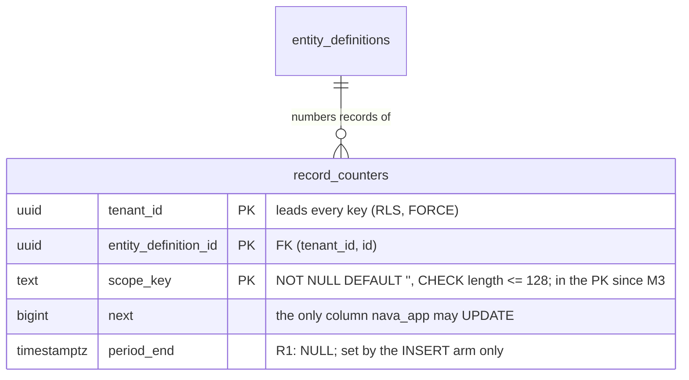
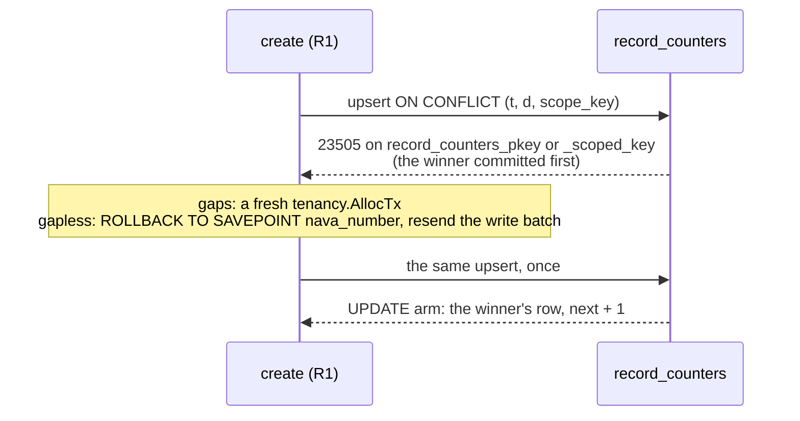
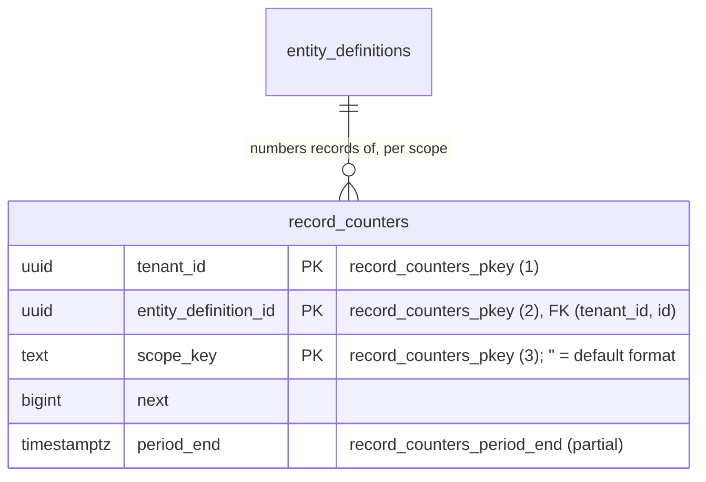

# record_counters scope_key: expand, deploy, contract (runbook)

S17 P6-01 (TICK-665) and S18 P6-05 (TICK-670, M3). Design: ADR-005 §4.1 and §4.2
(`docs/adr/ADR-005-record-numbering.md`). Evidence:
`docs/adr/ADR-005/spikes/postgres/counter-scope/`.

`record_counters` goes from one counter per (tenant, type) to one counter per
(tenant, type, scope). The default scope `''` is today's counter, so every
existing row keeps its `next`. No per-tenant DDL, no sequences, no downtime.



## Three releases

| Release | Binary | Schema | ON CONFLICT target | Arbiter index |
|---|---|---|---|---|
| R0 | today | PK `(tenant_id, entity_definition_id)` | `(tenant_id, entity_definition_id)` | `record_counters_pkey` |
| R1 | S17 (this story) | M1 + M2: columns, CHECK, `record_counters_scoped_key`, `record_counters_period_end`; old PK kept | `(tenant_id, entity_definition_id, scope_key)`, writes `''` only | `record_counters_scoped_key` |
| R2 | S18 | M3: PK becomes `(tenant_id, entity_definition_id, scope_key)`, still named `record_counters_pkey`; non-empty `scope_key` rows can exist | 3-column, no first-create retry | `record_counters_pkey` |

Order: apply M1 and M2 (the migrate job runs before the R1 rollout), roll out
R1 to every API and worker replica, then and only then run M3 with R2.

## Migrations (R1)

| File | Step | Lock | Measured (PG 16.10, 20k rows, spike host below) |
|---|---|---|---|
| `20261112193000_record_counters_scope_columns.sql` | M1: `ADD COLUMN scope_key text NOT NULL DEFAULT ''`, `ADD COLUMN period_end timestamptz NULL`, `CHECK (length(scope_key) <= 128) NOT VALID` | ACCESS EXCLUSIVE, catalogue only, `lock_timeout = 5s` | 12.0 ms, filenode unchanged |
| `20261112193100_record_counters_scope_key_len_validate.sql` | M1: `VALIDATE CONSTRAINT` | SHARE UPDATE EXCLUSIVE | 7.1 ms |
| `20261112193200_record_counters_scoped_key.sql` | M2: `CREATE UNIQUE INDEX CONCURRENTLY record_counters_scoped_key` | none that blocks writes, `NO TRANSACTION` | 50 ms |
| `20261112193300_record_counters_period_end.sql` | M2: `CREATE INDEX CONCURRENTLY record_counters_period_end ... WHERE period_end IS NOT NULL` | same | empty in R1 (every row is NULL) |

M1 is two files, not one: the repo keeps `VALIDATE` in its own migration
(D10, as `20261110040000`/`0100`). In one transaction the validate scan would
run under the ADD's ACCESS EXCLUSIVE lock.

**Re-running M2.** A failed `CREATE INDEX CONCURRENTLY` leaves an INVALID
index under the name. Re-run the migrate job: each M2 file drops an INVALID
index first, then creates. A VALID index is kept, not rebuilt, so a re-run
never takes the arbiter away from a serving R1. (This differs from `00005`'s
unconditional drop on purpose; tested by `TestP601CounterScopeIndexRepair`.)

**The R0/R1 window** (tested by `TestP601CounterScopeExpandWindow`):

- R0's 2-column and R1's 3-column upsert both succeed on the same row and
  advance the same `next`. Mixed fleets during the rollout are safe.
- A non-empty `scope_key` for a type that already has a row fails with 23505
  on `record_counters_pkey`. So no binary can fork a type's counter before
  M3, and S18's publish gate keeps non-default formats off until then.

**First-create race while two unique indexes exist (ADR-005-E1).** Between
M2 and M3, two concurrent *first* upserts of one (tenant, type) can fail
with 23505 on whichever unique index is not the statement's arbiter
(`record_counters_scoped_key` for R0, `record_counters_pkey` for R1):
`ON CONFLICT` absorbs conflicts on its arbiter only. Existing counter rows
are not affected. Evidence: [`docs/adr/ADR-005/spikes/postgres/e1-first-create-race/README.md`](../adr/ADR-005/spikes/postgres/e1-first-create-race/README.md) (0 of 160,000
before M2 and after M3; 15,533 R0 and 19,829 R1 failures of 160,000 with
both indexes, in a workload where every upsert is a first insert).

Decision A (TICK-665): **R1 retries once** (P6-02, TICK-666). R0 binaries
are not fixed; they can fail a type's first create while R1 rolls out
(accepted risk). **Operator guidance:** run M3 soon after R1 is fully
rolled out; that closes the window. #581 merges into the story branch only
together with P6-02.



- Only SQLSTATE 23505 on `record_counters` naming one of those two indexes is
  retried (`store.CounterRace`), and only once; any other error, or a
  second failure, fails the create as before.
- The second attempt finds the winner's row because the winner committed
  before the loser's 23505 was raised and the create runs at READ COMMITTED.
  At REPEATABLE READ the same race raises 40001, which is not retried: do
  not raise the create transaction's isolation level, and do not add 40001
  to the predicate.
- `gapless` opens the savepoint `nava_number` as the first statement of the
  create's write batch: one more statement, no more round trips. `gaps`
  sends nothing extra. The rollback and the resend cost one or two round
  trips, on the race only.
- Every retry is counted in `nava_numbering_first_create_retries{mode}`.
- **Temporary, and gone in R2.** After M3 there is one unique index and the
  predicate can never fire. R2 (TICK-670) removed the retry, `CounterRace`,
  the `gapless` savepoint and `nava_numbering_first_create_retries`
  (`TODO-S17-02`). An R1 replica still serving after M3 keeps its retry,
  which simply never fires.
- Tests in R1: `TestP602FirstCreateRaceIsRetriedOnce` and
  `TestP602FirstCreateRaceIsRetriedNoMoreThanOnce` (removed in R2 with the
  retry). Kept: `TestConcurrentFirstCreatesOfATypeAllSucceed` (pinned),
  `TestP602ConcurrentFirstCreatesAllSucceed`,
  `TestAllocatorPoolDoesNotStarveThePool`; added in R2:
  `TestP605FirstCreateWaitsForTheWinner`,
  `TestP605OtherScopeDoesNotBlockTheDefault`.

**Grants, RLS, audit:** unchanged. `nava_app` and `nava_worker` have
table-level INSERT (the INSERT arm sets `scope_key` and `period_end`) and
`UPDATE (next)` only (the UPDATE arm can touch neither: 42501, tested). The
per-row tenant policies cover the new columns. The table stays in
`db/audited-tables.yaml`'s exempt list. `nava_purge`'s policies and grant on
`period_end` come with the purge change (ADR-005 §4.3), not here.

**Indexes and tenancy:** `record_counters_scoped_key` leads with `tenant_id`.
`record_counters_period_end` does not: it serves `nava_purge`'s cross-tenant
batch DELETE, like the `00005` purge indexes, and is listed as the one
exception in `TestP309RecordsIndexSet`'s tenant-leading check.

## Cost

Spike host: Docker Desktop on WSL2, 16 vCPU, 19.4 GiB, PostgreSQL 16.10,
`shared_buffers=256MB`, single runs.

| What | Rows | Figure |
|---|---|---|
| Upsert on an existing scope row | 1,432,000 | 9 shared hits, 0.37 ms (same as a default-scope row) |
| Upsert, first create in a new scope (FK check) | 1,432,000 | 10 shared hits, FK trigger 0.24 ms |
| Purge batch of 1,000 through `record_counters_period_end` | 531,000 | 11.6 ms, 1,062 buffers |
| Empty last purge batch, with / without the partial index | 531,000 | 0.63 ms, 32 buffers / 210–232 ms, 16.4k buffers |
| `record_counters_period_end` size | 912,000 period rows | 6.5 MB |
| HOT updates with the partial index present | 20,000 upserts | 19,813 (99.1 %) |

Write amplification in R1: `record_counters_scoped_key` is one more btree
entry per new counter row (one per type today) and is not touched by a HOT
update, since the upsert's UPDATE changes `next` only, which no index covers.
`record_counters_period_end` holds no rows in R1.

## Rollback

| From | Back to | How |
|---|---|---|
| R1 binary | R0 binary | Redeploy R0. Safe: the old PK still exists and R0's upsert arbitrates on it. Leave M1/M2 in place. R0 has no retry, so while M1/M2 are in place it keeps the first-create race (AR-S17-01): expect occasional 23505 failures on `record_counters_scoped_key` on a type's first create until R1 is redeployed or M1/M2 are rolled back (the indexes dropped). |
| M1/M2 schema | pre-M1 schema | Only after no R1 replica serves: `goose down-to 20261112192959`. Drops both indexes, then the columns (and the CHECK with them). |
| M3 schema | M1/M2 schema (2-column key) | Only while every `scope_key` is `''`: `goose down-to 20261113034009`. Both unique indexes are back, so the E1 first-create race returns; R1 retries it, R2 does not (its retry was removed), so run M3 again soon or serve R1. The Down takes ACCESS EXCLUSIVE, refuses with `55000` "M3 down refused: record_counters holds rows with a non-empty scope_key" otherwise, and leaves the table unchanged. Once S18 has published a format with a period or field, there is no way back. |
| R2 binary | R0 binary | **Not possible** after M3: R0's `ON CONFLICT` fails with `42P10`. |

**M3 is the point of no return.** After M3 the primary key is
`(tenant_id, entity_definition_id, scope_key)` and no 2-column unique
constraint exists, so R0's `ON CONFLICT (tenant_id, entity_definition_id)`
fails every create with "there is no unique or exclusion constraint matching
the ON CONFLICT specification" (measured in the spike). R0 can never be
deployed again after M3. Run M3 only when every API and worker replica runs
R1; once non-default scopes exist, the M1/M2 Down cannot run either.

## M3 (S18, release R2): the point of no return

`db/migrations/20261113034010_record_counters_pkey_scope_key.sql`, TICK-670.

**Run it only when** every API and worker replica runs R1 or later (the
precondition of release R2). The migrate job runs it before the R2 rollout,
like every migration.

```sql
SET LOCAL lock_timeout = '2s';
ALTER TABLE record_counters
    DROP CONSTRAINT record_counters_pkey,
    ADD CONSTRAINT record_counters_pkey PRIMARY KEY USING INDEX record_counters_scoped_key;
```

- `ADD PRIMARY KEY USING INDEX` renames `record_counters_scoped_key` to
  `record_counters_pkey`: no build and no scan (the index is unique and valid,
  its columns `NOT NULL`). The FK `record_counters_entity_definition_fkey` is
  untouched. Measured 1.6 ms at 20k rows (ADR-005 spike). Filenode unchanged
  (`TestP605CounterKeyContract`).
- **Lock and retry.** The ALTER needs ACCESS EXCLUSIVE. Each attempt waits at
  most 2 s (`lock_timeout`), then the `DO` block retries up to 5 times after
  0.2, 0.4, 0.8, 1.6 and 3.2 s, each attempt in a subtransaction that releases
  what it took. So it holds no lock while it waits and gives up after about
  18 s. Measured: a conflicting lock held for 3 s, M3 succeeds after one retry
  (`TestP605M3RetriesALockAndSucceeds`); a lock held past every attempt, M3
  fails after 18.2 s with `55006` "M3: no ACCESS EXCLUSIVE lock on
  record_counters after 6 attempts", the table is unchanged and no version row
  is written (`TestP605M3GivesUpCleanly`). Re-run the migrate job when the
  long transaction holding the table is gone.
- **Why the retry is in the `DO` block, not the migrator.** The migrator
  retries any `55P03` 10 times (TICK-579) with its own 5 s session
  `lock_timeout`. ADR-005 fixes M3 at 2 s and 5 retries, so the migration
  owns them, and it raises `55006` when it gives up, which the migrator does
  not retry: one owner, no multiplied attempts.
- **Preconditions it checks.** If `record_counters_pkey` already covers
  `scope_key`, it does nothing (safe to re-run). If
  `record_counters_scoped_key` is missing or INVALID, it fails with `55000`;
  re-run the migrate job so M2 repairs it.
- **Do not re-run M2 by hand after M3.** Its index name is free again, so it
  would build a second unique index on the same columns: correct, but one
  more btree entry per counter row. The migrator never re-runs a recorded
  migration. If it happens: `DROP INDEX CONCURRENTLY record_counters_scoped_key`.

### How to tell whether M3 has run

The same catalog check as S18's publish gate (ADR-005 §4.2): does
`record_counters_pkey` cover `scope_key`?

```sql
SELECT EXISTS (
    SELECT 1 FROM pg_constraint c
    JOIN pg_attribute a ON a.attrelid = c.conrelid AND a.attnum = ANY (c.conkey)
    WHERE c.conrelid = 'record_counters'::regclass
      AND c.conname = 'record_counters_pkey'
      AND a.attname = 'scope_key');
```

`true`: M3 has run, R0 can never serve again, and the publish gate opens
within its 60 s cache TTL. `false`: M3 has not run (or was rolled back), and
non-default formats stay refused with `numbering_templates_unavailable`.
`goose_db_version` holding `20261113034010` says the same.

### After M3

| Statement | Result |
|---|---|
| R1/R2 `ON CONFLICT (tenant_id, entity_definition_id, scope_key)` | succeeds, arbiter `record_counters_pkey` |
| R0 `ON CONFLICT (tenant_id, entity_definition_id)` | `42P10`: no unique or exclusion constraint matches |
| a row with a non-empty `scope_key` beside the type's `''` row | succeeds (pinned test 3, second half) |
| tenant A takes from tenant B's counter at a non-empty scope | `42501` (RLS), isolation registry row |
| `nava_worker` starts a tenant A row on tenant B's type with a scope | `23503` (composite FK), isolation registry row |



Write amplification after M3: one unique btree instead of two, so one index
entry fewer per new counter row; the upsert's UPDATE arm still changes `next`
only and stays HOT.
