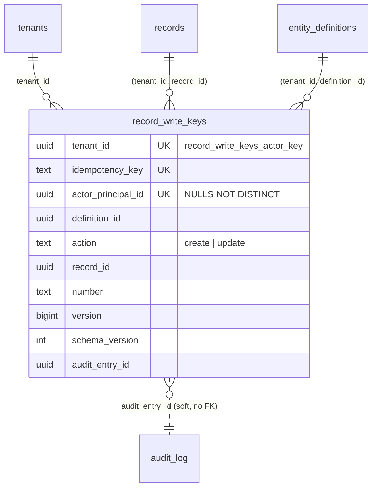

# record_write_keys per principal (TICK-626)

AR-TICK-480-01: an idempotency key must belong to one principal, not to the
whole tenant. TICK-480 and TICK-498 fixed this on `audit_log`. PLAN-005 D-5-3
then moved the key to `record_write_keys`, with `PRIMARY KEY (tenant_id,
idempotency_key)`, so the finding came back. Member B writing under member
A's key either replayed A's `Result` or got a 409. Both told B that the key
existed. This change puts the principal back into the key space.

## Decision

| Question | Answer |
|---|---|
| Column | `actor_principal_id uuid`, NULL for a system writer with no principal. It is the same principal as the write's audit entry (`audit_log.actor_principal_id`). |
| Uniqueness | `record_write_keys_actor_key`: `UNIQUE (tenant_id, idempotency_key, actor_principal_id) NULLS NOT DISTINCT`. A system writer still conflicts with itself, so its retry replays. The tenant-wide `record_write_keys_pkey` is dropped. A nullable column cannot be in a primary key, so the table has a unique index and no primary key. |
| Column order | Key, then actor. Replay matches the actor with `IS NOT DISTINCT FROM`, which a btree cannot search on. With the actor last, the lookup is a two-column probe plus a filter over that key's rows, one row per principal that used the key. |
| Store mapping | `store.idempotencyIndex` is `record_write_keys_actor_key`. A 23505 on it is `ErrDuplicateKey`. A 23505 on any other name, including the old primary key, stays a database error. |
| Lookup | `store.WriteKeyByKey(ctx, tx, tenant, actor, key)`. The pipeline passes `Command.Actor.PrincipalID`, or nil for none. |
| Backfill | From the write's primary audit entry (`audit_entry_id`). If that entry is gone and the key is a create, the record's `created_by`. Otherwise NULL. See below. |

## Migrations

1. `20261108120000_record_write_keys_actor.sql` runs in one transaction.
   - `ADD COLUMN` changes the catalogue only.
   - `record_write_keys_backfill_actor()` creates temporary canonical
     `nava_migrator` policies (ADR-004 R26), fills the column tenant by tenant
     under `app.tenant_id`, and drops the policies.
   - The R26.3 gate fails the migration if any `nava_migrator` policy is left.
2. `20261108120100_record_write_keys_actor_key.sql` is `NO TRANSACTION`.
   - It drops an INVALID index left by a failed build.
   - It runs `CREATE UNIQUE INDEX CONCURRENTLY`.
   - It drops the primary key under `lock_timeout = 5s`. That step changes the
     catalogue only.
   - Both constraints hold between the two steps, so uniqueness is never off.
   - It is re-runnable, which `TestNoTransactionMigrationsAreIdempotent`
     checks.
   - Its down migration rebuilds the tenant-wide key `CONCURRENTLY` and
     attaches it `USING INDEX`. That fails if two principals already hold one
     key.

Backfill sources, in order:

| Key | Source | Result |
|---|---|---|
| Entry in `audit_log`, principal actor | `audit_log.actor_principal_id`, matched on `(tenant_id, subject_type 'record', subject_id = record_id, id = audit_entry_id)`, which uses `audit_log_subject` | The member |
| Entry in `audit_log`, system actor | — | NULL, which is correct |
| Entry gone (P5-13a to P5-13b wrote it to `audit_log_v0`, which was dropped), `create` | `records.created_by`, set from the same principal | The member |
| Entry gone, `update` | None left | NULL, counted in a NOTICE |

The last row can exist only on a stack that took keyed member updates between
P5-13a and P5-13b. Every such stack is a development stack. A member retrying
one of those keys would write again. No key from that window can still be
retried in practice.

Rollout: the migrate job runs before the new binary starts. A stack that
rolls with old writers still running should run
`SELECT record_write_keys_backfill_actor()` again as `nava_migrator` once the
old binary is gone. It only fills NULLs.

## Evidence

The setup was PostgreSQL 16.10 (`postgres:16.10` in Docker), on a host with
16 CPUs and 19.4 GiB of memory available to Docker (Windows 11).
`scratch/record-write-keys-per-principal/bench.sql` builds a copy of the
table's columns without FKs or RLS. It holds 1,000 tenants × 2,000 keys =
**2,000,000 rows**, with 20 principals per tenant and one key in ten written
by a system writer. The raw output is in `result.txt` next to the script.

| Lookup | Plan | Buffers | Execution |
|---|---|---|---|
| Before: tenant-wide PK, no actor (main's `WriteKeyByKey`) | Index Scan using `rwk_pkey` | 5 (cold read) | 0.129 ms |
| After: own key, member | Index Scan using `rwk_actor_key`, Index Cond on tenant + key, Filter on actor | 5 (3 hit, 2 read) | 0.071 ms |
| After: another member's key (the AR-TICK-480-01 path) | Same, `Rows Removed by Filter: 1`, 0 rows | 5 hit | 0.037 ms |
| After: system writer, NULL actor | Same | 5 hit | 0.032 ms |

The lookup stays a single index probe of 5 buffers, the same as before. The
actor filter runs over the key's rows only.

| Cost | Before | After |
|---|---|---|
| Index size at 2M rows | `rwk_pkey` 165 MB | `rwk_actor_key` 198 MB (+33 MB, +20%: 16 more bytes per entry) |
| Build at 2M rows | — | `CREATE UNIQUE INDEX CONCURRENTLY` 10.5 s; `DROP CONSTRAINT` 49 ms |
| 20,000 keyed inserts, one run each | 228 ms | 351 ms |

The insert timing is a single run per shape and noisy. The after case ran
first, on a colder cache. Both shapes keep one unique index on the table, so
there is no extra index to maintain on each write. Only the entry is wider.
The backfill was not timed at scale. It is one `audit_log_subject` probe per
key, per tenant.

Tests:
- `internal/db/dbtest/record_write_keys_actor_test.go` covers the backfill
  cases, the cross-tenant entry id, no leftover policy, the index definition,
  down then up, and the per-principal and NULL uniqueness for `nava_app` and
  `nava_worker`.
- `internal/records/pipeline/tenant_scope_integration_test.go`
  (`TestIdempotencyKeyIsScopedByPrincipal`) covers these cases:
  - Member B's write under A's key creates B's own record, with no 409.
  - Each member's retry replays its own write.
  - A different write under a member's own key is still a conflict.
  - A system writer replays.
  - Concurrent duplicates by the same principal, or by NULL principals, are
    `ErrDuplicateKey`.
