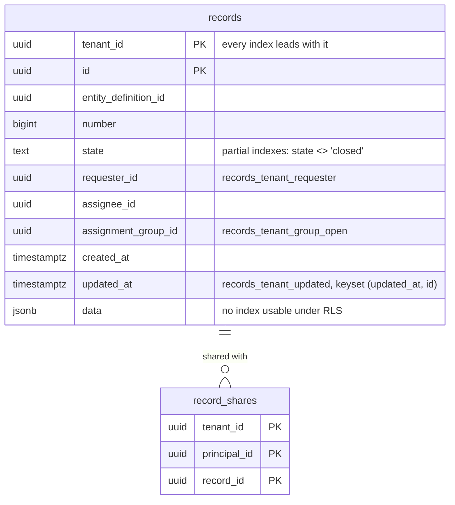

# Records list benchmark (P3-01, the D25 question)

Scope: TICK-339, PLAN-003 (`docs/delivery/plan-records-path.md`) D-3-2 and the
D25 escalation. The question: can an ACL-filtered, sorted, keyset-paged list
stay at p95 ≤ 150 ms at 800k records with only fixed-column B-tree indexes
led by `tenant_id`? Synthetic schema under `bench/records-list/`. It is not
a migration. Reproduce with `make bench-records-list` (about 140 minutes, not
in CI). Raw output with every `EXPLAIN (ANALYZE, BUFFERS)`:
`docs/data/records-list-bench/`.

## Verdict

**fixed columns meet 150 ms; D25 not needed in M1**

That holds for (d), the query P3-31 will compile, on one condition: the
repository runs list queries with **custom plans**, either with
`plan_cache_mode = force_custom_plan` for `nava_app` or with no cached
prepared statement. With the default plan cache, (d) with an explicit
`tenant_id = $1` misses the target (row 2 below).

| (d), large tenant, 8 clients, 60 s | Page 1 p95 | Page 20 p95 |
| --- | --- | --- |
| Custom plans, explicit `tenant_id = $1`, two repeat runs | 31.3 / 36.0 ms | 35.7 / 35.3 ms |
| Custom plans, RLS alone, two repeat runs | 32.1 / 36.3 ms | 33.7 / 39.3 ms |
| Default plan cache (`auto`), explicit `tenant_id = $1` | **398.4 ms** (miss) | **263.5 ms** (miss) |
| Default plan cache (`auto`), RLS alone | 38.4 ms | 48.0 ms |

The repository should do two things:

1. Always send an explicit `tenant_id = $1` in addition to RLS. RLS stays the
   enforcement; the explicit predicate gives the planner the tenant value.
   With RLS alone, the planner cannot see which tenant is asked for. The
   (c)/(c2) capped count on a small tenant then ran at p95 2.4 to 4.7 s on a
   seq scan of all 800k rows. A fresh `ANALYZE` gave the same query a 1.2 ms
   bitmap plan (`records-list-bench/c-count-small.txt`), so that plan is not
   stable. With the explicit predicate, the same count is 11 to 15 ms.
2. Plan every list execution for its parameters (custom plans). The generic
   plan of the explicit form is costed for an average tenant: 151 estimated
   rows against 3,683 actual. For the 400k-row tenant it reads all 60k open
   rows and sorts them, at 402 ms and 60,735 buffers. The custom plan walks
   the index and stops at 50 rows: about 8 ms and 4,598 buffers (excerpts
   below). Planning costs 0.3 to 0.8 ms per execution.

With both, every list query at both pages and for both tenant sizes has
p95 ≤ 70.6 ms in the second pass, except (d) explicit, at 121.3 and
132.8 ms. The repeat runs above put those two at 31 to 36 ms: the second
pass ran while the host was loaded (see "Noise").

Capped counts are reported apart. With explicit `tenant_id`, the large
tenant's (d), (c) and (c2) counts miss: p95 278, 312 and 352 ms. That is a
count-only miss, so it does not escalate D25. The capped count stays the
fallback, and these counts need their own budget or a cache.

Two findings outside the verdict, handed to the Security & Multi-Tenancy
Reviewer:

- **JSONB indexes are unusable for `nava_app` under RLS** (section below).
  The (c) and (c2) lists meet the target only because the filter matches 5%
  of rows and the walk ends early. A selective JSONB filter scans the whole
  tenant.
- The custom-plan setting and the always-explicit `tenant_id` are now
  requirements of the records repository (P3-09 / P3-31).

## Results

p50 / **p95** / p99 in ms, per transaction as `pgbench` measured it through
PgBouncer: `BEGIN`, the transaction-local `set_config('app.tenant_id')`,
the query and `COMMIT`. A primary-key read of the actor's ids comes before
the transaction. The large tenant has 400,000 records. The small tenants
have 1,002 or 1,003 each; their actors are spread over all 399 of them. A
small tenant has about 1,000 records, so no list of a small tenant reaches
page 20 (n/a). Page 20 is keyset page 20: the cursor is the 950th row.

### Pass 2: `plan_cache_mode = force_custom_plan` (the recommended configuration)

Proposed set, (a), (b), (c) without an expression index, and (d):

| Query | Tenant | Page | RLS alone | Explicit `tenant_id = $1` |
| --- | --- | --- | --- | --- |
| (d) list | large | 1 | 23.36 / **43.45** / 61.63 | 45.07 / **121.31** / 213.62 |
| (d) list | large | 20 | 31.87 / **61.14** / 96.26 | 50.88 / **132.81** / 202.03 |
| (d) list | small | 1 | 8.44 / **18.32** / 31.18 | 15.22 / **61.67** / 117.55 |
| (d) capped count | large | – | 67.24 / **109.75** / 155.30 | 107.00 / **277.56** / 386.55 |
| (d) capped count | small | – | 5.26 / **12.89** / 27.09 | 11.41 / **61.38** / 119.58 |
| (a) list | large | 1 | 43.48 / **101.65** / 164.72 | 37.07 / **70.63** / 100.34 |
| (a) list | large | 20 | 33.33 / **89.47** / 147.38 | 26.03 / **44.81** / 59.70 |
| (a) list | small | 1 | 6.75 / **21.68** / 50.22 | 6.00 / **11.75** / 18.95 |
| (a) capped count | large | – | 6.51 / **21.97** / 40.41 | 7.36 / **19.09** / 37.55 |
| (a) capped count | small | – | 6.27 / **20.63** / 39.69 | 5.15 / **9.82** / 16.09 |
| (b) list | large | 1 | 10.06 / **20.38** / 33.85 | 9.41 / **18.77** / 30.99 |
| (b) list | large | 20 | 9.61 / **18.96** / 33.25 | 9.69 / **20.05** / 33.92 |
| (b) list | small | 1 | 8.86 / **17.78** / 31.18 | 6.88 / **11.47** / 16.65 |
| (b) capped count | large | – | 5.26 / **12.02** / 23.69 | 4.23 / **7.70** / 11.10 |
| (b) capped count | small | – | 5.05 / **10.20** / 17.27 | 4.69 / **9.38** / 14.90 |
| (c) list | large | 1 | 12.61 / **21.52** / 29.48 | 12.68 / **25.14** / 38.49 |
| (c) list | large | 20 | 11.61 / **19.95** / 26.81 | 11.88 / **20.34** / 29.96 |
| (c) list | small | 1 | 10.15 / **18.68** / 28.46 | 8.62 / **13.95** / 19.23 |
| (c) capped count | large | – | 125.03 / **911.82** / 2088.93 | 65.48 / **311.59** / 549.45 |
| (c) capped count | small | – | 1966.94 / **4691.87** / 5740.18 | 5.54 / **11.13** / 17.05 |

(c) with the expression index `records_tenant_priority`:

| Query | Tenant | Page | RLS alone | Explicit `tenant_id = $1` |
| --- | --- | --- | --- | --- |
| (c) list | large | 1 | 12.42 / **30.75** / 64.21 | 12.70 / **22.06** / 30.53 |
| (c) list | large | 20 | 16.37 / **30.15** / 40.26 | 13.75 / **27.00** / 40.66 |
| (c) list | small | 1 | 11.86 / **22.43** / 34.34 | 13.09 / **28.43** / 44.52 |
| (c) capped count | large | – | 66.32 / **909.91** / 1177.71 | 30.76 / **279.84** / 351.49 |
| (c) capped count | small | – | 2055.55 / **2442.55** / 2601.39 | 7.18 / **14.67** / 22.07 |

(c2) with one `jsonb_path_ops` GIN on `data`:

| Query | Tenant | Page | RLS alone | Explicit `tenant_id = $1` |
| --- | --- | --- | --- | --- |
| (c2) list | large | 1 | 12.12 / **20.17** / 27.49 | 12.54 / **20.90** / 28.44 |
| (c2) list | large | 20 | 11.22 / **18.24** / 28.96 | 11.94 / **19.86** / 26.39 |
| (c2) list | small | 1 | 8.80 / **13.10** / 17.04 | 10.09 / **14.82** / 18.94 |
| (c2) capped count | large | – | 111.02 / **753.83** / 1682.03 | 62.63 / **351.61** / 508.96 |
| (c2) capped count | small | – | 1516.12 / **3829.06** / 4891.65 | 6.90 / **11.17** / 15.51 |

### Pass 1: `plan_cache_mode = auto` (the PostgreSQL default)

`pgbench -M prepared` keeps a prepared statement per connection, as pgx's
statement cache does. After five executions PostgreSQL may switch it to the
generic plan.

| Query | Tenant | Page | RLS alone | Explicit `tenant_id = $1` |
| --- | --- | --- | --- | --- |
| (d) list | large | 1 | 22.09 / **38.39** / 50.46 | 255.31 / **398.40** / 489.31 |
| (d) list | large | 20 | 25.20 / **48.04** / 69.02 | 172.82 / **263.46** / 344.45 |
| (d) list | small | 1 | 8.20 / **17.46** / 28.62 | 7.18 / **13.68** / 19.68 |
| (d) capped count | large | – | 66.31 / **127.35** / 182.69 | 45.04 / **108.99** / 155.95 |
| (d) capped count | small | – | 5.47 / **16.15** / 37.26 | 4.42 / **9.62** / 15.34 |
| (a) list | large | 1 | 21.41 / **33.07** / 41.21 | 24.81 / **45.22** / 64.06 |
| (a) list | large | 20 | 17.51 / **30.77** / 50.38 | 21.86 / **40.81** / 59.36 |
| (a) list | small | 1 | 5.29 / **9.40** / 13.22 | 5.40 / **12.79** / 19.48 |
| (a) capped count | large | – | 4.53 / **7.38** / 10.08 | 17.55 / **35.59** / 47.81 |
| (a) capped count | small | – | 4.18 / **7.96** / 12.48 | 4.95 / **9.96** / 16.17 |
| (b) list | large | 1 | 8.77 / **14.72** / 20.56 | 9.29 / **18.38** / 36.49 |
| (b) list | large | 20 | 8.71 / **15.04** / 21.33 | 8.36 / **14.53** / 21.59 |
| (b) list | small | 1 | 7.67 / **15.02** / 27.36 | 7.98 / **17.34** / 32.35 |
| (b) capped count | large | – | 5.58 / **15.73** / 24.61 | 4.88 / **13.11** / 21.26 |
| (b) capped count | small | – | 4.46 / **9.74** / 15.46 | 4.57 / **11.53** / 19.83 |
| (c) list | large | 1 | 10.20 / **20.15** / 32.65 | 566.59 / **667.94** / 757.22 |
| (c) list | large | 20 | 9.73 / **16.27** / 22.94 | 582.53 / **698.60** / 764.36 |
| (c) list | small | 1 | 7.96 / **13.85** / 21.02 | 6.48 / **8.66** / 10.69 |
| (c) capped count | large | – | 74.14 / **558.58** / 1265.47 | 149.03 / **183.98** / 200.33 |
| (c) capped count | small | – | 982.43 / **2137.74** / 2766.75 | 3.90 / **5.55** / 7.20 |
| (c), expression index, list | large | 1 | 7.38 / **10.42** / 13.36 | 12.16 / **30.53** / 60.01 |
| (c), expression index, list | large | 20 | 11.93 / **24.71** / 38.45 | 712.21 / **1336.06** / 1695.44 |
| (c), expression index, list | small | 1 | 10.88 / **21.80** / 35.38 | 10.62 / **22.23** / 35.35 |
| (c), expression index, capped count | large | – | 61.00 / **818.51** / 1091.53 | 210.90 / **424.95** / 566.36 |
| (c), expression index, capped count | small | – | 1775.42 / **2790.17** / 3489.11 | 4.63 / **8.90** / 15.43 |
| (c2) list | large | 1 | 7.67 / **17.09** / 40.84 | 11.86 / **35.54** / 68.66 |
| (c2) list | large | 20 | 8.30 / **15.52** / 34.12 | 856.71 / **1662.86** / 2393.87 |
| (c2) list | small | 1 | 7.07 / **13.85** / 32.20 | 9.47 / **21.65** / 38.56 |
| (c2) capped count | large | – | 78.71 / **555.29** / 1282.55 | 229.58 / **334.72** / 446.47 |
| (c2) capped count | small | – | 1220.45 / **3173.55** / 4297.46 | 5.74 / **13.22** / 22.68 |

### Noise

Both passes ran on a laptop that was also running the idle `nava` stack
(Temporal at about 50% of one CPU during the run). The single PgBouncer
process sat at about 96% of one core, because each transaction sends five
statements. So every latency here includes pooler queueing and is
pessimistic. The same query moved by up to three times between passes:
(a) RLS page 1 p95 was 33.1 ms in pass 1 and 101.7 ms in pass 2, with the
same plan. To check (d), it ran again eight times, alternating RLS alone and
explicit, 60 s each, under custom plans: p95 31.3 to 39.3 ms in every run
(`records-list-bench/repeat-d-custom.txt`). Across 20 actors, the
explicit-tenant custom plan of (d) is the same walk on
`records_tenant_updated` every time.

## Why: the plans

(d), custom plan, large tenant, page 1 (explicit; RLS alone has the same
plan and buffers). The walk down `records_tenant_updated` stops after 50
matches. Keyset page 20 costs the same, at 6,046 buffers, because the
cursor is an index condition:

```
Limit (actual time=0.244..6.372 rows=50 loops=1)
  Buffers: shared hit=4598
  ->  Result
        One-Time Filter: ((NULLIF(current_setting('app.tenant_id', true), ''))::uuid = '7636…'::uuid)
        ->  Index Scan using records_tenant_updated on records r (rows=50)
              Index Cond: (tenant_id = '7636…'::uuid)
              Filter: ((state <> 'closed') AND ((requester_id = '59fb…') OR (assignee_id = '59fb…')
                       OR (assignment_group_id = ANY ('{…}')) OR (hashed SubPlan 2)))
              Rows Removed by Filter: 4509
              SubPlan 2
                ->  Index Only Scan using record_shares_pkey on record_shares s (rows=4)
Execution Time: 6.434 ms
```

(d), generic plan, explicit `tenant_id = $1`, the same actor. Costed for an
average tenant, it scans every open row of the large tenant and sorts:

```
Limit  (cost=2505.26..2505.38 rows=50) (actual time=402.015..402.044 rows=50 loops=1)
  Buffers: shared hit=60735
  ->  Sort  Sort Key: r.updated_at DESC, r.id DESC   Sort Method: top-N heapsort
        ->  Result  One-Time Filter: (… = $1)
              ->  Index Scan using records_tenant_group_open on records r
                    (cost=0.42..2500.24 rows=151) (actual time=15.969..392.067 rows=3683 loops=1)
                    Index Cond: (tenant_id = $1)
                    Filter: ((requester_id = $2) OR (assignee_id = $2) OR (assignment_group_id = ANY ($3)) OR (hashed SubPlan 2))
                    Rows Removed by Filter: 56485
Execution Time: 402.320 ms
```

With RLS alone, the generic plan keeps the walk: `current_setting()` is not a
plan parameter, and its estimate (30,092 rows) favours the walk:
`Index Scan using records_tenant_updated … Buffers: shared hit=4598,
Execution Time: 47.663 ms` (under load). Every list and count has its
custom-plan and generic-plan `EXPLAIN (ANALYZE, BUFFERS)` in
`records-list-bench/pass2-force-custom-plan.txt`. Pass 1 has the custom
plans only.

## JSONB indexes under RLS

PostgreSQL uses a qualifier as an index condition below the RLS policy only
if its operator is leakproof. In PostgreSQL 16.10, `->>`
(`jsonb_object_field_text`) and `@>` (`jsonb_contains`) are not leakproof.
`uuid =`, `text =`, `text <>`, `timestamptz <` and `uuid <` are. So for
`nava_app` with forced RLS:

- The expression index `(tenant_id, (data ->> 'priority'), updated_at, id)`
  was never chosen, with or without the explicit `tenant_id`.
- The `jsonb_path_ops` GIN was never chosen for `nava_app`. The control:
  `count(*) WHERE data @> '{"category":"category-3","priority":"1"}'`
  (0.25% of rows) as the superuser is a `Bitmap Index Scan on
  records_data_gin`, 9.4 ms. As `nava_app`, the same predicate is a
  `Parallel Seq Scan`, 292.8 ms (`records-list-bench/gin-control.txt`).

The (c)/(c2) lists meet the target anyway: priority 1 is 5% of rows, so the
walk on `records_tenant_updated` finds 50 matches within about 900 rows. A
filter matching 0.25% of rows reads 23,732 buffers for page 1, at 47 to
71 ms single-threaded. A filter rarer than that reads further, up to the
whole tenant. Neither JSONB index earns its cost today, so neither is
proposed.

Marking `jsonb_contains` leakproof needs a superuser and changes what RLS
guarantees. That is a decision for the Security & Multi-Tenancy Reviewer,
not something to take inside P3-09.

## Index set for P3-09

| Index | Columns | Serves | Size (800k rows) |
| --- | --- | --- | --- |
| `records_pkey` | `(tenant_id, id)` | point reads, writes | 50 MB |
| `records_tenant_updated` | `(tenant_id, updated_at DESC, id DESC)` | the default list order, the (d) and (c) walk, keyset paging | 45 MB |
| `records_tenant_requester` | `(tenant_id, requester_id, updated_at DESC, id DESC)` | (b) | 59 MB |
| `records_tenant_group_open` | `(tenant_id, assignment_group_id, updated_at DESC, id DESC) WHERE state <> 'closed'` | (a), the (d) capped count | 9.1 MB |
| `record_shares_pkey` | `(tenant_id, principal_id, record_id)` | the share `EXISTS` of (d) | 1.3 MB |

The bench also built `records_tenant_assignee_open (tenant_id, assignee_id,
updated_at DESC, id DESC) WHERE state <> 'closed'` (9.0 MB). No list used
it. Only the (d) capped count used it, as a small "open rows of this tenant"
index, and `records_tenant_group_open` has the same shape for that.
Dropping it is inferred, not measured: P3-09 should leave it out, and the
(d) count re-run should confirm. Not proposed: `records_tenant_priority`
(expression, 52 MB) and `records_data_gin` (`jsonb_path_ops`, 74 MB). For
`nava_app` both are unusable (above), and the expression index would be
per-field DDL. The heap is 1,042 MB, and the total with the proposed set is
1,214 MB.

## Write throughput

8 clients, 60 s, into the large tenant, as `nava_app` through PgBouncer,
`fsync = on`. Insert: one roughly 1 KB record. Update: `updated_at`,
`state` and one `data` key of a random record, which changes every list
index. One run per set, in this order: GIN on, GIN off, proposed, primary
key only.

| Index set | Insert tps | Insert p95 / p99 / max ms | Update tps | Update p95 / p99 / max ms |
| --- | --- | --- | --- | --- |
| Primary key only | 680 | 22.6 / 40.6 / 143 | 728 | 20.2 / 28.8 / 119 |
| Proposed (4 secondary B-trees) | 560 (−18%) | 29.4 / 48.3 / 418 | 566 (−22%) | 28.1 / 40.4 / 393 |
| Proposed + GIN, `fastupdate = on` | 537 (−4% vs proposed) | 32.2 / 64.8 / 896 | 753 | 16.8 / 24.0 / 815 |
| Proposed + GIN, `fastupdate = off` | 474 (−15% vs proposed) | 34.3 / 57.8 / 126 | 661 | 21.4 / 34.6 / 121 |

The GIN's pending list after the 60 s insert run held 208 pages and 10,596
tuples. Flushing it shows as the 896 ms insert maximum with
`fastupdate = on`. With `fastupdate = off`, there is no spike, but
throughput is 12% lower. The update rows with the GIN are higher than
without it. They ran first, on a table without dead tuples from the earlier
runs, so they are not comparable. Read these as single runs with about ±15%
noise. The proposed set costs about a fifth of write throughput against the
primary key alone.

## Setup

- Host: Windows 11, 12th Gen Intel Core i7-1260P, 39.7 GB RAM. Docker 29.9.2
  on WSL2 (kernel 5.15.167.4), the VM with 16 CPUs and 19.4 GiB. PostgreSQL,
  PgBouncer and pgbench (in the PostgreSQL container) shared that VM.
- `postgres:16.10` (`docs/pins.md`): `shared_buffers = 2GB`,
  `effective_cache_size = 6GB`, `max_wal_size = 8GB`, `track_io_timing = on`.
  Everything else is the default: `work_mem = 4MB`, `random_page_cost = 4`,
  `max_parallel_workers_per_gather = 2`, `jit = on`, `fsync = on`,
  `synchronous_commit = on`. Warm cache: `pg_prewarm` of every relation
  before each read pass.
- `edoburu/pgbouncer:v1.24.1-p1` with the settings of
  `deploy/compose/pgbouncer/pgbouncer.ini`: transaction mode,
  `max_prepared_statements = 100`, `default_pool_size = 20`.
- `nava_app`: `LOGIN NOBYPASSRLS`, not the owner. Both tables have
  `FORCE ROW LEVEL SECURITY` and the platform policy
  `tenant_id = NULLIF(current_setting('app.tenant_id', true), '')::uuid`.
- Load: `pgbench -M prepared -c 8 -j 8 -T 60`. The first pass ran with
  `plan_cache_mode = auto`. The second ran with
  `ALTER ROLE nava_app SET plan_cache_mode = force_custom_plan` and
  PgBouncer restarted. Percentiles are nearest-rank over the per-transaction
  `pgbench -l` log.
- Data (`bench/records-list/02_seed.sql`, `setseed(0.339)`, no parallel
  workers, so it reproduces): 800,000 records. One tenant has 400,000, and
  399 tenants have 1,002 or 1,003 each. Each tenant has 50 groups; each user
  is in 3 groups. 15.0% of rows are open (120,278), independent of
  `updated_at`, which is the pessimistic case for the walk. `data` is
  1,047 bytes on average. `updated_at` is `2026-10-01 − 365 d × random()³`.
  Priority 1 is 5% of rows. Requesters are skewed (`random()²`, 8 users
  have more than 1,000 records, and those are the (b) page-20 actors).
  Assignees are uniform, 90% assigned. 2% of records are shared with one
  user (15,815 shares). The large tenant has 5,000 users and 200 load
  actors; each small tenant has 20 users and 1 actor.
- Queries: `bench/records-list/pred_<q>.sql`, wrapped by
  `bench/records-list/q.sh` as
  `SELECT r.* … ORDER BY r.updated_at DESC, r.id DESC LIMIT 50`, with
  `AND (r.updated_at, r.id) < ($cts, $cid)` for page 20. The capped count is
  `SELECT count(*) FROM (SELECT 1 … LIMIT 1001) x`.
- The raw files come from three invocations: `setup base expr gin writes`
  (pass 1), `setup custom base expr gin` (pass 2), and a kept database for
  the (d) repeats and the GIN control. `run.sh` gained the `custom` step,
  the small-tenant count `EXPLAIN` and the `plan=` label after pass 1, so
  the pass-1 file has no generic plans in it.



## Hand-offs

- Security & Multi-Tenancy Reviewer: the repository will always send
  `tenant_id = $1` next to RLS, and it needs custom plans. Separately, JSONB
  filters are unindexable under RLS, and the only fix (a leakproof `@>`)
  weakens what RLS guarantees.
- P3-09: the index set above. `plan_cache_mode = force_custom_plan` for
  `nava_app` belongs in `db/grants.yaml` / db-roles; that is the Solution
  Architect's and P3-09's call.
- Technical Lead: the verdict above. A count-only miss (the large tenant's
  (c), (c2) and (d) capped counts, p95 278 to 352 ms) does not escalate D25.
