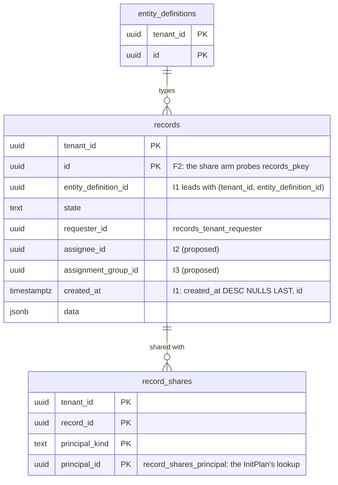

# Records list: the exact total and the page under the ACL predicate (TICK-637)

Scope: TICK-637, risk 3 deferred from the TICK-619 / PR #530 security review.
`GET /api/v1/records/{entity}` (`internal/server/records_list.go`,
`internal/records/store/list.go`) runs an exact `count(*)` and the page,
both under `authz.CompileRead` plus the filters, on every page. The budget is
P3-36's: list p95 ≤ 150 ms. This document measures that path at 1M and 100k
records per tenant and proposes a fix. It changes no code and no migration.

## Verdict

**Both statements miss the budget, not only the count.** At 1M incident
records, page 1 has p95 2.2 to 6.2 s and the exact count 0.7 to 3.6 s, for every
principal measured. At 100k, page 1 has p95 0.27 to 0.72 s.

| Cause | Effect | Fix | Contract change? |
| --- | --- | --- | --- |
| C1: no index matches the list's order, `ORDER BY r.created_at DESC NULLS LAST, r.id ASC` | Every page reads all of the entity type's rows and sorts them, even when 1M rows are visible | **I1**, an index in the list's own order | No |
| C2: the share arm is a correlated `EXISTS`, OR-ed with the other arms | No `BitmapOr` is possible, so the count walks every row of the type (1.01M buffers at 1M) | **F2**, render the share arm as an InitPlan array, plus **I2**/**I3** for the assignee and group arms | No (the SQL changes, the semantics do not) |
| C3: an exact count is O(visible rows) | 1M visible rows cost at least 470 ms, even as a parallel index-only scan with 0 heap fetches | No index fixes it | **Yes**: back to the plan author as an RFC |

I1 + F2 + I2 + I3 bring every case into budget except two: a principal who
sees most of the tenant (the count), and a share-heavy principal at 1M (count
and page). Those two need the RFC (C3) and a plan-shape fix for F2's page
(below).

## Results

Statement time, nava_app, one client, as p50 / **p95** in ms. Baseline: 30
runs. Variants: 10 runs. "Visible" is the exact count. Page 20 is the keyset
page after row 950. "n/a": fewer than 950 visible rows.

### Tenant L, 1,000,000 incident records (+100,000 request)

| Principal (visible) | Query | Baseline (main) | + I1 | + I1, F2, I2, I3 | Capped count 1001, + I1, F2, I2, I3 |
| --- | --- | --- | --- | --- | --- |
| end user (1,114) | count | 2,014 / **2,993** | 3,199 / **4,841** | 11 / **17** | 11 / **14** |
| | page 1 | 2,325 / **3,990** | 107 / **184** | 20 / **26** | |
| | page 20 | 1,950 / **3,321** | 1,293 / **1,751** | 14 / **23** | |
| agent, 3 teams (40,248) | count | 1,619 / **2,027** | 2,031 / **4,063** | 162 / **203** | 57 / **79** |
| | page 1 | 1,676 / **2,223** | 10 / **38** | 40 / **70** | |
| | page 20 | 2,386 / **4,300** | 36 / **52** | 85 / **105** | |
| service desk (1,000,000) | count | 473 / **714** | 353 / **391** | 574 / **664** | 3 / **4** |
| | page 1 | 2,184 / **3,290** | 4 / **5** | 5 / **6** | |
| | page 20 | 1,678 / **2,086** | 9 / **10** | 7 / **9** | |
| share-heavy partner (51,377) | count | 2,541 / **3,633** | 2,484 / **3,661** | 325 / **457** | 283 / **357** |
| | page 1 | 4,470 / **6,204** | 90 / **125** | 446 / **598** | |
| | page 20 | 4,150 / **4,826** | 140 / **216** | 470 / **515** | |

### Tenant M, 100,000 incident records (+10,000 request)

| Principal (visible) | Query | Baseline (main) | + I1 | + I1, F2, I2, I3 | Capped count 1001, + I1, F2, I2, I3 |
| --- | --- | --- | --- | --- | --- |
| end user (304) | count | 248 / **336** | 160 / **184** | 6 / **10** | 5 / **7** |
| | page 1 | 238 / **267** | 55 / **66** | 10 / **13** | |
| agent, 3 teams (8,220) | count | 259 / **368** | 198 / **280** | 38 / **52** | 20 / **25** |
| | page 1 | 276 / **421** | 8 / **10** | 96 / **120** | |
| | page 20 | 274 / **494** | 29 / **37** | 68 / **128** | |
| service desk (100,000) | count | 219 / **291** | 233 / **305** | 300 / **382** | 8 / **11** |
| | page 1 | 434 / **546** | 6 / **8** | 6 / **7** | |
| share-heavy partner (5,270) | count | 255 / **384** | 239 / **441** | 95 / **175** | 41 / **80** |
| | page 1 | 327 / **721** | 14 / **21** | 91 / **114** | |
| | page 20 | 282 / **727** | 63 / **76** | 104 / **194** | |

Full tables with max and `EXPLAIN` buffers, and every `EXPLAIN (ANALYZE,
BUFFERS)`: `scratch/tick-637-list-count/out/<variant>/`. `SET LOCAL jit = off`
(F1, `out/f1-jitoff/`) left every plan and every buffer count unchanged and
moved the times only within the noise, so it is not proposed.

## Why: the plans

**C2, baseline count, end user, tenant L.** The planner walks
`records_number_key` for the entity type and filters 998,886 rows. It estimates
443,890 rows; 1,114 match.

```
Index Scan using records_number_key on records r (rows=443890) (actual rows=1114)
  Index Cond: ((tenant_id = '…0a') AND (entity_definition_id = '9591…'))
  Filter: ((requester_id IS NOT NULL AND requester_id = '5022…') OR (assignee_id IS NOT NULL AND assignee_id = '5022…')
           OR (hashed SubPlan 2))
  Rows Removed by Filter: 998886
  Buffers: shared hit=1011225
Execution Time: 1921.251 ms        (JIT: 423 ms of it)
```

**F2, the same count.** The share arm is now
`r.id = ANY(ARRAY(SELECT acl_share.record_id FROM record_shares acl_share WHERE acl_share.tenant_id = $1 AND (…same pair match…)))`.
It is uncorrelated, so it runs once as an InitPlan, and every arm of the OR
becomes a bitmap index scan:

```
InitPlan 1 -> Bitmap Heap Scan on record_shares acl_share (actual rows=575)
Bitmap Heap Scan on records r (actual rows=1114)
  ->  BitmapOr
        ->  Bitmap Index Scan on records_tenant_requester (actual rows=443)
        ->  Bitmap Index Scan on records_tenant_assignee  (actual rows=196)
        ->  Bitmap Index Scan on records_pkey             (actual rows=575)
Buffers: shared hit=3447     Execution Time: 9.075 ms
```

**F2's regression, share-heavy page, tenant L.** The planner cannot know the
InitPlan array's length when it plans, so it estimates 133 rows. It picks the
bitmap and a top-N sort over 51,377 rows (532 ms, 219,490 buffers) instead of
I1's ordered walk (90 ms p50 without F2). So F2 helps the count and narrow
pages, and hurts pages for a principal with many shares.

**C1, page, service desk.** Without I1, the page reads all 1M rows of the
type and sorts them (175,721 buffers). With I1 it walks the index and stops
at 51 rows (205 buffers, 4 ms). `records_tenant_updated (updated_at DESC,
id DESC)` cannot serve a list sorted by `updated_at` either: the store renders
`DESC NULLS LAST, id ASC`, and the index is `DESC` (NULLS FIRST), `id DESC`.
None of the three list indexes in `20261101190000_records_pipeline.sql`
serves the default order or the `updated_at` order that `store.List`
produces. At best, `records_tenant_requester` gives a requester-sorted list a
presorted prefix for an incremental sort.

**C3, the floor of an exact count.** As nava_app, the count of the service
desk's 1,000,000 rows as a parallel index-only scan on I1, 0 heap fetches, takes
470 to 592 ms (`count-ceiling.sql`). The planner's own choice, a sequential
scan, takes 353 to 664 ms. The cost grows with the number of visible rows, so
no index brings it to 150 ms at 1M.

**The planner's estimate as `total` is not an option.** It reads 443,890 for
a principal who sees 1,114 rows. Its tenant-wide statistics also do not apply
the ACL, so it would reveal how many rows the caller cannot read. That is a
count oracle, so it should go to the Security & Multi-Tenancy Reviewer, not
only to performance.

## Proposal

### Data layer, no contract change (postgres-dev, follow-up task)

1. **I1** `records_tenant_def_created ON records (tenant_id, entity_definition_id, created_at DESC NULLS LAST, id)`,
   91 MB at 1.21M rows, `CREATE INDEX CONCURRENTLY`. It serves the default
   sort and keyset. Page 1 p95 3.3 s → 5 ms for the service desk at 1M.
2. **F2** in `authz.compiler.shared`: the uncorrelated InitPlan form, bound to
   `p.TenantID`. The rendering of the decision changes and the decision does
   not, so the I5 agreement suite (P3-32) and the Security & Multi-Tenancy
   Reviewer must pass it first. It needs **I2** `(tenant_id, assignee_id)`
   (8.9 MB) and **I3** `(tenant_id, assignment_group_id)` (8.7 MB) so every arm
   is indexable. `records_tenant_group_open` is partial (`state <> 'closed'`)
   and cannot serve closed rows.
3. Use F2 for the count only and keep the `EXISTS` form for the page, until the
   share-heavy page plan is fixed. The page then gets I1's walk, and the count
   gets the bitmap. This combination is inferred from the two columns above,
   not run end to end; the follow-up measures it.
4. Align the other sort orders with the indexes, or drop the indexes no order
   uses (C1, last paragraph). That needs its own measurement.

Write cost of I1 + I2 + I3: a 100,000-row bulk insert took 6.2 to 8.3 s with
the current set and 4.8 to 6.1 s with all three added (`write-cost.sql`,
three runs each). On this loaded host that is inside the noise, so the cost
is **not measured**. The follow-up must measure it with the TICK-339 pgbench
write test before any migration. TICK-339 measured −18 to −22% for four
secondary B-trees, so expect a few percent per index.

### Contract (RFC to the plan author before any change)

C3 means an exact `total` cannot meet 150 ms when a principal sees a large
share of a 1M tenant. The options, measured with I1 + F2 + I2 + I3:

| Option | 1M, service desk | 1M, share-heavy | Contract effect |
| --- | --- | --- | --- |
| Exact `count(*)` on every page (today) | 574 / **664** ms | 325 / **457** ms | none |
| Exact count on the first page only | the same on page 1 | the same on page 1 | `total` absent after page 1; page 1 still misses |
| **Capped count**, `LIMIT 1001` (`total` exact up to 1,000, else "more than 1,000") | 3 / **4** ms | 283 / **357** ms | `total` becomes a lower bound plus a flag |
| Planner estimate | not measured | not measured | rejected: wrong by 400x, and a count oracle |

My recommendation is the capped count, the fallback P3-01 already named for a
count-only miss (`records-list-bench.md`), with the share-heavy page fixed as
in step 3. The capped share-heavy count still misses at 357 ms: the bitmap
builds the whole share set before `LIMIT` stops it. That case needs either the
step 3 plan or a cap on the number of shares a principal can hold, and it is
the main open question for the RFC.

## Setup

- Host: Windows 11, 12th Gen Intel Core i7-1260P, 39.7 GB RAM. Docker 29.9.2
  on WSL2, a VM with 16 CPUs. The idle `nava` stack and another agent's
  PostgreSQL container ran at the same time, so treat timings as about ±50%,
  and compare buffers first. The same query moved by up to 2x between runs
  with the same plan (for example, service desk count without F2, 391 ms vs
  714 ms p95).
- `postgres:16.10`: `shared_buffers = 2GB`, `effective_cache_size = 6GB`,
  `max_wal_size = 8GB`, `track_io_timing = on`, `fsync = off`,
  `synchronous_commit = off` (reads are unaffected). Everything else is the
  default, including `jit = on` and `work_mem = 4MB`, as the stack has it. Warm
  cache (`pg_prewarm`).
- Schema: the real migrations (47, up to `20261109100100`), applied by
  `go run ./cmd/nava-db roles` and `migrate`. Seed:
  `scratch/tick-637-list-count/seed.sql` as the superuser with
  `session_replication_role = replica`, `setseed(0.637)`.
  - Tenant L: 1,000,000 incident and 100,000 request records, 5,000 users,
    100 groups.
  - Tenant M: 100,000 incident and 10,000 request records, 1,000 users, 50
    groups.
  - 20 tenants of 1,000 incident records each.
  - 15% of records are open. `created_at` is skewed to recent
    (`730 d × random()³`). Requesters are skewed (`random()²`). 90% of records
    are assigned, and 95% have a group.
  - 2% of records are shared with a user, and 10% with a group. Half of the
    group shares go to group 0 ("partners").
  - Heap: 1,373 MB.
- Harness: `scratch/tick-637-list-count/main.go` (`-tags bench`). The ACL is
  the real `authz.CompileRead`. The count and page SQL is `store.List`'s text,
  with the handler's defaults: sort `created_at` desc, limit 50 + 1, no filter.
  Each execution is its own transaction with `set_config('app.tenant_id')` as
  nava_app, pgx `QueryExecModeExec`, so every plan is a custom plan.
  Percentiles are nearest-rank.
- ACLs. The onboarding default (P3-35, TICK-620) has not merged, so the
  "default incident ACL" is assumed:
  - `own`: requester, assignee or shared.
  - `team`: group `agents`, where `assignment_group_id` is in `my_groups`.
  - `desk`: group `service-desk`, every record.

  The "share-heavy ACL" is `shared` OR requester. Its principal is in
  `partners` and in two other groups.



## Hand-offs

- Plan author (records path): the RFC on `total` (C3).
- Security & Multi-Tenancy Reviewer: F2 (an authz compiler change), and the
  estimate-as-total oracle.
- postgres-dev follow-up: I1, I2, I3 with a write benchmark, and F2 on the
  count only.
