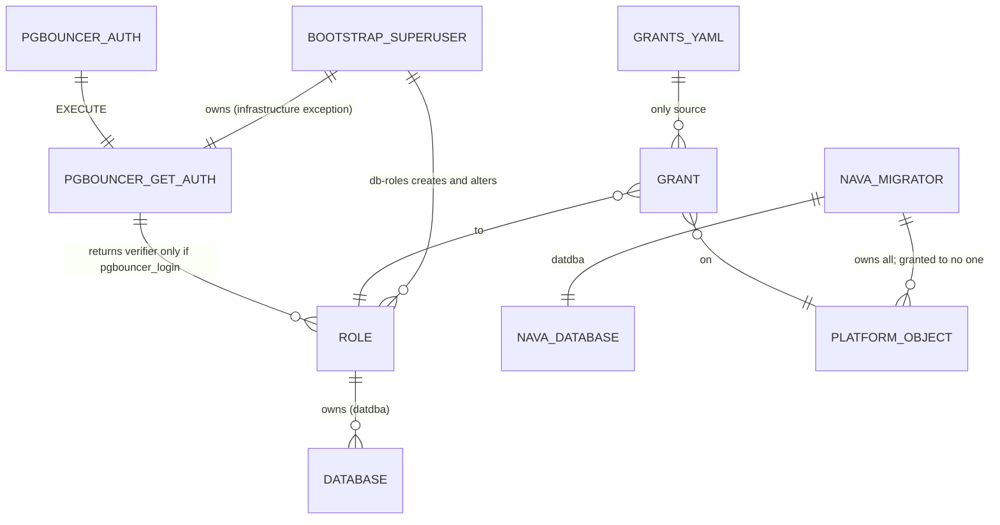

# Roles, ownership and grants (T03)

Scope: TICK-54. ADR-001 I3 and A.3, PLAN-001 D-P2. PostgreSQL 16.10.

## Who owns and reaches what

| Role | Attributes | Owns | On `nava` | Through PgBouncer |
| --- | --- | --- | --- | --- |
| `nava_migrator` | LOGIN | `nava` (datdba), every platform object | owner | refused |
| `nava_app` | LOGIN | nothing | CONNECT, USAGE on `public`; tables as later tasks list them | yes |
| `keycloak`, `temporal` | LOGIN | their own databases | nothing (no CONNECT) | refused |
| `pgbouncer_auth` | LOGIN | nothing | CONNECT, USAGE on `pgbouncer`, EXECUTE on `get_auth` | n/a (auth_file) |

Every role is `NOSUPERUSER NOCREATEDB NOCREATEROLE NOBYPASSRLS` and a member of
no role, `pg_*` included. T08 adds the other D28 roles to `db/grants.yaml`.

## Decisions

1. **db-roles is Go, not the T02 shell script.** It must read `grants.yaml`
   through the shared strict YAML loader (audit item 9), which a shell script
   cannot. It does everything `init.sh` did (roles, databases, owners,
   `get_auth`), so `deploy/compose/db-init/init.sh` is removed.
2. **PgBouncer allow-list is a literal list in `get_auth`, not a group role.**
   The T02 review suggested membership of a `pgbouncer_login` group, but I3
   allows runtime roles no memberships. db-roles rebuilds the function body
   from `pgbouncer_login: true` in the manifest. It also refuses any
   superuser, BYPASSRLS or REPLICATION role, so a role that gains one of those
   drops out on its own.
3. **Ownership splits who converges which grants.** The migrator converges
   grants on objects it owns. `pgbouncer.get_auth` and its schema are owned by
   the bootstrap superuser (the function reads `pg_shadow`), so db-roles
   converges them, as the manifest's single `infrastructure_exceptions` entry.
4. **Passwords go to PostgreSQL as SCRAM verifiers.** db-roles computes the
   verifier client-side and changes a role only when the stored verifier does
   not match. A re-run is a true no-op (`rolpassword` unchanged), and no
   plaintext password reaches the server or its statement log.
5. **PUBLIC counts as drift.** The applier reads `coalesce(acl, acldefault())`,
   so implicit PUBLIC grants (and a missing global function default) are
   revoked like explicit ones.
6. **Session lock.** goose v3.29.0 with
   `WithSessionLocker(lock.NewPostgresSessionLocker(...))`, retrying every 2 s
   up to 300 times (10 min). A second migrator waits, then applies nothing.

## Cost

No table is created yet, so there is no index or query-plan evidence to show.
The applier reads the catalogue once before and once after its revokes. In
the stack test's second `up` (Docker Desktop 28.0.1, Windows 11), db-roles
logged done at 11:28:52.28 and `migrate` at 11:28:54.00: 1.7 s for the
migrate container to start, take the lock, find nothing to apply and verify
every grant.

## Not done here (owners)

- Default `USAGE` on new types still goes to PUBLIC; A.3 revokes only function
  `EXECUTE`. CI-3 (T10) decides whether types count as platform objects.
- `pg_hba` rules, the other D28 roles and the post-run RLS/FORCE check belong
  to T08 and T10.
