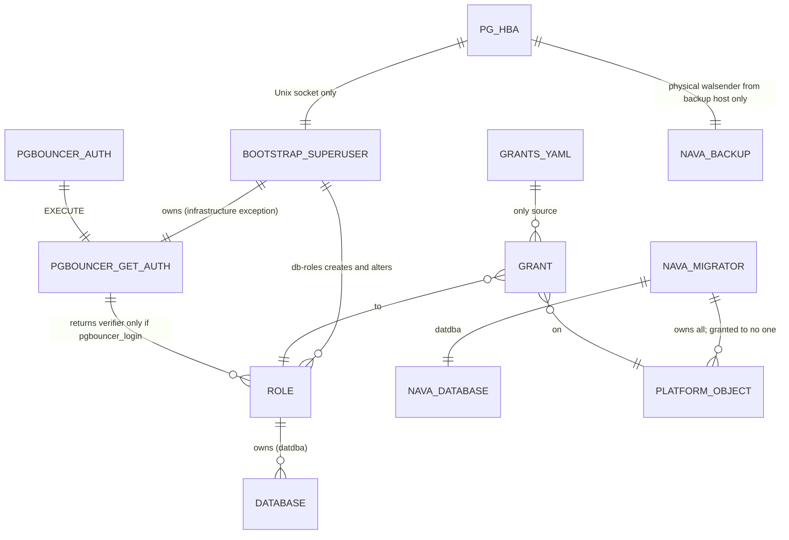

# Roles, ownership and grants (T03, T08)

Scope: TICK-54, TICK-62. ADR-001 I3 and A.3, PLAN-001 D-P2. PostgreSQL 16.10.

## Who owns and reaches what

| Role | Attributes | Owns | On `nava` | Through PgBouncer |
| --- | --- | --- | --- | --- |
| `nava_migrator` | LOGIN | `nava` (datdba), every platform object | owner | refused |
| `nava_app`, `nava_worker`, `nava_relay`, `nava_purge`, `nava_onboard`, `nava_groupsync` | LOGIN | nothing | CONNECT, USAGE on `public`; tables as T09/T16 list them | yes |
| `nava_backup` | LOGIN REPLICATION | nothing | nothing; `pg_hba` refuses every SQL session and logical walsender | refused |
| `keycloak`, `temporal` | LOGIN | their own databases | nothing (no CONNECT) | refused |
| `pgbouncer_auth` | LOGIN | nothing | CONNECT, USAGE on `pgbouncer`, EXECUTE on `get_auth` | n/a (auth_file) |

Every role is `NOSUPERUSER NOCREATEDB NOCREATEROLE NOBYPASSRLS` and a member of
no role, `pg_*` included. The service databases (`keycloak`, `temporal`,
`temporal_visibility`) carry only their owner's privileges: db-roles revokes
PostgreSQL's default `CONNECT`/`TEMPORARY` to PUBLIC and any other grant on
them, so no platform role can connect there. On `nava` the migrator owns the
grants, but db-roles runs `REVOKE ALL ON DATABASE nava FROM PUBLIC` right
after `CREATE DATABASE nava`, so PUBLIC has no `CONNECT`/`TEMPORARY` there
while `keycloak` and `temporal` start and `migrate` has not yet run (T08
security review).

db-roles fails, before it changes anything, if any role outside the manifest
other than the bootstrap superuser has `rolsuper`, and names it. The
`pg_hba.conf` superuser rules match `pgadmin` by name, so a second superuser
would reach PostgreSQL over TCP through the catch-all. A manifest role with
`rolsuper` is drift that the same run demotes, so it does not fail the run.

### `db/pg_hba.conf` (first match wins)

| Line | Effect |
| --- | --- |
| `local all pgadmin scram-sha-256`, then `host all pgadmin 0.0.0.0/0` and `::/0 reject` | The bootstrap superuser only over the Unix socket, which only `postgres` and `db-roles` mount (tmpfs volume `pgsocket`; `db-roles` has `network_mode: none`). T02 security review. |
| `host replication nava_backup 127.0.0.1/32 scram-sha-256` | Physical walsender from the backup host. In compose that is the postgres container itself. A deployment changes only this address. |
| `host all nava_backup 0.0.0.0/0` and `::/0 reject`, `local all nava_backup reject` | No SQL session and no logical walsender (`replication=database` names a database, so it matches `all`). |
| `local`/`host all all … scram-sha-256` | Everyone else, password only. No `replication` line follows, so no other role can be a physical walsender. |

## Decisions

1. **db-roles is Go, not the T02 shell script.** It must read `grants.yaml`
   through the shared strict YAML loader (audit item 9), which a shell script
   cannot. It does everything `init.sh` did (roles, databases, owners,
   `get_auth`), so `deploy/compose/db-init/init.sh` is removed.
2. **PgBouncer allow-list is a literal list in `get_auth`, not a group role.**
   The T02 review suggested membership of a `pgbouncer_login` group, but I3
   allows runtime roles no memberships. db-roles rebuilds the function body
   from `pgbouncer_login: true` in the manifest. It also refuses any
   superuser, BYPASSRLS or REPLICATION role, so a role that gains one of those
   drops out on its own.
3. **Ownership splits who converges which grants.** The migrator converges
   grants on objects it owns. `pgbouncer.get_auth` and its schema are owned by
   the bootstrap superuser (the function reads `pg_shadow`), so db-roles
   converges them, as the manifest's single `infrastructure_exceptions` entry.
   db-roles checks that ownership before it creates or replaces either one,
   and fails, naming the object and its owner, when a non-superuser owns
   them. `CREATE OR REPLACE` keeps the existing owner, so db-roles does not
   repair ownership; a person must drop the object or change its owner
   (TICK-107).
   An object the check found absent is created with plain `CREATE SCHEMA` /
   `CREATE FUNCTION`, so one created after the check fails the run instead
   of being adopted; `OR REPLACE` only rewrites a function the check saw
   superuser-owned, which no other role can drop or re-own.
4. **Passwords go to PostgreSQL as SCRAM verifiers.** db-roles computes the
   verifier client-side and changes a role only when the stored verifier does
   not match. A re-run is a true no-op (`rolpassword` unchanged), and no
   plaintext password reaches the server or its statement log.
5. **PUBLIC counts as drift.** The applier reads `coalesce(acl, acldefault())`,
   so implicit PUBLIC grants (and a missing global function default) are
   revoked like explicit ones.
6. **The superuser reaches PostgreSQL only through a shared Unix socket (T08).**
   The issue allowed "local socket, or only from db-init". Container
   addresses are dynamic, so an address rule for db-roles would need a fixed
   subnet. A socket directory mounted only into `postgres` and `db-roles`
   needs no addressing, and db-roles then needs no network at all.
7. **Session lock.** goose v3.29.0 with
   `WithSessionLocker(lock.NewPostgresSessionLocker(...))`, retrying every 2 s
   up to 300 times (10 min). A second migrator waits, then applies nothing.

## Cost

No table is created yet, so there is no index or query-plan evidence to show.
The applier reads the catalogue once before and once after its revokes. In
the stack test's second `up` (Docker Desktop 28.0.1, Windows 11), db-roles
logged done at 11:28:52.28 and `migrate` at 11:28:54.00: 1.7 s for the
migrate container to start, take the lock, find nothing to apply and verify
every grant.

## Not done here (owners)

- Default `USAGE` on new types still goes to PUBLIC; A.3 revokes only function
  `EXECUTE`. CI-3 (T10) decides whether types count as platform objects.
- The post-run RLS/FORCE check belongs to T10. Per-table grants and policies
  for the D28 roles arrive with T09 ([platform-tables.md](platform-tables.md))
  and T16.
- PUBLIC keeps `CONNECT` on the `postgres` maintenance database, which is not
  in the manifest. `pg_hba` already refuses `pgadmin` and `nava_backup` there
  over TCP.
