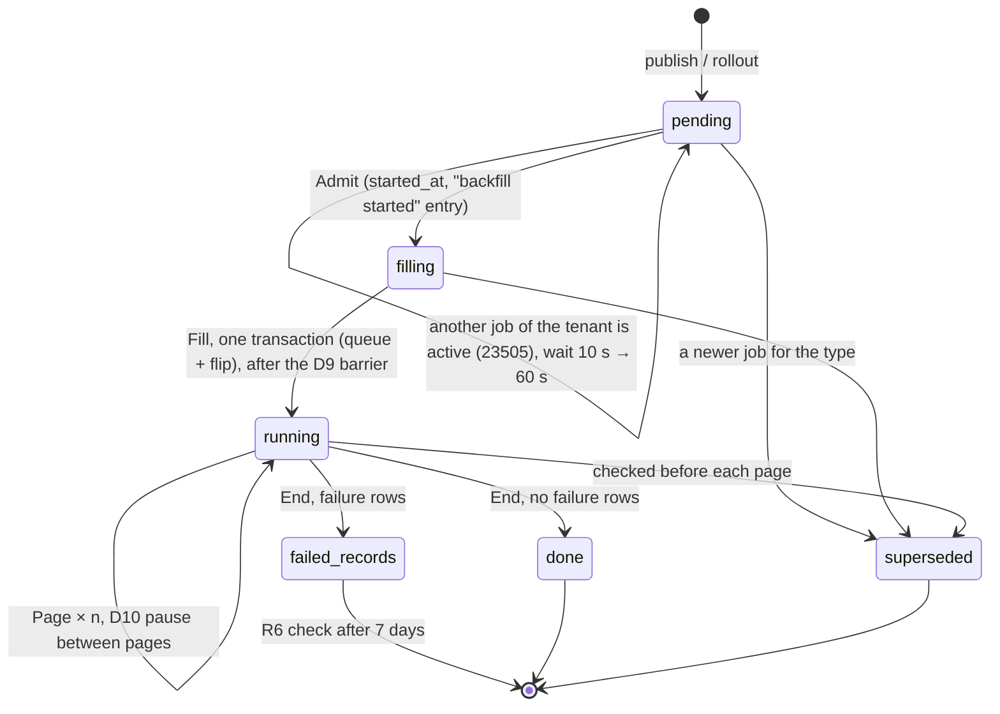

# Schema backfill job (ADR-009, S29)

When a published version adds a default, a background job writes that default
into every record of the type that lacks it. This note covers the job itself:
the `schema.backfill` workflow in `internal/schemabackfill` (PLAN-010 P10-03,
P10-05, P10-06; TICK-920). The tables are in
`db/migrations/20261127110300_schema_backfill_tables.sql` (P10-01), and the
record write is `pipeline.Write(OpMaterialize)` (P10-02).

## Who starts it

The publish that adds a default (P10-04) or the rollout migration (D15) writes
a `pending` `schema_backfills` row and an outbox row in one transaction. The
outbox row has `kind = schema.backfill`, payload `{entity_definition_id}`,
`target_seq` = the target version, and dedupe key
`schema-backfill:<def>:<version>`. The payload holds UUIDs only
(`outbox_payload_check`), so the version is in `target_seq`. The causation
audit id is on the job row.

The relay starts workflow `t:<outbox.tenant_id>:schema.backfill:<def>:<version>`
on task queue `schema-backfill`. Its input is the row's `outbox.Delivery`, with
no tenant. A redelivered row gets `WorkflowExecutionAlreadyStarted`, which
acknowledges it. The Authorizer lists the type as platform and start-only, and
the queue as a platform queue: only the relay can start it, never a child or a
continue-as-new.

## What it does

- **Tenant.** Every activity reads the job from the workflow id
  (`workerguard.TenantOf`) and checks it against the guard's tenant. Each
  query names `tenant_id = $1` and also runs under RLS as `nava_worker`. A job
  with no row under RLS is a non-retryable stop (`nava.schema_backfill.NoJob`).
- **Admission.** The `pending → filling` UPDATE is the admission. The partial
  unique index `schema_backfills_one_active_per_tenant` lets one job per
  tenant fill or run. A `23505` on that index leaves the job pending, and the
  workflow tries again after a Temporal timer.
- **Fill.** After the barrier, one transaction queues every record with
  `NOT (data ?& default_keys)`, using the job row's keys, and sets `running`.
- **Pages.** A page reads 100 pending ids with no row lock. Each id gets its
  own transaction with `SET LOCAL synchronous_commit = off`. That transaction
  deletes the pending row, which locks it so a second attempt finds nothing,
  rewrites the record through `OpMaterialize`, and adds one to `rewritten` or
  `skipped`, all committing together. A version conflict or deadlock rolls back
  and leaves the id pending for a later pass. A refusal or database error rolls
  back, then a separate transaction moves the id to `schema_backfill_failures`
  with the pipeline's code (`validation_failed`, ..., or `db_error`). No
  savepoints are used. When a pass finds no id after its cursor, the next pass
  starts from the first id. An empty queue ends the job.
- **Supersede (D8).** Admission and every page check for a newer job of the
  type. If one exists, the job is set to `superseded`, its pending and failure
  rows are deleted, and the workflow ends.
- **R6.** After `failed_records`, the workflow sleeps 7 days
  (`NAVA_SCHEMA_BACKFILL_R6_AFTER`). If the job is then still `failed_records`
  and still the newest for its type, it increments
  `nava_schema_backfill_r6_tripped_total` and logs one WARN line with the
  tenant, the type key and the version.

## Audit

Each rewritten record gets one `update` entry from the pipeline
(`actor_system = schema-backfill`). Its causation is the publish entry at that
entry's depth + 1; a rollout job has none, so the pipeline mints a new origin.
The job writes two entity-type entries of its own: "started" in the admission
transaction, and "finished" with the counts in the end or supersede
transaction. Both follow the numbering-mode pattern: domain `config`, action
`update`, subject the entity definition, and a diff of
`{"backfill": {state, target_version, counts}}` with `content_sha256` of the
after document. No version moves.

## History

Every workflow and activity argument, result and heartbeat holds references
only (worker guard, CI-7). The results are optional pointers to the job's
definition id (`Admitted`, `Ended`, `Next`, `FailedRecords`). The counters are
written only to the job row, never returned. The barrier's heartbeat holds
transaction ids.

## Worker

`cmd/nava-worker` runs a second worker on `schema-backfill` with
`MaxConcurrentActivityExecutionSize = NAVA_SCHEMA_BACKFILL_CONCURRENCY`
(default 4). That is the D7 cap on how many tenants' pages run at once, per
replica. The D9 barrier is `internal/fieldindex/barrier`, and the D10 pause is
`fieldindex.Pacer`. Both were moved out of the field-index backfill with no
change in behaviour.
