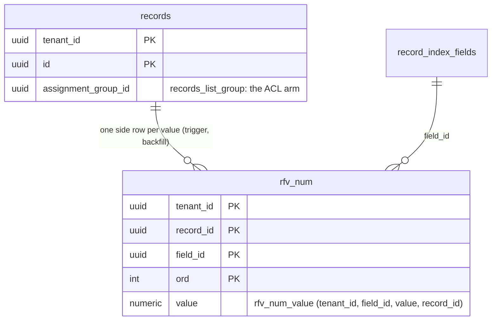

# TICK-1022: the ≥ 40% ACL list depends on the side table's visibility map

**Finding.** The S21 kit's slow ≥ 40% ACL list (217 ms single-client on one
fresh stack, 34 ms on the next) is a plan flip in the list's **capped count**.
The visibility map of `rfv_num` decides it. Its statistics do not. Analyzing
the side table at the flip to ready, the suggested direction, does not fix
it: 255 ms after `ANALYZE`, 64 ms after `VACUUM (ANALYZE)`. The slow plan is
also the steady state. Re-writing 5% of the side rows through edits leaves
1% of the pages all-visible, and the count takes the slow plan again until
autovacuum runs.

**Candidate fix, not adopted yet.** Set `random_page_cost = 1.1` for
`nava_app` (a role setting in `db/grants.yaml`). It keeps the fast plan at
0% all-visible: 42 ms against 255 ms. It changes every plan of the app role,
so it needs a D13 + P3-36 re-score on an idle host before it lands (next
step below).

## What the list runs

With a narrowing ACL, the list sends two statements: the page and a count
capped at 1,001 (`internal/records/store/list.go`, `CountStatement`). The
page always walks `records_list_updated` and probes the side table, 4–13 ms
in every state below. The count's first ACL arm joins the agent's
group-visible records (`records_list_group`, 2–4k rows here, 20k for the
kit's Alice) to the filter's `EXISTS` on `rfv_num`. The planner chooses one
of two plans for it:

| Plan | When | Count execution, pk=3 |
| --- | --- | --- |
| Nested Loop Semi Join: one index-only probe of `rfv_num_value` per visible record | `rfv_num` mostly all-visible | 9–15 ms |
| Hash Semi Join: seq scan of `rfv_num`, a hash of the value's 192k side rows, spilled to disk (`Batches: 2`, `work_mem` 4 MB) | under roughly 50–70% all-visible | 100–490 ms |

The planner costs an index-only probe by the share of pages that are not
all-visible (`pg_class.relallvisible / relpages`), because each such page
needs a heap fetch at `random_page_cost` 4. Every page is in shared buffers
here, so the heap fetches it costs never happen, and the Hash Semi Join is the
slower plan in practice.

## Measurements

Harness: `TestFieldIndexPostBackfillStats`
(`internal/server/records_fieldindex_stats_perf_integration_test.go`), run by
`scratch/tick-1022-post-backfill-stats/run.sh`. It reuses P7-07's 800k seed:
400 tenants, one with 400,000 tickets, and P3-36's agent (the agents group
plus 3 assignment groups). It adds a num field `pk` with the kit's
distribution: 1 and 2 at 1% each, 3 at 48%, 4 at 50%. The lists go through
the real handler as `nava_app` under forced RLS. The side rows are copied in
the backfill's order (record id), with autovacuum off on `rfv_num` so each
state stays as set up.

Host: Windows 11, i7-1260P, Docker 29.9.2 on WSL2, VM with 16 CPUs and 24.5
GiB, `postgres:16.10`, `shared_buffers` 2.5 GB, `work_mem` 4 MB,
`random_page_cost` 4, `default_statistics_target` 100. The host was shared:
the kit's compose stack was idle, and other agents' integration-test
Postgres containers were running. The 8-client p95 is reported only. Read the
single-client p50 and the per-statement execution times.

### Run 1: the states a backfill can end in (pk=3, single-client p50 / 8-client p95, ms)

| State of `rfv_num` at the first list | all-visible | pk=3 (48%) | pk=4 (50%) | pk=1 (1%) |
| --- | --- | --- | --- | --- |
| never analyzed | 0% | **4,536 / 15,451** | **9,376 / 15,343** | 449 / 695 |
| analyzed at 50% of the rows | 0% | **259 / 425** | 180 / 1,639 | 109 / 385 |
| analyzed at 91% (S21 stack 2's last autoanalyze) | 0% | **202 / 902** | 185 / 569 | 179 / 762 |
| `ANALYZE` after the last row (the suggested fix) | 0% | **255 / 527** | 315 / 787 | 203 / 468 |
| `VACUUM (ANALYZE)` after the last row (as D13 was measured) | 100% | **64 / 215** | 67 / 189 | 129 / 322 |

Statistics taken at 50%, 91% or 100% of the rows give the same MCV
frequencies within 1 point (3 at 0.477–0.482, 4 at 0.497–0.501), and the
same slow plan. Only the vacuum, which sets the visibility map, changes it.
A table never analyzed at all is worse again: the planner estimates 1 side
row and builds a different plan, 4.5 s. A real backfill avoids that state,
because autoanalyze fires after the first ~50 rows of an empty table. The
kit's stack 2 shows 10 autoanalyzes on `rfv_num`.

### Run 2: where the plan flips, and the steady state (single-client p50 ms; count statement execution ms)

| State | all-visible | pk=3 p50 | pk=4 p50 | Count plan | Count exec pk=3 / pk=4 |
| --- | --- | --- | --- | --- | --- |
| vacuum | 100% | 48.3 | 43.3 | Nested Loop | 13.3 / 10.1 |
| planner told 90% | 90% | 41.7 | 41.5 | Nested Loop | 9.4 / 9.3 |
| planner told 80% | 80% | 102.9 | 91.7 | Nested Loop | 8.6 / 15.4 |
| planner told 70% | 70% | 43.1 | 42.4 | Nested Loop | 10.4 / 8.9 |
| planner told 50% | 50% | **193.8** | **219.0** | **Hash Semi Join, spills** | 151.1 / 108.1 |
| planner told 25% | 25% | 130.1 | 112.4 | Hash Semi Join, spills | 124.7 / 103.9 |
| 5% of side rows re-written, then `ANALYZE` | **1%** | 116.4 | 131.8 | Hash Semi Join, spills | 101.7 / 151.7 |
| 10% re-written | 0% | 147.2 | 167.1 | Hash Semi Join, spills | **493.1** / 160.3 |
| 20% re-written | 0% | 125.4 | 131.8 | Hash Semi Join, spills | 114.7 / 166.4 |
| `ANALYZE` only, `random_page_cost = 1.1` for `nava_app` | 0% | **42.4** | **42.6** | Nested Loop | 13.6 / 10.2 |

"Planner told n%" vacuums the table and then sets `pg_class.relallvisible`
to n% of `relpages`, so only the planner's input changes. The 80% row's
HTTP p50 is host noise: its count ran in 8.6 / 15.4 ms on the fast plan. The
"re-written" rows delete and insert n% of the side rows, spread over the
heap as record edits are. The trigger's delete and insert does the same.
Autovacuum vacuums a table for dead rows only after 50 + 20% of its rows
change. So between two autovacuums, a type with ordinary edit traffic is in
the slow region most of the time. `rfv_num` is shared by every tenant's num
fields, so one tenant's edits move every tenant's plan.

Plans: `docs/data/tick-1022-post-backfill-plan/count-plans.md` (the count
statement for pk=3 after `ANALYZE`, after `VACUUM`, at 5% re-written, with
`random_page_cost` 1.1, and never analyzed). Raw tables: `states-raw.md`,
`sweep-raw.md`, host lines in `host.txt`.

## Why not the other fixes

| Option | Result |
| --- | --- |
| `ANALYZE` the side table when the backfill flips a field to ready | Measured: no effect (255 ms against 202 ms without it). It would also need a `SECURITY DEFINER` wrapper, because `nava_worker` does not own the table and PG 16 has no `MAINTAIN` privilege. That breaks CI-1. |
| `VACUUM` at the flip | Cannot run in a function or a transaction, and needs ownership. Not reachable from the worker. |
| Tighter autovacuum on `rfv_*` (insert and dead-row scale factors) | Narrows the window but cannot close it: 5% re-written already leaves 1% all-visible, and autovacuum runs at most once a naptime. |
| Force the per-record probe in the count (`OFFSET 0` in the `EXISTS`) | Fixes the ACL arm but takes away the side-index-driven plan from the selective, no-ACL filters (the 0.01% band). A compiler change to ADR-006 D7's shape. Kept as the fallback if `random_page_cost` fails the matrix. |
| `random_page_cost = 1.1` for `nava_app` | Measured: fast plan at 0% all-visible. Matches a data set that fits in shared buffers on SSD. It changes every `nava_app` plan, so it is scored first. |

## Next step

Re-score on an idle host with `random_page_cost = 1.1` for `nava_app`,
against the current arm on the same host:

- D13's 40-cell list matrix (`TestFieldIndexPerf800k`, lists phase), with
  the side tables vacuumed as now, and again at 5% re-written.
- P3-36's list matrix (no data filter).

If both hold, the change is one line in `db/grants.yaml` (`settings`) plus
`random_page_cost` in `grants.AllowedSettings`. If not, the fallback is the
compiler's per-record probe for ACL arms.
