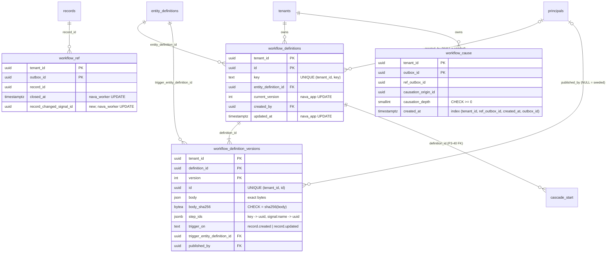

# Workflow definitions, workflow_cause and the waiting state (P3-40)

TICK-709, S11b (TICK-337). The shapes are the S11b interface contract (D-3-29,
`docs/delivery/decisions/2026-11-11-d-3-29-s11b-interface-contract.md`).
Migrations: `db/migrations/20261113123300` to `20261113123400`, and `20261113200000` (`workflow_cause_ref_newest`, TICK-785).

## Model

Every key, index and foreign key leads with `tenant_id`. All three new tables
are `ENABLE` + `FORCE` RLS, with one canonical-predicate policy per command.

| Role | workflow_definitions | workflow_definition_versions | workflow_cause | workflow_ref (new) |
| --- | --- | --- | --- | --- |
| `nava_app` | SELECT, INSERT, UPDATE (`current_version`, `updated_at`) | SELECT, INSERT | SELECT, INSERT | none |
| `nava_worker` | SELECT | SELECT | SELECT, INSERT | UPDATE `record_changed_signal_id` (plus the existing `closed_at`) |
| others | none | none | none | unchanged |

No role has DELETE on any of the three tables, and no role has UPDATE on a version or a cause.

## Decisions beyond the contract

- **Nullable `created_by` / `published_by`.** This follows `entity_definition_versions.published_by` (P3-02). A NULL is a seeded definition (the demos, and future templates). A set value is held to its own tenant by the composite FK. P3-41's publish route always sets it.
- **Audit.** Both definition tables are `audited` under a new subject type, `workflow_definition` (`20261113123310`/`0123320`), and P3-41's publish writes the config entry. `audit_commit_check` is attached to both by P3-41b (`20261113180000`); a fixture that needs a raw row writes its own audit entry or turns the trigger off for its own seed transaction. `workflow_cause` is exempt: it copies the causation of an outbox row whose write is already audited.
- **No FK from `workflow_cause` to `outbox` or `workflow_ref`.** Both of those tables are purged, and a NO ACTION key would make the purge fail. `workflow_cause` has no purge yet. It should be purged with `workflow_ref` (30 days after close); that task is open.
- **`step_ids` is `jsonb`, `CHECK (jsonb_typeof = 'object')`.** It is read whole and never hashed. Validating its contents (UUIDv4 values) stays in `AssignStepIDs` (P3-41).

## Evidence

Run with `sh scratch/p340-workflow-definitions/run.sh` (raw output is in `scratch/p340-workflow-definitions/out.txt`).

- **Hardware:** postgres:16.10 in Docker Desktop (16 vCPU, 24.5 GiB VM) on an Intel i7-1260P with 39.7 GB RAM; warm cache, no parallel workers.
- **Data:** 2,000 tenants and 20,000 definitions (10 per tenant), with 3 versions each (60,000 version rows). There are 2,000,000 `workflow_ref` rows (1,000 per tenant over 200 records). 5% of them are open and 50,000 wait on `record_changed`.

| Query (per record write, P3-42) | Without the index | With the index |
| --- | --- | --- |
| (1) Trigger lookup: current versions matching `(tenant, entity, op)` | 0.308 ms, 52 buffers. The plan probes every definition of the tenant through `workflow_definitions_key_key`, then probes the version PK for each (10 loops), so it grows with definitions per tenant. | 0.139 ms, 16 buffers. An index-only scan on `workflow_definition_versions_trigger` (0 heap fetches), then one PK probe per matching version. |
| (2) Open refs on a record that wait on `record_changed` | 0.110 ms, 8 buffers. `workflow_ref_record` plus a filter over every ref of the record (5 here). | 0.104 ms, 7 buffers. `workflow_ref_waiting`, no filter. |

Storage at this shape:

- `workflow_definition_versions_trigger` is 6.5 MiB (the table is 52 MiB and its PK 4.5 MiB). It costs one extra index entry per publish, and publishes are rare.
- `workflow_ref_waiting` is 856 KiB for 50,000 waiting rows. `workflow_ref` itself is 223 MiB, its PK 129 MiB, and `workflow_ref_record` 63 MiB.

**Write cost of `workflow_ref_waiting`.** `closed_at` and `record_changed_signal_id` are in its predicate. Any UPDATE that changes either one is therefore no longer HOT. That covers every `CloseWorkflowRef` and every set or clear of the waiting state, and each such update writes new entries in `workflow_ref_pkey` and `workflow_ref_record` as well as the partial index. At this shape, (2) gains 0.006 ms per write. The index pays off only for a record with many refs inside the 30-day purge window. The contract specifies it, so it ships. Dropping it is a single `DROP INDEX CONCURRENTLY` if P3-42's load shows the HOT loss matters more.

## Newest-cause check (TICK-785)

`causeSQL` (`internal/workerguard/cause.go`) reads one cause row by primary key, and an `EXISTS` asks whether the same run has a later row by `(created_at, outbox_id)`. Before this change, no index served that `EXISTS`, so it read every cause row of the tenant. `workflow_cause_ref_newest (tenant_id, ref_outbox_id, created_at, outbox_id)` turns it into one index-only range probe of the run's own rows. `tenant_id` leads, and the row comparison is an index condition.

Run with `sh scratch/tick785-workflow-cause-newest/run.sh` (raw output is in `scratch/tick785-workflow-cause-newest/out.txt`).

- **Hardware:** postgres:16.10 in Docker Desktop (16 vCPU, 24.5 GiB VM) on an Intel i7-1260P with 39.7 GB RAM; warm cache, no parallel workers, JIT off.
- **Data:** 2,100,000 rows: 1,000 tenants × 200 runs × 10 causes, plus one heavy tenant with 2,000 runs × 50 causes (100,000 rows). The query is planned as a non-owner role under FORCE RLS with `force_custom_plan`, as `nava_worker` runs it.

| Probe (heavy tenant) | Without the index | With the index |
| --- | --- | --- |
| Newest cause (`newer = false`, the hot path) | 19.0 ms, 2,076 buffers. A bitmap scan of `workflow_cause_pkey` on `tenant_id`, then 100,000 rows removed by filter. | 0.05 ms, 8 buffers. An index-only scan of `workflow_cause_ref_newest`, 0 heap fetches. |
| Stale cause (`newer = true`, a replayed delivery) | 7.0 ms, 796 buffers. The same bitmap scan, stopping at the first newer row. | 0.07 ms, 9 buffers. |

The cost without the index grows linearly with the tenant's cause history. With the index, the cost depends only on how many causes the run has.

**Cost:**

- **Storage:** 155 MB at 2.1M rows, against 219 MB for the heap and 131 MB for the PK. That is about 74 bytes per row, because three uuids and a timestamptz is a wide key.
- **Writes:** each delivery that resumes a run inserts one cause row, which now carries one more index entry. The insert-only workload has no UPDATEs, so no HOT loss. 100,000 inserts in one transaction took 504 / 595 ms without the index and 913 / 993 ms with it, measured warm and alternating. That is about 4 µs more per cause row, against the 7 to 19 ms the read cost before.
- **Build:** 4.8 s at 2.1M rows, `CONCURRENTLY`, so it takes no lock that blocks writes.

The index cannot replace the PK. `ResolveCause` reads its row by `(tenant_id, outbox_id)`, and the PK enforces uniqueness. The table has no purge yet (see above), so this index grows with the table until that task lands.

## FORCE RLS makes a bare `VALIDATE CONSTRAINT` of a foreign key vacuous

This was found while proving the `cascade_start` FK pair, on postgres:16.10:

- When the caller owns both tables, PostgreSQL validates a FK with one SQL anti-join (`RI_Initial_Check`).
- That query is subject to the **referencing** table's RLS, and FORCE applies it to the owner.
- `nava_migrator` has no policy on any tenant table, so the scan sees no rows, and the key is marked valid over orphans.

| FORCE RLS on | Orphan row | VALIDATE result |
| --- | --- | --- |
| Referencing table | yes | **passes, `convalidated = true`** |
| Referenced table only | none | **fails**: every row looks orphaned (a false positive) |
| Both tables, with a temporary `TO nava_migrator USING (true)` SELECT policy on each | yes / none | fails / passes (correct) |
| `CHECK` constraint on a FORCE RLS table | violating row | fails (correct: a heap scan) |

`20261113123340` therefore creates those two temporary policies, validates and drops them in one transaction.
`TestP340CascadeStartDefinitionKeyOverExistingClaims` pins this: an orphan claim must stop the migration.

Two earlier FK validations have the same shape and were probably validated vacuously:

- `group_members_group_live_fkey` (`20261104013500`)
- `records_assignment_group_fkey` (`20261104043100`)

They are reported to the Technical Lead (TICK-337) and are not changed here.
