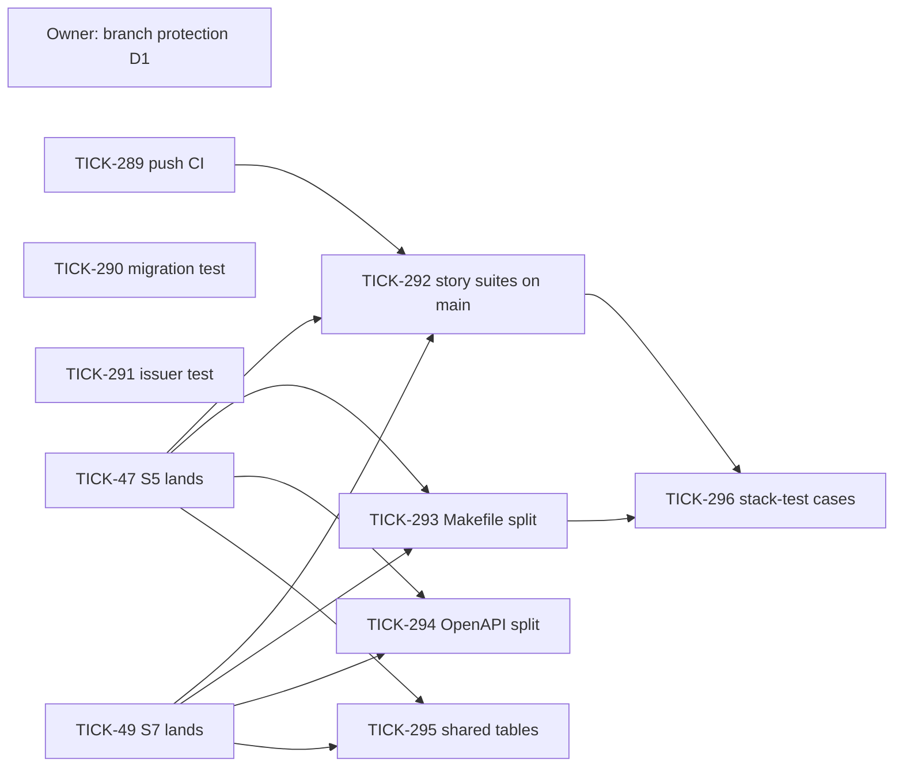

# Merge safety

Owner: Technical Lead. Issue: TICK-288. Measured on `main` at `68fbff5` (2026-10-28).

**Decided:** `main` is protected and tested after every merge. Migration versions become timestamps, and a test catches a duplicate version. The files every story edits are split so each story adds new files. Eight tasks (TICK-289 to TICK-296) do the work. TICK-289, TICK-290 and TICK-291 start now. The file splits wait until S5 (TICK-47) and S7 (TICK-49) are on `main`.

**Status (2026-10-28):** D1 is applied. `main` requires the eight `ci.yml` jobs (`changes`, `lint`, `unit`, `temporal-server`, `integration`, `stack`, `stack-db`, `stack-internal`), requires the branch to be up to date, includes admins, and blocks force pushes. A PR that adds a `ci.yml` job adds it to the required list in the same change. D2 reverses the 2026-10-25 "no run on push to main" decision. Pull requests keep their change-based job selection.

## 1. Why S5 and S7 broke

### 1.1 Text conflicts: the same files every time

I replayed the last 300 merge commits and counted the files that conflicted:

| File | Merges that conflicted | Why it conflicts |
|---|---|---|
| `Makefile` | 11 | 384 lines and 58 targets in one file. Every story adds its targets and its CI wiring here. |
| `docs/security/accepted-risks.md` | 7 | One table. Every story appends its row at the end. |
| `docs/delivery/todo.md` | 7 | One table, appended at the end, with sequential `TODO-NNN` ids. |
| `deploy/compose/test/stack-test.sh` | 5 | One script with a case per stack test. Fixed by TICK-296: one script per case under `cases/`. |
| `docs/pins.md`, `.gitignore` | 4 each | Shared lists, appended at the end. |
| `.github/workflows/ci.yml`, `docs/delivery/decision-log.md` | 3 each | One step per suite in one job; one log. |
| `api/openapi.yaml` + `api/api.gen.go` | S5 (TICK-281) | One spec and one generated file. Two stories that add endpoints conflict in both. |

S5 is 20 commits ahead of `main` and S7 is 42 ahead. A trial merge of S5 and S7 against each other still conflicts in `Makefile`, `.golangci.yml`, `docs/delivery/todo.md` and `docs/security/accepted-risks.md`. Whichever story merges second will hit conflicts again.

### 1.2 Test failures: semantic conflicts that git merges cleanly

These are the breaks that failed tests. None of them showed up as a text conflict.

| Break | What happened | Why nothing caught it before the merge |
|---|---|---|
| Duplicate goose versions (TICK-284, TICK-285) | `main` took `00006` and `00007` (S4). S5 and S7 had each used `00006` and `00007` on their own branches. The file names differ, so git merged cleanly, but goose refuses the directory. Every test that migrates failed: integration, isolation and stack. | Each branch picks its own migration numbers and nothing coordinates them. `task test` runs no migrations, so local runs passed. |
| CI-5.10 accepted a foreign-IdP user (TICK-263) | TICK-223 on `main` drops unbound IdP links. The S5 resolver relies on those links to refuse the user. | The CI-5 suite existed only on the story branch, so `main`'s CI could not run it. |
| Onboarding returned 401 (TICK-278) | TICK-160 on `main` pinned the issuer for `nava-core` only. `nava-onboard` on S4 still trusted `keycloak:8080`. | No test checked that every service that validates tokens trusts the same issuer. |

### 1.3 Process gaps

- `ci.yml` runs on `pull_request` and `workflow_dispatch` only. It does not run on `push` to `main`, so the tree a merge produces is never tested.
- `main` has no branch protection: no required checks and no "branch must be up to date" rule. A PR that was green against an older `main` can merge after `main` has moved. S5 was approved at `027a9f4`, and then S3 and S4 landed.
- Story branches live for days and take in `main` only at the end. Breakage piles up and shows up all at once.
- The story suites (CI-5, CI-6, CI-7) join `main`'s CI only after their story lands, so a change on `main` can break them without anyone seeing it.

## 2. Decisions

| # | Decision | Why |
|---|---|---|
| D1 | Protect `main`. Every `ci.yml` job is a required check, the branch must be up to date before merge (or a merge queue is used), and direct pushes are blocked. The owner applies this, because it needs admin rights. | This is the only control that stops a stale-green PR from merging. |
| D2 | `ci.yml` runs on `push` to `main` and to `TICK-*`, with every stage selected. A red `main` opens a `P0` GitHub issue, and the Technical Lead mirrors it to the board. | Every merged tree gets a verdict. |
| D3 | New migrations use 14-digit UTC timestamp versions. Goose runs with out-of-order allowed. A unit test in `task test` rejects duplicate versions, malformed names, gaps in the legacy `00001`–`000NN` range, and anything goose cannot load. `00001`–`00007`, and the numbers TICK-284 and TICK-285 assign, stay as they are. | Timestamps from parallel branches do not collide. The test is cheap and catches what a collision would still break. |
| D4 | `Makefile` becomes `make/*.mk` fragments, with append-style target lists. | Fixes the file that conflicts most often. |
| D5 | The OpenAPI source is split into `api/paths/*.yaml` and bundled by a generator. Lint regenerates the code and fails on any diff. Generated files are never merged with `merge=ours`. | Separate source files avoid conflicts. Regenerating the code is safer than hand-merging it or keeping one side. |
| D6 | Shared tables use story-prefixed ids (`TODO-S5-01`, `AR-S7-02`) and `merge=union`. Decision-log entries become one file each, under a generated index. | A union merge is safe for unordered tables, but it would interleave the newest-first log. |
| D7 | Stack tests become one script per case, with a registry, and `ci.yml` loops over the registry. | A new suite means a new file. This also removes TODO-009 and TODO-012. |
| D8 | After every merge to `main`, the Technical Lead merges `main` into each open story branch, and full CI runs (via D2). Stories are sized to land within about two working days. | Breakage shows up a day at a time instead of all at once at the end. |
| D9 | A test checks that every service that validates tokens trusts the pinned issuer. Every landed story suite runs in `main`'s CI. | Covers the TICK-263 and TICK-278 classes of break. |

## 3. Review standard: merging to `main` and to story branches

- A PR merges only if it is green against the current tip of its base branch. If the base moved after the last green run, merge the base in and run CI again. Approval does not carry over.
- A PR that adds a migration uses a timestamp version (after TICK-290).
- A PR does not hand-edit a generated file (`*.gen.go`, the bundled spec). It regenerates the file.
- A PR that adds a `make` target, stack test, todo row, risk row or decision adds it in its own fragment, file or story-prefixed row (after TICK-293, TICK-295 and TICK-296). Until those land, open story branches keep the current layout.
- **How to add a make target (TICK-293):** create `make/<story-or-suite>.mk` with the target, its `.PHONY` line and any variables, and do not edit `Makefile` or another fragment. Hook it into a gate with a recipe-less rule (`ci-lint: my-target`, `ci-unit: ...`) and into the stack tests by adding `deploy/compose/test/cases/<name>.sh` (TICK-296; see "How to add a stack test" below). `Makefile` keeps only shared variables, `help` and `include make/*.mk`. A change under `make/` runs every CI stage (`tools/ci/cichanged`).
- **How to add a stack test (TICK-296):** create `deploy/compose/test/cases/<name>.sh`: first line `#!/bin/sh`, second `# stack-case: job=<stack|stack-db|stack-internal> order=<n> mode=<serial|parallel>` (order: lower runs first; cases that stop or restart services take 50 or more; `parallel` only for read-only cases), then `set -eu`, `. "$(dirname "$0")/../case-env.sh"` and the test (a Go suite: `exec make --no-print-directory <target>`). Do not edit `stack-test.sh`, `make/stack.mk` or `ci.yml`: each CI stack job runs `make stack-tests JOB=<job>`, which runs every matching case in its own log group and names the failing one. `sh deploy/compose/test/run-cases.sh registry` prints the derived registry.
- After a merge to `main`, the push run (D2) must be green. A red `main` blocks all other merges to `main` until it is fixed.

## 4. Task graph

| Task | Item | Role | Depends on | Starts |
|---|---|---|---|---|
| Owner action | D1 branch protection | vknavaladi | none | now |
| TICK-289 MS-1 | D2 push CI and red-main alert | `qa` | none | now |
| TICK-290 MS-2 | D3 migration versions | `qa` | none | now |
| TICK-291 MS-3 | D9 issuer invariant | `qa` | none | now |
| TICK-292 MS-4 | D9 story suites on `main` | `qa` | TICK-47, TICK-49, TICK-289 | after S5 and S7 land |
| TICK-293 MS-5 | D4 `Makefile` split | `backend-dev` | TICK-47, TICK-49 | after S5 and S7 land |
| TICK-294 MS-6 | D5 OpenAPI split | `backend-dev` | TICK-47, TICK-49 | after S5 and S7 land |
| TICK-295 MS-7 | D6 shared tables | `backend-dev` | TICK-47, TICK-49 | after S5 and S7 land |
| TICK-296 MS-8 | D7 stack-test cases | `backend-dev` | TICK-293, TICK-292 | after both |
| Standing duty | D8 daily merge of `main` into story branches | Technical Lead | TICK-289 | now |

TICK-289, TICK-290 and TICK-291 must not edit `Makefile`, because S5 and S7 are still open there. Each of them adds new files or touches only `ci.yml`'s `on:` block and a new job.

## 5. Cut and deferrals

- **One file per entry for `todo.md` and `accepted-risks.md`: rejected** in favour of D6, which is cheaper and keeps the tables readable. Revisit if a union merge produces a malformed table.
- **Merge queue: deferred.** "Branch must be up to date" is enough at the current merge rate. Revisit when more than three PRs a day wait on rebases.
- **Splitting `api.gen.go` per tag:** only if oapi-codegen does it without duplicating code (TICK-294 decides). Otherwise it stays one file, and the regeneration gate makes it safe.

## 6. Story suites on main

TICK-292 (D9). Measured on `main` at `4392c26`, after S5 (TICK-47) and S7 (TICK-49) landed. Every suite below runs on every push to `main` (TICK-289 selects every stage on a push). On a pull request, `make ci-stages` selects the job when a file the suite covers changes. `TestStorySuitesSelected` and `TestEveryCommandIsAStackRoot` in `tools/ci/cichanged` check that selection.

| Suite (ADR-001 Annex B) | Story | `make` target | `ci.yml` job, step |
|---|---|---|---|
| CI-1, CI-3, CI-4 catalogue gate (`internal/db/dbtest`) | S2 (TICK-44) | `test-integration` | `integration`, "Integration tests" |
| CI-2 tenant isolation suite (`internal/tenancy/isolation`) | S2 (TICK-44) | `test-integration` (runs `isolation`) | `integration`, "Integration tests", plus the `isolation-report` artifact |
| CI-5 contract suite, unit part (`internal/identity/contracttest`) | S3 (TICK-45), S5 (TICK-47) | `test` | `unit`, "go test -race" |
| CI-5 adversarial identity suite (`TestCI5`) | S5 (TICK-47) | `identity-attacks` | `stack`, "CI-5 adversarial identity suite (T19)", plus the `ci5-report` artifact |
| CI-5 realm and onboarding cases (`internal/identitystack`, `TestCI5` skipped) | S3, S4 (TICK-46) | `stack-test-identity` | `stack`, "Realm nava, operator custody and the Keycloak adapter" |
| CI-6 Authorizer adversarial unit tests (`temporal-server/authz`) | S7 (TICK-49) | `temporal-server-test` | `temporal-server`, "temporal-server unit tests" |
| CI-6 certificate, network, Authorizer, relay and worker cases (`internal/temporalstack`) | S7 (TICK-49) | `stack-test-sdk` | `stack`, "SDK clients dial…", plus the `ci6-report` artifact |
| CI-6 network and certificate stack cases | S7 (TICK-49) | `stack-test-temporal_handshake`, `_isolation` (runs `_confinement`), `_custody`, `_operator_reach` | `stack`, one step each |
| CI-7 payload schema, Temporal side (`ci7_isolation_test.go`) | S7 (TICK-49) | `stack-test-sdk` | `stack`, "SDK clients dial…", in the `ci6-report` artifact |
| CI-7 payload check, database side (`internal/outbox`) | S7 (TICK-49) | `test-integration` | `integration`, "Integration tests" |
| S7 demo, one key, one workflow, two signals | S7 (TICK-49) | `stack-test-demo_outbox` | `stack`, "S7 demo…" |
| S7 worker service and guarded activity | S7 (TICK-49) | `stack-test-worker` | `stack`, "nava-worker ready…" |

**What TICK-292 changed.** No suite was missing from `ci.yml`. The gap was on pull requests: `cmd/demo-outbox` (the binary `stack-test-demo_outbox` builds) and `cmd/nava-purge` (an image) were not stack roots in `cichanged`. A PR that changed only those files skipped the `stack` job, so it did not run the S7 demo. Both are now stack roots. The `workerstack` and `demooutbox` tags are now in the package graph, and a new command under `cmd/` fails `task test` until it is classified.

**Deliberately not in CI:**
- `identity-attacks-fixture` (the CI-5.06 negative fixture on Keycloak 26.1.2). It is opt-in and only proves the pinned Keycloak fixes the tamper. Run it when the Keycloak pin changes.
- `TestS4Acceptance` (`acceptance` tag). It runs once per acceptance, on a fresh stack, and writes evidence.
- `bench-relay`. It is report-only (TODO-011).
- CI-8 to CI-11 are outside this task. CI-8 and CI-10 are partial (TICK-87, TICK-88).

## 7. Acceptance

- A deliberately duplicated migration version fails `task test` (TICK-290).
- A PR that is behind `main` cannot merge (D1, checked after the owner applies it).
- A push to `main` runs every job, and a red run opens a `P0` issue (TICK-289).
