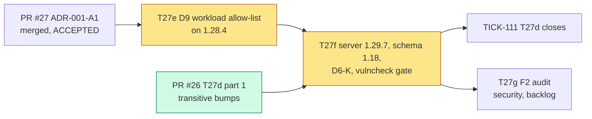
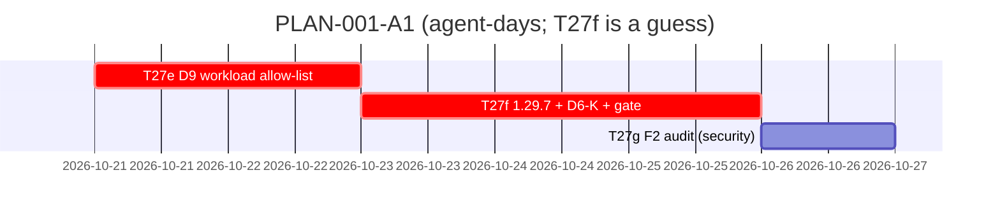

# PLAN-001-A1: ADR-001 amendment A1

## Summary

**What ships:** the D9 workload allow-list in the Authorizer, then the move to Temporal server v1.29.7 / api v1.53.0 with schema 1.18, the D6-K startup guard and `vulncheck-temporal-server` as a required CI step. All of it sits under story S7 (TICK-49), next to T27d (TICK-111).

**Order:** T27e (D9, on today's 1.28.4) → T27f (1.29.7 + D6-K + gate). Two tasks, two PRs, strictly in that order. T27d (TICK-111) closes when T27f merges, because that is when the gate goes on.

**The one risk that matters most:** S1, cross-tenant terminate through `temporal-sys-batch-workflow`. It is live on `main` today, on 1.28.4, and the upgrade alone doesn't fix it. So D9 goes first and doesn't wait for the version move.

**Second risk:** T27f compiling against 1.29.7. `authorization.NewInterceptor` changed its signature, and five new API methods must be classified. The ADR's verification notes say nobody has built or run against 1.29.7 yet. The estimate for T27f is a guess.

## Decisions this plan makes

| # | Decision |
|---|---|
| **D-A1-1** | **Split RFC-002 §9's single T27d PR into T27e (D9) then T27f (upgrade).** D9 is version-independent (the ADR says it's needed on every version) and closes a live High finding, so it shouldn't wait behind the riskiest build change. Each PR fits one run. The ADR's "Done means" still holds: CI-A to CI-I are all green on T27f's PR, because T27e's tests stay in the suite and run against 1.29.7 there. |
| **D-A1-2** | **Allocation of the acceptance tests.** T27e: CI-C (golden D9 sub-table), CI-H, CI-I, and the D9 part of CI-G (smoke renamed to `nava.smoke.Echo` on `nava-tq`). T27f: CI-A, CI-B, CI-C (drift at api v1.53.0, five new methods in `deniedByDefault`), CI-D, CI-E, CI-F, CI-G (`1.29.7`, schema 1.18, shipped D6-K values), plus CI-H and CI-I passing again on the 1.29.7 image. |
| **D-A1-3** | **E4 closed: no 1.28.4 data needs keeping.** M1 is single-node and dev-only, and no environment holds data we have to preserve. T27f still proves schema-before-binary in place: an existing 1.28.4 dev volume upgrades to schema 1.18 through the compose `temporal-schema` service, and an in-flight execution survives (I6). *Trigger to revisit:* the first non-dev deployment. That one gets a runbook, together with F1. |
| **D-A1-4** | **RS5 accepted as written.** Every new workflow type or task queue is a policy PR (Security reviews) plus an image rebuild. *Trigger:* more than about one such change a week, or PLAN-002's workflow interpreter (Epic 09) needs a type per definition. Either one reopens the question with the triad. Owner: Technical Lead. |
| **D-A1-5** | **D6-K values go into both dynamic-config files**: `temporal-server/config/dynamicconfig/development.yaml` and `deploy/compose/temporal/config/dynamicconfig/compose.yaml`. CI-G runs the compose stack, so a key set only in `development.yaml` would never be tested. |
| **D-A1-6** | **No grooming meeting.** The tasks are lifted directly from an ADR that already went through two review rounds with the Principal Software Engineer's commits (`6c16dc0`) and Security's tests (`37b7bf4`, `f39e0a3`). The PR reviews (Technical Lead + Security) carry that weight instead. |
| **D-A1-7** | **F2 becomes a backlog task for Security (T27g).** It isn't part of A1. It is released after T27f, so it audits the final 1.29.7 surface. F1 isn't a task: its trigger is "before any multi-node deployment", recorded in the decision log. |

## Task graph

**Critical path:** T27e → T27f. PR #26 is approved and labelled `MergePr` already, so it isn't expected to gate T27f.

**Estimates:** T27e 1–1.5 agent-days. The rules are fully specified, and the failing tests already exist at `37b7bf4` and `f39e0a3`. T27f 1.5–3 agent-days. *Assumption:* the 1.29.7 server builds with our Authorizer after the `NewInterceptor` argument change and nothing else. *Guess:* it could double if the CI-D suite surfaces SDK v1.49.0 ↔ 1.29.7 behaviour (RS3) or a system workflow breaks under D6-K (RS4). Total: about 3–5 working days.

## Tasks

| Task | Issue | Role | Depends on | ADR parts |
|---|---|---|---|---|
| T27e | TICK-120 | `core-dev` | PR #27 merged | D9a/b/c, Annex A.2 sub-table |
| T27f | TICK-121 | `core-dev` | T27e, PR #26 merged | Decision 1–4, 6; D6-K |
| T27g | TICK-122 | `security` | T27f | Follow-up F2 |

Reviews: the Technical Lead (`change-review`, core standard) plus the Security & Multi-Tenancy Reviewer on T27e and T27f, since both change the tenant-isolation module.

## Invariant coverage

| Invariant | Enforced by |
|---|---|
| I2 | T27e (D9). CI-H shows S1 is closed end to end. |
| I6 | T27f, through the in-place schema upgrade check (D-A1-3) and CI-D |
| D22 | T27e (workload allow-list), T27f (drift: new methods deny by default) |

Nothing that enforces an invariant is cut.

## The cut

- **F1** (mixed-version 1.28/1.29 node smoke): deferred. *Trigger:* before any multi-node deployment. Owner: Technical Architect.
- **RS1** (1.29 support horizon): no task. *Trigger:* an unfixed advisory, a 1.29 end-of-support announcement, or M2 planning. Owner: Technical Lead.
- **1.30.8 / 1.31.4:** rejected by the ADR. They are the next step under RS1.
