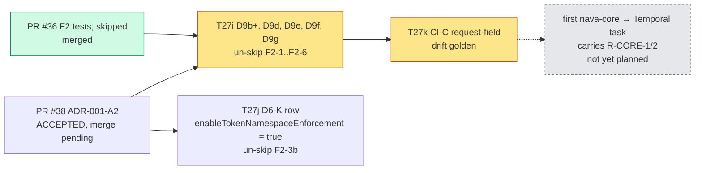
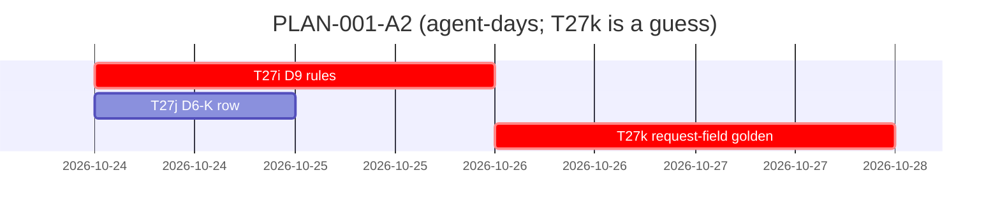

# PLAN-001-A2: ADR-001 amendment A2

## Summary

**What ships:** the D9 additions (D9b+, D9d with its query clause, D9e, D9f, D9g) in the Authorizer, the `frontend.enableTokenNamespaceEnforcement` D6-K row (must be `true`), and the widened request-field drift golden (CI-C). Together they un-skip every F2 test from PR #36. All three tasks sit under story S7 (TICK-49), next to T27e–T27h.

**Order:** T27i (D9 rules) and T27j (D6-K row) run in parallel. T27k (drift golden) follows T27i. Three tasks, three PRs.

**The one risk that matters most:** none of the F2 findings crosses tenants, and each one needs a stolen service certificate (ADR: "urgency is normal"). The delivery risk is **T27k's descriptor walk**. `Failure.cause` is recursive, so a naive walk never ends. And every field must be classified, so the golden is large. The estimate for T27k is a guess.

**Not in this plan:** R-CORE-1 and R-CORE-2. They bind the first `nava-core` change that calls Temporal, and no planned task does that yet (see D-A2-4).

## Decisions this plan makes

| # | Decision |
|---|---|
| **D-A2-1** | **Split the ADR's single `core-dev` acceptance into three tasks by outcome.** T27i: the D9 rules, which un-skip the F2-1 to F2-6 Authorizer tests. T27j: the D6-K `want bool` row, which un-skips F2-3b. It only touches `cmd/server`, so it runs in parallel. T27k: the CI-C drift golden. Each one fits a single run and can be tested on its own. The ADR's acceptance list holds in full once all three merge. |
| **D-A2-2** | **T27k comes after T27i, not alongside it.** The golden's classification column names the D9b+/D9d/D9e/D9f/D9g rule for each field, so it needs those rules to exist. Both tasks also edit `policy_test.go`. Running them in sequence avoids a rebase fight for the price of about one day. |
| **D-A2-3** | **`allowlist.golden.md` is regenerated in T27i** (it lists the rules), and the **request-field golden is new in T27k** (a separate file in `testdata/`). Each PR's golden diff matches its own change. |
| **D-A2-4** | **R-CORE-1 and R-CORE-2 are a gate, not a task.** No M1 task makes `nava-core` call Temporal. T30b (TICK-85) is `nava-relay`, which A1's Annex A.2 already covers. The gate is recorded in the decision log, and noted on Epic 09 (TICK-12) and T23 (TICK-58, the opaque cursor that R-CORE's "opaque tokens" clause will use). The first `nava-core` → Temporal task must carry R-CORE-1 and R-CORE-2 as acceptance tests, plus the single workflow-id constructor, with the Security & Multi-Tenancy Reviewer reviewing. *Owner:* Technical Lead, at that task's planning. |
| **D-A2-5** | **No grooming meeting.** As with D-A1-6: the tasks come straight from an ADR that passed two review rounds, and the failing tests already exist on `main` (PR #36, `92d0863`). The Technical Lead and Security review on each PR carry that weight. |
| **D-A2-6** | **Every task waits for PR #38 (ADR-001-A2, ACCEPTED) to merge.** A task's issue links the ADR by repo path, so the ADR must be on `main` before work starts. |
| **D-A2-7** | **T32a (TICK-79, in progress) isn't a dependency.** It runs the CI-6 Authorizer suite against a live stack and doesn't edit `policy.go`. Whichever lands second rebases. If T32a's suite asserts that one of the F2 requests is *allowed*, that assertion flips to deny in T27i. |

## Task graph

**Critical path:** PR #38 merge → T27i → T27k.

**Estimates:**
- **T27i: 1–1.5 agent-days.** Every rule is specified field by field, and the red tests exist. *Assumption:* `token.v1.Task` and `token.v1.QueryTask` decode with the server's own token serializer at v1.29.7, and nothing more.
- **T27j: 0.5 agent-day.**
- **T27k: 1–2 agent-days.** *Guess:* the size of the field list across about 40 allow-listed request messages, and how stable the cycle printing is.
- **Total:** about 2.5–3.5 working days on the critical path.

## Tasks

| Task | Issue | Role | Depends on | ADR parts |
|---|---|---|---|---|
| T27i | TICK-131 | `core-dev` | PR #38 merged | D9b+, D9d (both clauses), D9e, D9f, D9g; A1 sentence change |
| T27j | TICK-132 | `core-dev` | PR #38 merged | D6-K addition (F2-3b) |
| T27k | TICK-133 | `core-dev` | T27i (TICK-131) | Drift golden (CI-C), the "Known at api v1.53.0" note |

Reviews: the Technical Lead (`change-review`, core standard) plus the Security & Multi-Tenancy Reviewer on all three, because all three change the tenant-isolation module or its guard.

## Invariant coverage

| Invariant | Enforced by |
|---|---|
| I2 | T27i (D9d/e/f/g: service certificates reach only `t:<tenant>:` workflows and platform queues); T27k (an unclassified field fails CI); R-CORE gate (D-A2-4) |
| I5 | R-CORE gate (D-A2-4) |
| I6 | T27i (D9b+ removes the server-side deployment-workflow start); CI-D/CI-G smoke, including graceful worker shutdown, stays green on every PR |
| D22 | T27i, T27k |

Nothing that enforces an invariant is cut. R-CORE isn't cut. It's moved to the task it constrains, because a test of "`nava-core` builds ids from the JWT tenant" can't exist before `nava-core` builds any ids.

## The cut

- **R-CORE-1 / R-CORE-2:** deferred to the first `nava-core` → Temporal task (D-A2-4). *Trigger:* that task is planned. Owner: Technical Lead. Security reviews it (RS6).
- **RS7** (one worker pod can unload a sibling's sticky queue): accepted by the ADR. *Trigger:* per-pod or per-tenant worker certificates. Owner: Security & Multi-Tenancy Reviewer.
- **`ShutdownWorkerRequest.TaskQueue` classification:** not possible at api v1.53.0. *Trigger:* the api bump that adds it. T27k's golden fails, and that policy PR classifies it as "platform queue". Owner: whoever does the bump; Security reviews.
