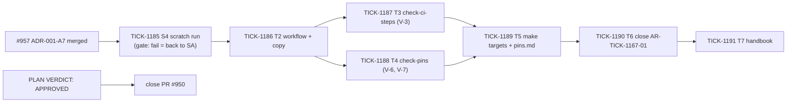
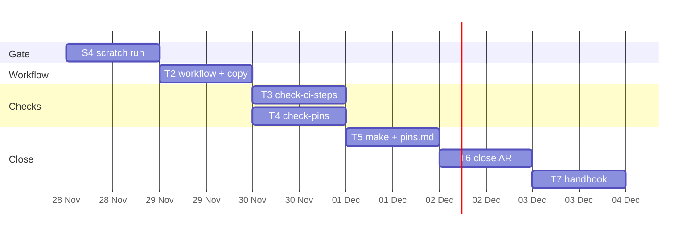

# PLAN-001-A7: ADR-001 amendment A7

## Summary

**What ships:** the two scan jobs of `govulncheck.yml` run `go run golang.org/x/vuln/cmd/govulncheck@v1.9.0 ./...` with every Go setting in the step's `env:`, on setup-go v6. `check-ci-steps` refuses any `make` in that workflow and stops reading make. `check-pins` holds the three copies of the govulncheck version to one string and refuses a tracked `vendor/` or stray `go.mod`. Local `make vulncheck` runs the same command line. `AR-TICK-1167-01` is closed.

Seven tasks, no story (precedent D-E4-1: build tooling nobody tries by hand). Each task PR targets `main`.

| Item | Task | Issue | Role / owner | Outcome | Proves |
|---|---|---|---|---|---|
| 1 | S4 | TICK-1185 | `qa` | scratch run: empty `GOFLAGS` despite `$GITHUB_ENV`, go1.27.4 in both modules, v1.9.0 builds, non-zero exit on a finding, build time | A7.5 |
| 2 | T2 | TICK-1186 | `qa` | `govulncheck.yml` and its copy: direct scan step, setup-go v6, no make, one PR | A7.1; rules 7, 9 |
| 3 | T3 | TICK-1187 | `qa` | `check-ci-steps`: no `make` in any `run:`; `pinnedRecipes` and `checkMakeDatabase` deleted | A7.3; **V-3** (amended) |
| 4 | T4 | TICK-1188 | `security` | `check-pins`: one version, exactly one line per scan job; `go.mod` / `vendor/` layout | A7.2; rule 7; **V-6**, **V-7** |
| 5 | T5 | TICK-1189 | `qa` | `make vulncheck` / `vulncheck-temporal-server` (and Taskfile) run the workflow's command; `docs/pins.md` exception | A7.3; R-A7-3 |
| 6 | T6 | TICK-1190 | `security` | `AR-TICK-1167-01` closed in `docs/security/accepted-risks.md` | A7.6 |
| 7 | — | PR #950 | Technical Lead | PR #950 (TICK-1167) closed unmerged with a pointer to A7 (D-A7-2) | A7.3 "retired" |
| 8 | T7 | TICK-1191 | Technical Lead | Handbook: `adr-001-e4.md` and the accepted-risks page; build passes | handbook gate |

**The one risk that matters most:** a window on `main` in which the scan job still runs make but the make recipes are no longer pinned (or the inverse, a red `main`). The order below closes it: the workflow stops running make (T2) **before** the recipe pins are deleted (T3), and the recipes change (T5) only after the pins are gone. T2 alone keeps `check-ci-steps` green because the pins still describe today's unchanged recipes.

## Order

- **S4 gates everything.** If any of its criteria fails, S4 goes `blocked` and back to the Solution Architect; no later task works around it.
- **T2 before T3** (acceptance criterion: items 2 and 3 land together or 2 first). T3's new assertion would be red on today's workflow, and T3 deletes the recipe pins, which must not happen while the workflow still runs make.
- **T3 and T4 in parallel** after T2: different packages (`tools/ci/cisteps` vs `tools/ci/checkpins`), no shared file.
- **T5 after T3 and T4:** new recipes would fail the TICK-1149 pins until T3 deletes them; `docs/pins.md` is read by T4's version check, so the check lands first and guards T5's edit.
- **T6 after T2 to T5**, T7 last.

**Estimate:** 4 to 6 working days end to end, one task per day on the critical path S4 → T2 → T3 → T5 → T6 → T7. Each task is 0.25 to 1 day of work; the range is driven by CI turnaround and review rounds, not code size (a guess, based on PLAN-001-E4's pace).

## Decisions this plan makes

| # | Decision |
|---|---|
| **D-A7-1** | **No story; tasks only, parented to TICK-1184, PRs into `main`** (D-E4-1 precedent). The handbook gate still applies through T7. |
| **D-A7-2** | **PR #950 (TICK-1167) is closed unmerged on plan approval**, by the Technical Lead, with a comment pointing to ADR-001-A7. It has no approving review, and the issue's default applies. So none of its additions reach `main`, and A7.3's "retired: the additions of PR #950" needs no task. |
| **D-A7-3** | **`AR-TICK-1167-01` exists only on PR #950's branch.** T6 adds it to the register already closed, with the closing reason and commit, so the history is kept although #950 never merged. |
| **D-A7-4** | **The make-word test is per line of the `run:` value** (`(^|[\s;&|(])make(\s|$)`), so a second line of a block scalar is caught and `cmake` / `automake` are not. |
| **D-A7-5** | **The Taskfile `vulncheck` task follows the make target** (D-E4-8 precedent): local scans agree. `scripts/ci/vulncheck.sh` (`vulncheck-ci`, used by `ci-lint`) is unchanged; A7.3 keeps it out of the contract. |
| **D-A7-6** | **S4 uses `golang.org/x/text` v0.3.5 with `language.Parse` (GO-2021-0113)** as the known reachable finding, in a throwaway module under `$RUNNER_TEMP`; the scratch workflow lives only on a deleted scratch branch. |
| **D-A7-7** | **Reviews:** Security reviews T2, T3 and T4 (gate files, RS3); Quality reviews T4 and T6; the Technical Lead reviews T5 and owns T7. CI results come from the Quality, Testing & CI Advisor in GitHub Actions, never from a local `make ci`. |
| **D-A7-8** | **No grooming meeting.** The acceptance criteria are A7's own tests (V-3, V-6, V-7) and S4's five checks, already reviewed by the Technical Architect on TICK-1183. A readiness pass on all seven bodies answered: the scratch finding module (D-A7-6), the regex scope (D-A7-4), where the layout check sits (with `-same-go` in `checkpins`), and the missing AR row (D-A7-3). The Solution Architect's plan verdict is the check, as in D-E4-9. |

## The cut

Nothing is cut. Not in this plan, by A7's own terms: scanning `docs`, `tools/navalint`, `tools/workflowcheck` (R-A7-1, `AR-TICK-1183-01`); checks on `replace` / `exclude` / `ignore` (R-A7-2, `AR-TICK-1183-02`); any new rule about makefile features. Anything A7 does not cover goes back to the Solution Architect as an RFC.
