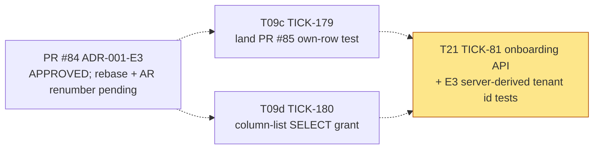
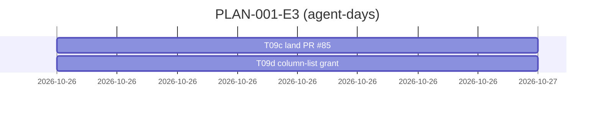

# PLAN-001-E3: ADR-001 erratum E3

## Summary

**What ships:** E3 changes words, not code. So the plan is small: land the test that pins "own row, in either state" (PR #85), narrow `nava_onboard`'s `SELECT` on `tenants` to a column list so residual RS8's first trigger closes by construction, and put E3's T21 condition into T21's acceptance tests. Both new tasks sit under story S2 (TICK-44), next to T09.

**Order:** T09c and T09d run in parallel, with no dependencies. The T21 condition is an edit to an existing backlog task (TICK-81), not a new task.

**The one risk that matters most:** T21 is where "own row" can quietly become "any row". If onboarding ever takes `app.tenant_id` from the caller, RS8 stops being Info. That test now lives in T21's acceptance list, and Security reviews T21.

## Decisions this plan makes

| # | Decision |
|---|---|
| **D-E3-1** | **PR #85 becomes task T09c (TICK-179), owned by its author.** The test is written; the task is review, rebase and merge. The Postgres & Data Modeling Specialist reviews it, because they found the drift (TICK-71). |
| **D-E3-2** | **Narrow the grant now: `nava_onboard` gets `SELECT [id, state, onboarding_request_hash, created_at]` on `tenants` (T09d, TICK-180).** Today that is the same as `SELECT: []`, so nothing changes. When a column is added later, `nava_onboard` can't read it until someone grants it on purpose. The PR #84 note says this was Delivery's call. A tripwire test that fails CI when `tenants` gains a column was the alternative. It was rejected because it fails open: it depends on someone reading the failure correctly, and a grant does not. It only narrows privilege. E3's "no grant change" covers the erratum itself and is not contradicted. |
| **D-E3-3** | **E3's T21 condition goes into T21 (TICK-81), not a new task.** The condition is that the onboarding tenant id is derived on the server, and operator 2 replaying operator 1's Idempotency-Key sees 0 rows. It can only be tested once the endpoint exists. TICK-81's description now carries it as two acceptance tests. Security reviews T21. |
| **D-E3-4** | **PR #84 must be rebased, and AR-026 renumbered, before it merges.** `main` took AR-026..AR-028 for the relay in PR #87 (TICK-74), and PR #84 now conflicts on `docs/security/accepted-risks.md`. RS8 takes the next free id (AR-029 on today's `main`). The Solution Architect owns this, along with the ACCEPTED status edit. |
| **D-E3-5** | **No grooming meeting.** As with D-A1-6 and D-A2-5: two tasks straight from an ADR that passed a review round with no blocking finding. One of the two is already written. |
| **D-E3-6** | **The tasks don't wait for PR #84 to merge.** Unlike D-A2-6, neither task implements new behaviour. T09c tests what's already on `main`, and T09d narrows a grant. Each task links the ADR by its path on the PR #84 branch until it merges. |

## Task graph

Dotted edges show context, not dependencies. T21 keeps its own PLAN-001 dependencies (T17, T18, T22, and TICK-52).

**Critical path:** none inside this plan. Each task takes one run.

**Estimates:** T09c is 0.25–0.5 agent-day, mostly rebase and review. T09d is 0.5 agent-day. *Assumption:* the grants applier and manifest test already handle column-list `SELECT`, which `nava_app` uses on `tenants` today.

## Tasks

| Task | Issue | Role | Depends on | ADR parts |
|---|---|---|---|---|
| T09c | TICK-179 | `security` | none | Consequences (D4 test) |
| T09d | TICK-180 | `postgres-dev` | none | Accepted residual RS8 (column-list trigger) |
| T21 (amended) | TICK-81 | `backend-dev` | unchanged | Condition (T21, Security round 1) |

Reviews: T09c by the Postgres & Data Modeling Specialist. T09d by the Technical Lead and the Security & Multi-Tenancy Reviewer.

## Invariant coverage

| Invariant | Enforced by |
|---|---|
| I1 tenant wall | T09c (no other tenant, no tenant set → 0 rows); existing `TestT09PolicyAllowListCatchesLeaks`; T21's E3 tests (the caller can't choose `app.tenant_id`) |
| I3 / D28 | T09d (least privilege: a new column on `tenants` isn't readable by `nava_onboard` by default) |
| CI-9 | T09c (binding an active tenant still gets 42501) |

Nothing that enforces an invariant is cut.

## The cut

- **A "tenants gained a column" tripwire test:** not built, because D-E3-2's column grant makes it unnecessary.
- **RS8 itself** (`nava_onboard` reads its own `active` row): accepted by the ADR, severity Info. *Triggers left after T09d:* onboarding stops running inside `InTenantTx(tenant)`, or T21 lets the caller influence `app.tenant_id`. Owner: the Security & Multi-Tenancy Reviewer.
