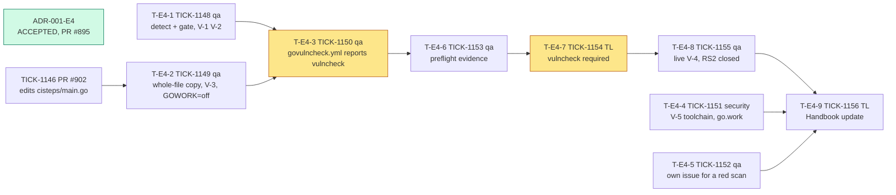
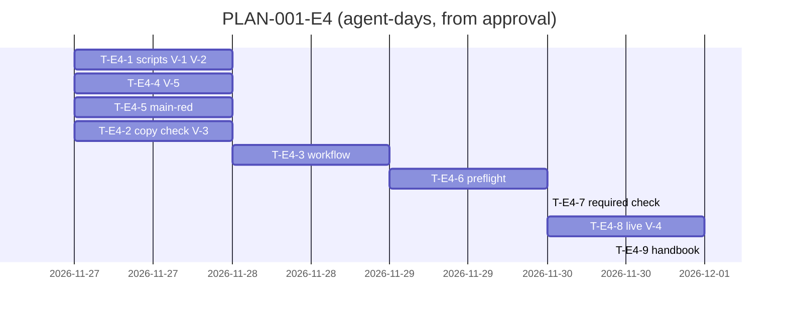

# PLAN-001-E4: ADR-001 erratum E4

## Summary

**What ships:** the `govulncheck` workflow runs on every pull request, scans only the module (or modules) the change needs, and reports one check, `vulncheck`, on pull requests into `main`. That check then becomes required, so GitHub, not only the agents' written rule (E4-3), blocks a merge with a failed scan. A red scheduled scan gets an issue of its own.

Nine tasks, no story: this is build tooling nobody tries by hand. Like TICK-1145 (PR #900), each task PR targets `main` directly.

| Task | Issue | Role | Outcome | ADR part |
|---|---|---|---|---|
| T-E4-1 | TICK-1148 | `qa` | detect and gate scripts, tests V-1, V-2 | FU1; contract rules 2, 4 |
| T-E4-2 | TICK-1149 | `qa` | `check-ci-steps` compares the whole workflow with a copy, checks the make recipes, `GOWORK=off` (V-3) | FU1; rules 7, 9 |
| T-E4-3 | TICK-1150 | `qa` | `govulncheck.yml` rewired: no `paths`, detect, gate `vulncheck`; names test reads both values; stale text fixed | FU1; rules 1, 3 to 6; E4-1, E4-5 |
| T-E4-4 | TICK-1151 | `security` | scanned Go equals shipped Go; no tracked `go.work` (V-5) | FU1; rules 7, 8; E4-2 |
| T-E4-5 | TICK-1152 | `qa` | red scheduled scan opens `govulncheck is red:`; #259 closed | FU3; RS1 |
| T-E4-6 | TICK-1153 | `qa` | preflight: `vulncheck` seen on one docs-only and one library PR | FU2 precondition |
| T-E4-7 | TICK-1154 | Technical Lead | `vulncheck` (app 15368) added to `main`'s required checks | FU2; E4-4 |
| T-E4-8 | TICK-1155 | `qa` | live V-4 (a) to (d); AR-TICK-1140-02 (RS2) closed | FU2; V-4 |
| T-E4-9 | TICK-1156 | Technical Lead | Handbook update | handbook gate |

**Order:** T-E4-1, T-E4-4 and T-E4-5 start on approval, in parallel. T-E4-2 starts when TICK-1146's PR #902 (which edits `tools/ci/cisteps/main.go`) has merged or closed. T-E4-3 needs both T-E4-1 and T-E4-2. Then T-E4-6 → T-E4-7 → T-E4-8 → T-E4-9, strictly in series.

**The one risk that matters most:** making `vulncheck` required while it does not report on every pull request. Then every merge into `main` stops (a check that never reports stays Pending). Three things guard against it: the gate job always runs and has no `paths` filter (T-E4-3, red-tested in V-3); T-E4-6 sees it report on real pull requests before T-E4-7 turns it on; and T-E4-7 records the exact undo (`PATCH` back to the saved `checks`). The opposite failure, a gate that passes without scanning, is covered by V-1 and V-3 and by Security review of every gate file (RS3).

## Decisions this plan makes

| # | Decision |
|---|---|
| **D-E4-1** | **No story; tasks only, parented to TICK-1147, PRs into `main`.** Nothing here is a slice the human can try; the precedent is TICK-1145 (PR #900). The handbook gate still applies through T-E4-9. |
| **D-E4-2** | **Names are pinned in the plan, not left to the implementers,** because three tasks share them: `scripts/ci/vulncheck-detect.sh`, `scripts/ci/vulncheck-gate.sh`, tests in `tools/ci/vulngate`, copy `tools/ci/cisteps/govulncheck.copy.yml` (replaces `required-govulncheck.yaml`), jobs `vulncheck-detect`, `vulncheck-root`, `vulncheck-temporal-server`, `vulncheck` (gate), `vulncheck-main-red`. Detect outputs `root`, `temporal_server`; gate inputs `DETECT_RESULT`, `ROOT_NEEDED`, `TS_NEEDED`, `ROOT_RESULT`, `TS_RESULT`. |
| **D-E4-3** | **Detect is slightly wider than the contract's table, never narrower:** `tools/ci/vulngate/` (the gate's tests) counts as the gate, any `Dockerfile*` counts as a Dockerfile, `go.work.sum` counts with `go.work`, and the diff uses `--no-renames` so a rename shows both paths. Each costs at most an extra scan. |
| **D-E4-4** | **FU1 is split by outcome into four tasks** (T-E4-1 to T-E4-4) so each fits one run and can be tested alone: the scripts are tested before anything calls them, the copy check is tested on today's workflow, and V-5 touches only `tools/ci/checkpins`. |
| **D-E4-5** | **V-5 lives in `tools/ci/checkpins/main.go`,** so `make check-pins` in `ci-lint` enforces it on every pull request, not only `task test`. |
| **D-E4-6** | **FU2's precondition is its own task (T-E4-6)** with an evidence file, and the live V-4 is another (T-E4-8). Turning the check on is a one-call repository setting the Technical Lead owns (ADR FU2), applied with the token's admin rights, as the 2026-10-28 protection was (decision log, TICK-288). |
| **D-E4-7** | **V-4 (c) is built to give a green `vulncheck-other` on the same head commit** as the red pull request into `main` (head `X` on top of library commit `L`, story branch at `L`). That is the case rule 5 exists for: a green result from another base must not unblock the merge. |
| **D-E4-8** | **`GOWORK=off` also goes into `scripts/ci/vulncheck.sh` and the Taskfile `vulncheck` task,** so a local or `ci-lint` scan sees the same versions as the workflow (rule 7). |
| **D-E4-9** | **No grooming meeting.** The acceptance criteria are the contract's rules and tests, already reviewed by the Technical Architect and Security on PR #895. A readiness Goldfish ran on all nine bodies before creation; its blockers (diff renames, the stub's `--jq`, the `checkpins` entry point, V-4 (c) construction, stale `main-red` text) are answered in the bodies. The Solution Architect's plan verdict is the check, as in D-E9-7. |

## Interface contracts

The binding contract is `docs/adr/ADR-001/E4/vulncheck-contract.md`. This plan adds only the pinned names (D-E4-2) and these two seams:

```text
vulncheck-detect.sh   env EVENT, BASE_SHA, HEAD_SHA
                      >> $GITHUB_OUTPUT  root=true|false
                                         temporal_server=true|false
                      exit != 0 on a pull_request with no merge base or empty SHAs

vulncheck-gate.sh     env DETECT_RESULT, ROOT_NEEDED, TS_NEEDED, ROOT_RESULT, TS_RESULT
                      exit 0 iff DETECT_RESULT=success and, per module,
                      (NEEDED=true and RESULT=success) or (NEEDED=false and RESULT=skipped)
```

T-E4-1 produces both scripts; T-E4-3 consumes them. T-E4-2 produces the copy check; T-E4-3 updates the copy in the same commit as the workflow.

## Task graph



**Critical path:** PR #902 → T-E4-2 → T-E4-3 → T-E4-6 → T-E4-7 → T-E4-8 → T-E4-9. T-E4-1 runs beside T-E4-2 and is shorter.



**Estimates:** 5 to 7 agent-days of work, about 4 to 5 calendar days with the parallel start. T-E4-1, T-E4-2, T-E4-3: 0.5 to 1 day each. T-E4-4, T-E4-5, T-E4-6, T-E4-8: 0.25 to 0.5. T-E4-7, T-E4-9: under 0.25. *Assumption:* PR #902 merges by 2026-11-27; each day it slips moves the critical path a day. *Guesses:* T-E4-3 (first workflow with an expression in a required job name here) and T-E4-8 (finding a reachable advisory for (b) can take a few tries).

## Reviews

| Task | Reviewers |
|---|---|
| T-E4-1, T-E4-2, T-E4-3 | Principal Software Engineer; Security & Multi-Tenancy Reviewer (gate files, RS3) |
| T-E4-4 | Quality, Testing & CI Advisor |
| T-E4-5 | Principal Software Engineer |
| T-E4-6, T-E4-7, T-E4-8 | Security & Multi-Tenancy Reviewer |
| T-E4-9 | Quality, Testing & CI Advisor; Security for the accepted-risks references |

CI for every PR: GitHub Actions, confirmed by the Quality, Testing & CI Advisor. Locally only `task test` and `task lint`.

## Invariant coverage

E4 touches no tenant data, identity or runtime path; I1 to I9 are unchanged (ADR Consequences). What this plan protects is the build guarantee that a known flaw does not reach `main`:

| Guarantee | Enforced by |
|---|---|
| A failed scan blocks a merge into `main` | T-E4-3 (gate), T-E4-7 (required), T-E4-8 (proved live) |
| A skip or cancel is never a pass | T-E4-1 V-1 |
| The right module is scanned | T-E4-1 V-2 |
| An edit to one gate file is caught | T-E4-2 V-3, T-E4-3 V-3 gate cases |
| The scanned Go and libraries are the shipped ones | T-E4-4 V-5, T-E4-2 `GOWORK=off` |
| A red scan is seen | T-E4-5 |

Nothing that enforces one of these is cut.

## The cut

- **RS3 is not closed.** A pull request that edits the gate and its copy together can still report green without a scan. No GitHub setting we have prevents it; Security review of every gate file stays the control (owner: Security & Multi-Tenancy Reviewer; trigger: a second collaborator or required approvals exist, or an unreviewed gate edit reaches `main`).
- **RS1 stays at about 50 h** between scheduled scans: the owner's two-day schedule (TICK-694) is not changed. T-E4-5 only makes a red run visible on its own issue.
- **The interim rule E4-3 stays in force until T-E4-7 is applied,** and its "read every check run on the head commit" part until TICK-1146's fix merges. Agents keep following it on any library pull request in the meantime.
