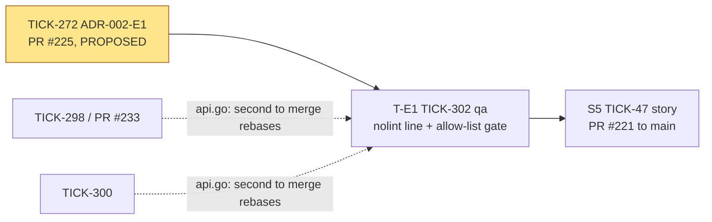
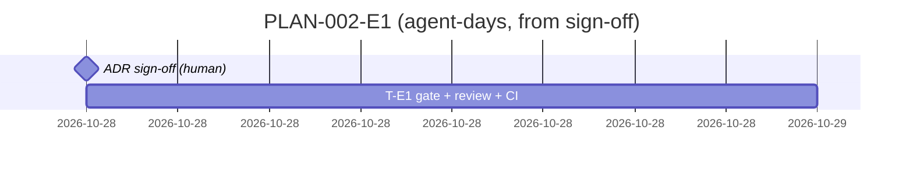

# PLAN-002-E1: ADR-002 erratum E1

## Summary

**What ships:** one Delivery task, T-E1 (TICK-302, `qa`). It removes the `forbidigo` exclusion for `internal/server/api.go` and puts a single `//nolint:forbidigo` on the `GetMe` → `GroupPaths` call line. It also turns on `nolintlint` and adds `scripts/ci/nolint-allowlist.sh` to `make lint`. The script fails on a second waiver, a wider exclusion, or a fake generated-file header. There is no runtime change. The gate script is already written and tested 17 out of 17 in the ADR's spike (`gate-cases.md`), so the task is to copy it in, wire it up and prove it red to green.

**Order:** T-E1 starts when nava signs ADR-002-E1 (TICK-272). Nothing else blocks it.

**The one risk that matters most:** the S5 story merging to `main` while it still carries the file exclusion. That would put residual R-b on `main`. D-E1-2 handles this by putting T-E1 under S5, plus a fallback if the sign-off comes late.

## Decisions this plan makes

| # | Decision |
|---|---|
| **D-E1-1** | **One task, as ADR §Consequences says, owned by `qa`.** The change is lint config, a CI script, and the Makefile and Taskfile wiring, which is CI work. ADR-002 itself was `backend-dev` (TICK-268), but this erratum adds no feature code. The Security & Multi-Tenancy Reviewer reviews it: they raised finding 2 on PR #204 and reproduced F3. |
| **D-E1-2** | **T-E1 goes under story S5 (TICK-47) and targets the S5 story branch.** The exclusion, the `GetMe` caller and the `GroupPaths` rules exist only on `TICK-47/group-changes-within-10-minutes`, not on `main`. Fixing it there means `main` never carries R-b. **Fallback:** if TICK-272 is still unsigned when every other S5 task is `done`, T-E1 does not hold up S5 acceptance. It is re-parented out of S5, waits for S5 to merge, and then targets `main` as a standalone task, like TICK-289. The Technical Lead makes that call on S5's acceptance run. |
| **D-E1-3** | **Shared file within S5: `internal/server/api.go`.** TICK-298 (PR #233) and TICK-300 also edit it. T-E1 changes one line in `GetMe`, and the others change the router and middleware block. The rule from PLAN-002 applies: they run in parallel, and whichever merges second rebases. This is an overlap between tasks inside one story, not between stories, so the story-independence rule is not engaged. |
| **D-E1-4** | **`docs/security/accepted-risks.md` stays with the ADR PR.** PR #225 already adds R-e as AR-039, so T-E1 must not touch that file. |
| **D-E1-5** | **No grooming meeting.** As with D-E3-5 and D-A2-5, this is one task straight from an erratum. Both reviewers approved it in round 2, and its acceptance criteria were already listed in the ADR and tested in a spike. |
| **D-E1-6** | **The `navalint` `grouppaths` analyzer stays deferred,** as the ADR records (R-e trigger: a second `forbidigo` waiver is needed, or the directive line is moved once). Owner: the Solution Architect. This plan creates no task for it. |

## Task graph

Solid arrows are dependencies. Dotted arrows show a shared file, not a dependency.

**Critical path:** nava's sign-off → T-E1 → S5 acceptance. The sign-off is the only wait.

**Estimate:** T-E1 takes 0.5 to 1 agent-day. *Assumption:* the spike's script runs unchanged on the story-branch head. If TICK-281's merge of `main` adds a new generated file or a new `forbidigo` directive, the gate's allow-list needs that edit too, which adds a review cycle. That part is a guess.

## Tasks

| Task | Issue | Role | Depends on | ADR parts | Reviewer |
|---|---|---|---|---|---|
| T-E1 | TICK-302 | `qa` | TICK-272 (signed) | Decision 1–4; Consequences AC1–AC5 | Security & Multi-Tenancy Reviewer |

Files T-E1 changes: `.golangci.yml`, `internal/server/api.go` (one line), `scripts/ci/nolint-allowlist.sh` (new), `Makefile`, `Taskfile.yml`, `tools/ci/suiteran/main_test.go` (one unused directive).

## Invariant coverage

| Invariant | Enforced by |
|---|---|
| I5 (one authorization layer) | T-E1. Only one line in production may read group paths. `forbidigo` covers other files and packages, and the gate covers `api.go` and the config (ADR table "How a second `GroupPaths` caller is caught"). |
| I1–I4, I6–I9 | Not touched. There is no runtime change. |

Nothing that enforces an invariant is cut.

## The cut

- **The `navalint` analyzer** (D-E1-6) is deferred, with the trigger and owner recorded in the ADR.
- **The `awk` change for F1** is out of scope, by the CTO's ruling on TICK-272. `nolintlint` plus the exact-line gate already makes F1 fail.
- **Coverage of `_test.go` files** is excluded by the ADR: `forbidigo` stays off for tests.
