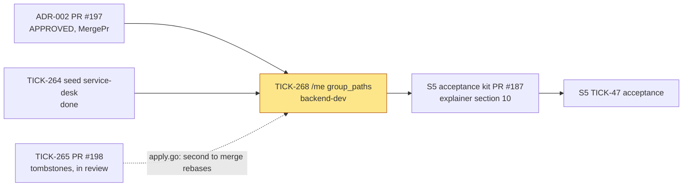
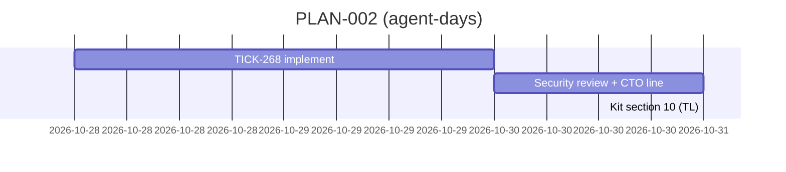

# PLAN-002: ADR-002, `/me` shows the caller's group paths

## Summary

**What ships:** `GET /api/v1/me` gains `group_paths: [{id, path}]`, tenant-scoped, membership-scoped, with the `/t/<tenant>` prefix stripped. With it, story S5 (TICK-47) step 1 passes as written: Alice sees `/service-desk`.

**Shape:** one implementation task, as ADR-002 §4 asks. It already exists: **TICK-268** (`backend-dev`, under S5, in `backlog`). This plan rewrites its description so it stands alone, and fixes three gaps the ADR leaves to Delivery (D-002-3 to D-002-5).

**The one risk that matters most:** the membership scope. If `GroupPaths` ever reads by group id instead of by principal, any member can list every group in the tenant (ADR-002 §8, isolation finding S2). AC2's exact-membership-set assertion and AC5's `Denied` path are what catch it, so neither may be cut, and Security reviews the PR.

## Decisions this plan makes

| # | Decision |
|---|---|
| **D-002-1** | **One task: TICK-268.** Split by outcome there is only one outcome (`/me` returns `group_paths`); the lint rule, the `Principal` test and TODO-013 have nothing to guard until the port exists. Estimate 1–1.5 agent-days, at the top of the one-run size. *Assumption:* the isolation runner and the SQL `Path` registry take a new case without new harness code. If the implementer finds otherwise, they split off the isolation work as TICK-268b, not cut it. |
| **D-002-2** | **TICK-268 restarts from the story branch.** `origin/TICK-268/me-group-paths` holds `df3db91` (already on the story branch as PR #191) and `62d604e`, which changed `groups` itself and is not the design. The implementer resets the branch onto `origin/TICK-47/group-changes-within-10-minutes` and reuses parts of `62d604e` only where they match ADR-002. Force-pushing their own task branch is allowed. |
| **D-002-3** | **The S5 explainer edit moves out of TICK-268.** Its old description asked it to update section 10 of the S5 explainer, which PR #187 (S5 acceptance kit) also edits. The Technical Lead updates section 10 in PR #187 after TICK-268 merges, so no two open PRs touch that file. |
| **D-002-4** | **AC5 edits `internal/tenancy/isolation/registry.go`, a CTO sign-off path the ADR did not list.** ADR §6 covers `http_isolation_test.go` and `seed.sql` only. The change is one added `sql(... "nava_app", Denied, ...)` entry, nothing removed or skipped. The implementer asks the CTO on TICK-268 for sign-off on that line, citing ADR-002 AC5, before the PR merges. `make review-paths` will print `CTO sign-off required: yes`. |
| **D-002-5** | **TICK-268 runs alongside TICK-265 (PR #198); whichever merges second rebases.** Both touch `internal/groupsync/apply.go`, but TICK-268 only replaces `tenantPrefix` with `identity.TenantGroupPrefix` (ADR §3). Serialising on it would block TICK-268 behind an unrelated review for a three-line conflict. |
| **D-002-6** | **No grooming meeting.** As with D-A1-6, D-A2-5 and D-E3-5: one task from an ADR that passed two review rounds and was approved with no open finding. |
| **D-002-7** | **TODO-013 takes the next free number when the PR merges** (ADR AC9). Today `main` stops at TODO-009 and TODO-010 to TODO-012 are claimed on open branches. The implementer re-checks open PRs before merging, and the `TODO(TODO-013)` comment on `GroupPathReader` follows whatever number the row gets. |

## Task graph

Solid edges are dependencies; the dotted edge is a merge-order note only. Both of TICK-268's prerequisites are already met.

**Critical path:** TICK-268 → S5 acceptance kit → S5 acceptance. TICK-268 is now the last code task blocking S5 step 1; TICK-263 and TICK-267 block other steps.

**Estimates:** TICK-268 is 1–1.5 agent-days (a guess anchored on `62d604e`, which did the handler and store half in one run). Review is 0.5 day because of the protected paths.

## Tasks

| Task | Issue | Role | Depends on | ADR parts | Reviewer |
|---|---|---|---|---|---|
| `/me` returns `group_paths` | TICK-268 | `backend-dev` | TICK-264 (done), ADR-002 approved (done) | §1–§5, all ten ACs | Security & Multi-Tenancy Reviewer (security paths `internal/identity/`, `.golangci.yml`; isolation suite), CTO for the `registry.go` line |

Files TICK-268 is expected to change: `api/openapi.yaml` and the generated server code, `internal/identity/` (prefix helper, `GroupPathReader`, `Principal` field-set test), `internal/identity/pgstore/`, `internal/groupsync/apply.go`, `internal/server/api.go` and its tests, `internal/platform/apidiff/apidiff_test.go`, `internal/tenancy/isolation/{http_isolation_test.go,registry.go,testdata/seed.sql}`, `.golangci.yml`, `docs/delivery/todo.md`. Overlap with open S5 work: `apply.go` with PR #198 (D-002-5). No other open story touches these files.

## Invariant coverage

| Invariant | Enforced by |
|---|---|
| I1 tenant wall | AC2 (B-only marker never appears; exact membership set), AC5 (`nava_app` with a wrong-tenant predicate gets 0 rows) |
| I2 tenant source | The handler takes tenant and principal from the resolved `Principal`; the forged-tenant `/me` paths in `registry.go` must still pass (AC2) |
| I5 one authorization layer | AC7 (`Principal` field set pinned), AC8 (lint rule red then green), TODO-013 (ACL compiler takes uuids only) |

Nothing that enforces an invariant is cut.

## The cut

- **A per-function lint scope** (only `GetMe`, not all of `api.go`): accepted by the ADR as R-b. Review of `api.go` is the control.
- **The ACL-compiler test** that paths never reach authorization: deferred to TODO-013. *Trigger:* the first I5 ACL compiler PR. *Owner:* the I5 ACL epic.
- **`GET /api/v1/groups/{id}`:** rejected by the ADR (§8); needs its own ACL design.
