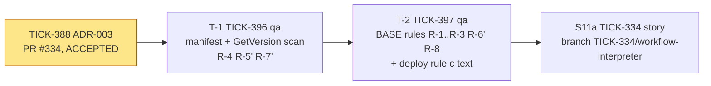
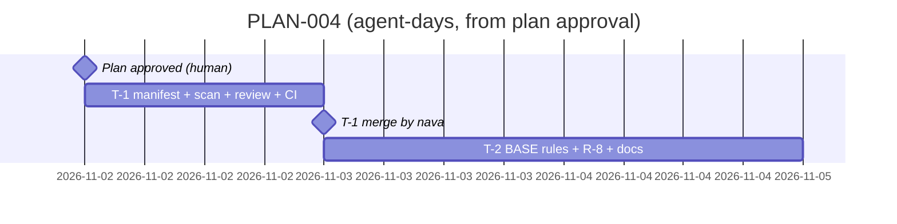

# PLAN-004: ADR-003, retiring recorded histories

## Summary

**What ships:** two Delivery tasks under story S11a (TICK-334), both `qa`, both test code, testdata and docs only:

- **T-1 (TICK-396):** the empty manifest `internal/workflow/testdata/retired-histories.json`, a strict decoder, the `GetVersion` AST scan by import path, and `TestRetiredHistoriesManifest` (schema, R-4, R-5′, R-7′, no `BASE`).
- **T-2 (TICK-397):** `TestHistoriesAppendOnly` gains R-1 to R-3, R-6′ and R-8 against `BASE`, every RFC-007 §3.4 case red then green, and the binding `ci-pipeline.md` "Deploy rules (c)" text plus the three comment changes.

There is no production code change. PLAN-003 rows D-3-25 and D-3-17 (ADR §4, AC 5) already land with the ADR PR #334, and RS-1 is the CTO's (R-004, PR #341). This plan creates no task for either.

**Order:** T-1 → T-2. Nothing else blocks T-1.

**The one risk that matters most:** R-8 is the only rule that needs a Temporal replay, and its red cases depend on reproducing the spike's TMPRL1100 with an interceptor over `signal.json`, with no recording. If that pattern does not carry over into a scratch-repo test, T-2 grows. The spike already produced the exact error on all four timer histories at `main` 69f3a62, so this is a known path, not an unknown.

## Decisions this plan makes

| # | Decision |
|---|---|
| **D-4-1** | **The tasks go under story S11a (TICK-334) and target its branch `TICK-334/workflow-interpreter`.** The replay gate, `histories_test.go`, `replay_test.go`, `make/workflow.mk` and the `ci-pipeline.md` "Deploy rules" section exist only on that line (PR #331), not on `main` (ADR §4, §8). A separate story would touch the same files, so under the story-independence rule it would have to wait for S11a to reach `main`. **Fallback:** if T-1 or T-2 is not `done` when every other S11a task is, they do not hold up S11a acceptance. They are re-parented out of S11a, wait for S11a to merge, and then target `main` as standalone tasks. The Technical Lead makes that call on S11a's acceptance run. |
| **D-4-2** | **Two tasks, split by outcome, not one.** T-1 is independently mergeable and useful on its own (the manifest exists and R-4/R-5′/R-7′ run on every laptop). T-2 is the git- and replay-based half. Together they are about 1.5 to 2.5 agent-days, too large for one run. The interface between them (the decoder, the scanner, the R-4/R-5′ check) is fixed in T-1's issue as Go signatures, so T-2 starts without asking. |
| **D-4-3** | **Owner `qa`, reviewer Principal Software Engineer.** The work is the replay gate's own test code, which `qa` built in TICK-350. The reviewer is the Principal Software Engineer because R-7′ and R-8 reach into how `nava.interpreter` uses the SDK. The Technical Architect is not asked to review the tasks: they review the first real retirement PR, as ADR §3.3 says. |
| **D-4-4** | **T-1's PR creates `retired-histories.json`, so it gets `MergePr` and the human owner merges it.** ADR §1.4 says agents never merge a PR that touches the manifest. Creating the file with `"retired": []` is the literal case. The cost is one human merge, and it keeps the rule exceptionless from the start. T-2 does not touch the manifest, so normal task policy applies. |
| **D-4-5** | **No grooming meeting.** As with D-E1-5, D-E3-5 and D-A2-5: two tasks straight from an accepted ADR whose acceptance criteria (RFC-007 rev 1 §6) and red-then-green case list (§3.4) were written and checked by the Technical Architect before sign-off. |
| **D-4-6** | **No new tasks for ADR §4's other consequences.** D-3-25 and the D-3-17 rule (c) wording are already in PR #334. The `docs/cto/risks.md` entry for RS-1 is the CTO's (R-004, PR #341). The deferred `TemporalChangeVersion` query refinement (RS-2) and retiring a non-default version (RS-3) have triggers and owners in ADR §7, and no task until those triggers fire. |

## Task graph

**Critical path:** T-1 (including nava's merge, D-4-4) → T-2 → S11a story PR.

**Estimates:** T-1 is 0.5 to 1 agent-day. *Assumption:* `go/parser` plus the file's import specs is enough, with no `go/types`, because R-7′ only allows literals. T-2 is 1 to 1.5 agent-days. *Assumption:* the spike's `NewTimer` interceptor gives TMPRL1100 inside a `worker.WorkflowReplayer` in a unit test, as it did in the spike. The T-2 range is a guess. If the interceptor needs a recorded history instead, add 0.5 day.

## Tasks

| Task | Issue | Role | Depends on | ADR parts | Reviewer |
|---|---|---|---|---|---|
| T-1 | TICK-396 | `qa` | none | §1.2–§1.3, §3.1, §3.2 R-4, R-5′, R-7′; RFC-007 §6 AC 1, AC 2 (no-BASE half) | Principal Software Engineer |
| T-2 | TICK-397 | `qa` | TICK-396 | §1.2–§1.4, §3.2 R-1–R-3, R-6′, R-8, §4; RFC-007 §6 AC 2–AC 4, AC 6 | Principal Software Engineer |

**Files T-1 changes:** new `internal/workflow/interp/retired_test.go`, new `internal/workflow/testdata/retired-histories.json`.

**Files T-2 changes:** `internal/workflow/interp/histories_test.go`, `internal/workflow/interp/replay_test.go` (comment), `make/workflow.mk` (comment), `docs/quality/ci-pipeline.md`, `retired_test.go` only if a helper must move, new testdata under `internal/workflow/interp/testdata/` if a case needs it.

**Overlap inside S11a:** TICK-374 (P3-27, in progress) changes the Temporal allow-list and `temporalstack`, none of these files. No other open S11a task touches them.

## Invariant coverage

The project description carries no invariant list, so this checks against ADR-001 and ADR-003 §9, as the ADR does.

| Invariant | Enforced by |
|---|---|
| Temporal determinism (replay gate) | T-1 and T-2. A history leaves the gate only by a tombstone, only when R-8 proves it fails on the retired arm, and only with the call kept (R-5′), so production fails loudly in the same case. |
| R1 / CI-7, references only | Unchanged. The manifest holds a file name, a blob id, a change id and an issue key. R-8 replays BASE blobs that already passed the R1 walk. |
| I7 idempotency, tenant isolation, ACL, claims, D9 allow-list | Not touched. No production code changes. |

Nothing that enforces an invariant is cut.

## The cut

- **CI-enforced approval** (CODEOWNERS plus "require review from code owners" on the manifest) is deferred by ADR §7 RS-1. Owner: CTO. Trigger: agents get their own GitHub identity.
- **The `TemporalChangeVersion` query refinement** (RS-2) and **retiring a recorded version ≥ 0** (RS-3) are out of scope, with owners and triggers in ADR §7.
- **No retirement happens in this plan.** The manifest ships empty. The first real retirement is a future issue that follows "Deploy rules (c)" and goes through the Operator, the Technical Architect and the human owner.
