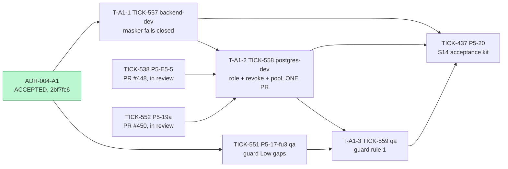
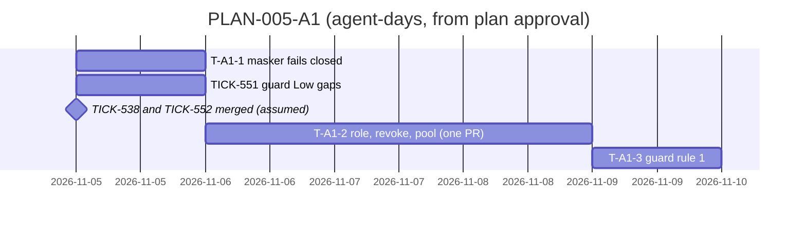

# PLAN-005-A1: ADR-004 amendment A1

## Summary

**What ships:** three new tasks under story S14 (TICK-419). All of them target `TICK-419/one-audit-log`, so `main` never carries `nava_app`'s SELECT on `diff` (A1-11 prefers this).

| Task | Issue | Role | Outcome |
|---|---|---|---|
| T-A1-1 | TICK-557 | `backend-dev` | The masker fails closed with `ErrNoDefinitionVersions`: a 500 with no diff and no salt (A1-4) |
| T-A1-2 | TICK-558 | `postgres-dev` | In **one PR** (A1-11): the `nava_audit_reader` role and its password, the pooler line, the policy migration, the revoke from `nava_app`, the reader pool, the DSN and the handler split, plus CI-A3 and the `diff-denied`, `reader-scoped` and `reader-masks` tests |
| T-A1-3 | TICK-559 | `qa` | Guard rule 1: only `internal/audit/read` opens the pool, and only the config loader names its DSN (A1-10) |

TICK-551 (the TICK-541 guard's Low gaps) already exists. Its trigger was "TICK-549 keeps the guard as a layer". The guard is kept as layer 2, so TICK-551 is released with this plan. It is unchanged.

**Order:** T-A1-1 and TICK-551 start at once. T-A1-2 starts when T-A1-1, TICK-538 and TICK-552 are done. T-A1-3 starts when T-A1-2 and TICK-551 are done. P5-20 (TICK-437) now also waits for all three new tasks.

**The one risk that matters most:** T-A1-2 is merged half-done, or merged in two pieces. The revoke without the reader pool turns every audit endpoint into a 500. The pool without the revoke changes nothing. A1-11 forbids the split, so T-A1-2 is a single task and a single PR. It is larger than our usual task size (D-A1-1).

## Decisions this plan makes

| # | Decision |
|---|---|
| **D-A1-1** | **A1-11 steps 1 and 2 are one task (T-A1-2), not two.** The ADR requires one PR and forbids merging either step alone. Two tasks on one PR would break our rule that a task closes when its PR merges, and the delivery sweep could never release the second one. The task is 2–3 agent-days, over the one-day guideline. We accept that because no smaller slice can merge on its own. It goes to `postgres-dev`, because the risky half is the catalogue: the grants manifest, the policy migration, CI-A3 and the isolation probes. Security reviews it, and the Senior Software Engineer also reviews the Go pool and handler half. |
| **D-A1-2** | **The fail-closed masker (A1-4) ships first, in its own PR (T-A1-1).** A1-11 lists it under step 2. But it is safe to merge alone: today `nava_app` can see every version row, so it never fires in a healthy database. Merging it first makes T-A1-2 smaller. It also means that when T-A1-2's policy change goes in, a missing `entity_definition_versions_select` grant shows up as a 500, not as an unmasked diff. The one-PR rule exists to keep the endpoints from returning 500 between steps. Moving the masker earlier does not reopen that window. **The Solution Architect checks this against A1-11 in the plan verdict.** |
| **D-A1-3** | **T-A1-2 depends on TICK-538 and TICK-552, because their files overlap.** TICK-538 (PR #448) edits `db/grants.yaml` and adds R29 to `internal/db/audited/check.go`, the same CI-A3 gate that A1-9 extends. TICK-552 (PR #450) reworks the isolation harness that reads the diff through `read.Reader` (`internal/tenancy/isolation/audit_paths.go`), and T-A1-2 moves that harness to the reader pool. Both are in review now. If either is not merged when T-A1-1 is done, it becomes the critical path. |
| **D-A1-4** | **Guard rule 1 is its own task (T-A1-3) and comes after TICK-551.** A1-10 allows it to follow later. It can only test against the `read.OpenPool` and the DSN name that T-A1-2 creates. TICK-551 edits the same guard file (`diffreaders_test.go`), so the two are serialized. Rule 1 still lands inside S14, because AR-TICK-549-01 relies on it. |
| **D-A1-5** | **P5-20 (TICK-437, the S14 acceptance kit) now also depends on TICK-557, TICK-558 and TICK-559. This is done on the issue.** S14 is not accepted, and `main` does not get the audit log, until Postgres enforces the diff wall. |
| **D-A1-6** | **The DSN reaches nava-core only (revised after the Solution Architect's CHANGES).** `config.Load` is shared by `cmd/nava-core`, `cmd/nava-worker` and `cmd/nava-relay`, so the key must **not** be added to its `Config`. If it were, the worker and relay would either need the raw-diff credential or fail to start, and AR-TICK-549-01 accepts that credential in nava-core only. Instead, T-A1-2 does three things. It adds `internal/platform/config/auditreader.go` with its own `LoadAuditReader(lookup)`, in the same style as `onboard.go`, `purge.go` and `groupsync.go`. Only `cmd/nava-core/main.go` calls `LoadAuditReader`, then `read.OpenPool`, and hands the `*read.Pool` to the reader. And `NAVA_AUDIT_READER_DATABASE_URL` is set on the `nava-core` compose service and in the CI isolation stack only; `cmd/nava-core/compose_test.go` asserts that nava-worker and nava-relay do not have it. A1-6's "`cmd/nava` config loader" means this pair: `cmd/nava-core` plus `LoadAuditReader`. T-A1-3's rule 1 allows exactly these call sites. This is placement only, so the ADR needs no erratum. |
| **D-A1-7** | **No grooming meeting.** As with D-E5-9, the acceptance tests come from an amendment that three reviewers approved after two rounds, and the Technical Architect checked its fidelity. The Solution Architect's plan verdict is the check. |
| **D-A1-8** | **Export (A1-5, A1-7).** There is no export handler on the story branch yet (P5-17 shipped list and history only). T-A1-2 covers list and history. The rule "export pages use the reader pool; lease and entry stay on `nava_app`" goes into the contract of whichever task builds export. It is recorded in the decision log (trigger: an export task is created). |

## Task graph

**Critical path:** T-A1-1 → T-A1-2 → T-A1-3 → P5-20, about 3.5–5.5 agent-days, assuming TICK-538 and TICK-552 merge while T-A1-1 is running.

**Estimates (ranges; the second number is a guess):**

- **T-A1-1: 0.5–1 agent-day.** The work is one sentinel, one propagation and a handler mapping.
- **T-A1-2: 2–3.** *Assumptions:* the spikes' SQL and PgBouncer setup carry over unchanged, and the seven tests named in A1 are the only ones that break (the Postgres full-suite run says so). Moving the `internal/server` tests to a second pool is the unknown.
- **T-A1-3: 0.5–1.** It extends an existing AST walker.

## Files per task

| Task | Expected files |
|---|---|
| T-A1-1 | `internal/audit/read/definition_masker.go`, `mask.go`, `mask_test.go`; the audit handler's error mapping in `internal/server` |
| T-A1-2 | `db/grants.yaml`; one policy migration; `internal/db/audited/manifest.go`, `check.go`; `internal/db/dbtest/`; `internal/tenancy/isolation/`; `internal/audit/read/`; `internal/platform/config/auditreader.go`, `cmd/nava-core/main.go`, `cmd/nava-core/compose_test.go`; `internal/server/`; `compose.yaml`, `.env.example`, the CI isolation stack, both PgBouncer `.ini` files; `docs/adr/ADR-004-audit-log.md` and its `.html` |
| T-A1-3 | `internal/audit/read/diffreaders_test.go` or a sibling, plus `testdata/` (fixtures in a fake `cmd/nava-core` and `cmd/nava-worker`) |

Overlaps are serialized by dependencies:
- `internal/audit/read` and `internal/server`: T-A1-1 → T-A1-2;
- `db/grants.yaml` and `check.go`: TICK-538 → T-A1-2;
- `internal/tenancy/isolation`: TICK-552 → T-A1-2;
- `diffreaders_test.go`: TICK-551 and T-A1-2 → T-A1-3.

TICK-537 (PR #444) touches `internal/server` record tests, but not the audit handlers. Whichever of the two merges second rebases. No other story touches these files: S14 is the only open story on `TICK-419/one-audit-log`.

## ADR coverage

| ADR item | Task |
|---|---|
| A1-1 role, A1-2 revoke, A1-3 policies | T-A1-2 |
| A1-4 masker fails closed | T-A1-1 (unit and handler); T-A1-2 (`reader-masks`) |
| A1-5 pool, A1-6 DSN, A1-7 handlers | T-A1-2 (export: D-A1-8) |
| A1-8 pooler cap | T-A1-2 |
| A1-9 CI-A3 extended | T-A1-2 |
| A1-10 rule 1 | T-A1-3; rule 2 kept, its gaps closed by TICK-551 |
| A1-11 one PR, password with the manifest | T-A1-2 (D-A1-1), with the masker moved earlier (D-A1-2) |
| Tests: CI-A3, `diff-denied`, `reader-scoped`, `reader-masks` | T-A1-2 |
| Tests: unit `read` masker | T-A1-1 |
| Existing tests that change (7) | T-A1-2 |
| Changes to ADR-004 text (R7, R12, R14, CI-A3) | T-A1-2 |
| AR-TICK-549-01, AR-TICK-549-02 | Accepted in the ADR; no task. Their triggers are in the decision log. |

## Invariant coverage

| Invariant | Enforced by |
|---|---|
| I3 (least privilege; no definer functions, no memberships) | T-A1-2: a role with no memberships, column grants only, nothing on `records` or partitions; CI-A3 asserts it, with the `pg_inherits` walk and the exact policy role list. T-A1-3 keeps the credential inside one package. |
| I1 (tenant wall) | T-A1-2: `reader-scoped` (tenant B and no tenant both read 0 rows); record history keeps the same 404 for other-tenant records; the canonical predicate is unchanged on both altered policies. |
| R7 masking (ADR-004) | T-A1-1 (fails closed); T-A1-2 (`reader-masks`, which goes red without the versions policy change). |
| I2, I4–I9 | Not touched. A `nava_app` INSERT into `audit_log` still commits (T-A1-2, criterion 8). |

Nothing that enforces an invariant is cut. No isolation-registry entry is removed. `TestP510bAppReaderGrantAndTenantBoundary` is inverted, not dropped, and its tenant half moves to the reader.

## The cut

- **Export through the reader pool** (D-A1-8): export does not exist yet. Owner: Technical Lead. Trigger: an export task is created.
- **TICK-550** (a Parse-time error through PgBouncer is followed by `08P01`): out of scope by the ADR. It does not affect the `42501` denials.
- **Dissent:** none.
