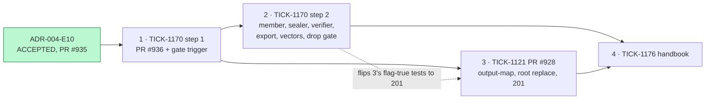
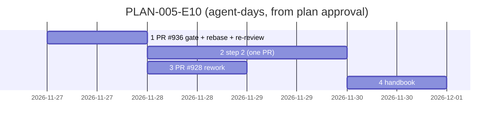

# PLAN-005-E10: ADR-004 erratum E10

## Summary

**What ships:** the flag `diff_nul_escaped` on `audit_log`, sealed into the hash envelope only when true, and the TICK-1121 repair publish that sets it. Three work items already exist; this plan orders them and adds one handbook task. No other task is created.

| # | Item | Issue / PR | Role, owner | Reviewer | Outcome |
|---|---|---|---|---|---|
| 1 | T-E10-1 | TICK-1170 step 1, PR #936 (open) | `postgres-dev`, Postgres & Data Modeling Specialist | Principal Software Engineer | Column, grants (incl. reader, E10-4), `audit.Entry.DiffNULEscaped`, recreated `audit_log_guard_update`, **gate trigger `audit_log_nul_escaped_gate`** |
| 2 | T-E10-2 | TICK-1170 step 2, one new PR | `postgres-dev`, Postgres & Data Modeling Specialist | Principal Software Engineer (code); Technical Lead (vectors, PLAN-005 D-5-7) | `trueOnlyField` envelope member, sealer read, verifier JSONL + CSV rules, export, read endpoints, vectors, `docs/api/audit-export-v1.md`, **drop the gate trigger** |
| 3 | T-E10-3 | TICK-1121, PR #928 (open) | `core-dev`, Principal Software Engineer | Postgres & Data Modeling Specialist | Output-map collision test, two-NUL-key case, root-`replace` fallback with 201, sets the flag |
| 4 | T-E10-4 | TICK-1176 (new, backlog) | Technical Lead | area owners (TICK-718 table) | Handbook pages for the table, grants, export format, audit chain, sealer |

**Order:** 1 → 2. 3 starts after 1 and may merge before or after 2. 4 after 2 and 3.

**The one risk that matters most:** a row sealed with the flag true by code that does not hash the member. It reads `tampered` forever. The gate trigger in item 1 makes this impossible until item 2 drops it in the same PR that teaches the envelope, the sealer and the verifier the member. **PR #936 does not contain the gate trigger today** (it has the recreated guard only), so item 1 is not mergeable until it does (D-E10-1).

## Decisions this plan makes

| # | Decision |
|---|---|
| **D-E10-1** | **The gate trigger is added to PR #936, not to a later PR.** E10-6 puts it in step 1. #936 also has to be rebased (GitHub reports it conflicting with `main`). Review of #936 checks for the gate and its 23514 test before APPROVE. |
| **D-E10-2** | **Item 2 is one PR and is the only place the trigger is dropped.** The down migration of that PR recreates the trigger. Reviewers reject an item-2 PR that drops the trigger without the envelope member, the sealer read and both verifier rules in the same diff, and reject any other PR that drops it. |
| **D-E10-3** | **If #928 merges before item 2, its flag-true integration tests assert the loud failure; item 2 flips them.** Before item 2, a publish over a NUL-holding version (and a collision publish) must fail with the gate's 23514 surfaced as a server error, writing no version, audit or outbox row. Item 2's PR changes those same tests to 201 plus "the chain verifies", since dropping the trigger would otherwise turn them red. If item 2 is already on `main` when #928 is ready, #928 asserts 201 directly. |
| **D-E10-4** | **TICK-1121 is not `done` until item 2 is on `main`.** Its criterion 4 (201) holds only then. #928 may merge earlier; the issue stays `in_review` until item 2 lands and CI-A19 (b) passes on `main`. |
| **D-E10-5** | **#928 never drops a diff member.** The collision check tests the output map (`out[k2]`), and on any collision the whole diff is the single root `replace` op. The current `x[k2]` input-map test and `errNULKeyCollision` refusal are removed. |
| **D-E10-6** | **The 23514 test moves, it is not deleted.** Item 1 proves INSERT with the flag true gives 23514. Item 2 replaces it with a test that the trigger no longer exists and that a flag-true row seals and verifies. |
| **D-E10-7** | **No grooming meeting.** The acceptance criteria are E10's CI-A19 and the work is already routed and partly reviewed. The Solution Architect's plan verdict is the check, as in D-E9-7. |
| **D-E10-8** | **No story.** E10 is an erratum to delivered audit work; nothing new is tried by the human. The handbook task (TICK-1176) is the closing task. |

## Task graph

**Critical path:** item 1 (gate + rebase) → item 2 → item 4. Item 3 runs alongside item 2.

**Estimates:**
- **Item 1: 0.5 agent-day.** The trigger is a few lines; the rebase conflict size is unknown (guess).
- **Item 2: 1.5–2.5 agent-days.** The spike patch (`docs/adr/ADR-004/spikes/solution-architect/e10/envelope.patch`) covers the envelope; most work is the CSV rule, the vectors and the flipped tests. Upper end is a guess.
- **Item 3: 0.5–1 agent-day.** Small code change; the two-NUL-key HTTP case is the effort.
- **Item 4: 0.5 agent-day.**

## Files per item

| Item | Expected files |
|---|---|
| 1 | `db/migrations/20261126150000_audit_log_diff_nul_escaped*.sql` (adds the gate), `db/grants.yaml`, `internal/audit/entry.go`, `internal/db/audited/manifest.go`, `internal/db/dbtest/*`, `internal/tenancy/isolation/audit_paths.go`, `docs/handbook/src/database/migration-history.json` |
| 2 | new `db/migrations/<ts>_audit_log_drop_nul_escaped_gate*.sql`; `internal/audit/chain/envelope.go` and tests (`TestEveryFieldIsHashed`, `TestCanonicalKeysAreSortedAndComplete`); `internal/audit/chain/testdata/vectors.json`; `internal/audit/seal/seal.go`; `internal/audit/verify/` (JSONL, `csv.go`); the export package; the audit read handlers; `docs/api/audit-export-v1.md`; the flag-true tests in `internal/entitytypes` if #928 merged first (D-E10-3) |
| 3 | `internal/entitytypes/audit.go`, `nulescape.go`, `nulescape_test.go`, `entitytypes.go`, their integration tests |
| 4 | the pages listed in TICK-1176 |

**Overlap:** items 2 and 3 share only the `internal/entitytypes` flag-true tests, and only when #928 merges first; D-E10-3 assigns those edits to item 2. No other open work touches `internal/audit/chain` or `audit_log` migrations.

## CI-A19 coverage

| Case | Proved by |
|---|---|
| (a) existing vectors and seeded sealed rows verify unchanged | 1 (after the migration), 2 (after the code change) |
| (b) publish over a NUL-holding version → 201, flag true, no NUL in `diff`, chain verifies | 3 (code) + 2 (end-to-end on `main`, D-E10-3/4) |
| (c) UPDATE of the column → 42501 for every role (`"nul_escaped"` in `audit_paths.go`); INSERT true → 23514 before step 2 | 1 |
| (c) mismatch half: member added to a false row's export line / removed from a true row's line → `envelope_sha256_mismatch` | 2 |
| (d) JSONL member stripped → mismatch; `"diff_nul_escaped":false` → `malformed_line` | 2 |
| (e) real NUL next to literal `\\u0000` escapes only the real one, flag true; no NUL → bytes and flag unchanged | 3 |
| (f) collision → one root `replace` op, flag true, 201, both shapes (also in `nulescape_test.go`) | 3 (unit + loud-fail before 2) + 2 (201 end-to-end) |
| (g) pre-E10 and E10 CSV headers verify; empty cell → omitted; `false` cell → `malformed_line` | 2 |
| (h) reader reads the column; tenant B and no-tenant see zero rows | 1 (grant), 2 (read endpoints) |

## ADR coverage

| E10 item | Item |
|---|---|
| E10-1 column, grants, no UPDATE, recreated guard | 1 |
| E10-2 omit-when-false canonical form, verifier table, single optional member in the guard tests | 2 |
| E10-3 `Entry.DiffNULEscaped` set exactly when `escapeNUL` replaced a NUL; diff via `$1::jsonb::text` | 1 (field), 3 (setter) |
| E10-4 reader (31 columns), `grants.yaml` lists | 1 |
| E10-4 read endpoints, JSONL, CSV, golden vectors | 2 |
| E10-5 output-map collision test, root `replace`, 201, `audit_nul_escape_collision` log | 3 |
| E10-6 gate trigger in step 1, dropped in step 2 | 1, 2 |
| Handbook pages | 4 (TICK-1176) |

## Invariant coverage

| Invariant | Enforced by |
|---|---|
| I1 tenant wall | 1 and 2: CI-A19 (h), the column follows the row under existing policies. |
| I4 audit in the same transaction | 3: the repair publish writes its entry or fails whole (D-E10-3 asserts no version without an entry). 1 and 2: the flag is tamper-evident and never sealed unhashed (gate). |
| I8 platform-owned vocabulary | 1: platform migration only. |

Nothing that enforces an invariant is cut.

## The cut

- **The `CHECK` alternative to the gate trigger** is not planned; E10-6 allows it only after measuring the scan, and the trigger needs no measurement.
- **RS-E10-1 and RS-E10-2** get no task. Signal for RS-E10-2: the `audit_nul_escape_collision` log line. Owner: Solution Architect.
- **Dissent:** none.
