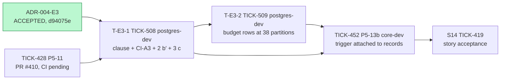
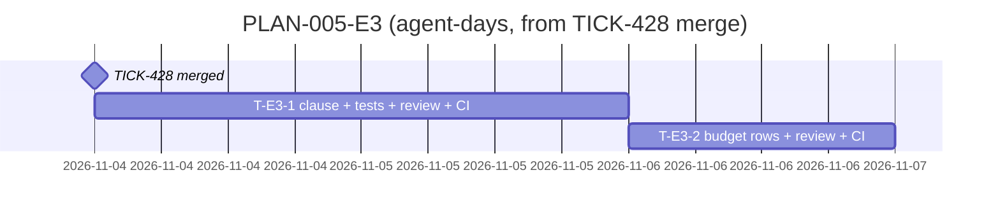

# PLAN-005-E3: ADR-004 erratum E3

## Summary

**What ships:** two `postgres-dev` tasks under story S14 (TICK-419), both targeting `TICK-419/one-audit-log`:

- **T-E3-1 (TICK-508):** a migration adds `SET plan_cache_mode = force_custom_plan` to `audit_commit_check()`. CI-A3 gets a `proconfig` check with a negative control. Finding 5 items 2 (b′) and 3 (c) replace the two `TICK-502` skips, with the no-clause negative control in the same job.
- **T-E3-2 (TICK-509):** both budget rows are measured in the CI `integration` job at 38 partitions, with a same-run reference to the shipped function, and they replace the 42.2 µs row in `docs/budgets.md`.

TICK-452 (P5-13b, which attaches the trigger to `records`) now depends on both tasks, in place of TICK-502.

**Order:** TICK-428 (PR #410, approved, waiting on CI) → T-E3-1 → T-E3-2 → TICK-452.

**The one risk that matters most:** the 3 (c) ratios and the budget rows are timing measurements on shared GitHub runners. The TA measured 1.8–2.3× variance on one laptop within an hour. Two controls address this: the same-run reference and the medians of three runs (both from the ADR), plus D-E3-4 below. A flaky result stops the task under the TICK-460 rule; nobody tunes thresholds.

## Decisions this plan makes

| # | Decision |
|---|---|
| **D-E3-1** | **Two tasks, not the ADR's three follow-ups.** Follow-ups 1 (clause + CI-A3) and 2 (tests) become one task, T-E3-1. The tests are the clause's only proof, and both edit the TICK-428 test files. Splitting them would give a task whose acceptance test lives in another task. Follow-up 3 (budget) is T-E3-2. It needs the clause in the migration, and it owns `docs/budgets.md` and a new test file. |
| **D-E3-2** | **The clause ships as a new migration, not as an edit to TICK-428's migration.** PR #410 already has both approvals and is waiting on CI. Re-opening it would reset two reviews and a CI run, and once it merges, editing an applied migration would break goose's history. ADR decision 6's real condition is "before any table attaches the trigger". The trigger is only attached in TICK-452, which depends on T-E3-1, so that condition still holds. The `ALTER FUNCTION` text is the ADR's, word for word. **The Solution Architect is asked to confirm this reading in the plan verdict.** |
| **D-E3-3** | **Both tasks go to `postgres-dev`** (the ADR names the Postgres specialist for the budget, and they wrote the TICK-428 tests). Reviewers: the Technical Architect for T-E3-1, because they own S2 and the re-check that the pass conditions come from. The Quality, Testing & CI Advisor reviews T-E3-2, which adds runtime to a required CI job, and the TA checks the method. |
| **D-E3-4** | **T-E3-2 reports the wall time it adds to the `integration` job.** If it adds more than 3 minutes, it is moved to its own required job before merging. The ADR requires the CI job and the pinned image; it does not name a job, so this keeps the pipeline's 10-minute target. |
| **D-E3-5** | **No grooming meeting.** As with D-E1-5 (PLAN-002-E1) and D-E3-5 (PLAN-001-E3), these tasks come straight from an erratum whose pass conditions were measured by two reviewers and accepted without dissent. The task text copies the ADR's conditions. |
| **D-E3-6** | **S3 (custom plan on the leaf partition) gets no task.** The CTO deferred it (E3-R2). Its trigger is built into T-E3-2's verdict rule: over ceiling **and** same-run ratio out of range. If that fires, T-E3-2 stops and the Technical Lead escalates to the CTO. The risk register entry is R-005 (PR #411, CTO). |
| **D-E3-7** | **`docs/security/accepted-risks.md` is not touched.** AR-TICK-502-01 and -02 shipped with the ADR PR. |

## Task graph

**Critical path:** TICK-428 merge → T-E3-1 → T-E3-2 → TICK-452. E3 adds about 1.5–3 agent-days before TICK-452 can start. TICK-452 also waits on TICK-430, TICK-451, TICK-422 and TICK-431, so E3 may not be the longest path to it.

**Estimates (ranges; the second number is a guess):**

- **T-E3-1: 1–2 agent-days.** The clause and the catalog check are small. *Assumption:* `auto_explain` can be loaded per session in the CI container and its plans read back through client notices. If it needs `session_preload_libraries` in the container's config, that adds a CI change and a review cycle.
- **T-E3-2: 0.5–1 agent-day.** *Assumption:* the TA's 38-partition builder ports into `dbtest` unchanged, and the first CI run lands inside the ceilings. A runner-variance re-run adds half a day.

## Tasks

| Task | Issue | Role | Depends on | ADR parts | Reviewer |
|---|---|---|---|---|---|
| T-E3-1 | TICK-508 | `postgres-dev` | TICK-428 | Decisions 1–4, 6; Revised Finding 5 pass condition | Technical Architect |
| T-E3-2 | TICK-509 | `postgres-dev` | TICK-508 | Decision 5; Budget section; E3-R2 trigger rule | Quality, Testing & CI Advisor (+ TA on method) |
| (amended) | TICK-452 | `core-dev` | + TICK-508, TICK-509 (TICK-502 removed) | Gate: no trigger attached before E3 is in | as before |

**Files:**

- T-E3-1: a new migration under `db/migrations/`, `internal/db/audited/` (CI-A3), and the TICK-428 commit-check tests in `internal/db/dbtest/`.
- T-E3-2: `internal/db/dbtest/commit_check_budget_test.go` (new) and `docs/budgets.md`.

There is no overlap between the two tasks, and the order between them is a real dependency.

## Invariant coverage

| Invariant | Enforced by |
|---|---|
| I4 (audit in the same transaction, one write pipeline) | T-E3-1: the clause, the CI-A3 catalog check (a missing clause fails the gate), and 3 (c) with its negative control (O(n²) at COMMIT fails CI). T-E3-2: the flatness condition catches plan decay. TICK-452 cannot attach the trigger before both are done. |
| I1 (tenant wall), I3 (least privilege) | Not changed (ADR invariant check). T-E3-1 adds no grant, policy or role. The function stays `SECURITY INVOKER`. |
| I2, I5–I9 | Not touched. |

Nothing that enforces an invariant is cut.

## The cut

- **S3** (custom plan on the leaf partition) is deferred by the CTO. Its trigger is in T-E3-2's verdict rule, and the risk is in R-005 (D-E3-6).
- **Re-measuring at Epic 30's partition count** belongs to Epic 30's design (E3-R2), not to M1.
- **PG-upgrade drift (E3-R3)** needs no task. Item 3 (c) runs on every Postgres bump through pinned-version CI, and T-E3-1 makes it a permanent test.
