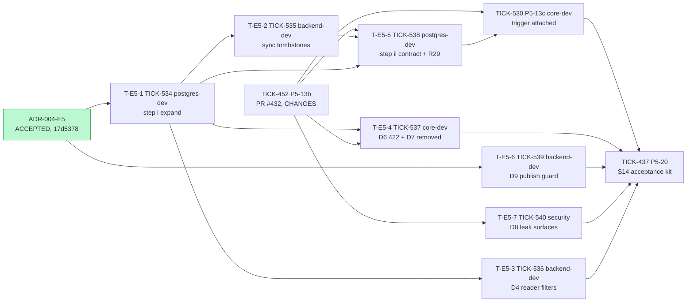
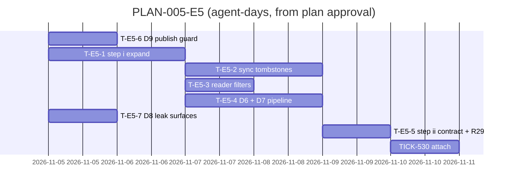

# PLAN-005-E5: ADR-004 erratum E5

## Summary

**What ships:** six new tasks plus the amended TICK-530 (P5-13c), all under story S14 (TICK-419), all targeting `TICK-419/one-audit-log`.

| Task | Issue | Role | Outcome |
|---|---|---|---|
| T-E5-1 | TICK-534 | `postgres-dev` | Step (i) expand migrations: `groups.deleted_at`, D11 `live` columns and FK, `UPDATE (path, deleted_at)` for `nava_groupsync`, D5 pointer DELETE grants and policies, I1 |
| T-E5-2 | TICK-535 | `backend-dev` | Group sync tombstones and revives groups (D1, D5, I3) and never issues `DELETE FROM groups` |
| T-E5-3 | TICK-536 | `backend-dev` | The D4 readers filter tombstoned groups (`/me`, `RecordAdminGroup`, group pickers) |
| T-E5-4 | TICK-537 | `core-dev` | The pipeline refuses a change to a tombstoned group with `422 assignment_group_removed`; reads return `removed: true` (D6, D7, N4) |
| T-E5-5 | TICK-538 | `postgres-dev` | Step (ii) contract: `RESTRICT … NOT VALID` (ii-a), `VALIDATE` in its own migration (ii-b), DELETE revoked, R29 in CI-A3, the listed tests rewritten |
| T-E5-6 | TICK-539 | `backend-dev` | S8 create and publish refuse a required secret property with `definition_secret_required` (D9); entity-definition docs narrow `writeOnly` (D8) |
| T-E5-7 | TICK-540 | `security` | Adversarial proof that a secret in a record write leaks nowhere (CI-E5-7, D8 half) |
| P5-13c | TICK-530 (amended) | `core-dev` | Trigger attached to `records` (`attached: true`), CI-E5-1 passes attached, N3 runbook extended to `tenant_auditor_group` |

**Order:** T-E5-1 → (T-E5-2 ‖ T-E5-3) → T-E5-5 → TICK-530. TICK-452 (PR #432, currently `VERDICT: CHANGES`) gates T-E5-4, T-E5-5, T-E5-7 and TICK-530. T-E5-6 has no prerequisite and starts first, as the ADR allows.

**The one risk that matters most:** step (ii) running before step (i)'s sync is in. If DELETE on `groups` is revoked while sync still deletes, every tenant's sync, deprovisioning included, fails: the same stall E5 exists to remove. T-E5-5 depends on T-E5-2, and its first acceptance test runs a full sync with DELETE revoked (D-E5-3).

## Decisions this plan makes

| # | Decision |
|---|---|
| **D-E5-1** | **Step (i) is one task, and its tests are database-level.** The expand migrations, grants, policies, catalogue entries and I1 ship together because CI-E5-5 and CI-E5-5b test them as one set, and splitting them would leave a policy without its grant. I5 is followed literally: the `CHECK (live)` and the D11 FK are added `NOT VALID` and validated in a second migration of the same PR; the migration that adds `groups.live` sets `lock_timeout`. |
| **D-E5-2** | **Sync (T-E5-2) and the readers (T-E5-3) are separate tasks.** They touch disjoint packages (`internal/groupsync` versus `internal/identity/pgstore`, `internal/onboard`, the picker query), both need only T-E5-1, and each has its own CI-E5 tests. Both go to `backend-dev`; they can run in parallel. |
| **D-E5-3** | **Step (ii) depends on T-E5-2 and TICK-452.** On T-E5-2 because a revoked DELETE breaks the old sync (the risk above). On TICK-452 because PR #432 edits `records_pipeline_test.go`, one of the ADR's tests to rewrite. Within M1 there is no deployed fleet, so "after step (i)'s binaries run everywhere" (D10) means "after T-E5-2 has merged into the story branch". The rollout rule I4 (stop-old, then start-new) is written into the operator docs by T-E5-2 for the first real deploy. **The Solution Architect is asked to confirm this reading in the plan verdict.** |
| **D-E5-4** | **TICK-530 keeps P5-13c's number and scope, amended to E5.** It now depends on T-E5-5 and TICK-452, carries the attach, CI-A2 (records), the attached run of CI-E5-1, and N3 (runbook and its cross-tenant test extended to `tenant_auditor_group`), because the ADR names P5-13c for both. |
| **D-E5-5** | **D6/D7 is `core-dev`, not `backend-dev`.** The lookup must run inside the pipeline transaction under RLS (D6), in `internal/records/pipeline`, which TICK-452 is rewriting. It depends on TICK-452 and T-E5-1. |
| **D-E5-6** | **D8 is a test task for `security`, not a code change.** PR #432 already refuses a secret path in a record write with `audit_secret_in_diff` (`internal/records/pipeline/audit.go`). What E5 adds is the proof that the value reaches none of the six surfaces in CI-E5-7. If a surface leaks, the Security reviewer reports it and the Technical Lead opens a `core-dev` fix task; T-E5-7 does not close on a skipped test. |
| **D-E5-7** | **The D9 half of CI-E5-7 belongs to T-E5-6.** It is a publish-time check in `internal/entitytypes` / `internal/metadata`, independent of the pipeline. It also covers `POST /api/v1/entity-types` (version 1), because "S8 publish" includes the first version. |
| **D-E5-8** | **P5-20 (TICK-437, the S14 acceptance kit) gains `Depends on:` TICK-530, TICK-536, TICK-537, TICK-539 and TICK-540 (TICK-534, -535 and -538 are covered through TICK-530). Done on the issue.** The story is not accepted while E5's acceptance tests are not in. |
| **D-E5-9** | **No grooming meeting.** As with D-E3-5 (PLAN-005-E3), every task comes from an erratum whose acceptance tests were written by the reviewers and accepted. The dissent (T9, drop D5) was ruled on by the CTO and is not re-opened here. The Solution Architect's plan verdict is the check. |
| **D-E5-10** | **Q-A (auto-reassignment of a removed group's records) gets no task.** It is a product question for the human. R-E5-1 is owned by the Technical Lead and recorded in the decision log with its trigger. |

## Task graph

**Critical path:** T-E5-1 → T-E5-2 → T-E5-5 → TICK-530 → P5-20, about 5–8 agent-days. TICK-452 runs in parallel and must merge before T-E5-5 starts; if PR #432 is not merged when T-E5-2 is done, TICK-452 becomes the critical path.

**Estimates (ranges; the second number is a guess):**

- **T-E5-1: 1–2 agent-days.** *Assumption:* the D11 composite FK and `NOT VALID` CHECK validate cleanly on the CI fixture; the policy catalogue accepts the two new policies without a schema change to `policy.go`.
- **T-E5-2: 1–2.** *Assumption:* I3's batch order fits the existing two-batch shape of `applyGroups` (`internal/groupsync/apply.go:284`).
- **T-E5-3: 0.5–1.** Three query edits plus tests.
- **T-E5-4: 1–2.** *Assumption:* PR #432's pipeline shape is final; the `removed` flag is a join in the read model, not a schema change to `records`.
- **T-E5-5: 1 (guess: 1.5).** The test rewrites are the unknown.
- **T-E5-6: 0.5–1.** The recursive subschema walk is the work.
- **T-E5-7: 0.5–1.** *Assumption:* the existing log and span capture helpers from the isolation suite can be reused.
- **TICK-530: 0.5–1.**

T-E5-6, T-E5-7 (once TICK-452 is in) and T-E5-4 are off the critical path.

## Files per task

| Task | Expected files |
|---|---|
| T-E5-1 | two new migrations under `db/migrations/`; `db/grants.yaml`; `internal/db/catalog/policy.go`; `internal/db/dbtest/tenant_admin_group_test.go` (split the `:81` denial test), a new `internal/db/dbtest/groups_tombstone_test.go`, the `tenant_auditor_group` dbtest file |
| T-E5-2 | `internal/groupsync/apply.go`, `internal/groupsync/groupsync.go`, their tests; `docs/operator/` (I4 rollout note) |
| T-E5-3 | `internal/identity/pgstore/pgstore.go`, `internal/onboard/store.go`, the group picker query, their tests |
| T-E5-4 | `internal/records/pipeline/*`, `internal/records/store/store.go` (read model), `api/paths/records.yaml`, `api/errors.yaml`, `api/openapi.bundled.yaml`, `internal/server` tests |
| T-E5-5 | two new migrations; `db/grants.yaml`; `internal/db/audited/check.go` (R29); `internal/db/dbtest/identity_tables_test.go`, `records_pipeline_isolation_test.go`, `records_pipeline_test.go`, `tenant_admin_group_test.go:267`; `docs/data/identity-bench/03_sync.sql` |
| T-E5-6 | `internal/entitytypes/*`, `internal/metadata/compile.go`, `api/errors.yaml`, `api/paths/entity-types.yaml`, entity-definition docs |
| T-E5-7 | one new adversarial test file under `internal/records/pipeline/` or `internal/server/` |
| TICK-530 | `db/audited-tables.yaml`, one attach migration, `docs/operator/` runbook, `admin_group_runbook_isolation_test.go` |

Overlaps are serialized by real dependencies: `db/grants.yaml` (T-E5-1 → T-E5-5), `tenant_admin_group_test.go` (T-E5-1 → T-E5-5), `internal/records/pipeline` (TICK-452 → T-E5-4, T-E5-7). `api/errors.yaml` is shared by T-E5-4 and T-E5-6, which add different codes; whichever merges second rebases. No other story touches these files: S14 is the only open story on `TICK-419/one-audit-log`.

## ADR coverage

| ADR item | Task |
|---|---|
| D1, I3 | T-E5-2 |
| D2 | T-E5-1 (UPDATE grant), T-E5-5 (RESTRICT, DELETE revoked, `groups_delete` dropped) |
| D3 (R29) | T-E5-5 |
| D4 | T-E5-3; sync's unfiltered diff read in T-E5-2; the unfiltered policy subquery in T-E5-1 |
| D5, I1 | T-E5-1 (grants, policies, catalogue), T-E5-2 (sync deletes the pointer) |
| D6, D7, N4 | T-E5-4 |
| D8 | T-E5-6 (docs), T-E5-7 (leak proof) |
| D9 | T-E5-6 |
| D10 (i) | T-E5-1 + T-E5-2 + T-E5-3 |
| D10 (ii-a), (ii-b) | T-E5-5; attach in TICK-530 |
| D11, I5 | T-E5-1 |
| I4 | T-E5-2 (operator note) |
| N3 | TICK-530 |
| Tests to rewrite | T-E5-5 |
| CI-E5-1 | T-E5-2 (detached), TICK-530 (attached) |
| CI-E5-2, -3, -8 | T-E5-5 |
| CI-E5-4 | T-E5-2 |
| CI-E5-5 | T-E5-1 (`23503` both ways, every role), T-E5-3 (`ErrForbidden`, `ErrAdminGroupMissing`) |
| CI-E5-5b | T-E5-1 (split denial test, both tables, catalogue), T-E5-2 (I1 through sync) |
| CI-E5-6 | T-E5-4 |
| CI-E5-7 | T-E5-7 (leak half), T-E5-6 (D9 half) |

## Invariant coverage

| Invariant | Enforced by |
|---|---|
| I4 (one write pipeline, audit in the same transaction) | T-E5-5 (`RESTRICT`, R29 in CI-A3), TICK-530 (trigger attached). After E5 no FK action can rewrite `records`. |
| I1 (tenant wall) | T-E5-1 (canonical tenant predicate on both D5 policies), T-E5-4 (cross-tenant group gives the same 422 as a random UUID, on create and update), TICK-530 (N3 cross-tenant runbook test). |
| I3 (least privilege) | T-E5-1 (column-scoped UPDATE, policy-limited DELETE, two-column SELECT), T-E5-5 (DELETE on `groups` revoked; CI-E5-2 asserts it). `nava_groupsync` gains nothing on `records`, `audit_log` or `outbox`. |
| I7 (idempotency) | T-E5-4 and T-E5-6: a refused write writes nothing, including `record_write_keys`. |
| I2, I5, I6, I8, I9 | Not touched. |

Nothing that enforces an invariant is cut. No isolation-registry entry or adversarial test is removed (T-E5-5 and TICK-530 acceptance).

## The cut

- **Q-A, automatic reassignment** of a removed group's records (option e2): a product decision and a separate RFC. R-E5-1 owner: Technical Lead. Trigger: product asks for it.
- **ACL group resolution** (D4) does not exist yet. The filter is a requirement on whichever task builds it; this plan adds a line to the D4 contract in T-E5-3 and records it in the decision log.
- **Production rollout** of stop-old, then start-new (I4) is a deploy procedure, not an M1 task. T-E5-2 documents it; R-E5-5 owner: Technical Lead.
