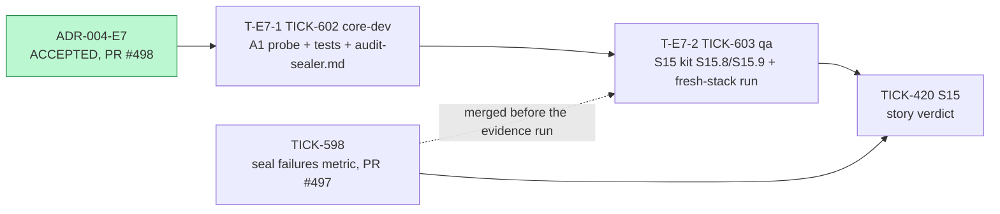
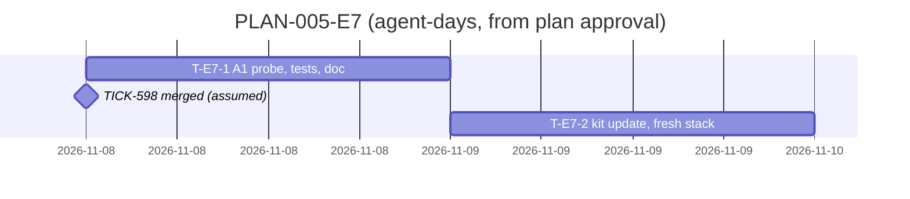

# PLAN-005-E7: ADR-004 erratum E7

## Summary

**What ships:** two tasks under story S15 (TICK-420). Both target `TICK-420/audit-sealer`, so `main` never gets a sealer that can break R-A2.

| Task | Issue | Role | Outcome |
|---|---|---|---|
| T-E7-1 | TICK-602 | `core-dev` | `seal.Reschedule` (A1) probes for unsealed entries on the non-stale path and, if any, books o′ at 10 s and stores `seal_interval_s = 10`. Integration tests for both branches, CI-A16 "idle tenant with backlog > cap" and "poison fan-out", and the `audit-sealer.md` rewrite. RFC-013 rev 1 fix AC 1, 2, 3, 5. |
| T-E7-2 | TICK-603 | `qa` | The S15 kit expects E7: S15.8/S15.9 sealed in about 10 s plus one run, the "spec drift" note removed, and a fresh-stack run with AC1–AC4 green. Fix AC 4. |

**Order:** T-E7-1 starts on approval. It shares no file with TICK-598 (PR #497, `metrics.go` only), so the two run in parallel. T-E7-2 starts when T-E7-1 is done. Its fresh-stack run also needs TICK-598 merged, but its file edits do not, so TICK-598 is not a `Depends on:` (D-E7-3).

**The one risk that matters most:** the fix leaks out of the A1 activity body. A change to `workflow.go` or to the `Rescheduled` result type breaks replay of the recorded histories and would need `workflow.GetVersion` plus re-recording, which E7 puts out of scope. T-E7-1's criterion 4 fails the PR if `workflow.go` or `testdata/histories/` changes.

## Decisions this plan makes

| # | Decision |
|---|---|
| **D-E7-1** | **One code task, not two.** The probe, its tests and the `audit-sealer.md` rewrite are about one agent-day and share one package. Splitting docs from code would leave the architecture doc wrong between merges (TA F3). |
| **D-E7-2** | **T-E7-1 goes to `core-dev` (Principal Software Engineer).** The sealer is core engine (P5-34a, TICK-440, was `core-dev`). The Technical Lead reviews; the Technical Architect also checks the determinism claim (F7), because a Temporal history break is the risk above. |
| **D-E7-3** | **S15 acceptance now waits for TICK-602 and TICK-603, as well as TICK-598.** The current kit passes on today's code, but E7 says the code does not yet meet R16 and R-A2. Accepting S15 first would put a known R-A2 breach on `main`. TICK-603's evidence run is the fresh-stack run the story verdict uses, so TICK-598 must be merged before that run, not before the task starts. |
| **D-E7-4** | **No security task.** No grant, role or policy changes; the probe stays inside `workerguard.InTenantTx` with an explicit `tenant_id = $1` predicate (F10). The isolation suite is unchanged and still runs in CI. |
| **D-E7-5** | **No grooming meeting.** As with D-A1-7 and D-E5-9: the acceptance criteria are RFC-013 rev 1's, which the Technical Architect proposed and the Solution Architect accepted. The Solution Architect's plan verdict is the check. |

## Task graph

**Critical path:** T-E7-1 → T-E7-2 → S15 verdict, about 1.5–2.5 agent-days.

**Estimates:**
- **T-E7-1: 0.75–1.5 agent-days.** The code is one query and one branch. The 20,000-entry CI-A16 test and the poison fan-out test are most of the work. The upper number is a guess that covers the poison test needing harness changes.
- **T-E7-2: 0.5–1.** Kit edits are small; the fresh-stack run is most of it.

## Files per task

| Task | Expected files |
|---|---|
| T-E7-1 | `internal/audit/seal/seal.go`, `seal_integration_test.go` (or `activities_integration_test.go`), `docs/architecture/audit-sealer.md` |
| T-E7-2 | `docs/acceptance/S15/README.md`, `run-kit.sh`, `evidence/`, `docs/acceptance/guide/bruno/S15/` |

TICK-598 touches `metrics.go` and `metrics_test.go` only: no overlap. No other open story touches `internal/audit/seal` or `docs/acceptance/S15`.

## ADR coverage

| E7 / RFC-013 rev 1 item | Task |
|---|---|
| Fix AC 1: A1 probe, 10 s when pending, stored interval otherwise, stale path writes nothing | T-E7-1 |
| Fix AC 2: `workflow.go` and `Rescheduled` unchanged, replay on existing histories | T-E7-1 (criterion 4) |
| Fix AC 3: integration tests both branches; CI-A16 backlog > cap; CI-A16 poison fan-out (F9) | T-E7-1 |
| Fix AC 4: S15.8/S15.9 expectations | T-E7-2 |
| Fix AC 5: `audit-sealer.md` rewrite (F3) | T-E7-1 |
| R-A2 bound and the 600 s `AuditSealLag` alert unchanged | No task; T-E7-1's CI-A16 backlog test proves the bound holds |
| No new accepted risk | Nothing added to `docs/security/accepted-risks.md` |

## Invariant coverage

| Invariant | Enforced by |
|---|---|
| I1 (tenant wall) | T-E7-1: the probe runs in `InTenantTx` with a `tenant_id`-led predicate; no grant change; isolation suite unchanged. |
| Determinism (Temporal replay) | T-E7-1 criterion 4: replay gate green on unchanged histories; `workflow.go` diff empty. |
| Idempotency | T-E7-1: the stale-path test asserts no write; a retry after commit stays the stale no-op. |
| Chain integrity (no gap, no duplicate `seq`) | T-E7-1 poison test (no run uses a `seq`, lineage alive); T-E7-2 AC2 kill/restart re-run. |

Nothing that enforces an invariant is cut.

## The cut

- **Spike S-1** (TA): not run. It was needed only for Option A, which was rejected.
- **Revisiting the `AuditSealLag` threshold or adding `for:`**: out of scope; E7 keeps the alert. Trigger: the alert fires on a healthy system after E7 lands.
- **Dissent:** none.
