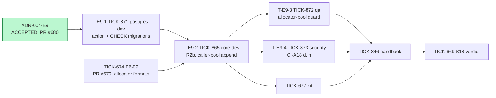
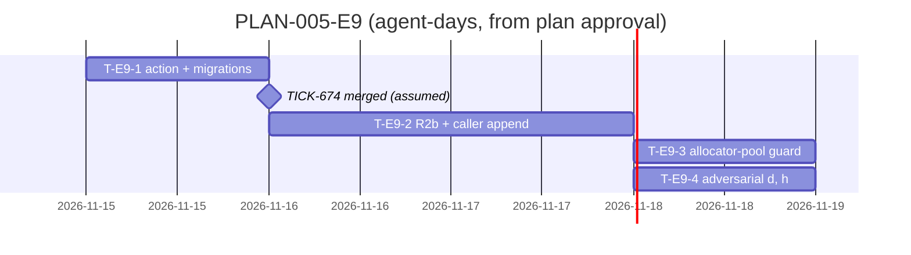

# PLAN-005-E9: ADR-004 erratum E9

## Summary

**What ships:** four tasks under story S18 (TICK-669). All of them target `TICK-669/number-formats`, so nothing reaches `main` before the S18 verdict.

| Task | Issue | Role | Outcome |
|---|---|---|---|
| T-E9-1 | TICK-871 | `postgres-dev` | `audit.ActionNumberSpaceExhausted`. Migration A (`NOT VALID`; its Down raises if rows exist) and migration B (`VALIDATE`). A test that the CHECK mirrors `audit.Actions()`. The `ATTACH PARTITION` rule in `db/migrations/README.md`. Covers CI-A18 (e), [PG 1] and [PG 2]. |
| T-E9-2 | TICK-865 (rewritten) | `core-dev` | R2b at both refusal sites, and `Epoch`/`Counter` on `ErrNumberSpaceExhausted`. `Write` returns the entry; `internal/server/records.go` appends it on the API pool after the create's transaction has ended, on `context.WithoutCancel` bounded by the request deadline (N1). Adds the metric `records_number_space_exhausted_total` and closes `TODO-S18-02`. Covers CI-A18 (a), (b), (c), (f), (g) and (i) with the TA additions, plus [Sec P3]. |
| T-E9-3 | TICK-872 | `qa` | A test guard: no create path runs `InTenantTx` on the allocator pool (the `docs/budgets.md` rule). `rejectTooDeep` is the one documented exception. The Postgres & Data Modeling Specialist reviews it. |
| T-E9-4 | TICK-873 | `security` | CI-A18 (d) through `POST /api/v1/records/{entity}` [Sec P2], a forged-tenant case, and CI-A18 (h) (the mask and the log line). |

**Existing S18 tasks amended:**
- TICK-677 (the acceptance kit) gains one E9 check and now depends on TICK-865.
- TICK-846 (the handbook update) gains the ADR-004 E9 page and its `nav.yaml` entry, plus updates to the audit-log, write-pipeline and budget pages. It now depends on all four tasks.

**Order:**
- T-E9-1 starts on approval and runs in parallel with TICK-674 (PR #679). It touches no file PR #679 changes.
- T-E9-2 starts when both T-E9-1 and TICK-674 are merged.
- T-E9-3 and T-E9-4 then run in parallel. Each adds its own new test file.

**The one risk that matters most:** the append lands on the wrong pool, or runs while the create's connection is still held. The first is the placement spike S1 failed (another tenant's p95 rose 32×). The second is the TICK-657 hold-and-wait. Three independent checks catch it:
- T-E9-2's CI-A18 (i): a closed allocator pool, a distinct `txid`, and a released API connection;
- T-E9-3's guard test;
- Security's re-check of the `records.go` call site (I1).

## Decisions this plan makes

| # | Decision |
|---|---|
| **D-E9-1** | **TICK-865 is reused and rewritten, not replaced.** `TODO-S18-02` and the story already link it. Its old scope (write through `p.runner.InTenantTx` in `write.exhausted`) is the rejected rev 1 placement, and the new body says so at the top. |
| **D-E9-2** | **The vocabulary migration is its own `postgres-dev` task (T-E9-1).** It has no code dependency on PR #679, so the migration risk leaves the critical path, and the Postgres specialist owns [PG 1] and [PG 2]. |
| **D-E9-3** | **The allocator-pool guard is a test, not the runner type split.** The ADR prefers the split. But a `PoolRunner` whose allocator side has no `InTenantTx` forces `rejectTooDeep` off the allocator pool, and E9 leaves that alone (RS-E9-3) unless it costs one line. A test that records every `InTenantTx` call on the allocator runner enforces the same rule now. Revisit: do the split when `rejectTooDeep` moves (the RS-E9-3 trigger). |
| **D-E9-4** | **CI-A18 is split by owner:** (e) goes to T-E9-1; (a), (b), (c), (f), (g), (i) and P3 to T-E9-2; (d) and (h) to T-E9-4. Each task's tests fail on their own if its part breaks. |
| **D-E9-5** | **The S18 kit gets one E9 check:** a 409, then exactly one entry in tenant A's timeline and none in tenant B's. The refusal audit is part of what S18 delivers (ADR-005 §3.5), so the fresh-stack verdict must see it. |
| **D-E9-6** | **S18 acceptance now also waits for TICK-865, TICK-871, TICK-872 and TICK-873.** The ADR says S18 is not accepted until the follow-up is done. TICK-674 still merges without the row, as agreed. |
| **D-E9-7** | **No grooming meeting.** The acceptance criteria are the ADR's CI-A18 and its Consequences list. The Technical Architect, Security and the Postgres specialist already reviewed them on PR #680. The Solution Architect's plan verdict is the check, as in D-E7-5. |

## Task graph

**Critical path:** TICK-674 merged → T-E9-2 → T-E9-3 and T-E9-4 → TICK-846 → S18 verdict. T-E9-1 stays off the critical path as long as it merges before TICK-674 does.

**Estimates:**
- **T-E9-1: 0.5–1 agent-day.** The pattern already exists (`20261114090000_audit_log_subject_tenant_setting*.sql`). The upper end covers the Down guard and the partition check.
- **T-E9-2: 1–2 agent-days.** The code is small. Most of the work is CI-A18 (i), which must prove the API connection was released, and the cancelled-context test. The upper number is a guess.
- **T-E9-3: 0.5–1 agent-day.**
- **T-E9-4: 0.5–1 agent-day.** The HTTP harness already exists from TICK-676.

## Files per task

| Task | Expected files |
|---|---|
| T-E9-1 | `internal/audit/entry.go`, two `db/migrations/<ts>_audit_log_action_number_space_exhausted*.sql` files, `internal/db/dbtest/audit_log_test.go`, `db/migrations/README.md` |
| T-E9-2 | `internal/records/pipeline/pipeline.go`, `batch.go`, `alloc.go` and their tests; `internal/server/records.go` and its integration test; `docs/delivery/todo.md`; `docs/architecture/record-write-pipeline.md` |
| T-E9-3 | new `internal/records/pipeline/allocpool_guard_integration_test.go` |
| T-E9-4 | new `internal/server/number_space_audit_adversarial_integration_test.go` |

**Overlap:**
- T-E9-2 shares pipeline files with TICK-674, hence the dependency.
- TICK-869 is test-only (`format_isolation_adversarial_integration_test.go`) and touches no T-E9 file.
- No other open story touches `internal/audit/entry.go` or `audit_log_action_check`.

## ADR coverage

| E9 item | Task |
|---|---|
| The R2 action list, `audit.ActionNumberSpaceExhausted`, migrations A and B | T-E9-1 |
| [PG 1] the mirror test; [PG 2] the Down that raises | T-E9-1 |
| The `ATTACH PARTITION` rule | T-E9-1 (README) |
| The R2b shape, both refusal sites, `Epoch`/`Counter` | T-E9-2 |
| The placement on the caller's pool after the create ends; N1 `WithoutCancel` with the deadline | T-E9-2 |
| Failure: the refusal joined with the audit error | T-E9-2 (CI-A18 f) |
| One entry per refused create, one per transaction | T-E9-2 (CI-A18 g) |
| The metric `records_number_space_exhausted_total` | T-E9-2 |
| The log line without `scope_key` | T-E9-2 (code), T-E9-4 (test, h) |
| CI-A18 (a), (b), (c), (f), (g), (i), the TA additions to (i), Sec P3 | T-E9-2 |
| CI-A18 (d) through HTTP [Sec P2], and (h) | T-E9-4 |
| CI-A18 (e) | T-E9-1 |
| The [PG] allocator-pool guard | T-E9-3 (D-E9-3) |
| The optional `rejectTooDeep` move | T-E9-2, only if it costs one line |
| `docs/budgets.md`, AR-TICK-653-01, the RFC and the spikes | Done in PR #680 |
| The handbook ADR-004 E9 page and its nav entry | TICK-846 |

## Invariant coverage

| Invariant | Enforced by |
|---|---|
| I1 tenant wall | T-E9-2 appends in `tenancy.InTenantTx` with the token's tenant, and Security re-checks the call site. T-E9-4 covers (d) and the forged-tenant case. The noisy-neighbour risk is covered by T-E9-2 (i) and T-E9-3. |
| I4 audit in the same transaction | Does not apply to a create that commits nothing (E9). T-E9-2 (a) and (f) prove no record exists. |
| I5 masks | T-E9-4 (h). |
| I7 idempotency | T-E9-2's replay scenario: a retry after a refusal is a new attempt with a new entry. |
| I8 platform-owned vocabulary | T-E9-1: one action, a platform migration, and the mirror test. |

Nothing that enforces an invariant is cut.

## The cut

- **The runner type split** (the ADR's preferred guard) is deferred by D-E9-3. Trigger: `rejectTooDeep` moves off the allocator pool (RS-E9-3).
- **Option 2, a dedicated audit-runner pool,** was rejected in E9 and is not planned.
- **RS-E9-1 monitoring** (refusal rows above 10 % of a tenant's daily audit volume) gets no task now. The metric from T-E9-2 is the signal. Owner: the Technical Lead.
- **Dissent:** none.
