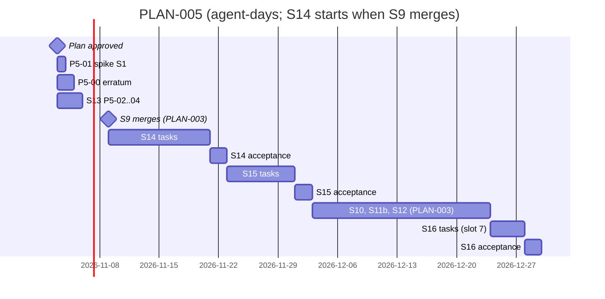

# PLAN-005: ADR-004, one audit log

## Summary

**What ships:** four stories and 30 tasks (26 drafted; grooming on TICK-449 added P5-12c and split P5-10, P5-13 and P5-34), plus a spike and one erratum request:

1. **S13: offline verification.** The export file format, the hash chain and `nava audit verify`, tested against golden vectors. It touches only new files, so it **starts now, in parallel with S9**.
2. **S14: one log.** `audit_log` and `audit_chain_head`, `audit.Append`, the patch walker and secret rejection, the generated writer grants and commit-check trigger, records and S8 publishing switched to the new log, the S8 backfill (migration A), and the reader API behind `audit.read`.
3. **S15: the sealer.** The `audit.seal` allow-list entry, non-record start rows (A6.3), onboarding seeding (A6.2), the self-rescheduling sealer, and migration B.
4. **S16: export.** The anchored, filtered, verifiable export (JSONL and CSV), `chain:reseed`, and erasure proven end-to-end.

**Order:** S1 spike and S13 now → S9 merges → S14 → S15 → S10 → S11b → S12 → S16 (lane-A slots 2, 3 and 7; see "Lane-A order"). S14 takes the next lane-A slot, **before S10** (D-5-2).

**The one risk that matters most:** the commit-check trigger's cost on record writes (R-A4). **Spike S1 (P5-01) measures it first.** If it misses ≤ 10% p95, record tables fall back to the existing single-writer architecture test (P3-13), and only configuration tables keep the trigger. The ADR already defines that fallback, so a fail changes one task (P5-13b), not the plan.

**Found while planning (design and code have diverged; handled in this plan):**

1. **S9 already has an `audit_log`** on its story branch (`20261101190000_records_pipeline.sql`), in a different shape: `before`/`after` jsonb snapshots, `record_id` FK, no chain. ADR-004 does not mention it. → D-5-1.
2. **The pipeline's idempotent replay reads `audit_log.idempotency_key`** (PLAN-003 D-3-13, `store.AuditByKey`). ADR-004 R1 has no such column. → D-5-3: the key moves to its own table, and R1 is unchanged.
3. **ADR-004 R2's closed `action` list has no entry for the cascade audit rows** that ADR-001-A5 (`cascade_cycle`) and PLAN-003 D-3-7a (`ErrCascadeTooDeep`) require. The R2 unique key would also collide for a second entry on the same (transaction, record, version). → **P5-00 asks the Solution Architect for erratum ADR-004-E1.** P5-12b and P5-13b wait on it (P5-13a does not). E1 also carries `diff_truncated` into R1.

**A line for nava (timeline):** putting S14 **and S15** ahead of S10 moves S10, S11b and S12 back by both stories plus their acceptances: 12 to 15 plus 8 to 10 agent-days of tasks, plus about 4 days of acceptance, so **about 4 to 5 weeks**. S16 runs after S12. That is the cheaper order (D-5-2). If you would rather have S10 first, say so: S14 then waits, and S10, S11b and S12 build their audit writes on the S9 table and are reworked later.

## Decisions this plan makes

| # | Decision |
|---|---|
| **D-5-1** | **S9 finishes on its own audit table, unchanged; S14 replaces it.** S9 is mid-flight (P3-13, P3-14 and TICK-88 are open). Re-cutting it now would put its acceptance at risk for no gain. In S14, P5-10a's migration renames S9's table (and its indexes, constraints and policies) to `audit_log_v0`, and the same PR re-points every by-name reader (store, isolation registry, S9 tests, `db/grants.yaml`) at it, so the story branch and S9's isolation guards stay green. P5-10b creates the ADR-004 `audit_log`. P5-13b moves the pipeline onto `audit.Append` and revokes INSERT on v0. **P5-17 drops `audit_log_v0`, rows included,** in the same PR that rebuilds the history endpoint, so that endpoint is never broken between PRs (grooming, TICK-449). **The cut, said out loud:** S9-era audit rows are not carried into the new log. No release contains S9 without S10 (AR-S9-01), so only dev and CI data is lost. The S9 history endpoint (P3-15) is rebuilt on the new reader in P5-17, about half a day of rework. |
| **D-5-2** | **S14 takes the lane-A slot after S9, before S10.** S14 rewrites `internal/records/pipeline`, `internal/records/store`, `db/grants.yaml`, `api/errors.yaml` and the OpenAPI bundle, which every later lane-A story touches too. Under story independence it cannot run alongside them. Going first means S10's masks, S11b's cascade rows and S12's comment audit are built once, on the final table. S15 and S16 are released when no open lane-A story shares a file with them. At release, the Technical Lead checks the file lists below against the open story. |
| **D-5-3** | **The idempotency key leaves the audit log** (revises PLAN-003 D-3-13). There is a new table `record_write_keys(tenant_id, idempotency_key, definition_id, action, record_id, number, version, schema_version, audit_entry_id)`, `CONSTRAINT record_write_keys_pkey PRIMARY KEY (tenant_id, idempotency_key)` (named: the concurrent-duplicate path matches it), with canonical RLS and FORCE. Created in P5-10b; replay moves in P5-13a. The pipeline writes it in the write transaction and `replay` reads it. `audit_entry_id` is a soft pointer to the primary entry with no FK (the partitioned PK is `(tenant_id, occurred_at, id)`); replay never reads the entry. It is exempt in `db/audited-tables.yaml` ("dedupe index of a write that is already audited"). ADR-004 R1 is unchanged, so no ADR change is needed. Epic 30 erasure does not need to touch it: it holds no record data. |
| **D-5-4** | **`audit.read` and `audit.export` are checked by `authz.RequireAuditPermission(ctx, tx, p, perm)`.** It allows a tenant admin (D-3-3) or a member of the tenant's onboarded `auditors` group, identified by id in `tenant_auditor_group(tenant_id PK, group_id)`, which mirrors `tenant_admin_group` (D-3-3, ADR-002 §1.4: never by path). Onboarding creates the group. No other permission implies either one (R8). Owned by P5-18; reviewed by Security. |
| **D-5-5** | **Masks come through a port.** The reader and the export take an `audit.Masker` (`Masks(ctx, reader, subject) []jsonpointer`). S14 ships a fixture masker for tests and a production masker that returns S8's `x-nava-secret`/`writeOnly` paths only. **S10 plugs its field masks into the port.** That task, with CI-A12 on real masks, is recorded now as `TODO-S10-01` in `docs/delivery/todo.md` (Security, grooming), and becomes an S10 task when S10's tasks are created (PLAN-003 D-3-8). |
| **D-5-6** | **`nava audit verify` ships as a new binary, `cmd/nava`, with an `audit verify <file>` subcommand.** No `nava` CLI exists yet. The verifier imports only `internal/audit/chain` and `internal/audit/verify`, never the database or the network, and an `arch_test` enforces that. |
| **D-5-7** | **Golden vectors are the S13↔S14↔S15 contract.** `internal/audit/chain/testdata/vectors.json` (envelope → JCS bytes → `envelope_sha256` → `entry_hash`, plus `diff_sha256`) is committed in P5-02. The writer (P5-12b), the sealer (P5-34a) and the verifier (P5-03) each test against the same file. Changing it is a breaking change to `docs/api/audit-export-v1.md` and needs Technical Lead review. |
| **D-5-8** | **Migration B goes in S15, not S14.** It seeds the first `audit.seal` start row per tenant. Without the R18 allow-list entry and a registered sealer, the relay would start a denied workflow and the row would go dead. Between S14 and S15, S8 publishes write entries with no commit trigger on the entity-definition tables. ADR-004 R25 has the same window between the deploy and migration B, and P5-15's backfill is re-run by B, so nothing is lost. |
| **D-5-9** | **`chain:reseed` goes in S16, with the export.** That keeps S15 free of `api/` files, so S15 can run alongside an open lane-A story that does not touch `db/grants.yaml`. S15's kit proves sealing and recovery from a killed run. S16's kit proves reseed. |
| **D-5-10** | **Erasure is proven without the Epic 30 job.** The role, grants and R11 erase transition land in P5-10b. The verifier's `tampered` and `pending` outcomes land in P5-03. P5-42 runs CI-A7 end-to-end with a test-only erase helper that connects as `nava_erasure`. The erasure job itself and its record-table grants stay with Epic 30. |
| **D-5-11** | **Review standard.** D-P10 applies. `internal/audit/` is added to the `security` paths in `review-paths.yaml` by P5-02. Every migration gets the Postgres and Security reviewers. The Technical Lead reviews every Principal Software Engineer change. P5-02, P5-03, P5-34a and P5-34b also get the Technical Architect, because they define and consume the hash chain. |
| **D-5-12** | **Grooming meeting: yes.** This plan cuts into an in-flight story (D-5-1), reorders lane A (D-5-2) and revises D-3-13 (D-5-3). Held on TICK-449; outcome in D-5-13. |
| **D-5-13** | **Grooming outcome (TICK-449).** D-5-1, D-5-2, D-5-3, D-5-8 and D-5-9 stand; no dissent. Task changes: new **P5-12c** `internal/audit/jsondiff` (deterministic RFC 6902; nothing produced the diff C2 consumes). **P5-10 → 10a** (rename, depends on S9 only) **+ 10b** (new tables, `record_write_keys`, `diff_truncated`, `nava_erasure` and its CI credential). **P5-13 → 13a** (`record_write_keys` replay; no erratum wait) **+ 13b** (`audit.Append`, trigger attachment, cascade rows). **P5-34 → 34a** (activities) **+ 34b** (workflow, metrics, kill, poison). P5-10 no longer waits for S13. The commit-check trigger attaches to `records` in P5-13b. The tenant comes from `app.tenant_id` in C2 and C5 (I2): both lose their tenant field/argument. **`diff_truncated` is a stored column inside the hashed envelope** (Solution Architect, via ADR-004-E1); past 64 KB the diff keeps whole ops and `diff_sha256` covers the stored bytes. P5-18 back-fills the auditors group for existing tenants. P5-42 depends on P5-35. |

## Interface contracts (fixed before either side starts)

**C1 · `internal/audit/chain` (P5-02 produces; P5-03, P5-12b and P5-34a consume)**

```go
type Envelope struct { /* exactly the R1 envelope columns, JSON tags = column names */ }
func CanonicalEnvelope(e Envelope) ([]byte, error)   // JCS per audit-export-v1.md
func EnvelopeSHA256(e Envelope) ([32]byte, error)
func EntryHash(prev [32]byte, envelopeSHA [32]byte) [32]byte
func DiffSHA256(salt [16]byte, diff []byte) [32]byte
var Genesis [32]byte // 32 zero bytes
```

**C2 · `audit.Append` (P5-12b produces; P5-13b, P5-14, P5-34a and P5-40 consume)**

```go
type Entry struct {
    ID uuid.UUID // UUIDv7, set by Append if zero; no TenantID: Append reads app.tenant_id (I2), ErrInvalidEntry if unset
    Domain Domain; Action Action; SubjectType SubjectType; SubjectID uuid.UUID
    EntityDefinitionID *uuid.UUID; VersionBefore, VersionAfter *int64
    Actor Actor // exactly one of PrincipalID or System
    Source Source; SourceRef *string; ChangeSetID, CausationID *uuid.UUID; CausationDepth int16
    RequestID *string; ContentSHA256 *[32]byte
    Diff []byte // RFC 6902 bytes; nil for none
    SecretPaths []jsonpointer // from the subject's schema: x-nava-secret and writeOnly
}
func Append(ctx context.Context, tx pgx.Tx, e Entry) (uuid.UUID, error)
// errors: *ErrSecretInDiff{Path} (code audit_secret_in_diff), ErrInvalidEntry
```

`Append` walks the diff (R5), rejects secrets (R6), truncates past 64 KB by keeping whole ops and setting the stored `diff_truncated` column (inside the hashed envelope, ADR-004-E1), draws the salt and computes `diff_sha256`. It never sets `occurred_at`, `txid`, `backfilled`, or the seal or erasure columns (R10).

**C3 · Reader (P5-17): `GET /api/v1/audit/entries`.** Query: `from`, `to`, `domain`, `subject_type`, `subject_id`, `change_set_id`, `after_seq`, `page_token`, `limit ≤ 500`. Each item has the R1 envelope, `diff` (masked per reader), `diff_redacted`, `diff_salt` only when not redacted, `sealed`, and `seq`/`entry_hash` when sealed. 403 `forbidden` without `audit.read`. The per-record history `GET /api/v1/records/{entity}/{id}/history` reads the same table, `domain = record`, gated on the record ACL, masked.

**C4 · Export file (P5-02 writes the spec; P5-40 produces; P5-03 consumes):** `docs/api/audit-export-v1.md`. The format is JSONL `nava.audit.export/v1`: a header line, then the anchor (a stub or genesis), then full entries and stub lines in `seq` order, then unsealed lines, then a trailer `{anchor_seq, last_seq, head_hash, count, stub_count, unsealed_count, verifiable}`. CSV has the same lines.

**C5 · Seal start row (P5-31 produces; P5-32, P5-33 and P5-34a consume).** `outbox.EnqueueSeal(ctx, tx, headVersion int64) (outboxID uuid.UUID, error)` (no tenant argument: the tenant comes from the tx's `app.tenant_id`; the caller holds the head row `FOR UPDATE`; the row's `dedupe_key` is `audit.seal:<headVersion>`) inserts `kind = 'audit.seal'`, `target_key = 'audit.seal:<id>'`, `target_seq = headVersion`, payload `{}`, and no `workflow_ref`. The relay starts it as `t:<tenant>:audit.seal:<id>` (A6.3).

## Task graph

```mermaid
flowchart LR
  E1[P5-00 erratum ADR-004-E1<br/>Solution Architect]:::gate
  SP[P5-01 spike S1<br/>postgres-dev]:::gate
  S9[S9 TICK-335 merged to main]:::gate
  subgraph S13[S13 offline verify, starts now]
    T02[P5-02 chain + format + vectors<br/>core-dev] --> T03[P5-03 verifier + cmd/nava<br/>core-dev] --> T04[P5-04 S13 kit<br/>qa]
  end
  subgraph S14[S14 one log, after S9 and S13 merge]
    T10a[P5-10a v0 rename<br/>postgres-dev]
    T10[P5-10b tables, triggers, roles<br/>postgres-dev]
    T11[P5-11 manifest, generated grants, commit check<br/>postgres-dev]
    T12a[P5-12a patch walker + secrets<br/>core-dev]
    T12c[P5-12c jsondiff<br/>core-dev]
    T12b[P5-12b audit.Append<br/>core-dev]
    T13a[P5-13a replay on record_write_keys<br/>core-dev]
    T13[P5-13b pipeline on audit.Append<br/>core-dev]
    T14[P5-14 S8 publish audited<br/>backend-dev]
    T15[P5-15 migration A backfill<br/>postgres-dev]
    T18[P5-18 auditors group + permission<br/>backend-dev]
    T17[P5-17 reader API + history<br/>backend-dev]
    T19[P5-19 isolation + role matrix<br/>security]
    T20[P5-20 S14 kit<br/>qa]
    T10a --> T10 --> T11 --> T13
    T10 --> T12b
    T10 --> T13a --> T13
    T12c --> T13
    T12c --> T14
    T12a --> T12b --> T13
    T12b --> T14
    T10 --> T15
    T18 --> T17
    T13 --> T17
    T13 --> T19
    T14 --> T19
    T17 --> T19
    T15 --> T20
    T19 --> T20
  end
  subgraph S15[S15 sealer]
    T30[P5-30 allow-list audit.seal<br/>security]
    T31[P5-31 non-record start rows<br/>core-dev]
    T34a[P5-34a sealer activities<br/>core-dev]
    T34[P5-34b sealer workflow<br/>core-dev]
    T33[P5-33 onboarding seeds<br/>backend-dev]
    T32[P5-32 migration B<br/>postgres-dev]
    T36[P5-36 S15 kit<br/>qa]
    T31 --> T34a --> T34
    T30 --> T34
    T31 --> T33
    T34 --> T32
    T33 --> T36
    T32 --> T36
  end
  subgraph S16[S16 export]
    T40[P5-40 JSONL export<br/>backend-dev] --> T41[P5-41 CSV<br/>backend-dev]
    T40 --> T35[P5-35 chain:reseed<br/>backend-dev]
    T40 --> T42[P5-42 erasure + export isolation<br/>security]
    T35 --> T42
    T41 --> T43[P5-43 S16 kit<br/>qa]
    T42 --> T43
    T35 --> T43
  end
  SP --> T11
  SP --> T10
  S9 --> T10a
  T02 --> T12b
  E1 --> T12b
  E1 --> T13
  T20 --> T31
  T20 --> T30
  T36 --> T40
  classDef gate fill:#fde68a,stroke:#b45309
```



**Critical path:** S9 merge → P5-10a → P5-10b → P5-11 → P5-13b → P5-17 → P5-19 → P5-20 → S14 acceptance → P5-31 → P5-34a → P5-34b → P5-32 → P5-36 → S15 acceptance → P5-40 → P5-41 → P5-43. S13 and the spike finish while S9 is still open. **The erratum (P5-00) must land before P5-12b and P5-13b start**, about 2 to 4 agent-days into S14 (P5-13a no longer waits for it). If it has not, the Technical Lead escalates to the CTO on that day.



**Estimates (after grooming):** S13 is 2 to 3 agent-days. S14 is 12 to 15. S15 is 8 to 10. S16 is 4 to 6. Add 1 for the spike. That is 27 to 35 agent-days. **S14 and S15 finish about 4 to 5 calendar weeks after S9's merge**, with the WIP cap of 3 and about 2 days per acceptance. S16 sits in lane-A slot 7, so it lands after S12; the Gantt's 21-day bar for S10 to S12 is a placeholder, and PLAN-003 owns that number. *Assumptions:* S9 merges around 2026-11-09, and the relay and worker take a new workflow type without harness changes (S11a did). *Guesses:* P5-34b (the sealer's kill and poison cases are new ground), P5-11 (the grant generator is a new kind of thing for `nava-db`), and S9's merge date.

## Stories

Stories are assigned to the Technical Lead and parented to Epic 05 (TICK-8). Each starts in `backlog`.

| Story | Issue | Try it as | Branch (created at release) |
|---|---|---|---|
| S13 An auditor verifies an audit export offline, and any tampering is caught | TICK-418 | `nava audit verify` on the kit's sample files | `TICK-418/audit-verify-offline` |
| S14 Every record and entity-type change lands in one audit log that an auditor can read | TICK-419 | Bruno `S14 audit` as `admin@tenant-a.test`, `auditor@tenant-a.test` (seeded by P5-18), `alice@tenant-a.test`, `bob@tenant-b.test` | `TICK-419/one-audit-log` |
| S15 Each tenant's audit entries are sealed into a hash chain within seconds | TICK-420 | Bruno `S15 seal` + `docker compose kill worker` | `TICK-420/audit-sealer` |
| S16 An auditor exports a filtered audit log and proves it complete offline | TICK-421 | Bruno `S16 export` + `nava audit verify` | `TICK-421/audit-export` |


## Tasks

| Task | Role | Depends on | ADR parts | Reviewer |
|---|---|---|---|---|
| P5-00 erratum ADR-004-E1 (R2 cascade actions + R1 `diff_truncated`) | Solution Architect | none | R1, R2, ADR-001-A5 A5-4, PLAN-003 D-3-7a | Technical Architect, CTO |
| P5-01 spike S1 | postgres-dev | none | R-A4, R10 on PG 16.10, R21 caps | Technical Architect, Technical Lead |
| P5-02 chain, format spec, golden vectors | core-dev | none | R13, R20, R22 (spec), C1, C4 | Technical Lead, Technical Architect, Security |
| P5-03 verifier and `cmd/nava` | core-dev | P5-02 | R20, R22, R24; CI-A6 (file half), CI-A7 and CI-A14 (verifier half), the tampered-`diff_truncated` vector fails as `tampered` | Technical Lead, Technical Architect |
| P5-04 S13 kit | qa | P5-03 | CI-A6 file cases | Technical Lead |
| P5-10a v0 rename and re-point readers | postgres-dev | S9 merged | D-5-1 | Technical Architect, Security |
| P5-10b tables, triggers, roles, `record_write_keys` | postgres-dev | P5-10a, P5-01 | R1 (+`diff_truncated`), R2, R9, R10, R11, R14, R28, A6.1, D-5-3; CI-A10, CI-1/CI-3 | Technical Architect, Security |
| P5-11 manifest, generated grants, commit-check function | postgres-dev | P5-10b, P5-01 | R12, decision 2; CI-A3 | Security, Technical Lead |
| P5-12a patch walker and secret rejection | core-dev | S14 open | R5, R6; CI-A5 (walker half) | Security, Technical Lead |
| P5-12c `internal/audit/jsondiff` | core-dev | S14 open | R1 `diff` (RFC 6902, deterministic) | Technical Lead, Technical Architect |
| P5-12b `audit.Append` | core-dev | P5-10b, P5-12a, P5-02, P5-00 | C2, R1, R3, R4, R6, R13; CI-A1 (unit), CI-A5 | Technical Lead, Postgres |
| P5-13a replay on `record_write_keys` | core-dev | P5-10b | D-5-3, D-3-13; CI-A1 (keys) | Technical Lead, Postgres, Security |
| P5-13b pipeline on `audit.Append`, trigger attached, v0 read-only | core-dev | P5-11, P5-12b, P5-12c, P5-13a, P5-00 | decision 1–2, R4, D-5-1, A5-4; CI-A1, CI-A2 (records) | Technical Lead, Postgres, Security |
| P5-14 S8 publish audited | backend-dev | P5-12b, P5-12c | R3, R6 (`config_secret_in_content`, scanner) | Principal Software Engineer, Security |
| P5-15 migration A backfill | postgres-dev | P5-10b | R25, R26 | Security, Technical Architect |
| P5-17 reader API and per-record history, drop v0 | backend-dev | P5-13b, P5-18 | C3, R7, R8, D-5-1; CI-A12 (fixture masker), CI-A14 (read) | Security, Principal Software Engineer |
| P5-18 auditors group and `RequireAuditPermission` | backend-dev | S14 open | R8, D-5-4 | Security |
| P5-19 isolation and role matrix | security | P5-13b, P5-14, P5-17 | CI-A4 (read), CI-A5 (bytes), CI-A10 | QA |
| P5-20 S14 kit, fresh stack | qa | P5-15, P5-19 | CI-A11 | Technical Lead |
| P5-30 `audit.seal` on the workload allow-list | security | S15 open | R18, ADR-001-A1 | Technical Architect |
| P5-31 non-record start rows | core-dev | S15 open | A6.3, C5; A6.3 relay test | Technical Lead, Technical Architect |
| P5-33 onboarding seeds head and first seal row | backend-dev | P5-31 | A6.2, R16 seeding; CI-A16 (onboarding) | Security, Postgres |
| P5-34a sealer activities A1/A2 | core-dev | P5-31 | R13–R15 | Technical Lead, Technical Architect, Postgres |
| P5-34b sealer workflow | core-dev | P5-34a, P5-30 | R16, R-A2 metrics; CI-A16 | Technical Lead, Technical Architect, Postgres |
| P5-32 migration B | postgres-dev | P5-34b, P5-15 | R25, R26, R27; CI-A9, CI-A3 (R26.3) | Security, Technical Architect |
| P5-36 S15 kit, fresh stack | qa | P5-32, P5-33 | CI-A16 (stack) | Technical Lead |
| P5-40 JSONL export | backend-dev | S16 open | R19, R20, R21, R7 salt rule; CI-A6, CI-A8, CI-A14 | Security, Principal Software Engineer, Technical Architect |
| P5-41 CSV export | backend-dev | P5-40 | R22; CI-A15 | Security |
| P5-35 `chain:reseed` | backend-dev | P5-40 | R17; CI-A16 (reseed) | Security |
| P5-42 erasure end-to-end and export isolation | security | P5-40, P5-35 | R11, R23, R24; CI-A7, CI-A4 (export, stubs, reseed) | QA, Postgres |
| P5-43 S16 kit, fresh stack | qa | P5-41, P5-42, P5-35 | CI-A6 (stack) | Technical Lead |

**Files each story changes** (checked for overlap at release, D-5-2):

- **S13:** new `internal/audit/chain/`, `internal/audit/verify/`, `cmd/nava/`, `docs/api/audit-export-v1.md`, `docs/acceptance/S13/`; one line in `docs/delivery/review-paths.yaml`; `Taskfile.yml`/`Makefile` build targets for `cmd/nava`. **No overlap with S9** (`internal/records/`, `api/`, `db/` untouched).
- **S14:** `db/migrations/` (new files), `db/grants.yaml`, new `db/audited-tables.yaml`, `cmd/nava-db` (grant generator), `internal/audit/` (new subpackages), `internal/records/pipeline`, `internal/records/store`, `internal/metadata` or the S8 publish path, `internal/authz`, `internal/onboard`, `api/openapi.yaml`, `api/paths/audit.yaml` (new), `api/errors.yaml`, the Bruno collection, `docs/acceptance/S14/`.
- **S15:** `temporal-server/authz/policy.go` (+ tests), `internal/outbox`, `internal/relay` (only if A6.3 needs it), `internal/audit/seal/` (new), `cmd/nava-worker`, `internal/onboard`, `db/migrations/` (new files), `db/grants.yaml`, `deploy` alert rules, `docs/acceptance/S15/`. **No `api/` files** (D-5-9).
- **S16:** `internal/audit/export/` (new), `api/openapi.yaml`, `api/paths/audit.yaml`, `api/errors.yaml`, the Bruno collection, a test-only erase helper under `internal/audit/erasetest/`, `docs/acceptance/S16/`.

## Invariant coverage

The project description carries no invariant list, so this is checked against ADR-001 I1–I9, as the ADR does.

| Invariant | Enforced by |
|---|---|
| I1 tenant isolation (RLS, canonical policies, allow-list unchanged) | P5-10b (FORCE RLS, canonical policies), P5-11 (generated policies), P5-15/P5-32 (temporary canonical migrator policies, catalogue gate), P5-19 and P5-42 (CI-A4). |
| I2 tenant from platform context | P5-12b (`tenant_id` from the tx's `app.tenant_id`), P5-31 (`outbox.tenant_id`). |
| I3 least-privilege roles, grants from the manifest | P5-10b (`nava_erasure`, A6.1), P5-11 (writer grants generated), P5-33 (A6.2 pinned policies), P5-19 (CI-A10). |
| I6 workflows start only from committed outbox rows | P5-31 and P5-34b (seal runs are ordinary D22 starts). |
| I7 idempotency | P5-13a (`record_write_keys` keeps D-3-13 replay), P5-15/P5-32 (UUIDv5 ids plus `NOT EXISTS` dedupe), P5-33 (head PK), P5-34a (`next_seal_outbox_id`). |
| I8 no tenant DDL | P5-10b (subject types are a platform CHECK). |
| I9 causation and cascades | P5-13b (causation columns, cascade rows per P5-00). |
| Temporal determinism | P5-34a and P5-34b (seal workflow under the replay gate; activities hold only counts and ids). |

Nothing that enforces an invariant is cut.

## The cut

| Cut | Why | Trigger to revisit / owner |
|---|---|---|
| S9-era audit rows are dropped, not migrated (D-5-1) | No released data. Converting snapshots to RFC 6902 diffs costs a day and serves only dev data. | None; a one-time event. |
| CI-A13 (promotion and rollback entries) | Change sets do not exist yet. | Epic 28 planning; its stories carry CI-A13. Technical Lead. |
| The closed adapter and plugin schema lint (R6) | No adapter or plugin schema exists. | The first adapter or plugin schema; that task adds the lint. Technical Lead. |
| Partition management (R28) | ADR: Epic 30 owns it. M1 runs on the DEFAULT partition. | Epic 30. |
| The erasure job | ADR: Epic 30. The transition, role and verifier are proven here (D-5-10). | Epic 30. |
| External anchoring | ADR R-A1, deferred by the CTO. | A regulated buyer asks (AR-TICK-409-01). |
| Audit entries for other configuration types | Epics 06, 10, 11, 12, 16, 17, 20 and 28 register their own subject types and manifest rows (ADR Consequences). | Each epic's planning. |

## Tracker

| Item | Issue |
|---|---|
| S13 | TICK-418 |
| S14 | TICK-419 |
| S15 | TICK-420 |
| S16 | TICK-421 |
| P5-00 | TICK-422 |
| P5-01 | TICK-423 |
| P5-02 | TICK-424 |
| P5-03 | TICK-425 |
| P5-04 | TICK-426 |
| P5-10a | TICK-427 |
| P5-10b | TICK-450 |
| P5-11 | TICK-428 |
| P5-12a | TICK-429 |
| P5-12b | TICK-430 |
| P5-12c | TICK-451 |
| P5-13a | TICK-431 |
| P5-13b | TICK-452 |
| P5-14 | TICK-432 |
| P5-15 | TICK-433 |
| P5-18 | TICK-434 |
| P5-17 | TICK-435 |
| P5-19 | TICK-436 |
| P5-20 | TICK-437 |
| P5-30 | TICK-438 |
| P5-31 | TICK-439 |
| P5-34a | TICK-440 |
| P5-34b | TICK-453 |
| P5-33 | TICK-441 |
| P5-32 | TICK-442 |
| P5-36 | TICK-443 |
| P5-40 | TICK-444 |
| P5-41 | TICK-445 |
| P5-35 | TICK-446 |
| P5-42 | TICK-447 |
| P5-43 | TICK-448 |

### Lane-A order (CTO ask, grooming TICK-449)

S15 touches `db/grants.yaml` and `internal/onboard`, and S16 touches `api/`, so both overlap S10 to S12 in practice and run serially in lane A. The order below is the M1 critical path; at each release the Technical Lead re-runs the file check, and a change to this order is a decision-log entry.

| Slot | Story | Estimate (agent-days, tasks only; add about 2 per acceptance) | Why here |
|---|---|---|---|
| 1 | S9 (TICK-335) | in flight (PLAN-003) | already open |
| 2 | S14 (TICK-419) | 12 to 15 | D-5-2: S10 to S12 build their audit writes once, on the final table |
| 3 | S15 (TICK-420) | 8 to 10 | straight after S14, to close the unsealed window early (CTO) |
| 4 | S10 | per PLAN-003 | plugs real masks into `audit.Masker` (TODO-S10-01) |
| 5 | S11b | per PLAN-003 | cascade rows on `audit.Append` |
| 6 | S12 | per PLAN-003 | comment audit on `audit.Append` |
| 7 | S16 (TICK-421) | 4 to 6 | after S12: shares `api/openapi.yaml`, `api/paths/`, `api/errors.yaml` with S10 to S12 |

S13 (TICK-418, 2 to 3) runs now, outside lane A (new files only). S14's estimate rose by about 2 agent-days at grooming (P5-12c, the 10a/10b and 13a/13b splits); S15's by about 2 (34a/34b).
