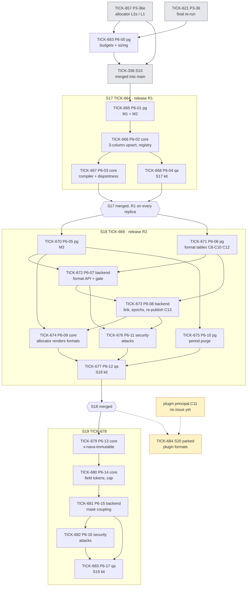
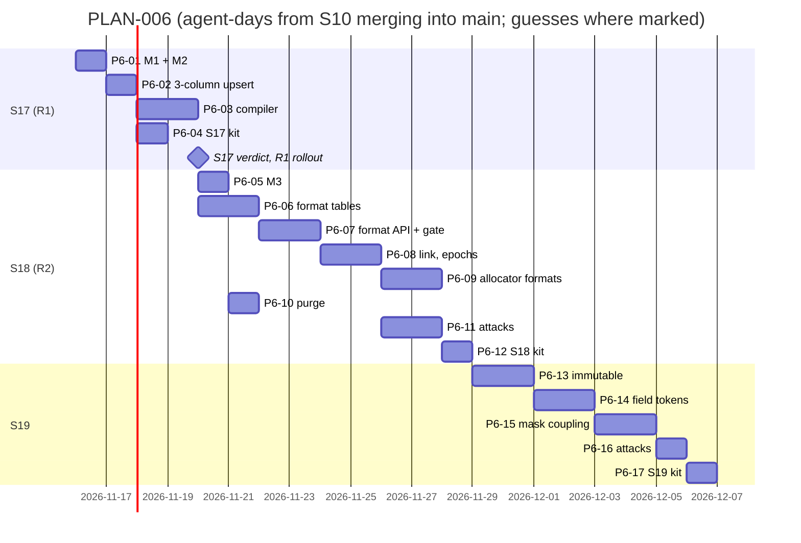

# PLAN-006: ADR-005 record numbering

## Summary

**What ships, and when.** Milestone 2. Configurable formats are not on the Milestone 1 path: S10 (TICK-336) ships on the default format `<PREFIX><7 digits>`, and no one is waiting on formats. Nothing in this plan starts before S10 has merged into `main`.

| Order | Issue | What | ADR-005 |
|---|---|---|---|
| 0 | TICK-657 (S10, existing) | The allocator: `gaps` on L2s, `gapless` on L1. **Not a PLAN-006 task**; amended on the issue with A1–A8, the PgBouncer point and the §2.1.1 mode-switch test (D-6-1) | §12 step 1 |
| 0 | TICK-663 P6-00 (S10) | `docs/budgets.md` rows and the allocator pool in the connection sizing | §10, A5 |
| 1 | TICK-664 **S17** | Counter key expand (M1, M2) and the 3-column upsert, release **R1**; plus the format compiler | §12 step 2, §3.1, §3.3 |
| 2 | TICK-669 **S18** | M3, then format tables, links, epochs, the admin API, the allocator rendering formats, mandatory purge; release **R2** | §12 step 2 (M3), step 3 |
| 3 | TICK-678 **S19** | Field tokens (enum only), `x-nava-immutable`, the coupled mask publish and re-check | §12 step 4 |
| — | TICK-684 **S20** | Plugin-authored formats. **Parked** in `backlog` on the plugin principal (C11) | §3.2 P-a, §3.7 C11 |

Feature: TICK-662. Everything is created in `backlog`.

**The one risk that matters most:** M3 is a point of no return. After it, a pre-S17 binary cannot take a number (`ON CONFLICT` no longer matches a constraint). If M3 ran in the same release as the 3-column code, old replicas would fail every create during the rolling deploy. D-6-2 puts M3 in a later story than M1, M2 and the new code, so "deploy fully rolled out, then M3" is a release boundary, not a promise in a runbook.

## Decisions this plan makes

| # | Decision |
|---|---|
| **D-6-1** | **No second allocator task.** ADR-005 §12 step 1 is TICK-657 (P3-36e). Its acceptance criteria had the weaker "switching continues from the counter" test, not the §2.1.1 mode-switch test, and its cut still said "no `synchronous_commit = off`". The issue is amended (2026-11-10): L2s with `tenancy.AllocTx` and rules A1–A8, the pinned mode-switch test (8 creators, `gaps` → `gapless` → `gaps`, forced failures, no shared number), and the PgBouncer point in D-6-6. The Principal Software Engineer had not started it, so nothing is rebuilt. |
| **D-6-2** | **M3 ships one release after M1, M2 and the 3-column code.** S17 = R1 (M1, M2, the code). S18 = R2, and M3 is its first task (TICK-670). S18 depends on S17 merged **and R1 running on every replica** (the runbook from TICK-665). This splits ADR-005 §12 step 2 across two stories; the order M1 → M2 → deploy → M3 is unchanged. |
| **D-6-3** | **S17 is a story, not a task.** The human can try it: a counter at 42 before the upgrade gives `INC0000043` after it, on both modes. It has a kit (TICK-668) because it is a release on its own. |
| **D-6-4** | **The template compiler (TICK-667) moves forward into S17.** It is pure Go behind `ErrTemplatesUnavailable` and the publish gate, so it changes no runtime path. In S17 it runs while the kit is built and R1 rolls out. In S18 it would sit on the critical path (compiler → API → link). The disjointness rule is the riskiest logic in the ADR, and its property test now runs first. |
| **D-6-5** | **The 1,000 cardinality cap moves to S19 (TICK-680).** ADR-005 §4.3 defines it over `{field:…}` tokens, which only exist in S19. In S18 a field token is refused at compile time, so there is nothing to cap. `period_end` and the mandatory purge stay in S18 (TICK-675), because date scopes arrive there. |
| **D-6-6** | **The allocator pool needs its own server-side capacity at PgBouncer.** A5 requires a dedicated pool so that `InTenantTx` cannot starve the allocator. Both pools log in as `nava_app` through the same PgBouncer (user, database) pool (`deploy/compose/pgbouncer/pgbouncer.ini`, `default_pool_size = 20`; CI 5). A second `pgxpool` alone moves the deadlock into PgBouncer, where the 200 ms timeout turns it into `ErrRetryable` under load. TICK-657 chooses the separation (for example its own PgBouncer database alias) and proves it through PgBouncer; TICK-663 writes the totals down. |
| **D-6-7** | **Error codes the ADR does not name, pinned here:** `number_format_invalid` (422: grammar, unknown token, and the field rules in S19 with a `rule` detail), `number_format_overlap` (422: disjointness), `field_immutable` (422), `mask_conflicts_number_format` (422). Codes the ADR names keep their names: `number_format_prefix_required`, `number_format_not_found`, `numbering_templates_unavailable`, `number_space_exhausted`. |
| **D-6-8** | **"Admin UI" means the tenant-admin API in this plan.** The repo has no front-end code, so S18 and S19 deliver the admin API that a UI would call; Bruno is how the human tries it. *Trigger:* when a UI lands (TICK-660 is the first UI task on numbering), the Technical Lead adds the format screens to the story open at that time. |
| **D-6-9** | **Format write permission for admins is entity-definition publish.** ADR-005 introduces `number_format:write` only as a plugin token scope (C11 point 5). Until S20, a format publish needs the same right as a definition publish, and linking still needs publish on each type (C13). |
| **D-6-10** | **The budgets task lands in S10 (TICK-663).** The pool it sizes is built in S10, and the L1 waiver value comes from the TICK-621 final re-run. |
| **D-6-11** | **The D-3-9 row in PLAN-003 is replaced with ADR-005 §11's text** in a docs PR into `TICK-336/group-acl-masking`, where PLAN-003 is maintained during S10 (the same branch as PR #551). PR #551's description is corrected: it said "gapless deferred" and "P3-36d"; the merged files already said per-type mode and P3-36e. |
| **D-6-12** | **No grooming meeting.** As with D-E7-5: the acceptance criteria are ADR-005's pinned tests and Security's conditions, which the triad has already reviewed. The Solution Architect's plan verdict is the check. |

## Task graph

**Critical path:** S10 merged → TICK-665 → TICK-666 → TICK-667 → S17 accepted, merged and R1 rolled out → TICK-671 → TICK-672 → TICK-673 → TICK-674 → TICK-677 → S18 accepted → TICK-679 → … → TICK-683 → S19 accepted.

**Estimates** (agent-days; ranges, with what drives them):
- **S17: 3–5.** M1/M2 are measured catalog-only steps; the compiler's property test is the uncertain part (guess: 1.5–2.5).
- **S18: 9–14.** Two API tasks with full scenario lists and the C10 race test drive it. The 60 s gate TTL and the midnight test are small. The upper end is a guess that covers the PgBouncer and time-zone fixtures.
- **S19: 6–9.** `x-nava-immutable` touches five write paths (one test each); the mask re-check touches every ACL and mask route. A guess: the number of routes is not yet counted.
- **TICK-663: 0.5–1.** Docs and two ini files, once TICK-657 has chosen the PgBouncer route.

## Files per story (overlap check)

| Story | Expected files | Overlap |
|---|---|---|
| S17 | `db/migrations/` (new), the allocator upsert (`internal/records/store/numbering.go`, `internal/tenancy`), `internal/records/pipeline`, new `internal/records/numbering/`, `internal/tenancy/isolation/registry.go`, `docs/data/record-counters-scope-key.md`, `docs/acceptance/S17/`, Bruno `S17` | All of the allocator files are S10's today (TICK-657): S17 starts only after S10 merges into `main`. |
| S18 | `db/migrations/`, `db/grants.yaml`, `db/audited-tables.yaml`, `internal/records/numbering/`, the allocator, `internal/records/pipeline`, `internal/entitytypes`, a new number-format admin package, `api/`, `internal/purge`, `registry.go`, the S17 runbook, `docs/acceptance/S18/`, Bruno `S18` | Same packages as S17: depends on S17 merged. |
| S19 | `internal/records/numbering/`, the write pipeline (PATCH, bulk, import, worker writes), `internal/entitytypes`, `internal/authz` (mask and ACL publish), `api/`, `docs/acceptance/S19/`, Bruno `S19` | Same packages as S18 and S10's masks: depends on S18 merged and S10 merged. |
| S20 | parked | — |

Before releasing each story, the Technical Lead re-checks that no other open story touches these files (in particular any open story on `internal/entitytypes` or `internal/authz`).

## ADR coverage

| ADR-005 item | Where |
|---|---|
| §2.1, §2.1.1 mode-switch test, §2.2 A1–A8 | TICK-657 (amended); A7's date parts in TICK-674 |
| §2.2 A5 pool in sizing; §10 budgets | TICK-663 |
| §4.1 shape; §4.2 M1, M2 | TICK-665 |
| §4.2 deploy row (3-column `ON CONFLICT`), registry rows rewritten in the same PR [Sec C4] | TICK-666 |
| §4.2 pinned test 1 (`''` / epoch 0) | TICK-666 |
| §4.2 pinned test 2 (`INC0000043`) | TICK-666, tried by the human in TICK-668 |
| §4.2 pinned test 3 (M2–M3 window) | first half TICK-665, second half TICK-670 |
| §4.2 M3, runbook "no rollback past M3" | TICK-670; runbook started in TICK-665 |
| §4.2 publish gate, 60 s TTL [TA-5] | TICK-672 |
| §3.1 grammar, leading-`{prefix}` rule, §3.5 overflow, §3.6 time zone (validation) | TICK-667 |
| §3.3 disjointness rule and property test [TA-1] | TICK-667; applied at publish in TICK-673 |
| §3.2, §3.3 epoch registry, §3.7 C8, C9, C12; tenant `time_zone` | TICK-671 |
| §3.2 format publish, audit (C12) | TICK-672 |
| §3.2 links, pinned version kept, re-publish linked types; C10; C13 | TICK-673 |
| §3.5 overflow at create (409, alert at 90 %); §3.6 time zone at create; A7 | TICK-674 |
| §4.3 purge, paired policies, A.3 entry | TICK-675 |
| §4.3 cardinality cap 1,000 | TICK-680 (D-6-5) |
| §5 isolation rows | TICK-666, TICK-670, TICK-671, TICK-672, TICK-675; attacks TICK-676 |
| §5 allocator pool refuses a non-`nava_app` role | TICK-657 |
| §3.4 rules 1–4 (field tokens) | TICK-680 |
| §3.4 rule 2, `x-nava-immutable` on every write path [C7] | TICK-679 |
| §3.4 coupled mask publish, re-check [C5] | TICK-681; attacks TICK-682 |
| §3.2 P-a plugin writes, C11, the two plugin rows of §5 | TICK-684 (parked) |
| §11 D-3-9 replacement | docs PR into `TICK-336/group-acl-masking` (D-6-11) |
| §6 P-b, §1.1 L3 | not planned (ADR-005 §6 trigger; L3 trigger > ~500 creates/s per scope) |

## The cut

| Cut | Why | Trigger to revisit | Owner |
|---|---|---|---|
| Plugin-authored formats (S20) | There is no plugin principal; C11 is High if missed | An accepted design for plugin principals (C11 points 1–5) | Technical Lead |
| Format screens in a UI | No front-end code in the repo (D-6-8) | A UI lands; TICK-660 is the first | Technical Lead |
| Reference-code field tokens | Deferred by ADR-005 §3.4 rule 3 | A tenant needs a reference code in a number | Solution Architect |
| P-b per-create plugins, L3 number blocks | Deferred by ADR-005 | ADR-005 §6 and §1.1 triggers | Solution Architect |
| Onboarding seeds default formats | Not needed: no link means the default | A tenant template ships formats | Technical Lead |

Nothing that enforces an invariant is cut: every Security condition (C4–C13 except C11, which is parked with S20) has a task with its tests.

## Release

On `PLAN VERDICT: APPROVED`: TICK-663 moves to `todo` once TICK-657 and the TICK-621 re-run are done (the delivery sweep does this). S17's tasks stay in `backlog` until S10 merges into `main`; then the Technical Lead cuts `TICK-664/counter-scope-key` and releases TICK-665. S18 and S19 follow the same way when the previous story merges. S20 stays parked.
