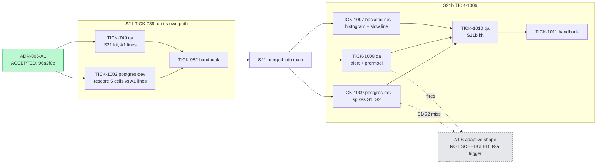
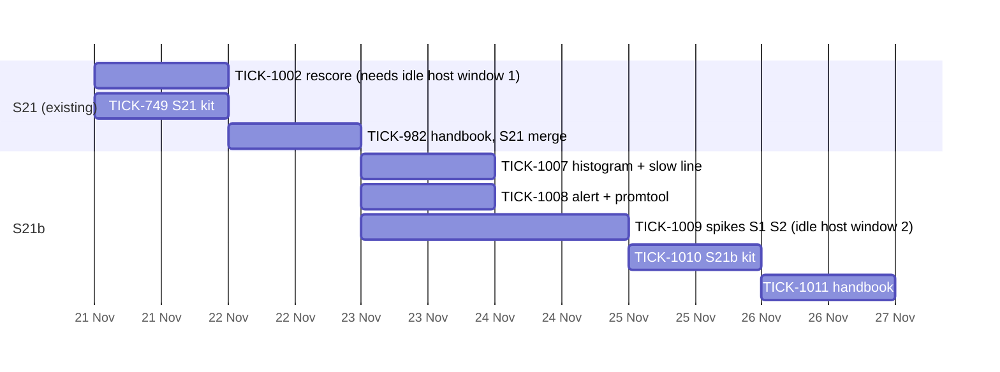

# PLAN-007-A1: ADR-006 amendment A1

## Summary

**What ships:** A1 changes a budget line, not code. The only new build work is A1-4: a histogram, an alert and a slow-list log line. It goes into a new follow-up story, **S21b (TICK-1006)**. S21b starts after S21 (TICK-739) merges into `main`, so it cannot delay S21's acceptance. The A1-7 spikes S1 and S2 go into S21b as well. The changes to S21 itself are text: the target lines its open tasks score against.

| Item | Issue | Role | Outcome |
|---|---|---|---|
| S21b story | TICK-1006 | Technical Lead | Slow filtered lists are watched, and the unmeasured D13 bands are measured |
| T-A1-1 | TICK-1007 | `backend-dev` | `nava_records_list_data_filter_seconds{row_acl}` is observed on every data-filter list. One `records list slow` line is written for each one over 350 ms, with no filter value and no field name (A1-4) |
| T-A1-2 | TICK-1008 | `qa` | `RecordsDataFilterListSlow` fires when more than 1% of those requests take over 350 ms for 1 h, proven by `promtool` (A1-4) |
| T-A1-3 | TICK-1009 | `postgres-dev` | Spikes S1 (5%, 10%, 20%) and S2 (ACL breadth 6%, 25%, 50%) are scored with plans on a fully idle host (A1-7) |
| T-A1-4 | TICK-1010 | `qa` | The S21b acceptance kit, verified on a fresh stack |
| T-A1-5 | TICK-1011 | Technical Lead | Handbook update for S21b |
| TICK-1002 (S21, amended) | TICK-1002 | `postgres-dev` | Rescores the provisional cells against the A1 lines, plus a fifth cell (40% `text in` + ACL), and relabels the budget rows (A1-5, A1-8) |
| TICK-749 (S21, amended) | TICK-749 | `qa` | The S21 kit asserts the A1 lines and asserts no 2–40% filter |
| TICK-739 (S21, amended) | TICK-739 | Technical Lead | Acceptance criterion 2 quotes the A1 lines |

**Order:** S21 finishes on its own path (TICK-1002, TICK-749, TICK-982). After S21 merges into `main`, S21b's branch is cut. T-A1-1, T-A1-2 and T-A1-3 start together. T-A1-4 follows them, and T-A1-5 comes last.

**The one risk that matters most:** S21b sits in `backlog` behind S21 and R-a stays unwatched in the meantime. A1-4 accepts this: "until it ships, the access log is checked by hand at each S21 follow-up review". No production tenant has 400k records yet, so the R-a trigger cannot fire before S21b ships. The second risk is the idle-host window. vknavaladi has to stop the `nava` stack twice: once for TICK-1002 and once for TICK-1009 (D-7A1-3).

## Decisions this plan makes

| # | Decision |
|---|---|
| **D-7A1-1** | **A1-4 is its own story (S21b), not a task under S21.** The brief allows this when A1-4 does not fit S21. It does not fit. Every child of S21 gates S21's acceptance, and A1-4 is new build work in the list handler, which S21's kit is about to verify. Moving it after S21 keeps the handler stable for TICK-749. It also gives A1-4 an acceptance kit of its own: the human can see the series, the slow line and the alert. Until S21b ships, the access log is checked by hand at each S21 follow-up review, as A1-4 says. |
| **D-7A1-2** | **The A1-4 contract is fixed in the plan, so T-A1-1 and T-A1-2 run in parallel.** The fixed points are: the series name `nava_records_list_data_filter_seconds`; the buckets `0.025, 0.05, 0.1, 0.15, 0.25, 0.35, 0.5, 1, 2` (0.35 is a bucket edge, so the alert reads `le="0.35"`, and 2 s is the D25 data-filter timeout); the single label `row_acl`; what counts as a data-filter list; what is timed (requests rejected before any query runs are not observed, and requests that time out are); and the log line's six attributes. T-A1-2 tests its rule on synthetic series, so it does not wait for T-A1-1. |
| **D-7A1-3** | **S1 and S2 are a separate task in S21b (TICK-1009), not part of TICK-1002 or TICK-749. The Solution Architect checks this against A1-7 in the plan verdict.** A1-7 names TICK-1002 or TICK-749 as the place and also says the spikes "do not gate A1 or S21". Both of those issues are children of S21, and S21 is accepted only when every child is done. Putting the spikes in either one would make S21 wait for them. They are also more than a rerun: `text eq` needs new 5%, 10% and 20% `tier` values in the seed, and S2 needs new agents whose groups see 25% and 50% of the type. That is fixture work plus an 800k reseed (1–2 agent-days, a guess). The cost is a second idle-host window from vknavaladi. The alternative, adding the spikes to TICK-1002, saves that window but holds S21 on fixture work that A1 says must not hold it. The harness and fixture are the same as TICK-992's, as A1-7 requires. |
| **D-7A1-4** | **TICK-1002 rescores against the A1 lines and gains one cell (A1-8).** The cells are: 0.25% `in` ×2 (150 ms), 0.25% bool + ACL (150), 2% `text eq` + ACL (350, a provisional pass at 317.6), and **40% `text in` + ACL (350, a provisional pass at 327.6)**. The harness target `fiListACL2TargetMS` and its 2% branch are updated so that the run prints the A1 lines. The 2% no-ACL cells (236.6–267.6 ms) pass 350 ms by more than 10%, so they are relabelled and not rerun. |
| **D-7A1-5** | **A1-5: TICK-1002 reruns the 0.25% `in` cells. TICK-749 does not.** TICK-1002 already has the idle host and the harness. The S21 kit checks behaviour on a fresh stack, not budgets on a reference host. The kit asserts the A1 lines: ≤ 350 ms for a 0.5–2% filter with or without the ACL, ≤ 350 ms for a ≥ 40% filter with the ACL, and ≤ 150 ms everywhere else. It asserts **no** 2–40% filter, because those bands are unmeasured until S1. If an idle rerun still misses 150 ms on a 0.25% `in` cell, that is a new finding and needs a new decision, which A1 does not cover. |
| **D-7A1-6** | **A1-6, the adaptive-shape spike, is recorded and not scheduled.** No issue is created. The spike scope is fixed in A1-6 (1)–(3). The trigger is R-a as amended: `RecordsDataFilterListSlow` fires **and** the slow-list lines show one tenant whose own p95 is above 350 ms for 1 h; or a tenant passes 400k records; or S1 or S2 misses (TICK-1009). The owner is the Technical Lead. When the trigger is hit, the Technical Lead opens the spike task for `postgres-dev`, with A1-6's exit criterion as its acceptance criterion. This is recorded in the decision log. |
| **D-7A1-7** | **T-A1-1 is reviewed by Security for the log line.** The line carries `tenant_id` and must never carry a filter value, a field name or a field id. The adversarial test (T-A1-1, criterion 4) uses unique canary strings for both, and asserts that neither appears in the log output or on `/metrics`. |
| **D-7A1-8** | **No grooming meeting.** Every test comes from an amendment that went through one critique round, which the Technical Architect closed with "no objection". The Solution Architect's plan verdict is the check, as with D-A1-7 in PLAN-005-A1. |
| **D-7A1-9** | **Drift recorded:** S21's description cites `docs/delivery/plan-adr-006.md` (PLAN-007), but that file is neither on `main` nor on `TICK-739/filterable-fields`. The Technical Lead adds it to the S21 handbook task (TICK-982), so it lands before S21 is accepted. Nothing in this plan depends on it. |

## Task graph

## Sequence

The dates are guesses. They assume both host windows are granted within a day of being asked for. TICK-1002 has been waiting on window 1 since TICK-992.

## Estimates

| Task | Range | Assumption |
|---|---|---|
| TICK-1007 | 0.5–1 agent-day | The list handler can take a meter provider the way groupsync does |
| TICK-1008 | 0.5 agent-day | The `promtool` pattern from `internal/audit/lineage.TestAlertRules` is reused |
| TICK-1009 | 1–2 agent-days (**guess**) | One 800k reseed and one run window. A second window doubles it |
| TICK-1010 | 0.5–1 agent-day | A small seed is enough. The slow line is forced with a 500 ms `ACCESS EXCLUSIVE` lock on the side table |
| TICK-1011 | 0.5 agent-day | — |
| TICK-1002 delta | +0.25 agent-day | One more cell, plus a target change in the harness |

## Story overlap

S21b's expected files are: `internal/server/records_list.go`, a new `records_list_metrics.go`, possibly `cmd/nava-core/main.go`, `deploy/compose/prometheus/rules/records.yml` and its test, the perf test fixture, `docs/budgets.md`, `docs/data/field-index-measured.md`, `docs/acceptance/S21b/`, and the handbook. S21 owns all of these until it merges, so S21b's branch is cut only after S21 is in `main`. Before cutting it, the Technical Lead checks this list against every story that is open at that time. `records_list.go` is the likely collision, with any story that changes list filters.

## The cut

- **Cut from S21:** all A1-4 build work, and S1/S2. Both move to S21b. Neither one is deferred out of Milestone 1.
- **Not scheduled:** the A1-6 adaptive shape. It is trigger-gated (D-7A1-6).
- **Not in any task:** option (b), the promoted column. A1 rejects it. It returns only if the A1-6 spike fails.
- **Nothing weakens an invariant.** The metric has no tenant label (T01). The log line has the same exposure as the access log, and a canary test enforces it (D-7A1-7).
