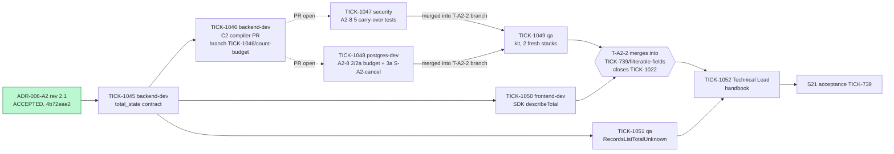
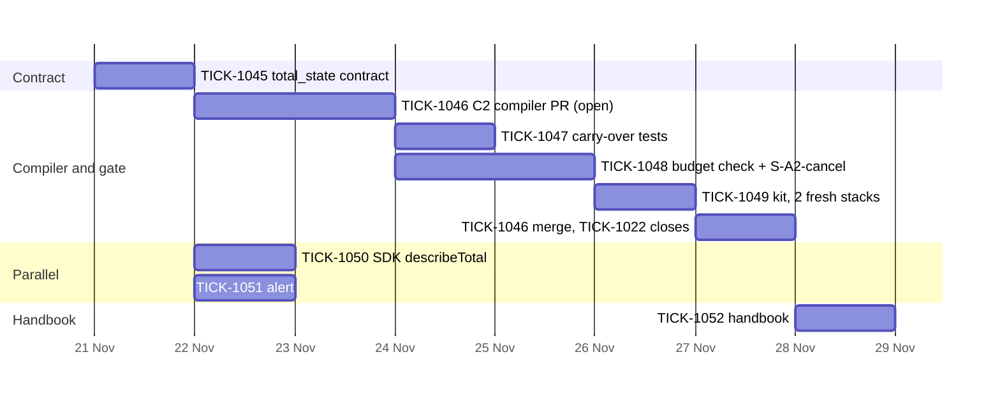

# PLAN-007-A2: ADR-006 amendment A2

## Summary

**What ships:** the C2 compiler change (A2-2 to A2-5), the `total_state` contract (A2-1) in the OpenAPI, the Go server types, the TS SDK types and a UI display rule, the `total_state` metric label and alert (A2-7), and the A2-8 merge gate. All of it lands **inside S21 (TICK-739)** as eight tasks, because TICK-1022 is an S21 child that blocks S21 criterion 2 (D-7A2-1).

| Item | Issue | Role | Outcome |
|---|---|---|---|
| T-A2-1 | TICK-1045 | `backend-dev` | `total_state` (required) and `total: integer \| null` in OpenAPI, `api.gen.go`, TS SDK types; handler and metric label set `exact` / `capped`. No behaviour change |
| T-A2-2 | TICK-1046 | `backend-dev` | **The C2 compiler PR.** Page first, then the one capped count under `SAVEPOINT list_count` + `SET LOCAL statement_timeout = min(CountBudget, q.Timeout)`, `ROLLBACK TO` on both paths, 57014 → 200 `unknown`; first-page shortcut; A2-8 (3), (3b), (3c), (3d), (4) |
| T-A2-3 | TICK-1047 | `security` | A2-8 (5): the PR #812 refusal, tenant-wall, ACL-denied-broad-value and metric-label tests, each asserting `total_state` |
| T-A2-4 | TICK-1048 | `postgres-dev` | A2-8 (2), (2a): band (ii) non-count p95 ≤ 94 ms under the host rule; (3a) spike S-A2-cancel, overshoot ≤ 15 ms at p99 |
| T-A2-5 | TICK-1049 | `qa` | A2-8 (7): the S21 kit asserts `total_state`; its ≥ 40% ACL cell ≤ 350 ms p95 on two fresh stacks in a row |
| T-A2-6 | TICK-1050 | `frontend-dev` | A2-1 UI rule and A2-8 (6) UI test: TS SDK `describeTotal` ("1,000+", "N+", "many", best-known total kept) |
| T-A2-7 | TICK-1051 | `qa` | A2-7: `RecordsListTotalUnknown` (> 5% `unknown` for 1 h), promtool-tested, runbook in the annotation |
| T-A2-8 | TICK-1052 | Technical Lead | Handbook update: list API, SDK, observability, S21 story page. Last task |

**Order:** T-A2-1 first (the contract everything keys off). Then T-A2-2, T-A2-6 and T-A2-7 in parallel. Once T-A2-2's PR is open, T-A2-3 and T-A2-4 stack PRs into its branch; T-A2-5 runs the kit on two fresh stacks from that branch once both have merged into it. T-A2-2 then merges into the story branch, and T-A2-8 closes the story's handbook gate.

**The one risk that matters most:** T-A2-4's host rule. The 94 ms non-count p95 counts only on a host that passes P3-36's gates (transport ≤ 3 ms, no-filter control ≤ 80.3 ms). Every shared-host run so far (TICK-992, TICK-1022 runs 1–5, A2-11) read the control at 105–219 ms. If the host is contended, the run is inconclusive and is repeated, and T-A2-2 cannot merge. Recovery: T-A2-4 asks vknavaladi on the issue to stop the other `nava-*` stacks for one window, the same request as TICK-992 and TICK-1002. **Second risk:** the measured p95 is above 94 ms, so A2-2's formula is rerun; at the 100 ms floor the Solution Architect takes it to the CTO (A2-2). That is a constant change, not a redesign.

## Decisions this plan makes

| # | Decision |
|---|---|
| **D-7A2-1** | **A2 lands inside S21 (TICK-739), not in a new story.** TICK-1022 is an S21 child and blocks criterion 2, and S21 owns every file A2 touches (`internal/records/store/list.go`, `internal/server/records_list*.go`, `api/paths/records.yaml`, `sdk/ts`, the S21 kit). A separate story would overlap S21's files and could only start after S21 merges, which S21 can't do without the fix. The cost: S21 gains eight tasks and its acceptance moves out by the critical path below. |
| **D-7A2-2** | **The contract (T-A2-1) merges ahead of the A2-8 gate.** A2-8 gates "the C2 compiler PR". T-A2-1 is additive: it adds `total_state` and makes `total` nullable on the wire and in the types, but `total` is never null until T-A2-2. Merging it first lets T-A2-6 and T-A2-7 build on the generated types in parallel. If `task check-openapi` flags the nullability, the approval line in `api/approved-breaking-changes.txt` starts with TICK-1045 and cites A2-1. |
| **D-7A2-3** | **The A2-8 gate PRs stack into T-A2-2's branch** (`TICK-1046/count-budget`), not into the story branch. T-A2-3 (tests), T-A2-4 (harness and evidence) and T-A2-5 (kit) each open a PR into that branch, so the gate runs on the exact code that merges, and nothing of the gate reaches the story branch before the compiler PR does. The Technical Lead releases T-A2-3 and T-A2-4 by hand when T-A2-2 is `in_review` with its PR open (not when it is `done`; the delivery sweep can't see that condition). T-A2-2 merges into the story branch only when T-A2-3, T-A2-4, T-A2-5 and T-A2-6 are `done`, review says `VERDICT: APPROVE`, and CI is green on the final head. |
| **D-7A2-4** | **The UI part of A2-1 ships as a TS SDK function, `describeTotal`, with its tests as A2-8 (6)'s UI test. The Solution Architect checks this deviation in the plan verdict.** The repo has no frontend (decision 2026-11-10, TICK-660). The first UI that shows a list total is the `<nava-records>` widget, S26 (TICK-803, backlog). So the rule ("1,000+", "N+", "many", best-known total kept, never 0) is one exported function that the widget must call. On APPROVED, the Technical Lead adds "the list view shows the total with `describeTotal`" to TICK-803's acceptance criteria. Not deferred: the rule and its test ship in S21. Only the screen waits for S26. |
| **D-7A2-5** | **The test-only delay hook design (A2-8 (3d)).** Go compiles `export_test.go` only into its own package's tests, so a store-level hook can't reach `internal/server` tests. `store.ListQuery` gains exported `CountDelay` and `SkipCount`. The handler copies them only from unexported `handlers.countDelay` / `skipCount`, which are set only by `WithCountDelay` / `WithSkipCount` in `internal/server/export_test.go`. A `go/ast` test asserts both of those facts. The count-statement hook is a pgx `QueryTracer` on the test pool (no production seam, and not `pg_stat_statements`, which isn't preloaded on the test Postgres). |
| **D-7A2-6** | **The A2-7 alert counts field-index lists, not legacy-scan lists. The Solution Architect checks this in the verdict.** A2-7 gives the label to `observeIndexedList`, which records only lists with an index filter. Legacy-scan data filters (`fieldindex.LegacyScanFields`, a closed list that only shrinks) get the budget and `total_state` in the response, but they aren't in that series. Adding them would mean a second series or mislabelling the indexed histogram, and A2-7 allows "exactly one label". **Trigger to revisit:** S21b's T-A1-1 (TICK-1007) histogram covers every data-filter list. If a legacy-scan field is still listed when TICK-1007 starts, TICK-1007 adds `total_state` there too. |
| **D-7A2-7** | **A2-8 (2)'s budget check runs in the Go perf harness on a fresh Postgres seeded with the kit's shape, not on the compose kit stack.** "Count skipped by a test hook" needs the server in the test binary. The compose stack runs production images, which by (3d) can't reach the hook. The seed is the kit's (400k tenant A incidents, priority 1/1/48/50%, Alice's default ACL). Latency is client-side HTTP, P3-36's measuring point. The kit's two fresh stacks (A2-8 (7), T-A2-5) remain the end-to-end check. |
| **D-7A2-8** | **The first-page shortcut (A2-4) applies to every list. The budget (A2-3) applies to every list with a data filter (indexed or legacy scan).** A2-4 is exact by construction and not limited to data filters. A list with no data filter keeps today's count with no savepoint, per A2-3. A new `ListQuery.BudgetCount` carries "has a data filter", because today `DataFilter` means "legacy scan" only (`records_list.go:525`). |
| **D-7A2-9** | **An `unknown` page reports `selectivity_band="unknown"`.** The band is computed from `total`, which is unknown. The label set stays `acl` × `selectivity_band` × `total_state` (A2-7). Only the value set grows. |
| **D-7A2-10** | **PR #796 is closed, not merged.** Its findings are on `main`: `docs/adr/ADR-006/spikes/a2-bounded-probe/` holds `tick-1022-post-backfill-plan.md`, `count-plans.md`, `host.txt` and the server-time tables (PR #808). Its harness (`records_fieldindex_stats_perf_integration_test.go`, `scratch/tick-1022-post-backfill-stats/`) is not needed on the story branch: T-A2-4 reuses the A2-11 harness from PR #812's branch and may cherry-pick #796's VM-state steps. Its "next step" (`random_page_cost = 1.1`) is rejected by A2. The raw tables stay reachable on branch `TICK-1022/analyze-on-ready`, which is **kept, not deleted**. The Technical Lead closes #796 with this reason on APPROVED. |
| **D-7A2-11** | **Where the R-a trigger and the page-walk cost (R-006) are tracked now that TICK-992 is done.** The trigger and its owner are in PLAN-007-A1 D-7A1-6 (decision entry `2026-11-20-plan-007-a1-adr-006-a1.md`). Owner: the Technical Lead. The signals live in S21b (TICK-1006): `RecordsDataFilterListSlow` (TICK-1008), spike S2 at 6/25/50% ACL breadth (TICK-1009, which measures the broad-ACL page walk), and a tenant passing 400k records. A2 adds one signal, `RecordsListTotalUnknown` (T-A2-7) persisting past autovacuum. The anti-correlated page-walk numbers (a6 page 96–335 ms, a50 2.2–3.4 s) are on record in `docs/adr/ADR-006/spikes/a2-bounded-probe/a2-11/`. None of it is in this plan (A2-9). TICK-1002 (provisional cells) is unchanged. |
| **D-7A2-12** | **TICK-1022 closes when T-A2-2 merges.** That merge comes after T-A2-5's two green fresh stacks, which are TICK-1022's own acceptance. The S21 kit change is T-A2-5, not a reopen of TICK-749 (TICK-749's kit merged as PR #794). The S21 acceptance run then uses the updated kit. |
| **D-7A2-13** | **No grooming meeting.** Every test comes from an amendment that went through critique, with the Technical Architect's and Security's conditions folded into rev 2.1. A readiness Goldfish was run on all eight task bodies. Its three blockers (hook reachability, the stack for the budget check, the exported test seams) and seven contradictions (#812's head is `e783c878`, the approval-file key rule, `pg_class.relallvisible`, the Bruno paths, the alert's file list, the handbook page names, the ADR page not being on the story branch) are answered in the bodies. The Solution Architect's plan verdict is the check, as in D-7A1-8. |
| **D-7A2-14** | **Reviewers.** T-A2-2: the Technical Lead, plus the Security & Multi-Tenancy Reviewer for (3b), (3c), (3d). T-A2-4's S-A2-cancel: the Technical Architect, who asked for it (A2-8 (3a)). T-A2-3: the Technical Lead (the author is Security). T-A2-7: the Technical Lead, who owns the alert (A2-7). |

## Task graph

## Sequence

The dates are guesses. They assume one clean host window for TICK-1048 and two green kit runs in a row. Each red kit run or failed host gate adds about half a day.

## Estimates

| Task | Range | Assumption |
|---|---|---|
| TICK-1045 | 0.5 agent-day | A required nullable field generates `*int64` without `omitempty`, as `next_cursor` does |
| TICK-1046 | 1–1.5 agent-days (**guess**) | The pooled-connection test (3c) reuses the `alloc_integration_test` pattern |
| TICK-1047 | 0.5–1 agent-day | The fixtures are on `TICK-1022/count-probe` (`e783c878`) |
| TICK-1048 | 1–2 agent-days (**guess**) | One fresh seed (about 35 min) and one host window. Each failed gate means a rerun |
| TICK-1049 | 1 agent-day | Two kit runs of about 35 min, plus a third if one is red |
| TICK-1050 | 0.5 agent-day | — |
| TICK-1051 | 0.5 agent-day | The `TestAlertRules` pattern is reused |
| TICK-1052 | 0.5 agent-day | — |

Critical path: TICK-1045 → TICK-1046 → TICK-1048 → TICK-1049 → TICK-1046 merge → TICK-1052. That is about 5–7 agent-days.

## Story overlap

Every file is already owned by S21: `internal/records/store/list.go` (+ `export_test.go`), `internal/records/pipeline/read.go`, `internal/server/records_list.go`, `records_list_index.go`, `export_test.go`, `api.go`, the list integration tests, `internal/fieldindex/d7_test.go` (unchanged), `api/paths/records.yaml`, `api/openapi.bundled.yaml`, `api/api.gen.go`, possibly `api/approved-breaking-changes.txt`, `sdk/ts/src/generated/schema.ts`, `sdk/ts/src/total.ts`, `sdk/ts/src/index.ts`, `sdk/ts/test/`, `deploy/compose/prometheus/rules/records.yml` and `tests/records_test.yml`, `internal/audit/lineage` (the alert test's file list), `docs/acceptance/S21/`, `docs/acceptance/guide/bruno/S21/`, `docs/data/adr-006-a2-gate*`, and `docs/handbook/src/`. S21b (TICK-1006) also writes `rules/records.yml` and `records_list.go`, but it is already cut only after S21 merges into `main` (PLAN-007-A1). S22 and S23 also wait for S21. No new overlap.

## The cut

- **Not in this plan (A2-9, scope guard):** the broad-ACL page walk (R-006: a50 2.2–3.4 s, a6 96–335 ms) and the 2% page. They stay on the R-a / A1-6 track, tracked as D-7A2-11 says.
- **The screen for the UI rule waits for S26** (D-7A2-4). The rule and its test ship now.
- **Legacy-scan lists are outside the alert** (D-7A2-6), with the TICK-1007 trigger.
- **Rejected work is not ported:** rev 0/1's pre-count, `CountWhere`, the forced probe and the visible-set guard from PRs #812 and #796.
- **Nothing weakens an invariant.** I1: there is no new statement; the count stays today's D7 statement under RLS, and T-A2-3 proves the tenant wall with forged rows. Pooled-connection state: (3c). Test-only hook: (3d). I7: read path only.
