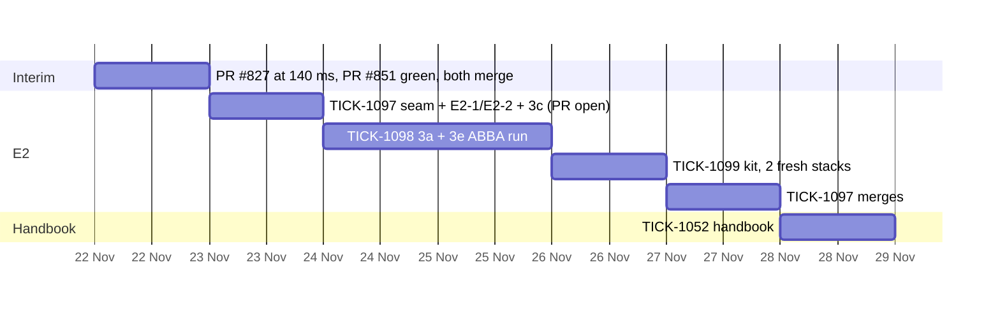

# PLAN-007-E2: ADR-006 erratum E2

## Summary

**What ships:** E2-1 and E2-2 together (`CountBudget` = 170 ms, and `SET LOCAL max_parallel_workers_per_gather = 0` in the same savepoint `Exec`), the extended (3c) tests, the reworded (3a) leak check, the new (3e) ABBA run that decides whether 170 ms ships, a rerun of A2-8 (7) that records the `unknown` share, and the handbook pages. It all lands **inside S21 (TICK-739)** as three new tasks plus TICK-1052, which gains the handbook scope.

| Item | Issue | Role | Outcome |
|---|---|---|---|
| Interim | TICK-1046 (PR #827) | `backend-dev` | PR #827 sets `CountBudget` = **140 ms** and merges into the story branch (D-7E2-1). Not a new task |
| T-E2-1 | TICK-1097 | `backend-dev` | Commit 1: a test-only arm seam (`WithCountArm`). Commit 2: E2-1 + E2-2 in one `Exec`, plus the (3c) tests for the worker setting and the no-`Gather` plan tests. The PR stays open until (3e) |
| T-E2-2 | TICK-1098 | `postgres-dev` | The (3a) leak verdict read from `pg_ls_tmpdir()`; the (3e) ABBA run (arm A 170 ms, workers off; arm B 140 ms, server settings) with a PASS / FAIL / INCONCLUSIVE verdict |
| T-E2-3 | TICK-1099 | `qa` | The S21 kit's ≥ 40% ACL cell ≤ 350 ms p95 on two fresh stacks in a row at the shipping budget, with the `unknown` share recorded |
| T-A2-8 | TICK-1052 | Technical Lead | Handbook (scope extended): the A2 count-budget content and the A2 gate benchmark entry. Last task |
| Fallback | TICK-1095 | `postgres-dev` | Stays in `backlog`. Promoted only on a (3e) FAIL (D-7E2-4) |

**Order:** PR #827 merges at 140 ms → T-E2-1 opens its PR from the story branch → T-E2-2 stacks into it and runs (3e) → on the verdict, T-E2-1 keeps or reverts its commit 2 → T-E2-3 runs the kit on that head → T-E2-1 merges → TICK-1052.

**The one risk that matters most:** the (3e) run needs a quiet host. Every block has gates before and after it, and P3-36's control gate has failed on shared-host runs before (TICK-1048, TICK-1083 runs 5 and 6). Each failed gate means a rerun. Recovery: TICK-1098 asks vknavaladi on the issue to stop the other `nava-*` stacks for one window, as TICK-992 and TICK-1048 did. **Second risk:** arm B launches no workers at 8 clients (workers are scarce, E2 "Context"), so the run is INCONCLUSIVE. It is repeated once; after that, E2-2 stands on E2-4's bounded-tail argument.

## Decisions this plan makes

| # | Decision |
|---|---|
| **D-7E2-1** | **PR #827 ships at 140 ms provisional; it doesn't wait for this plan.** E2's "Interim" allows either. The rest of PR #827's A2-8 gate is met (review APPROVE, TICK-1047/1048/1049 merged into its branch, TICK-1050 done). Only PR #851 (the S-A2-cancel archive, red on a CI timeout, not a code fault) is still open. Waiting would hold an approved PR, TICK-1022, and with it S21 criterion 2 (TICK-749), behind a run that needs a host window, for 2–3 days. 140 ms is arm B of (3e): it's the fallback E2 names and the code that ships if (3e) fails, so the interim is never a value we would later throw away. Lowering the budget from 200 to 140 ms can only shorten the count phase, so TICK-1049's two green stacks still show band (ii) ≤ 350 ms p95; the `unknown` share changes, and T-E2-3 records it. **How:** the Senior Software Engineer adds one commit to PR #827 under TICK-1046: `CountBudget = 140 * time.Millisecond` with a comment citing E2 "Interim", and `list_budget_test.go`'s constant check at 140 ms. CI is re-checked on the new head, then PR #851 and PR #827 merge in that order. TICK-1022 closes with that merge (D-7A2-12 unchanged). |
| **D-7E2-2** | **E2 lands as a new task PR into the story branch, not on `TICK-1046/count-budget`.** That follows from D-7E2-1: once PR #827 has merged, its branch is closed. T-E2-1 cuts `TICK-1097/serial-count` from `TICK-739/filterable-fields`. T-E2-2 and T-E2-3 open their PRs into that branch, so (3e) and the kit run on the exact code that merges (the same stacking rule as D-7A2-3). |
| **D-7E2-3** | **The two arms of (3e) run in one test binary, through a test-only seam.** (3e) wants ABBA blocks with gates around each block on one seeded database. Two binaries built from two refs would mean four separate harness runs, each one reseeding (about 35 min) and changing the physical layout between blocks. So T-E2-1's commit 1 adds `ListQuery.CountBudgetOverride` and `ListQuery.CountParallel`. They are set only from handler fields that `server.WithCountArm` in `export_test.go` sets, and the existing AST test enforces that (the `CountDelay` / `SkipCount` pattern, D-7A2-5). Arm B = `WithCountArm(140 ms, true)` is the fallback code path exactly. Production zero values give E2's behaviour. **The Solution Architect checks this:** it adds two production-visible fields that only tests may set. |
| **D-7E2-4** | **The (3e) verdict decides T-E2-1's merge.** PASS: T-E2-1 merges with both commits (170 ms, workers off). INCONCLUSIVE (arm B launched no workers): the run is repeated once in a new window; if that is inconclusive too, E2-2 stands on E2-4's bounded-tail argument and T-E2-1 merges with both commits, and the Technical Lead records it in the decision log. FAIL: T-E2-1 reverts commit 2 (140 ms, server settings stay, the seam stays for the harness) and merges. The Technical Lead promotes **TICK-1095** to `todo` the same run. It sets the parallel overshoot term, and if that changes the 140 ms figure, the follow-up is a one-constant task. **170 ms never ships without a (3e) PASS** (or the twice-inconclusive case E2-4 allows). |
| **D-7E2-5** | **The (3c) "no `Gather`" tests force the planner to want workers first.** A small fixture never gets a `Gather`, so a test asserting "no `Gather`" would pass with or without E2-2. The test sets `parallel_setup_cost`, `parallel_tuple_cost`, `min_parallel_table_scan_size` and `min_parallel_index_scan_size` to 0 for the session. Then it asserts a control plan (the savepoint without the worker `SET LOCAL`) **has** a `Gather`, and fails, not skips, if it doesn't. After that it asserts that the plan under the real `Exec` text has no `Gather`. Both the kit's band (ii) count and the `a6, three broad fields` count are checked. The `a50, pk = 3` plan check on real data and real settings is in (3e) (T-E2-2). |
| **D-7E2-6** | **The (3e) plan check replays the captured `Exec`, not a copy.** The pgx tracer records each arm's savepoint `Exec` text. The harness replays it in a transaction with the request's tenant and ACL setup, then runs `EXPLAIN (ANALYZE, SETTINGS)` of the captured count. That way the check can't drift from the code. |
| **D-7E2-7** | **The (3a) rewording applies to the harness's verdict now, and its first reading is the (3e) run.** Runs 5 and 6 already listed `pg_ls_tmpdir()` (PR #851) and found nothing after the run or 60 s later, so E2-3 changes which reading gates, not the evidence. No separate spill rerun is planned (scope guard). `temp_files` stays in the report as spill context only. |
| **D-7E2-8** | **T-E2-3 runs at whichever budget the (3e) verdict leaves.** E2 asks for the rerun at 170 ms with E2-2. On a FAIL, the same two stacks run at 140 ms, because the S21 acceptance kit needs a recorded `unknown` share at the shipping budget either way (R13). An `unknown` share above 5% is flagged to the Technical Lead (R14's trigger); it doesn't fail the task. |
| **D-7E2-9** | **The handbook work is folded into TICK-1052**, not a new task. TICK-1052 is already the A2 handbook task, assigned to the Technical Lead and last in S21's A2 chain. Its body gains items 5–7 (the count budget at the value that ships, the A2 gate benchmark entry in `benchmarks.yaml`, R14 on the story page) and `Depends on:` TICK-1097, TICK-1098 and TICK-1099. `adr-006-e2.md` is already on `main` (PR #853). |
| **D-7E2-10** | **Where the 190 ms win-back trigger is tracked.** If R13 or R14 fires, a gated spill-only rerun (`NAVA_PERF_SPIKE_CELLS=spill`) could raise the budget to about 190 ms (run 6's gate-clean +27.8 ms). That is not in this plan. The triggers are on the register rows **AR-TICK-1022-01** (R13) and **AR-TICK-1094-01** (R14) in `docs/security/accepted-risks.md`, owned by the Technical Lead. Their signals are T-E2-3's recorded `unknown` share (> 5%) and the `RecordsListTotalUnknown` alert (TICK-1051) in production. The decision-log entry for this plan names that lever. |
| **D-7E2-11** | **Reviewers.** T-E2-1: the Technical Lead, plus the Security & Multi-Tenancy Reviewer for the (3c) pooled-connection tests and the seam (D-7E2-3). T-E2-2: the Technical Architect, who wrote (3e). T-E2-3: the Technical Lead. TICK-1052: the Senior Software Engineer (list API area owner, TICK-718), as before. |
| **D-7E2-12** | **No grooming meeting.** Every test is spelled out in an erratum that went through critique, with the Technical Architect's (3e) text taken word for word in rev 1. The task bodies answer the design choices a readiness check would raise: how the arms switch (D-7E2-3), how to avoid a vacuous plan test (D-7E2-5), where the plan check's `Exec` comes from (D-7E2-6), what happens to each PR on each verdict (D-7E2-4), and which budget the kit runs at (D-7E2-8). The Solution Architect's plan verdict is the check, as in D-7A2-13. |

## Task graph

```mermaid
flowchart LR
    ADR[ADR-006-E2 rev 1<br/>ACCEPTED, 675cb9dc]:::done
    P851[PR #851 TICK-1083<br/>S-A2-cancel archive]
    I[TICK-1046 / PR #827<br/>CountBudget 140 ms interim]
    M1{{PR #827 merges into<br/>TICK-739/filterable-fields<br/>TICK-1022 closes}}
    T1[TICK-1097 backend-dev<br/>seam + E2-1/E2-2 + 3c<br/>branch TICK-1097/serial-count]
    T2[TICK-1098 postgres-dev<br/>3a reworded + 3e ABBA]
    V{3e verdict}
    T3[TICK-1099 qa<br/>kit, 2 fresh stacks,<br/>unknown share]
    F[TICK-1095 postgres-dev<br/>parallel-only rerun]
    M2{{TICK-1097 merges<br/>into story branch}}
    H[TICK-1052 Technical Lead<br/>handbook]
    ADR --> I
    P851 --> M1
    I --> M1 --> T1
    T1 -. PR open .-> T2 --> V
    V -->|PASS: keep 170| T3
    V -->|FAIL: revert commit 2, 140 stays| T3
    V -->|FAIL| F
    T3 --> M2 --> H
    H --> S21[S21 acceptance TICK-739]
    classDef done fill:#bbf7d0,stroke:#15803d
```

## Sequence

The dates are guesses. They assume one clean host window for TICK-1098 and two green kit runs in a row. Each failed gate or red kit run adds about half a day. On a (3e) FAIL, TICK-1095 runs in parallel with TICK-1099 and doesn't hold it.

## Estimates

| Task | Range | Assumption |
|---|---|---|
| Interim (PR #827) | 0.25 agent-day | One constant and one test line; CI re-check on the new head. PR #851 needs a green CI rerun (a timeout, not a code fault) |
| TICK-1097 | 1 agent-day (**guess**) | The zeroed parallel costs give a `Gather` on the test fixture; the control assertion shows it at once if they don't |
| TICK-1098 | 1–1.5 agent-days (**guess**) | One seed (about 35 min), about 5 min of blocks, one host window |
| TICK-1099 | 1 agent-day | Two kit runs of about 35 min, plus a third if one is red |
| TICK-1052 | 0.5–1 agent-day | Now two plans' worth of pages |

Critical path: interim → TICK-1097 → TICK-1098 → TICK-1099 → TICK-1097 merge → TICK-1052. That is about 4–5 agent-days.

## Story overlap

Every file is already owned by S21: `internal/records/store/list.go`, `list_budget_test.go`, `list_budget_integration_test.go`; `internal/server/records_list.go`, `export_test.go`, the AST hook test (`TestListQueryCountHooksAreSetOnlyByTheListHandler`), `records_a2_gate_perf_integration_test.go`; `scratch/tick-1098-e2-3e/`; `docs/data/adr-006-a2-gate*`; `docs/acceptance/S21/evidence/`; and `docs/handbook/src/`. Nothing in `api/`, `sdk/ts` or `deploy/` changes (scope guard: no change to `total_state`, the SDK or the alert). S21b, S22 and S23 already wait for S21 to merge into `main`. No new overlap.

## The cut

- **Not in this plan:** the gated spill-only rerun that could win back the margin to about 190 ms (D-7E2-10, trigger on AR-TICK-1022-01 / AR-TICK-1094-01), and the parallel-only rerun (TICK-1095) unless (3e) fails.
- **No new platform work** and no change to the A2 contract surfaces (`total_state`, SDK, alert). The only new code surface is the test-only arm seam (D-7E2-3).
- **Nothing weakens an invariant.** I1: same statement, same RLS; `ROLLBACK TO` undoes only the `SET LOCAL`s issued after the savepoint, and `app.tenant_id` is set before it (A2-8 (3b), unchanged). The (3c) tests prove the worker setting doesn't leak into the transaction or onto the pooled connection. I8: `CountBudget` stays a platform constant.
