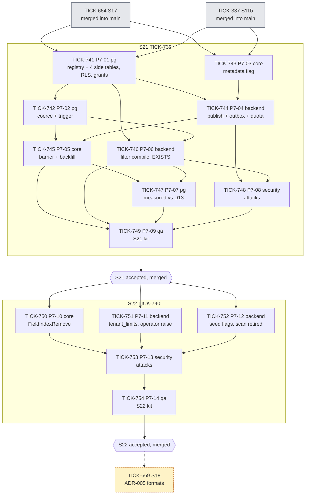
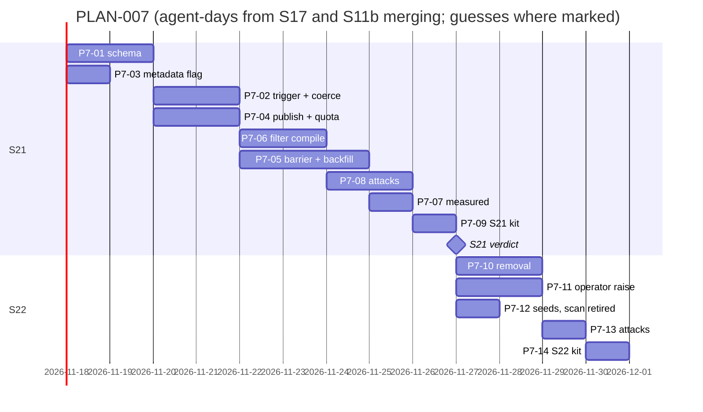

# PLAN-007: ADR-006 filterable tenant fields

## Summary

**What ships, and in what order.** Two stories under feature TICK-738, one after the other, both after S17 (TICK-664) and S11b (TICK-337) merge into `main`.

| Order | Issue | What | ADR-006 |
|---|---|---|---|
| 1 | TICK-739 **S21** | Registry and four typed side tables, the trigger and coercion, the flag at publish (default quota), the snapshot barrier and backfill, the compiled filters; measured against D13 | D1–D10, D12 (default), D13, D14 |
| 2 | TICK-740 **S22** | Unflag and removal, the operator quota raise to 10, seed types flagged and the JSONB scan retired | D6 (scan removal), D8 (busy), D11, D12 (raise) |

Everything is created in `backlog`. Features and stories are assigned to the Technical Lead; tasks to the Delivery squad with a role label.

**The one risk that matters most:** the race across the state flip (TA R1 and R3). A record written by a transaction that started before the flip is missed by the trigger and by the backfill unless the barrier waits for it. The spike showed "missing 1 without the barrier". So the barrier and its race test (TICK-745, CI-5) sit on the critical path, and the test must be shown to fail with the barrier disabled.

## Decisions this plan makes

| # | Decision |
|---|---|
| **D-7-1** | **Two stories, serial.** S22 changes the same packages as S21 (`internal/fieldindex`, publish, `list.go`), so it waits for S21 to merge into `main`. Removal is a separate story because S21 is already the largest story in flight (9 tasks) and removal has its own race test and kit. |
| **D-7-2** | **S21 waits for S17 and S11b to merge into `main`.** S17 shares `internal/tenancy/isolation/registry.go`, `db/grants.yaml` and migration ordering; S11b shares `internal/outbox`, `internal/relay`, `cmd/nava-worker` and the registry. |
| **D-7-3** | **ADR-006 runs before S18 (ADR-005), and S18 now also waits for S22.** S18 already waits for S17 and for R1 to be running on every replica. ADR-006 removes a measured production miss: data filters at 0.8–1.3 s, held only by the 2 s timeout (D25). S18 and both ADR-006 stories touch `internal/entitytypes` publish, `db/grants.yaml`, `registry.go` and `api/`, so one of them has to wait. *This is a sequencing call, not a priority call: if the human wants numbering formats first, S18 goes first and S21 waits for S18. Nothing else in this plan changes.* |
| **D-7-4** | **In S21, removing a flag is refused** with 422 `filterable_field_removal_unavailable`. Without the removal workflow a `removing` row would never clear. S22 (TICK-750) replaces the refusal with removal and deletes the code. The 409 `field_index_busy` check lands in S21 so its test exists before removal does. |
| **D-7-5** | **The operator raise from 5 to 10 is S22 (TICK-751)** through a new audited `tenant_limits` table and an operator route; this is not per-tenant DDL, so I8 holds. There is no `tenant_limits` table today. Until then the limit is a fixed 5 per type and 50 per tenant, read through one function (`fieldindex.PerTypeLimit`) so S22 changes no publish code. |
| **D-7-6** | **The legacy JSONB scan narrows in S21 and goes in S22.** ADR-006 D6 removes it "once the seed types are migrated". In S21 an unflagged field answers 400, except the fixed allow-list `fieldindex.LegacyScanFields` (the seed fields earlier kits filter on, such as `priority` and `site`), which keeps the old path and `store.DataFilterTimeout`. S22 (TICK-752) flags those fields in the templates and deletes the list, the path and the timeout, and supersedes the D25 decision entry. Earlier kits keep passing throughout. |
| **D-7-7** | **The filter compile (TICK-746) does not wait for the backfill workflow.** Its tests set registry rows to `ready` directly, so filters and backfill are built in parallel after the trigger. |
| **D-7-8** | **Error codes the ADR does not name, pinned here:** `filterable_field_removal_unavailable` (422, S21 only), `searchable_not_available` (422, `x-nava-searchable` until RFC-016). Unsupported property types for the flag use the existing `validation_failed`. Codes the ADR names keep their names. |
| **D-7-9** | **Observability is owned by the task that creates the signal:** the non-coercing counter (R5) in TICK-742; `field_index_barrier_slow` (R11) in TICK-745; the list latency histogram by selectivity band and ACL presence (R-a trigger) in TICK-746. No tenant id is a metric label. |
| **D-7-10** | **A measurement task (TICK-747) re-runs the spike harness on the merged code** before the kit. A miss of D13, the insert floor (40%) or the backfill +25% becomes a fix task, not a note. |
| **D-7-11** | **No grooming meeting** (as D-6-12). The acceptance criteria are ADR-006's pinned CI list and API scenarios, already reviewed by the Technical Architect and the Security reviewer. The Solution Architect's plan verdict is the check. |

## Task graph

**Critical path:** S17 and S11b merged → TICK-741 → TICK-742 → TICK-745 (barrier, backfill) → TICK-747 → TICK-749 → S21 accepted → TICK-750 → TICK-753 → TICK-754 → S22 accepted.

**Estimates** (agent-days; ranges, with what drives them):
- **S21: 10–14.** The trigger property test across writer roles and the R1 race test drive it. The backfill's adaptive pause is a guess (1–2 days): the signal it adapts to is not built yet.
- **S22: 5–7.** Removal reuses the barrier. The seed-flag step depends on how many fields earlier kits filter on; that count is a guess.
- **The 400k seed in the kit** may take minutes on a fresh stack; TICK-749 documents the time.

## Files per story (overlap check)

| Story | Expected files | Overlap |
|---|---|---|
| S21 | `db/migrations/` (new), `db/grants.yaml`, `db/audited-tables.yaml`, `internal/metadata` (classify, compile), `internal/entitytypes` (publish), `internal/outbox`, `internal/relay`, new `internal/fieldindex/`, `cmd/nava-worker`, `internal/records/store/list.go`, `internal/server` (list handler, errors), `api/` (OpenAPI, `errors.yaml`), `internal/tenancy/isolation/`, `docs/budgets.md`, `docs/data/field-index-measured.md`, `docs/acceptance/S21/`, Bruno `S21` | S17 (`registry.go`, `grants.yaml`) and S11b (`outbox`, `relay`, `cmd/nava-worker`, `registry.go`) are open: S21 starts after both merge (D-7-2). S18 and S19 are in `backlog` and wait (D-7-3). |
| S22 | `internal/fieldindex/`, `internal/entitytypes`, `internal/metadata` (templates), `db/migrations/` (`tenant_limits`), `db/grants.yaml`, `db/audited-tables.yaml`, `internal/server` (operator route, list), `internal/records/store/list.go`, `api/`, `internal/tenancy/isolation/`, `docs/delivery/decisions/` (D25 superseded), `docs/acceptance/S22/`, Bruno `S22` | Same packages as S21: depends on S21 merged. |

Before releasing each story, the Technical Lead re-checks that no other open story touches these files.

## ADR coverage

| ADR-006 item | Where |
|---|---|
| D1 source of truth, never a payload | TICK-742 (trigger), TICK-746 (D7 static test) |
| D2 registry, D3 side tables, statistics, RLS, `audited-tables.yaml` | TICK-741 |
| D4 trigger, D5 coercion | TICK-742 |
| D6 check order, operators | TICK-746; legacy scan narrowed TICK-746, removed TICK-752 |
| D7 one compiled query, static test | TICK-746 |
| D8 flag at publish, top-level, type change, busy | TICK-743, TICK-744; removal TICK-750 |
| D9 barrier | TICK-745 (reused by TICK-750) |
| D10 backfill, adaptive pause, one per tenant | TICK-745; measured TICK-747 |
| D11 removal | TICK-750 |
| D12 quota 5 / 50 | TICK-744; raise to 10 TICK-751 |
| D13 latency targets | TICK-747 |
| D14 grants and policies | TICK-741; attacks TICK-748 |
| `x-nava-searchable` reserved | TICK-743, TICK-744 |
| CI-1 pushdown | TICK-746 |
| CI-2 leakproof catalog | TICK-741 |
| CI-2b masks row-independent (R9) | TICK-746 |
| CI-3 cross-tenant, RLS, FK | TICK-741; attacks TICK-748, TICK-753 |
| CI-4 trigger vs recompute per writer role | TICK-742 |
| CI-5 R1, R3, replay races | TICK-745 (R1, replay), TICK-750 (R3) |
| CI-5b grants | TICK-741 |
| CI-5c no record values in Temporal history | TICK-745, TICK-750 |
| CI-6c row-ACL oracle | TICK-746; attacks TICK-748 |
| CI-7 API status codes | TICK-744, TICK-746, TICK-750, TICK-751 |
| CI-8 audit bytes unchanged | TICK-742 |
| CI-9 coercion across sessions | TICK-742 |
| R5 counter, R11 alert, R-a histogram | TICK-742, TICK-745, TICK-746 (D-7-9) |
| R-a, R-b, R8, R12 accepted risks | already indexed as AR-TICK-714-01..04 |

## The cut

| Cut | Why | Trigger to revisit | Owner |
|---|---|---|---|
| Free-text search (`x-nava-searchable`) | ADR-006 moves it to RFC-016; publish refuses it | RFC-016 accepted | Solution Architect |
| Sort on data fields | Out of ADR-006 D6 | A tenant needs sort on a data field | Solution Architect |
| Adaptive statement shape for the D13 band | ADR-006 D13 keeps the single `EXISTS` shape | R-a trigger: telemetry p95 > 350 ms on that band, or a tenant passes 400k records | Technical Lead |
| Filter screens in a UI | No front-end code in the repo; Bruno is how the human tries it | A UI lands | Technical Lead |
| Admin report of non-coercing values | The counter ships (TICK-742); a per-tenant report does not | R5: counter > 0 for a tenant | Technical Lead |

Nothing that enforces an invariant is cut: every CI pin in ADR-006 has a task, and isolation attacks are their own tasks in both stories.

## Release

On `PLAN VERDICT: APPROVED`: no task has `Depends on: none` that can start yet, because S21's branch is cut only after S17 and S11b merge into `main` (D-7-2). When both have merged, the Technical Lead cuts `TICK-739/filterable-fields`, moves S21 to `in_progress` and releases TICK-741 and TICK-743; the delivery sweep releases the rest as their dependencies close. S22 follows when S21 merges. S18 (TICK-669) gains `Depends on: TICK-740` (D-7-3).
