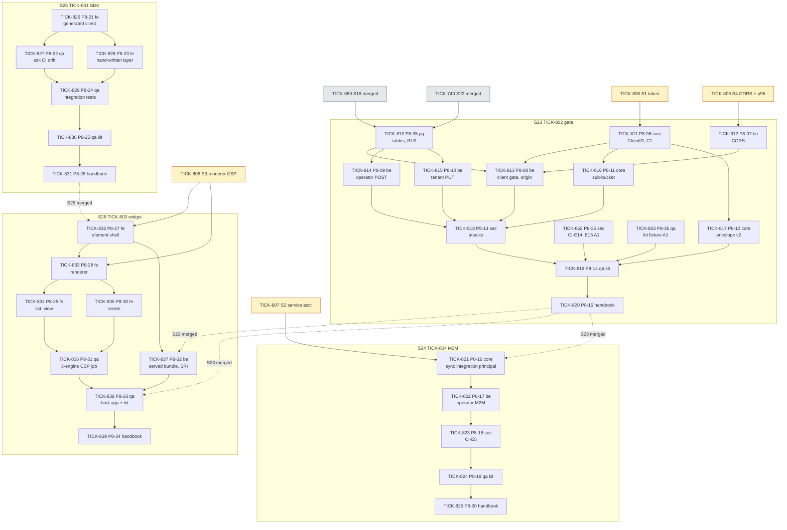
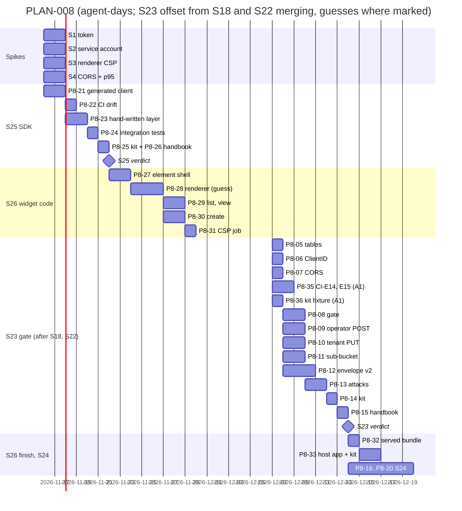

# PLAN-008: ADR-007 embedding (host apps, widget, TypeScript SDK)

## Summary

**What ships, and in what order.** Four spikes, then four stories under feature TICK-800. Everything is created in `backlog`; features and stories are assigned to the Technical Lead, tasks to the Delivery squad with a role label.

| Order | Issue | What | ADR-007 |
|---|---|---|---|
| 0 | TICK-806..809 spikes S1–S4 | Host-client token and no-prompt sign-in; service account as org member; renderer under strict CSP; CORS in three engines and the D2 lookup p95. Scratch code and evidence only | §Spikes |
| 1 | TICK-801 **S25** | TypeScript SDK generated from the contract, hand-written layer, drift gate. **Starts on plan approval**: new directory, no server change | D10, D11 |
| 2 | TICK-802 **S23** | Host-app registry and tenant opt-in, `Principal.ClientID`, CORS, client gate and origin check, sub-bucket, audit envelope v2, the two operator/admin routes | D1, D2, D3, D5, D6, D13 |
| 3 | TICK-803 **S26** | `<nava-records>` widget: shell, renderer, list/view, create, three-engine CSP job, platform-served bundle, sample host app | D7, D8, D9 |
| 4 | TICK-804 **S24** | Integration principal for host backends (machine-to-machine) | D4 |
| — | TICK-805 | ADR-007 handbook summary page, missing from PR #644 (Solution Architect; `todo` now) | publication rule |

**The one risk that matters most:** S1. If a host-client token does not pass the unchanged D26 resolver, the trust model of the ADR is wrong and S23, S26 and S24 all change. S1 runs first, gates S23 (TICK-811 depends on it) and costs one to two agent-days. A *prompt* on the top-level redirect is not a failure of the design: the ADR accepts it as a UX cost and the S26 kit records it.

**Second risk:** S23 cannot start before S18 (TICK-669, in progress) and S22 (TICK-740, after S21) merge, because it shares migrations, `db/grants.yaml`, the isolation registry, `api/` and `internal/server` (D-8-1). The SDK and the widget code do not wait for that: S25 starts now and S26's code tasks start when S25 merges. Only the platform-served bundle (TICK-837) and the S26 kit (TICK-838) wait for S23.

## Amendment A1 (TICK-851)

ADR-007-A1 (accepted on TICK-843 after S1 failed): **every embedding client's authorization request names the tenant with `organization:<alias>` and should send `kc_idp_hint` of the same tenant; `GET`/`PUT /api/v1/embedding-clients/{client_id}` hand the host that pair, derived from the resolved tenant id with no table read.** `Resolve`, `realm-nava.json` and `nava-web` do not change. The plan's shape does not change either: no new story, no new overlap, the same critical path. What changes:

| Change | Where |
|---|---|
| D1-A1.3 pair in GET/PUT responses; D1-A1.7 GET rules (role gate first, byte-identical 404, audited); PUT refuses the pair with 400 `unknown_field`; CI-E16 a–g | TICK-815 (P8-10), as the amendment places it |
| Keycloak client created with `organization` as an **optional** scope (the S1/S1b shape), so a host can request `organization:<alias>` | TICK-814 (P8-09) |
| CI-E2 restated: B's pair → 403 `client_not_enabled`; A's alias with B's hint → claimless → 401 `tenant_unresolved` | TICK-818 (P8-13) |
| **New:** CI-E14a–d, the E14 invariant, CI-E15 (Keycloak's answers to `organization:<alias>`) in `internal/identitystack/` | **TICK-852 (P8-35, `security`)**, no dependency inside S23 |
| **New:** kit fixture script, two tenants created through onboarding, printing users and the pair (CTO ruling: the seeds are not renamed) | **TICK-853 (P8-36, `qa`)**, no dependency inside S23 |
| S23 kit uses the fixture tenants; its PKCE helper takes the D13 response object | TICK-819 (P8-14), now also depends on TICK-852, TICK-853 |
| S23 AC1 and AC3, S26 AC5 rewritten in the amendment's words; how-to-try uses the fixture tenants | TICK-802, TICK-803 |
| Sample host always sends the pair; one recorded no-hint run (FAIL-UX); "Signing in" docs in `examples/host-app/` and `sdk/ts/README.md` (RR-A1-1, RR-A1-4) | TICK-838 (P8-33) |
| Handbook pages name the pair, the E14 answers and the residuals | TICK-820 (S23), TICK-839 (S26) |
| The amendment's handbook summary page, missing from PR #655 | **TICK-855**, Solution Architect, `todo` |

The Solution Architect's earlier CHANGES on this plan (four task-body edits) are made in the same pass: TICK-822, TICK-823, TICK-824 (integration clients opt in through the tenant PUT with `allowed_origins = []`; a B row for A's integration client stays inert); TICK-814 and TICK-822 (create-or-adopt saga, D-8-17); TICK-814 depends on TICK-806; the cross-origin CI-E9 run moves from TICK-836 to TICK-838.

**Estimate change:** S23 grows from 9–13 to **11–15 agent-days**. TICK-852 (1–2; the browser-flow helpers already exist in `internal/identitystack`) and TICK-853 (1) run in parallel with TICK-810..812, so the critical path grows only by TICK-815's GET rules and CI-E16 (about half a day).

## Decisions this plan makes

| # | Decision |
|---|---|
| **D-8-1** | **S23 waits for S18 and S22 to merge into `main`; if S19 opens first, it waits for S19 too.** All of them change `db/migrations/`, `db/grants.yaml`, `internal/tenancy/isolation/registry.go`, `api/` and `internal/server`. S23 goes **before S19** in the queue: it is the riskier integration (identity, CORS, browsers) and nobody waits on field tokens (PLAN-006). *Sequencing call, not a priority call: if the human wants numbering field tokens first, S19 goes first and S23 waits for it; nothing else in this plan changes.* |
| **D-8-2** | **S25 (SDK) runs first and in parallel with the server queue.** It changes only `sdk/ts/`, `examples/sdk-node/`, `Taskfile.yml` and `.github/workflows/ci.yml`. Before releasing it the Technical Lead re-checks that no open story changes `ci.yml` or `Taskfile.yml`. |
| **D-8-3** | **Spikes are tasks under the feature, not a story**, merged into `main` under the branching exception "task with no parent story": they change only `scratch/adr-007-<spike>/` and `docs/adr/ADR-007/spikes/`. They are released on plan approval. |
| **D-8-4** | **S1 failure routes:** a 401 from `Resolve` → stop S23, Solution Architect writes an ADR-007 amendment; a prompt → recorded in the S26 kit and the handbook page, no plan change. **S2 failure** → the D4 fallback the ADR already decided; the Technical Lead rewrites TICK-821 from the evidence (its body carries both outcomes). **S3 failure** → the next renderer in the ADR's order; TICK-833 uses the named one. **S4 failure** → TICK-812 implements the order fix the evidence names. |
| **D-8-5** | **The generated SDK is regenerated by whoever changes the contract.** Once S25 is in `main`, any story PR that changes `api/openapi.bundled.yaml` also runs `task sdk:gen`; the `sdk` CI job (TICK-827, CI-E10) enforces it. `sdk/ts/src/generated/` is a pure function of the bundle, which those stories already share, so it does not count as a new overlap for the story-independence check; a merge conflict there is resolved by regenerating, never by hand. |
| **D-8-6** | **RFC-017 Q3: the default `rate_limit_share` stays 50 %** (ADR D6). A tenant admin can change it per host app (TICK-815). Trigger to revisit: a tenant reports its own users throttled by a host app at the default. |
| **D-8-7** | **No publish to a public npm registry in v1.** CI builds the SDK and widget tarballs as artifacts (`npm pack`), and the platform serves the widget bundle (TICK-837). Choosing a registry and package scope is a vendor decision for the human. Trigger: the first external host app asks to install from a registry. |
| **D-8-8** | **"Platform-served" means nava-core serves the CDN file** at `/embed/v1/nava-records.<version>.js`, embedded at build time, with a `manifest.json` of SRI hashes and immutable caching (TICK-837). Public static file: `Access-Control-Allow-Origin: *`, no auth, no tenant. A separate CDN is out of v1. |
| **D-8-9** | **Middleware order is pinned (contract C2):** `cors → routeAuth → (tenant: authn → clientgate → ratelimit → idempotency) \| (operator: operatorAuth)`. The gate runs before the limiter so a refused host app spends no token, and it places the client's share in the context the limiter reads (C1). The gate's one read runs in its own `InTenantTx` on the resolved tenant (ADR D2). |
| **D-8-10** | **Error codes the ADR does not name, pinned here (contract C3):** `embedding_client_exists` (409, operator POST), `embedding_client_not_registered` (404, tenant **PUT** for a client not in the registry or retired; GET answers `not_found` for those cases and for a missing row alike, D-8-16). Invalid origins use the existing `validation_failed` (400) with the index of the bad entry. Stale `If-Match` uses `version_conflict` (412), missing `if_match_required` (428). The ADR's codes keep their names: `client_not_enabled`, `origin_not_allowed`. |
| **D-8-11** | **RFC-017 Q2 (operator write path for the registry) is answered in TICK-810** by the Postgres specialist: the existing operator pattern or an allow-listed policy (A.3), stated in the PR and reviewed by the Security reviewer. It does not change any other task. |
| **D-8-12** | **RR4 (sub-buckets per replica) gets its accepted-risk row `AR-S23-01` in TICK-816**, the task that creates the sub-buckets. RR1–RR3 are already indexed as AR-TICK-792-01..03. |
| **D-8-13** | **No grooming meeting** (as D-6-12, D-7-11). The acceptance criteria are ADR-007's pinned CI list (CI-E1..E13), its API scenarios and the spike pass conditions, already reviewed by the Technical Architect. The Solution Architect's plan verdict is the check. |
| **D-8-15** | **CI-E16 lives in TICK-815, not TICK-818**, as the amendment places it: same handler, response type and audit path. TICK-818 keeps the restated CI-E2. The Security reviewer also reviews TICK-815's CI-E16 part. |
| **D-8-16** | **The GET 404 uses the existing `not_found`.** Unknown `client_id`, retired client, and a registered client the caller's tenant has no row for answer the same bytes (D1-A1.7). `PUT` keeps `embedding_client_not_registered` for an unknown or retired registry client: the registry is global, and a PUT on a registered client creates the caller's row, so it says nothing about another tenant. New code `unknown_field` (400) is added to `api/errors.yaml` by TICK-815. |
| **D-8-17** | **Keycloak-then-Postgres saga (TICK-814, TICK-822): create-or-adopt, no delete compensation**, with marker attribute `nava.registered=true` (Solution Architect's verdict on this plan). An unmarked existing client is never adopted (409). |
| **D-8-18** | **CI-E14/E15 (TICK-852) register their own embedding-shape client inside the test** instead of using TICK-814's route, and use the seed tenants (CTO ruling: they test Keycloak, not the derivation). So they have no dependency inside S23 and start with the branch. |
| **D-8-19** | **D1-A1.1 applies to authorization requests.** Integration clients (S24) use `client_credentials` with the default `organization` scope S2 proved, and their service account is in exactly one org. S24 changes only by the CHANGES edits above. |
| **D-8-14** | **Before S23 merges, the widget's Playwright job runs same-origin through a dev proxy** (TICK-836); the cross-origin run is added when S23 is in `main`. The kit (TICK-838) is the first end-to-end cross-origin check. |

## Interface contracts

| # | Contract | Producer → consumers |
|---|---|---|
| **C1** | `internal/platform/embedding`: `type Client struct{ ClientID string; Share float64 }`, `WithClient(ctx, Client)`, `FromContext(ctx) (Client, bool)`; present only for an enabled, non-first-party client. Constants `StateEnabled/StateDisabled`, `KindBrowser/KindIntegration`. `identity.Principal.ClientID` = verified `azp`. | TICK-811 → TICK-813 (sets it), TICK-816 (limiter), TICK-817 (audit) |
| **C2** | Middleware order of D-8-9. | TICK-812, TICK-813, TICK-816 |
| **C3** | Error codes of D-8-10 plus `client_not_enabled`, `origin_not_allowed` (403) in `api/errors.yaml`. | TICK-813, TICK-814, TICK-815 → TICK-828 (SDK error classes), TICK-835 (widget) |
| **C4** | Tables `embedding_client_registry(client_id PK, display_name, kind ∈ {browser, integration}, state ∈ {active, retired}, created_at, created_by)` and `embedding_client(tenant_id, client_id, allowed_origins text[], state ∈ {enabled, disabled}, rate_limit_share numeric(3,2) DEFAULT 0.50 in (0,1], version, created_by, created_at, updated_at)`, `UNIQUE (tenant_id, client_id)` = `embedding_client_key`. | TICK-810 → TICK-813, TICK-814, TICK-815, TICK-821 |
| **C5** | Audit envelope v2: `envelope_version: 2` and `via_client_id: string \| null` (always emitted) inside the JCS bytes; v1 bytes unchanged; a v1 entry carrying either member is invalid. | TICK-817 → export, offline verifier, S23 kit |
| **C6** | SDK public API: `createClient({ baseUrl, getToken, fetch? })`; `records.list/get/create/update`; `NavaProblem`, `VersionConflict`, `RateLimited.retryAfter`; `Nava-SDK: ts/<version>`. | TICK-828 → TICK-832..835 (widget), host backends |
| **C7** | Widget element: attributes `base-url`, `entity`, `view` (`list\|record\|create`), `record-id`; property `getToken`; events `nava-created {id, number}`, `nava-error {NavaProblem}`; `--nava-*` variables and named `part`s. | TICK-832 → TICK-838 (sample host), handbook |

## Task graph

**Critical path:** S18 and S22 merged → TICK-810 → TICK-813 → TICK-818 → TICK-819 → TICK-820 → S23 accepted → TICK-837 → TICK-838 → TICK-839 → S26 accepted. S1 (TICK-806) must have passed before TICK-811, which is off the critical path only if S1 finishes before S22 merges; it will, since it starts now.

The S23 start date (2026-12-07) is a placeholder: it is "when S18 and S22 have merged", which depends on S11b, S21 and S22, none of which this plan controls.

**Estimates** (agent-days; ranges, with what drives them):
- **Spikes: 1–2 each**, in parallel. S1's browser half (WebKit, third-party cookies blocked) is the uncertain part.
- **S25: 5–7.** Generator choice and determinism drive it; the hand-written layer is bounded at ~500 lines.
- **S23: 11–15** (9–13 before amendment A1; TICK-852 and TICK-853 run in parallel). The envelope v2 change (golden vectors, verifier, export) and the Keycloak compensation in the operator POST drive it.
- **S26: 9–14 — a guess.** The renderer (2–5 days) depends entirely on S3: JSONForms passing is the low end, a hand-written renderer the high end.
- **S24: 4–7 — a guess** until S2 reports; the fallback adds a `Resolve` branch and its Technical Lead review.

## Files per story (overlap check)

| Story | Expected files | Overlap |
|---|---|---|
| S25 | new `sdk/ts/`, new `examples/sdk-node/`, `.github/workflows/ci.yml`, `Taskfile.yml`, `docs/acceptance/S25/`, handbook | None in Go. `ci.yml` and `Taskfile.yml` re-checked at release (D-8-2). |
| S23 | `db/migrations/`, `db/grants.yaml`, `db/global-tables.yaml`, `db/audited-tables.yaml`, `internal/tenancy/isolation/registry.go`, `internal/identity`, new `internal/platform/embedding/`, new `internal/platform/cors/`, `internal/platform/ratelimit`, `internal/platform/config`, `internal/server` (`api.go`, `server.go`, `operator.go`, new handlers), `internal/audit` (append, `chain`, `verify`, `export`), `api/`, `sdk/ts/src/generated/` (regenerated, D-8-5), `docs/budgets.md`, `docs/security/accepted-risks.md`, `docs/acceptance/S23/`, Bruno `S23` | S18 (open) and S21/S22 (queued) share migrations, grants, registry, `api/`, `internal/server`: waits for S18 and S22 (D-8-1). |
| S26 | new `widget/`, new `examples/host-app/`, `.github/workflows/ci.yml`, `Taskfile.yml`, `internal/server` (one static route, TICK-837 only), `docs/acceptance/S26/` | Shares `ci.yml` and `Taskfile.yml` with S25: waits for S25 merged. TICK-837 waits for S23 merged (`internal/server`). |
| S24 | `internal/groupsync`, `internal/identity/pgstore`, `internal/identity/keycloak` (fallback only), Keycloak admin adapter, `internal/server` (operator embedding handler), `db/migrations/` (only if `principals` lacks `integration`), `api/`, `internal/tenancy/isolation/`, `docs/acceptance/S24/`, Bruno `S24` | Same handler and identity packages as S23: waits for S23 merged. |

Before releasing each story the Technical Lead re-checks that no other open story touches these files.

## ADR coverage

| ADR-007 item | Where |
|---|---|
| D1 user-present identity, `Resolve` unchanged | S1 TICK-806; TICK-811; operator client creation TICK-814 |
| A1 D1-A1.1 `organization:<alias>` required; optional scope | TICK-814 (client shape); TICK-819, TICK-838 (hosts always send it) |
| A1 D1-A1.2 `kc_idp_hint` | TICK-819, TICK-838; no-hint run recorded in TICK-838 |
| A1 D1-A1.3 pair from `Principal.TenantID`, no table read | TICK-815; CI-E16 f |
| A1 D1-A1.4, D1-A1.5 expected Keycloak answers | TICK-852 (CI-E14a–d) |
| A1 D1-A1.6 claimless backstop; helper type requires the pair | TICK-852 (CI-E15); TICK-838 (helper type, docs) |
| A1 D1-A1.7 GET rules, PUT `unknown_field` | TICK-815 |
| A1 CI-E2 restated | TICK-818 |
| A1 CI-E14a–d, E14 invariant, CI-E15 | TICK-852 |
| A1 CI-E16 a–g | TICK-815 (D-8-15) |
| A1 fixtures: onboarded tenants, seeds unchanged | TICK-853 |
| A1 story criteria S23 AC3, S26 AC5 | TICK-802, TICK-803 |
| A1 RR-A1-1, RR-A1-4 (Technical Lead, host-app docs) | TICK-838, TICK-839 |
| A1 RR-A1-2, RR-A1-3 (Solution Architect) | no task; triggers in the amendment |
| A1 RR-A1-6 (seeds not renamed) | TICK-853 uses onboarded tenants; trigger in the amendment |
| A1 handbook summary page | TICK-855 (Solution Architect) |
| D2 registry, tenant opt-in, `ClientID`, gate, no cache | TICK-810, TICK-811, TICK-813; D2 budget from S4 TICK-809 |
| D3 CORS outermost, origin check | TICK-812, TICK-813; S4 TICK-809; attacks TICK-818 |
| D4 integration principal, fallback | S2 TICK-807; TICK-821, TICK-822, TICK-823 |
| D5 envelope v2, `via_client_id` | TICK-817 (Technical Lead review) |
| D6 sub-bucket, atomic reserve, signature change | TICK-816 |
| D7 web component, single-file ESM, SRI, `getToken` | TICK-832, TICK-837 |
| D8 renders server truth, field kinds, rules, no eval | S3 TICK-808; TICK-833 |
| D9 list, view, create with `Idempotency-Key` | TICK-834, TICK-835 |
| D10 TypeScript SDK, generated, drift gate | TICK-826, TICK-827, TICK-828 |
| D11 versioning, `Nava-SDK` | TICK-826, TICK-828 |
| D12 second SDK language | cut, with the ADR's trigger |
| D13 operator POST, tenant PUT, audited | TICK-814, TICK-815 |
| CI-E1, CI-E2, CI-E3 | TICK-813; TICK-818 |
| CI-E4 forged headers | TICK-818 |
| CI-E5 integration principal cross-tenant | TICK-823 |
| CI-E6 audit attribution | TICK-817 |
| CI-E7 sub-bucket, full first-party burst | TICK-816 |
| CI-E8 create replay | TICK-829 (SDK), TICK-836 (widget) |
| CI-E9 strict CSP, three engines | TICK-836 |
| CI-E10 SDK drift | TICK-827 |
| CI-E11 API scenarios for D13 | TICK-814, TICK-815, TICK-822 |
| CI-E12 v2 vectors, mixed chain | TICK-817 |
| CI-E13 one chunk | TICK-832, TICK-836 |
| RR1–RR3 | already AR-TICK-792-01..03 |
| RR4 | `AR-S23-01` in TICK-816 (D-8-12) |
| Handbook summary page for the ADR | TICK-805 (Solution Architect) |

## The cut

| Cut | Why | Trigger to revisit | Owner |
|---|---|---|---|
| Second SDK language (D12) | No host stack data yet; REST + OpenAPI already works for any language | The first host app that cannot use TypeScript or plain REST | Technical Lead |
| Publishing to a public npm registry | Vendor and scope choice for the human (D-8-7) | An external host asks to install from a registry | Technical Lead → human |
| Iframe widget | Rejected in ADR-007 | RR1: a host with untrusted third-party scripts on the embedding page | Security reviewer |
| Widget update, delete, workflow actions, comments, attachments, audit view | ADR-007 out of scope for v1 | A host asks for one of them; each becomes a story on this feature | Technical Lead |
| A separate CDN for the bundle | nava-core serves it (D-8-8) | Bundle traffic shows on nava-core latency | Technical Lead |
| Shared limiter store (RR4) | Today's per-replica limiter | Shared limiter store lands | Technical Lead |

Nothing that enforces an invariant is cut: the client gate, the origin check, the cross-tenant attacks (TICK-818, TICK-823), idempotent create (TICK-829, TICK-835, TICK-836) and the audit envelope (TICK-817) each have their own task.

## Release

On `PLAN VERDICT: APPROVED`:
1. Release the four spikes (TICK-806..809) to `todo`.
2. Re-check `ci.yml` / `Taskfile.yml` overlap, cut `TICK-801/typescript-sdk` from `main`, move S25 to `in_progress` and release TICK-826.
3. S23 stays in `backlog` until S18 and S22 merge into `main` (and S19 if it opened first), then the Technical Lead cuts `TICK-802/embedding-gate` and releases TICK-810, TICK-811, TICK-812 (once S4 has reported), TICK-852 and TICK-853. S1's condition is met by amendment A1.
4. S26 starts when S25 merges; S24 when S23 merges. The delivery sweep releases each task as its `Depends on:` closes.
5. TICK-805 (ADR-007 handbook page) is already `todo` with the Solution Architect.
