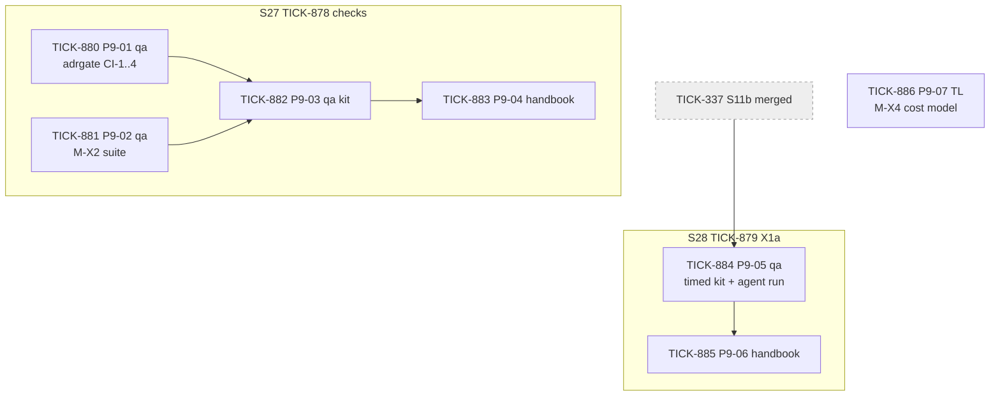
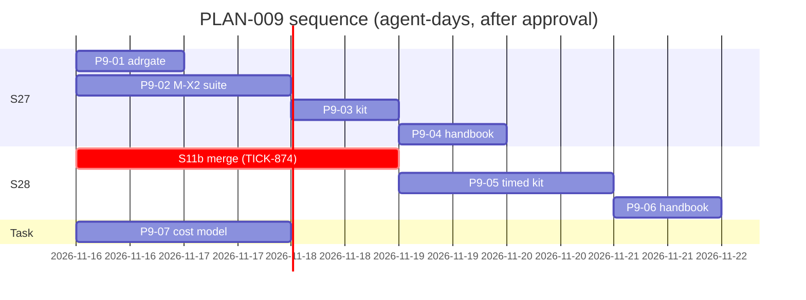

# PLAN-009: ADR-008 Competitive Gate

## Summary

**What ships, and in what order.** Two stories and one standalone task under feature TICK-877. Everything is created in `backlog`; the feature and stories are assigned to the Technical Lead, the code tasks to the Delivery squad with a role label.

| Order | Issue | What | ADR-008 |
|---|---|---|---|
| 1 | TICK-878 **S27** | CI-1..CI-4 docs gate in `task lint`; M-X2 upgrade-compatibility suite in `task test`. **Starts on plan approval** | D6, D7, D12, X2, R6; RFC-020 §8 CI-1..4, AC-1 |
| 2 | TICK-879 **S28** | M-X1a timed run: new tenant onboarded → first record routed by the admin's own workflow. **Waits for S11b (TICK-337) to merge** | X1a, D9, R4; RFC-020 §8 AC-2 |
| — | TICK-886 P9-07 | M-X4 cost-per-seat model at 50 and 500 seats. No target: that is Q1 (human). Starts on plan approval | X4, D9 |

**The one risk that matters most:** M-X2 pins today's configuration surface as an inventory. Any open story that adds a step type or a type-definition keyword (S18 number formats, TICK-669, is the likely one) will fail `task test` after S27 merges until it lists the item in `internal/configsurface/testdata/inventory.json`. That is the gate working (D12: additions must be listed), not a regression; it costs that story one line. The Technical Lead tells the S18 implementer when S27 merges (D-9-2).

**Second risk:** X1a may miss its 8 h target, or a step may need platform staff. S28 records that as a finding with a follow-up, not as a failed story: the ADR asks for a measurement, not a pass (D8, D9).

## Decisions this plan makes

| # | Decision |
|---|---|
| **D-9-1** | **Two stories.** S27 (checks) starts now; S28 (timed run) waits for S11b to merge into `main`, because it publishes a workflow through S11b's route and shares the acceptance guide files S11b changes. P9-07 is a docs-only task with no story (branching exception "task with no parent story"). |
| **D-9-2** | **The gates ride existing CI jobs; `.github/workflows/ci.yml` is not touched.** S11b (open) changes `ci.yml`. CI-1..CI-4 run as `go run ./tools/adrgate` inside `make lint` / `task lint` (the `lint` job, every PR and `main`), next to `tools/docindex -check`. M-X2 is a Go test package, so `make test` (`./...`, the `unit` job) runs it. S27's only shared files are `make/lint.mk` and `Taskfile.yml`'s `lint` task, which no open story changes (checked against `TICK-337/workflows-on-records` and `TICK-669/number-formats` on 2026-11-15). |
| **D-9-3** | **M-X1a lives in S28's kit, not inside S11b's kit.** RFC-020 AC-2 says "part of the story acceptance kit that ships S11b". S11b's kit (TICK-713) is done and the story is at its final merge; reopening it delays an almost-finished story for a measurement that does not change its code. S28 runs right after S11b merges, on S11b's capability, and is the kit that times it. The intent of AC-2 (nobody claims "hours not weeks" unmeasured) holds. *Solution Architect: say CHANGES if you want it inside S11b instead; S28 then becomes one task under TICK-337.* |
| **D-9-4** | **CI-2 and CI-4 scope.** They scan `docs/adr/**/*.md` except `docs/adr/_template-adr.md` (placeholders) and archived RFC revisions `docs/adr/*/rfc/rev-*/` (RFC-020 rev 0 cites `M-X1`, split into X1a/X1b by TA B1). Fenced code and HTML comments are not citations. CI-1's in-flight exemption is keyed on the record's `date:` against ADR-008's `accepted:`, read from ADR-008's front matter, as RFC-020 §8 states. |
| **D-9-5** | **M-X2 shape.** A pinned inventory (`internal/configsurface/testdata/inventory.json`) of step types, trigger events, condition operators, step fields, type-definition keywords, `x-nava-*` extensions and definition fields, each with a fixture that must still parse. Fails on removal, on an unlisted addition, and on a fixture that stops parsing. A removal is legal only with `major` + 1 and `docs/upgrade/v<major>.md` naming the item (D12). **No item is deprecated in v1**, so the "one deprecated item" of X2 is proven with a test-only injected inventory; the first real deprecation replaces it. **No release branches exist**: the suite runs on every `main` push and every `ci:run` PR, which is stricter than AC-1's "release branches". |
| **D-9-6** | **No script surface in v1.** `schema.json` has no `script` step. The inventory carries `script: []`, and the unlisted-addition check pulls a future script surface into the inventory the day it lands. |
| **D-9-7** | **M-X4 is P9-07, owned by the Technical Lead with the CTO reviewing**, as ADR-008 names the owner. It builds the method (inputs, cost per seat at 50 and 500 seats, ranges) and sets no target and no multiplier. Unit prices are a parameter table with an example set: picking an infrastructure vendor is the human's call. |
| **D-9-8** | **Go, not Python, for CI-1..CI-4.** RFC-020 §8 suggests "a small Python docs check alongside the handbook build", and leaves the implementation to this plan. The handbook build's Python runs only in its own `make test-handbook` step; adding a Python check to the `lint` job would need a `ci.yml` edit (D-9-2). `tools/docindex` is the precedent for a stdlib Go docs check in `lint`. |
| **D-9-9** | **No grooming meeting** (as D-8-13). The acceptance criteria are RFC-020 §8's pinned checks, already reviewed by the Technical Architect. A fresh-reader Goldfish ran on both stories and all seven tasks (comments on TICK-878 and TICK-879); the Solution Architect's plan verdict is the check. |
| **D-9-10** | **The `design-triad` skill update is not a repo task.** ADR-008 asks the skill owner to reference the gate in the critique checklist. Skills live outside the repo; owner: the CTO. Recorded here so it is not lost. |

## Interface contracts

| # | Contract | Producer → consumers |
|---|---|---|
| **C1** | `tools/adrgate`: `adrgate [-dir root]`; exit 0 clean, exit 1 with one line per finding, `path: CI-n: message`. | TICK-880 → TICK-882 (kit quotes the lines), CI `lint` job |
| **C2** | `internal/configsurface/testdata/inventory.json` schema and the failure strings `removed: <section>/<item>`, `unlisted: <section>/<item>`. | TICK-881 → TICK-882, every later story that changes the configuration surface |
| **C3** | `docs/quality/x1a-first-routed-record.md`: one table per run (step, start, end, minutes, help used, blocker), a total, and the run kind (`agent proxy` or `human`). | TICK-884 → TICK-885, ADR-008 handbook page |

## Task graph

| Task | Role | Outcome | Depends on | Estimate (agent-days) |
|---|---|---|---|---|
| TICK-880 P9-01 | `qa` | `task lint` fails on CI-1..CI-4 violations, passes on `main` | none | 0.5–1 |
| TICK-881 P9-02 | `qa` | `task test` fails on a removed or unlisted step type / keyword | none | 1–2 (guess: depends on how cleanly `internal/metadata` exposes its keyword list) |
| TICK-882 P9-03 | `qa` | S27 kit, run end to end | TICK-880, TICK-881 | 0.5 |
| TICK-883 P9-04 | Technical Lead | S27 handbook pages; build clean | TICK-880..882 | 0.5 |
| TICK-884 P9-05 | `qa` | Timed kit + one recorded agent-proxy run | S11b merged | 1–2 (guess: onboarding-to-publish path not yet walked end to end) |
| TICK-885 P9-06 | Technical Lead | S28 handbook pages; build clean | TICK-884, human run | 0.5 |
| TICK-886 P9-07 | Technical Lead (CTO reviews) | Cost-per-seat model | none | 1–2 (guess) |

**Critical path:** TICK-881 → TICK-882 → TICK-883 → S27 acceptance, **3–4 agent-days**. S28 is gated by S11b's merge (TICK-874, currently blocked), then 2–3 agent-days plus the human's timed run.

## Files per story (overlap check)

| Story | Expected files | Overlap |
|---|---|---|
| S27 | new `tools/adrgate/`, new `internal/configsurface/`, `make/lint.mk` (`lint:`), `Taskfile.yml` (`lint:`), `docs/acceptance/s27-competitive-gate.md`, handbook | None with S11b or S18 (checked 2026-11-15). Reads, does not edit, `internal/workflow/def/schema.json` and `internal/metadata/`. |
| S28 | `docs/acceptance/s28-first-routed-record.md`, new `docs/acceptance/guide/bruno/S28/`, the guide registration files, `docs/quality/x1a-first-routed-record.md`, handbook | Shares `docs/acceptance/guide/` build files with S11b: waits for S11b merged (D-9-1). |
| P9-07 | new `docs/quality/cost-model-x4.md` | None. |

Handbook output and the acceptance-guide build output are regenerated by every story; a conflict there is resolved by rebuilding, never by hand (as D-8-5). Before releasing each story the Technical Lead re-checks these lists against every open story branch.

## ADR coverage

| ADR-008 item | Where |
|---|---|
| D6 mandatory section, in-flight exemption guard 1 | TICK-880 (CI-1, date-keyed) |
| D6 guard 2 (back-apply line on acceptance of an exempt ADR) | Process, owned by whoever accepts the ADR; no task. CI-1 does not cover it (exempt records have no gate) |
| D7 (a) claim without number/method | Reviewer judgement (TA critique); CI-4 catches invented methods only |
| D7 (b), D3 grades, D2 register shape | TICK-880 (CI-2, CI-3) |
| D7 (c) `N/A` on a tenant-visible change | Reviewer judgement; not machine-checkable |
| D9 measured vs planned | TICK-883, TICK-885 update the ADR-008 handbook page as methods land |
| D12 additive configuration surface, R6 | TICK-881 (M-X2) |
| X1a, M-X1a, R4 (half) | TICK-884, TICK-885; human's run at S28 acceptance |
| X1b, M-X1b | Cut: no pilot yet |
| X2, M-X2, AC-1 | TICK-881 |
| X3, M-X3 | Already in the repo (`docs/quality/acl-perf-800k.md`, `docs/budgets.md`); competitor side is CG-SP-1, cut |
| X4, M-X4 | TICK-886 (method only; target is Q1) |
| RFC-020 §8 CI-1..CI-4 | TICK-880 |
| RFC-020 §8 AC-2 | TICK-884 (D-9-3) |
| `design-triad` checklist | D-9-10, CTO |
| Handbook summary page for ADR-008 | Already on `main` (`docs/handbook/src/adr/adr-008.md`) |

## The cut

| Cut | Why | Trigger to revisit | Owner |
|---|---|---|---|
| Spike CG-SP-1 (competitor timings) | ADR-008 runs it only if Q2 = yes; vendor terms may forbid benchmarking | The human answers Q2 = yes | Technical Lead plans it as one `qa` spike task |
| M-X1b production go-live timing | No pilot customer yet | The first pilot signs | Technical Lead |
| An X4 target | Q1 is a business tradeoff for the human | The human answers Q1 | CTO → human |
| A machine check for D7 (a) and (c) | Needs judgement about what is a claim or a tenant-visible change | R1 fires (two consecutive ADRs with identical gate text) | Technical Architect |

Nothing that enforces an invariant is cut: the plan adds checks and measurements only, and changes no runtime path (D5 parity holds trivially).

## Release

On `PLAN VERDICT: APPROVED`:
1. Cut `TICK-878/competitive-gate-checks` from `main`, move S27 to `in_progress`, release TICK-880 and TICK-881 to `todo`.
2. Release TICK-886 to `todo` (docs-only, targets `main`).
3. S28 stays in `backlog` until S11b (TICK-337) merges into `main`; then cut `TICK-879/first-routed-record` and release TICK-884.
4. When S27 merges, tell the S18 (TICK-669) implementer about the inventory (risk above).
5. Set TICK-876 `done`.
