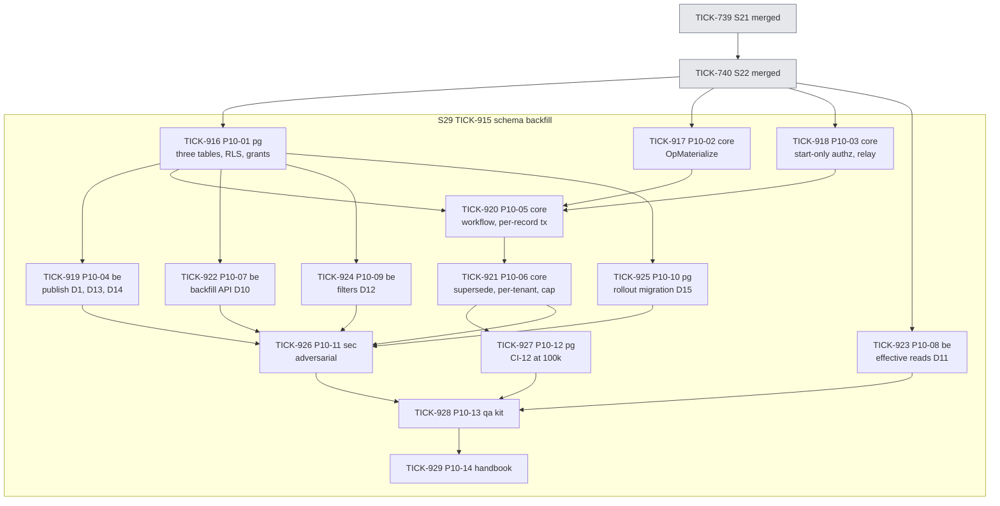
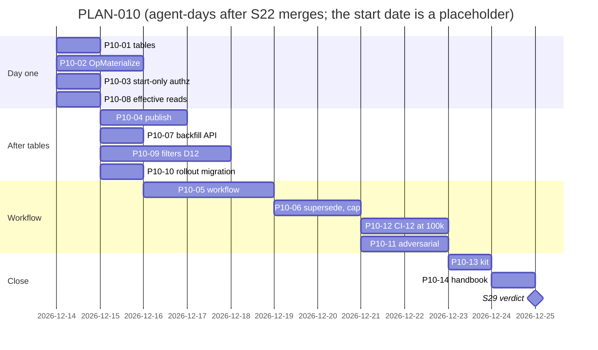

# PLAN-010: ADR-009 schema-version backfill

## Summary

**What ships.** One story, **S29** (TICK-915, under Epic 04 TICK-7), with 14 tasks (TICK-916..929). All are in `backlog`; the story is assigned to the Technical Lead, tasks to the Delivery squad with a role label, the handbook task to the Technical Lead.

**Order.** S29's branch is cut after **S21 and S22 merge into `main`** (and S12 if it has opened), because it reuses S21's barrier and pause controller and changes the filter compile S22 rewrites (D-10-1). Inside the story, four tasks start together on day one: the tables (TICK-916), `OpMaterialize` (TICK-917), the Temporal start rule (TICK-918) and the read helper (TICK-923). Everything else keys off the tables.

**The one risk that matters most:** CI-12 at 100k records on the real code has never run (ADR R1). The spike measured +1.7% live p95 at 20k with per-record transactions; 100k is inferred. TICK-927 runs it as soon as the workflow is complete (TICK-921), **before** the acceptance kit, so a tripped trigger comes back while the story is still open. A miss routes to its ADR owner, not into a hidden fix.

**Second risk:** S21 is in progress and S22 is queued behind it. S29 cannot start until both merge. That is the price of not building the barrier, the pacer and the filter compile twice (D-10-1). The live bug (reads show the default, filters miss it) stays until S29 merges; it is already recorded as drift in the Epic 04 decision of 2026-11-15.

## Decisions this plan makes

| # | Decision |
|---|---|
| **D-10-1** | **S29 waits for S21 (TICK-739) and S22 (TICK-740) merged into `main`**, the first option the ADR's sequencing note allows. It reuses `fieldindex.Barrier` and the D10 pause controller as S21 builds them, and adds D12 to the side-table filter compile in `internal/records/store/list.go` that S22 finishes. It also waits for **S12** (TICK-338) if S12 has opened by then (shared `internal/records/pipeline`, migrations, grants, isolation registry), and for S23 or S19 if either is open at that point (story independence). **If S29 and S23 are ready at the same moment, S29 goes first**: it fixes a wrong answer tenants get today, S23 adds a capability. *Sequencing call, not a priority call: if the human wants embedding first, S23 goes first and S29 waits; nothing else here changes.* |
| **D-10-2** | **D12 is built on the side-table path only.** S22 (TICK-752) deletes the JSONB data-filter path, and after it an unflagged data field answers 400 `field_not_filterable`, so no other data-filter path exists. CI-7's "JSONB path" variant is covered by S22's acceptance check (no JSONB filter compile in non-test code). *Trigger:* if S22's removal is cut or reverted before S29 starts, TICK-924 also covers the JSONB path and its body is amended first. |
| **D-10-3** | **OQ-4 (`backfill:retry` endpoint) is deferred out of v1.** A `failed_records` window closes with the next default-adding publish (D9). A retry cannot help a record that still fails validation, and a record fixed by a normal edit already holds the default (updates apply current defaults). TICK-921 adds the gauge `nava_schema_backfill_failed_records_oldest_seconds` so R6's trigger is observable. *Trigger (R6):* any type more than 7 days in `failed_records`. Owner: Technical Lead. |
| **D-10-4** | **The "4 tenants at once per worker pool" cap is a worker setting, not a query.** Page activities run on task queue `schema-backfill`, whose worker sets `MaxConcurrentActivityExecutionSize` from `NAVA_SCHEMA_BACKFILL_CONCURRENCY` (default 4). Counting other tenants' running jobs would need a cross-tenant read, which RLS forbids and this plan will not add. With N worker replicas the cap is 4×N; TICK-927 tunes it. "One job per tenant at a time" is checked inside the tenant, under RLS, at admission (TICK-921). |
| **D-10-5** | **S29 sits directly under Epic 04 (TICK-7)**, like S8, with no feature: it is one story closing that epic's last gap. Epic 04 can close when S29 is accepted. |
| **D-10-6** | **D11 surfaces today are four**: single read, list, PATCH response (`internal/server/records*.go`) and the workflow `RecordReader` (`internal/workflow/interp`). GraphQL and the embed SDK do not exist yet. TICK-923 adds one helper and an architecture test that refuses any other `ApplyDefaults` caller outside the pipeline, so future surfaces (S26 widget, GraphQL, export) inherit D11 without a note on each. |
| **D-10-7** | **The rollout migration (D15) reports skipped `default` + `x-nava-unique` types as `RAISE NOTICE` lines** (tenant id and type key only) in the deploy log, which the Technical Lead reads at the first deploy. Rollout jobs have `causation_audit_id = NULL` (no publish caused them). |
| **D-10-8** | **No grooming meeting** (as D-8-13). The acceptance tests are ADR-009's pinned CI-1..CI-12 and its API scenarios, already through two critique rounds with the Technical Architect, Security and Postgres. The Solution Architect's plan verdict is the check. The comprehension Goldfish ran on S29 and the readiness Goldfish on its two riskiest tasks (TICK-920, TICK-924); results on TICK-914. |
| **D-10-9** | **A tripped CI-12 trigger is routed, not patched in the measuring task.** TICK-927 reports R1/R5 (Postgres & Data Modeling Specialist) or R9 (Technical Architect) on TICK-915; the Technical Lead creates the fix task or sends it back to the Solution Architect if the fix changes the ADR. |

## Interface contracts

| # | Contract | Producer → consumers |
|---|---|---|
| **C1** | Tables `schema_backfills` (PK `tenant_id, entity_definition_id, target_version`; `state`, `default_keys`, `causation_audit_id`, counters, times), `schema_backfill_pending` and `schema_backfill_failures` (`record_id`, failures add `code` matching `^[a-z_]{1,64}$`, never a value); `FORCE RLS`, composite FKs, `nava_worker` DML, `nava_app` SELECT. Full column list in TICK-916. | TICK-916 → TICK-919, 920, 921, 922, 924, 925 |
| **C2** | `pipeline.Write(OpMaterialize)`: empty patch, `SourceSystem`, `actor_system='schema-backfill'`, causation fields; result `Written bool`; version conflict = existing typed conflict error; refusal = typed error with a lower-snake code. | TICK-917 → TICK-920 |
| **C3** | Outbox kind `schema.backfill`, dedupe key `schema-backfill:<def>:<version>`, payload `{entity_definition_id, target_version, causation_audit_id}`; workflow type `schema.backfill`, id `t:<tenant>:schema.backfill:<def>:<version>` from `outbox.tenant_id`, task queue `schema-backfill`, no tenant in the input. | TICK-918 → TICK-919, 920, 925 |
| **C4** | Job states `pending → filling → running → done \| failed_records`, `superseded` from any non-terminal state; `remaining` = pending + failure rows, counted to 1,001. | TICK-920, 921 → TICK-922, 924 |
| **C5** | `GET /entity-types/{key}` `backfill {state, target_version, rewritten, skipped, failed, remaining, started_at, finished_at}` (newest job; absent if none); `GET /entity-types/{key}/backfill/failures` `{items:[{record_id, code}], next_cursor}`, entity-type admin only, 404 otherwise. | TICK-922 → TICK-928, handbook |
| **C6** | `fieldindex.Barrier` and the D10 pause controller from S21 (TICK-745), reused unchanged; exported by TICK-920 with no behaviour change if S21 left the controller unexported. | S21 → TICK-920 |
| **C7** | `records.Effective(cur, rec)` is the only way a record body is built for output. | TICK-923 → every read surface |

## Task graph

**Critical path:** S21 → S22 merged → TICK-916 → TICK-920 → TICK-921 → TICK-927 (CI-12) → TICK-928 → TICK-929 → S29 accepted. TICK-917 and TICK-918 run beside TICK-916 and must be done before TICK-920 starts.

The start date (2026-12-14) stands for "when S22 has merged"; it depends on S21 and S22, which this plan does not control.

**Estimates** (agent-days, ranges, with what drives them):
- **S29 total: 11–15 on the critical path.** The workflow (TICK-920, 3–4) and the D12 filter shapes (TICK-924, 2–4) drive it.
- TICK-920: the per-record transaction loop and the crash/retry tests (CI-11) are the uncertain part.
- TICK-924: 2 if S21's side-table compile accepts a second branch cleanly, 4 if the `total` count has to be restructured. **A guess until S22 merges.**
- TICK-927: 1–2 to run; **open-ended if a trigger trips** (routed by D-10-9, not counted here).

## Files (overlap check)

| Story | Expected files | Overlap |
|---|---|---|
| S29 | `db/migrations/`, `db/grants.yaml`, `internal/tenancy/isolation/registry.go`, `internal/records/pipeline`, `internal/records/store/list.go`, `internal/metadata` (`compile.go`, `classify.go`), `internal/entitytypes`, `internal/server` (publish, `records.go`, `records_list.go`, `records_patch.go`, entity-type routes), `internal/workflow/interp`, new `internal/schemabackfill/`, `internal/fieldindex` (export only), `internal/relay`, `cmd/nava-worker`, `temporal-server/authz`, `api/`, `docs/budgets.md`, `docs/acceptance/S29/`, Bruno `S29`, handbook | S21, S22 (fieldindex, list.go, migrations, grants, `api/`), S12 (pipeline, migrations, grants, registry), S23 and S19 (migrations, grants, `api/`, `internal/server`): waits per D-10-1. |

Before cutting `TICK-915/schema-backfill` the Technical Lead re-checks that no other open story touches these files.

## ADR coverage

| ADR-009 item | Where |
|---|---|
| D1 job and outbox row in the publish tx | TICK-919 (CI-1) |
| D2 relay-only start, `t:` id, no tenant arg, start-only, `nava_worker`, audit identity | TICK-918 (CI-3 1, 2), TICK-920 (CI-3 3, 5), TICK-917 (audit identity) |
| D3 `OpMaterialize`, compare before SQL, validate rules | TICK-917 (CI-3 4) |
| D4 one audit entry per record; start and finish entries | TICK-917, TICK-920 |
| D5 `version` +1, `schema_version`, `updated_at` kept | TICK-917 (CI-2); `api/paths/records.yaml` text TICK-922 |
| D6 no workflows, signals or outbox | TICK-917 (CI-2) |
| D7 barrier, one-tx fill + flip, pages, per-record tx, failures, pause, states | TICK-920 (CI-2, 4, 6, 11); per tenant and cap TICK-921 (D-10-4) |
| D8 supersede, no lock, no new grant | TICK-921 (CI-5) |
| D9 poison records never block | TICK-920 (CI-6), TICK-924 (failures branch); OQ-4 D-10-3 |
| D10 `backfill` object and failures route | TICK-922 |
| D11 effective value on every surface | TICK-923 (CI-8, D-10-6) |
| D12 filter shapes, ACL in every branch, `total` | TICK-924 (CI-7), side tables only (D-10-2) |
| D13 no `default` + `x-nava-unique` | TICK-919 (CI-9) |
| D14 required-with-default is `needs_backfill` | TICK-919 (CI-10) |
| D15 rollout migration and skip list | TICK-925 (CI-3 7, D-10-7) |
| Grants (`db/grants.yaml`) | TICK-916 |
| CI-3 end to end | TICK-926 |
| CI-12, R1, R5, R9 | TICK-927 (D-10-9) |
| R2, R4, R7, R8 (Solution Architect), R3 (Technical Architect) | no task; triggers in the ADR. R3 is measured by S21's TICK-747 at 400k |
| R6 | D-10-3 gauge in TICK-921 |
| Handbook pages (metadata engine, write pipeline, ADR-006 filters) | TICK-929 |
| ADR handbook summary page (missing from PR #711) | TICK-930 (Solution Architect, `todo` now) |

## The cut

| Cut | Why | Trigger to revisit | Owner |
|---|---|---|---|
| `backfill:retry` endpoint (OQ-4) | The next default-adding publish closes the window; retrying a still-invalid record fails again (D-10-3) | R6: a type > 7 days in `failed_records` | Technical Lead |
| D12 on the JSONB filter path | S22 deletes that path (D-10-2) | S22's removal cut or reverted | Technical Lead |
| Building S21's barrier and pacer separately so S29 can start now | It doubles shared code and S21 is already in progress (D-10-1) | S21 or S22 slips by more than two weeks with S29 ready | Technical Lead → CTO |

Nothing that enforces an invariant is cut. Tenant scoping (TICK-916, 918, 920), the adversarial suite (TICK-926), I4's one write path (TICK-917), idempotency under redelivery and crash (TICK-918, TICK-920 CI-11) and the measurement that guards the live-write budget (TICK-927) each have their own task.

## Release

On `PLAN VERDICT: APPROVED`:
1. TICK-914 is set `done`. S29 and its tasks stay in `backlog`: none has `Depends on: none` that can start yet, because the story branch waits for S21 and S22 (D-10-1).
2. When S22 merges (and S12 or any open S23/S19 has merged), the Technical Lead re-checks overlap, cuts `TICK-915/schema-backfill`, moves S29 to `in_progress` and releases TICK-916, 917, 918 and 923.
3. The delivery sweep releases each further task as its `Depends on:` closes; TICK-927 before TICK-928.
4. TICK-930 (ADR-009 handbook summary page) is already `todo` with the Solution Architect.
