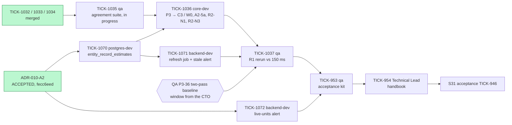
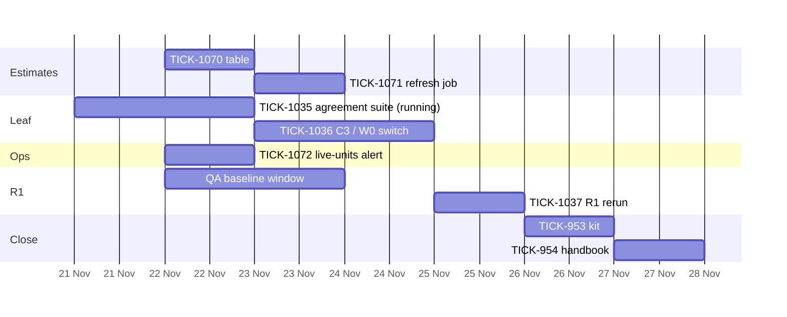

# PLAN-011-A2: ADR-010 amendment A2

## Summary

**What ships:** the N̂_e source (A2-9), the per-request page switch C3 / W0 with the rare-type shortcut (A2-5, A2-5a), the R2-N1 and R2-N3 fixes, the live-units alert (A2-7), and the R1 rerun scored per A2-11. All of it lands inside **S31 (TICK-946)**, on `TICK-946/in-my-region`, because A2 fixes S31's R1 breach and S31 already owns every file it touches (D-11A2-1).

A2's other tasks are already merged on the story branch: TICK-1032 (closure, B1 key), TICK-1033 (rebuild with the tenant lock), TICK-1034 (canonical U, `Allows`, CC, the deletions, the 4-set cap and nested-id refusal, PR #825). TICK-1035 (agreement suite) is in progress.

| Item | Issue | Role | Outcome |
|---|---|---|---|
| T-A2-1 | TICK-1070 (new) | `postgres-dev` | `entity_record_estimates` migration: RLS, grants, isolation registry, `nava_worker` read of `tenant_identity_binding.tenant_id` |
| T-A2-2 | TICK-1071 (new) | `backend-dev` | Hourly per-tenant refresh job in `nava-worker`; `authz_under_estimate_age_seconds`, `entity_record_estimates_refresh_failures_total`, `EntityRecordEstimatesStale` alert |
| T-A2-3 | TICK-1036 (rewritten) | `core-dev` | P3 → C3 at m ≤ K\*, W0 above; K\* with c = 0.8; A2-5a; `DISTINCT` U and `under_duplicate_id` at publish; plan test on both sort keys; A2-10 shape metrics |
| T-A2-4 | TICK-1072 (new) | `backend-dev` | `groupsync_org_units_live_max` and `GroupsyncOrgUnitsAboveCertified` at 10,111; no sync is ever refused |
| T-A2-5 | TICK-1037 (rewritten) | `qa` | R1 rerun: baseline first, then `bench_rare`, `bench_conc`, the count-only persona, each p95 against 150 ms |
| — | TICK-953 (updated) | `qa` | Acceptance kit names the A2 alerts, not the deleted R8 ones; waits for TICK-1037 |
| — | TICK-954 (updated) | Technical Lead | Handbook update, last task: list API and leaf pages for C3 / W0, new table, groupsync and worker pages, bench verdict |

**Order:** TICK-1070 and TICK-1072 start at once. TICK-1036 starts when TICK-1070 and TICK-1035 have merged. TICK-1071 runs beside TICK-1036. TICK-1037 scores once TICK-1036 and TICK-1071 are merged **and** QA's two-pass baseline exists. Then the kit (TICK-953) and the handbook (TICK-954).

**The one risk that matters most:** TICK-1037 cannot score without QA's P3-36 two-pass baseline. The 14:35–15:05 window gave one clean pass (p95 131.96 ms) because TICK-1058's `nava-it-*` containers started mid-window. Until two clean passes exist, 146.2 ms stays R1's baseline. **Recovery:** QA asks the CTO on TICK-1037 for a new idle-host window now, so it is granted while TICK-1036 is in review, not after. If no window is granted within one working day, the Technical Lead escalates to the CTO (unblock owner: the CTO). **Second risk:** R1 fails for the region-only caller at m ≈ K\* (A2-R1) or on `bench_conc` (A2-R6). That goes to the CTO as option (iii) (A2-11); A2's mechanism stands, and nothing becomes a groupsync refusal.

## Decisions this plan makes

| # | Decision |
|---|---|
| **D-11A2-1** | **A2 lands inside S31, not in a new story.** S31 owns `internal/authz/`, `internal/groupsync/`, the region bench and `docs/quality/acl-perf-region.md`, and A2 fixes S31's own R1 breach. A separate story would overlap every file and could not start until S31 merges, which S31 cannot do without A2. |
| **D-11A2-2** | **The refresh job's host (A2-9 leaves it to the Technical Lead): a ticker loop in `cmd/nava-worker`, connected as `nava_worker`, package `internal/estimates`.** A2-9 requires a role that already has tenant-scoped `SELECT` on `records`: only `nava_app` and `nava_worker` do (`records_select`). Not a Temporal workflow: `workerguard` refuses cron schedules (no cron in M1). Not `nava-core`: it would put a batch loop in the request process. Tenants are listed from `tenant_identity_binding.tenant_id`, extending the existing `binding_lookup` SELECT policy to `nava_worker` with a column grant on `tenant_id` only. No policy is added on `records` or `tenants`. The Security & Multi-Tenancy Reviewer reviews TICK-1070 for this. |
| **D-11A2-3** | **The table and the job are two tasks.** A2's Consequences say `postgres-dev` can start the table before the job code. TICK-1036 needs only the table (a missing row means K\* = 1,000, and its tests seed rows directly), so the job is off TICK-1036's path and gates only TICK-1037, which needs real N̂_e on the bench seed. |
| **D-11A2-4** | **R2-N1 sits in TICK-1036, both halves.** The SQL `DISTINCT` on U goes into the `unnest(U)` sources (P3 and TICK-1034's `RegionDriver`). Go's `sortedIDs` already deduplicates on every current path; the SQL step guards a future caller. The publish refusal is a new rule `under_duplicate_id`: TICK-1034 shipped the 4-set cap (`under_sets_exceeded`) and the nested-id refusal (`under_nested`), but no duplicate-id rule exists on the story branch. |
| **D-11A2-5** | **TICK-1036 depends on TICK-1035.** A2's tests require every agreement case to run with C3 forced, W0 forced and through the probe. That extends TICK-1035's suite, so TICK-1035 merges first. |
| **D-11A2-6** | **The A2-R3 staleness alert is owned by TICK-1071, the `groupsync_org_units_live_max` alert by TICK-1072.** Each alert ships with the metric it reads, so neither task waits on the other. Both rules have promtool tests. The Technical Lead owns both alerts (A2-R2, A2-R3 owner). |
| **D-11A2-7** | **TICK-953's kit no longer names `authz_under_set_too_large_total` or the R8 cap.** TICK-1034 deleted both (A2-4). The kit names the two A2 alerts and waits for TICK-1037: S31 has no acceptance run until R1 passes. |
| **D-11A2-8** | **The handbook task stays TICK-954**, assigned to the Technical Lead, and gains the A2 pages and a dependency on every A2 task. `adr/adr-010-a2.md` already merged with the ADR (PR #818). |
| **D-11A2-9** | **No grooming meeting.** Every rule here passed two critique rounds and a security review, with c measured. A readiness check of the five bodies against A2 found three gaps, answered in the bodies: the job's host and tenant enumeration (D-11A2-2), the missing duplicate-id rule (D-11A2-4), and stale kit alerts (D-11A2-7). The Solution Architect's plan verdict is the check. |
| **D-11A2-10** | **Reviewers.** TICK-1070: Security & Multi-Tenancy Reviewer. TICK-1036: the Technical Lead (`change-review`), plus Security for A2-6 requirements 1–4. TICK-1071: the Technical Lead, plus Security for tenant scoping. TICK-1072: the Technical Lead. TICK-1037: the Technical Architect (crossover-cell method). |

## Task graph

Critical path: TICK-1070 → TICK-1036 → TICK-1037 → TICK-953 → TICK-954, with the baseline as a parallel gate on TICK-1037.

## Sequence

The dates are guesses. They assume one idle-host window for the baseline and one clean scored rerun. Each refused floor gate adds about half a day.

## Estimates

| Task | Range | Assumption |
|---|---|---|
| TICK-1070 | 0.5 agent-day | Follows TICK-1032's RLS, grants and registry pattern |
| TICK-1071 | 0.5–1 agent-day | The `nava-purge` ticker and admin-listener pattern is reused |
| TICK-1036 | 1.5–2.5 agent-days (**guess**) | The plan test reuses TICK-1034's `EXPLAIN` harness; the forced-shape agreement runs reuse TICK-1035's generator |
| TICK-1072 | 0.5 agent-day | The `groupsync_org_subtree_max` code path is reused |
| TICK-1037 | 1 agent-day after the baseline (**guess**) | One 800k seed (about 35 min) plus the two new sets from the crossover cells |

## Story overlap

All files are S31's: `db/migrations/` and `db/grants.yaml` (TICK-1070), `internal/estimates/` and `cmd/nava-worker/` (TICK-1071), `internal/authz/acl.go`, `document.go`, `plan.go` and their tests (TICK-1036), `internal/groupsync/` (TICK-1072), `deploy/compose/prometheus/rules/` (TICK-1071, TICK-1072, separate files: `authz.yml` and `groupsync.yml`), `docs/quality/acl-perf-region.md` (TICK-1037), `docs/handbook/src/` (TICK-954). Inside S31, TICK-1036 and TICK-1059 both touch the `under` publish checks and `format2_invalid.json`; TICK-1036's body says to rebase on TICK-1059 if it is still open. `cmd/nava-worker/` is also touched by no other open story's task. No new cross-story overlap.

## The cut

- **Not in this plan (scope guard):** residual **A2-R5** (R2-N2, a selective request filter moving W0's crossover). It stays on risk **R-006** (PR #815, the broad-ACL page walk), tracked under PLAN-007-A1 D-7A1-6 and PLAN-007-A2 D-7A2-11, owner the Technical Lead.
- **A2-R2** (dormant subtree defeats W0's bound) has no task: its trigger is `authz_under_list_shape_total{shape="walk"}` (TICK-1036) plus a slow-list report; the fix would be A2-11's top-N index, a further amendment.
- **Deferred:** a refresh after bulk import (A2 open question 1); revisit if `EntityRecordEstimatesStale` fires. Incremental closure maintenance stays on TICK-1054.
- **Nothing weakens an invariant.** I1: FORCE RLS on the new table, no cross-tenant policy on `records`, the cross-tenant tests in TICK-1036 and TICK-1070. I5: three shapes checked by the forced-shape agreement suite. I8: K\* is computed. Revocation: groupsync never refuses a sync.

## Linked PRs

#818 (ADR-010-A2) and #820 (TICK-1040 contended-list void) are merged. #825 (TICK-1034) is merged and only cites TICK-1040. This plan's docs PR is the only PR on TICK-1069.
