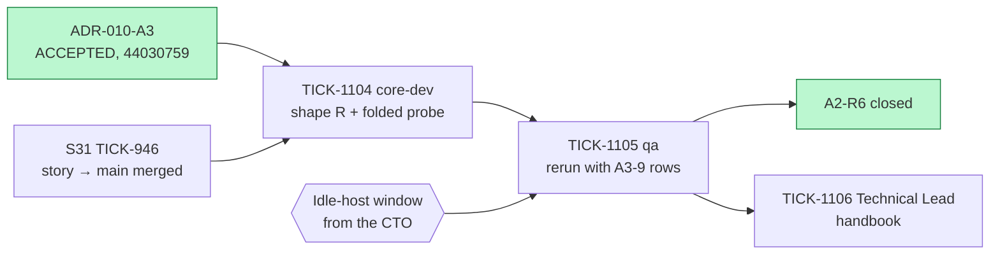
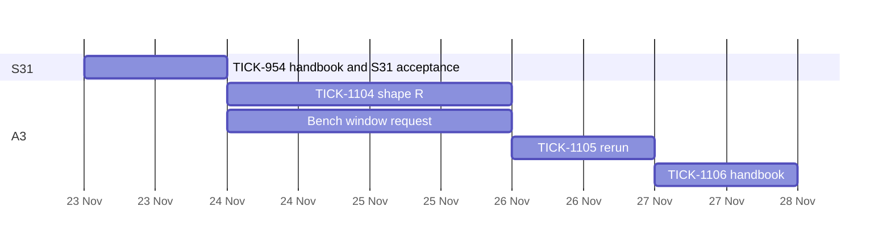

# PLAN-011-A3: ADR-010 amendment A3

## Summary

**What ships:** shape R and the folded probe with the U_hash bound (A3-1 to A3-8), then the TICK-1037 bench rerun with A3-9's rows, then the handbook. That is one implementation task, one rerun and one handbook task. There is no new index and no `records` change.

**Where it lands: after S31, as standalone task PRs into `main` (D-11A3-1).** A3 is a margin change. It does not gate S31, because R1 already passed under A2 (`bench_conc` 70.08 / 82.69 ms p95, TICK-1037 rerun). S31 has only its handbook task (TICK-954) left, so S31 is not held back for a bench window it does not need.

| Item | Issue | Role | Outcome |
|---|---|---|---|
| T-A3-1 | TICK-1104 | `core-dev` | `ShapeRecords` for the page and the count; the A3-2 selector order with the folded probe (`LIMIT $uhash`, R iff `n >= $cap AND n < $uhash`); `alpha = 3.3`, `uCert = 10111`, `uHash = 2*uCert`; selector and mutant tests; plan pins at 10,111 and 20,222; the five-item cross-tenant test (A3-7); A2-6 agreement for every shape; the `docs/budgets.md` line |
| T-A3-2 | TICK-1105 | `qa` | TICK-1037 rerun on `main` with the A3-9 rows, under the bench-window checklist. A pass closes A2-R6 |
| T-A3-3 | TICK-1106 | Technical Lead | Handbook: `core-acl` and the region pages gain shape R and the selector; the bench page gets the verdict |

**Order:** S31 (TICK-946) merges into `main` → TICK-1104 → TICK-1105 → TICK-1106. It is a straight chain: each task needs the one before it.

**The one risk that matters most:** the R count may not pick a `(tenant_id, entity_definition_id, …)` index once `IS NOT NULL` is gone (A3-R2). That changes cost, never rows. TICK-1104 ships as specified and reports the plan it observed. A miss goes to the Postgres & Data Modeling Specialist as A3-R2, to be costed as a further amendment. It does not become an index inside this plan. **Second risk:** TICK-1105 needs an idle-host window from the CTO. QA asks for one when TICK-1104 enters review, not after it merges.

## Decisions this plan makes

| # | Decision |
|---|---|
| **D-11A3-1** | **A3 lands after S31, as standalone task PRs into `main`, not inside S31.** The ADR leaves this choice to the Technical Lead (A3-9). Its Consequences name `TICK-946/in-my-region` as the target, and this plan overrides that. **Why:** S31's work is done except TICK-954, and TICK-953's kit is merged. Putting A3 inside S31 would hold S31's acceptance for an implementation, a review and an idle-host bench window, all for a margin it already has. A3 touches only files S31 owns (`internal/authz`, the region bench), so the rule that no two open stories touch the same file means it cannot start in parallel. It starts after S31 reaches `main`. A3 has nothing a human can try (it changes speed, not results), so it is tasks, not a story: standalone task PRs into `main` are the Technical Lead's call (`branching-strategy.md`). **Cost:** A2-R6 stays open as a margin risk until TICK-1105 passes. **Trigger to revisit:** S31's acceptance slips for a reason unrelated to A3, or a fresh-stack run of S31 goes over 150 ms. In either case, fold TICK-1104 into S31. |
| **D-11A3-2** | **The rerun is a new issue (TICK-1105), not TICK-1037 reopened.** TICK-1037 is done, with its report and PR #846 merged. The rerun reuses its harness, rows and method, and adds A3-9's three rows. |
| **D-11A3-3** | **The handbook for A3 is its own task (TICK-1106), not TICK-954.** TICK-1103 asked TICK-954 to pick up the A3 pages. Under D-11A3-1, TICK-954 gates S31 and closes before A3's code exists, so it documents S31 as built (A2's shapes). TICK-1106 adds R once TICK-1104 and TICK-1105 merge. `docs/handbook/src/adr/adr-010-a3.md` is already merged (PR #856). |
| **D-11A3-4** | **One implementation task, not split.** The spike diff (574 lines across `acl.go`, `shape.go` and three tests) already holds R, the probe and the tests. Splitting the selector from the leaf would give two PRs that cannot be tested alone. Estimate: 1 to 1.5 agent-days. |
| **D-11A3-5** | **An A3-R2 miss does not block TICK-1104.** If the plan test shows the R count on `records_org_unit` instead of an `(tenant_id, entity_definition_id, …)` index, the leaf still ships (rows are correct), and the PR states the observed plan. The Technical Lead hands it to the Postgres & Data Modeling Specialist. This keeps the scope guard: no new index here. |
| **D-11A3-6** | **The generic-plan check is reported, not gated.** A2-R4 (extended) asks for a plan-test run under `force_generic_plan` whenever cached statements change. TICK-1104 does not change the exec mode. It runs the check once and reports the result in its PR. A miss goes to A2-R4's owner. |
| **D-11A3-7** | **Reviewers.** TICK-1104: the Technical Lead (`change-review`), the Security & Multi-Tenancy Reviewer (the A3-7 test and the never-exposed list), and the Postgres & Data Modeling Specialist (plan pins). TICK-1105: the Technical Architect (method, as on TICK-1091). TICK-1106: the area owners from TICK-718. |
| **D-11A3-8** | **No grooming meeting.** A3 passed one critique round, one revision, a re-check and a security review, and its Consequences list the tests line by line. The readiness check of the three bodies found two gaps, both answered in the bodies: the branch target (D-11A3-1) and what to do on an A3-R2 miss (D-11A3-5). The Solution Architect's plan verdict is the check. |

## Task graph

Critical path: S31's merge → TICK-1104 → TICK-1105 → TICK-1106, with the bench window as a parallel gate on TICK-1105.

## Sequence

The dates are guesses. They assume S31 is accepted on its first fresh-stack run and the CTO grants a window while TICK-1104 is in review.

## Estimates

| Task | Range | Assumption |
|---|---|---|
| TICK-1104 | 1–1.5 agent-days | The spike diff applies to `main` after S31 with small conflicts; the plan test needs a 20,222-unit seed (the bench seed is 10,111) |
| TICK-1105 | 0.5–1 agent-day | One clean scored attempt; each voided attempt adds about half a day |
| TICK-1106 | 0.5 agent-day | TICK-954's region pages exist |

## The cut

Nothing is cut from A3. These items are excluded, with their triggers:

- **A covering index for the R count (A3-R2).** Excluded by the scope guard. Trigger: TICK-1104's plan test shows no `(tenant_id, entity_definition_id, …)` index. Owner: Postgres & Data Modeling Specialist.
- **TICK-1078** (closure `(tenant_id, descendant_id)` index) stays in S31's backlog. It is not part of A3.
- **A2 text pointers to A3** (A2-5, A2-6, A2-7, A2-10, A2-R6) are the Solution Architect's, from ADR acceptance. They are not a task here.

## Invariants check

- **I1 (tenant wall):** the five-item cross-tenant test is an acceptance criterion of TICK-1104, not a separate task that could be cut.
- **I5 (SQL and Go agree):** A2-6 agreement with R forced, for every shape, is in TICK-1104.
- **I8:** α, U_cert and U_hash are constants with no setting, as A3-3 requires.

## Linked PRs

- #856 (ADR-010-A3), merged at `44030759`.
- This plan's docs PR (labelled on TICK-1103).
