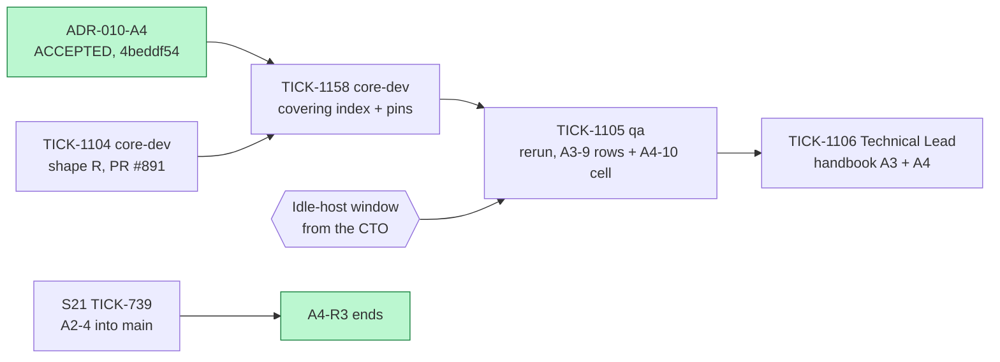
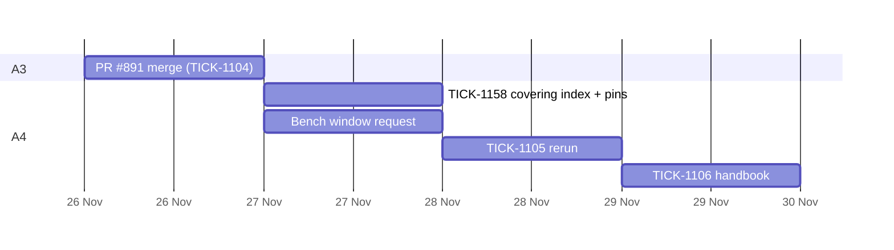

# PLAN-011-A4: ADR-010 amendment A4

## Summary

**What ships:** one migration that swaps `records_list_updated` for the same index with `INCLUDE (org_unit_id)` (A4-1), the index-list test, and the plan pins CI-1 to CI-8 (A4-5, A4-6). No Go outside tests changes, unless the A4-4 fallback fires. Then the A3 bench rerun (TICK-1105) gains A4-10's cell, and the A3 handbook task (TICK-1106) gains A4's pages.

| Item | Issue | Role | Outcome |
|---|---|---|---|
| T-A4-1 | TICK-1158 | `core-dev` | Migration with the CONCURRENTLY swap; `records_pipeline_test.go` index list; CI-3, CI-4 (with the 1.3× node guard and mutant `r_count_no_covering`), CI-5, CI-8 in `acl_under_records_integration_test.go` |
| (extended) | TICK-1105 | `qa` | A3 rerun, now also after TICK-1158, with the A3-R2 cell at m = 500 beside m = 0 (A4-10) |
| (extended) | TICK-1106 | Technical Lead | Handbook: A3's pages plus `database/records.md`, `core-acl`, the region page and AR-TICK-1143-01 |

**Order:** TICK-1104 (PR #891, approved) merges into `main` → TICK-1158 → TICK-1105 → TICK-1106. A straight chain.

**Where it lands: a standalone task PR into `main`, before S21 (D-11A4-1).** This is the merge-order call the ADR leaves to the plan. It means A4-R3 applies on `main` until S21 merges: **"Until ADR-006-A2 A2-4 is in `main`, A4 makes the first cold R list with at most `limit` matches slower: 1.45–1.95 s today (the Seq Scan count warms the heap for the page) against 8.8–11.2 s with the covering index (W1, m = 0, measured)."**

**The one risk that matters most:** the CI-4 world sits at a cost tie on another Postgres build or seed, so the pin flakes. The 1.3× node guard turns a tie into a named failure (`world at a tie`) instead of a flake; the measured ratio is 5.2. If the un-negated pin misses outright, A4-4's fallback is already decided and stays inside TICK-1158.

## Decisions this plan makes

| # | Decision |
|---|---|
| **D-11A4-1** | **A4 lands before S21, as a standalone task PR into `main`.** **Why:** S21 (TICK-739) still has open work (TICK-749 in review, TICK-1097 in review, TICK-1098 blocked, TICK-1099, TICK-1002, TICK-1095 and TICK-1052 in backlog), so waiting would hold A4 and TICK-1105 (and with it A2-R6's closure) for an unknown time. No production installation exists, so A4-R3's trigger (a region list p95 above 1 s in the first 10 minutes after a database restart, or a heap larger than RAM) cannot fire from a real tenant before S21 merges. Once S21 merges `main` into its branch, the story branch has both A4 and A2-4, so S21's own fresh-stack run does not see A4-R3. **Cost:** on `main`, a fresh stack's first cold region list with at most `limit` matches takes 8.8–11.2 s instead of 1.45–1.95 s, until S21 merges. **Trigger to revisit:** a fresh-stack acceptance kit run from `main` (any story) exercises a cold region list before S21 merges and its first request exceeds that kit's budget; then that kit warms the list first, or the story waits for S21. Owner: Technical Lead. |
| **D-11A4-2** | **One `core-dev` task, as the ADR's Consequences say.** The migration, the index-list line and the pins cannot be tested apart: the pins need the index, and the index's only acceptance test is the pins. Estimate: 0.5 to 1 agent-day. |
| **D-11A4-3** | **TICK-1158 waits for TICK-1104 (PR #891) to merge.** PR #891 creates `acl_under_records_integration_test.go` and TICK-1104's count pin, which A4-5 replaces. PR #891 is approved; only its merge is left. Stacking onto #891's branch would tie A4's review to a PR that is about to close. |
| **D-11A4-4** | **No new rerun or handbook issue: TICK-1105 and TICK-1106 are extended.** Both are in `backlog` under PLAN-011-A3, and A4-10 names TICK-1105 directly. TICK-1105's `Depends on:` now also names TICK-1158, and TICK-1106's names TICK-1158. One rerun scores A3 and A4 together; one handbook PR describes R as built. |
| **D-11A4-5** | **A4-4 stays inside TICK-1158.** If it fires, the change reaches `internal/authz/shape.go`, which S21 does not touch, so D-11A4-1 still holds. The implementer reports it on the issue and the Technical Lead re-checks the overlap before review. No new RFC (A4-4). |
| **D-11A4-6** | **Migration build time at production size (A4-R4) is not measured in this plan.** There is no stage environment. The 1.3 s build at 800,000 rows is on record. Trigger: the first stage rehearsal, owned by the Postgres & Data Modeling Specialist (A4-R4). |
| **D-11A4-7** | **Reviewers.** TICK-1158: the Technical Lead (`change-review`), the Postgres & Data Modeling Specialist (migration, pins, guard), the Security & Multi-Tenancy Reviewer (CI-7 and the rows-read bound behind AR-TICK-1143-01). TICK-1105: the Technical Architect, as before. TICK-1106: the area owners from TICK-718, plus the Postgres & Data Modeling Specialist for `database/records.md`. |
| **D-11A4-8** | **No grooming meeting.** A4 went through a critique round, a re-check, a security review and a CTO tie-break, and its Consequences list the tests and files line by line. A readiness check of TICK-1158's body found three gaps, answered in the body: the migration's re-run safety across drop and rename (and the split-file alternative if the idempotency test requires one CONCURRENTLY per file), CI-4's tenant split (150,000 of A's rows plus 50,000 others), and the migration timestamp against S21's field-index migrations. The Solution Architect's plan verdict is the check, as in D-11A3-8. |

## Task graph

Critical path: PR #891's merge → TICK-1158 → TICK-1105 → TICK-1106. S21 is not on it; it only ends A4-R3.

## Sequence

The dates are guesses. They assume PR #891 merges today, the pins pass without A4-4, and the CTO grants a window while TICK-1158 is in review.

## Estimates

| Task | Range | Assumption |
|---|---|---|
| TICK-1158 | 0.5–1 agent-day | CI-4's world seeds in under a minute (200,000 empty rows); A4-4 does not fire. If it does, +0.5 day |
| TICK-1105 | +0.1 agent-day on its PLAN-011-A3 range | One extra cell in a run already planned |
| TICK-1106 | +0.25 agent-day | Three more pages to touch |

## The cut

Nothing in A4 is cut. Excluded, with triggers (all from the ADR):

- **Ordering negated R arms, or INCLUDE-ing their columns (A4-R5).** Trigger: CI-5, TICK-1105 or a slow-query report shows a negated R arm over 150 ms; the fix is A4-4's order on that arm. Owner: Postgres & Data Modeling Specialist.
- **Filters the index does not hold (A4-R2).** Trigger: A3-R2 triggers 2 and 3 on a filtered list. Owner: Postgres & Data Modeling Specialist.
- **The page arm's cold walk (A4-R3).** Ends when S21 brings A2-4 to `main`. Trigger: a region list p95 above 1 s in the first 10 minutes after a restart, or a heap larger than RAM. Owner: Solution Architect.
- **Production-size build time (A4-R4).** D-11A4-6.

## Invariants check

- **I1 (tenant wall):** CI-7 (A3's five cross-tenant items) and the rows-read bound in CI-3 and CI-4 are acceptance criteria of TICK-1158, not a separate task that could be cut.
- **I5 (one authorization layer):** the count's text does not change; CI-6's agreement suite runs unchanged.
- **I8:** a fixed index, no setting.
- **AR-TICK-1143-01** is already on `main` (PR #906).

## Linked PRs

- #906 (ADR-010-A4), merged at `4beddf54`.
- This plan's docs PR (labelled on TICK-1157).
