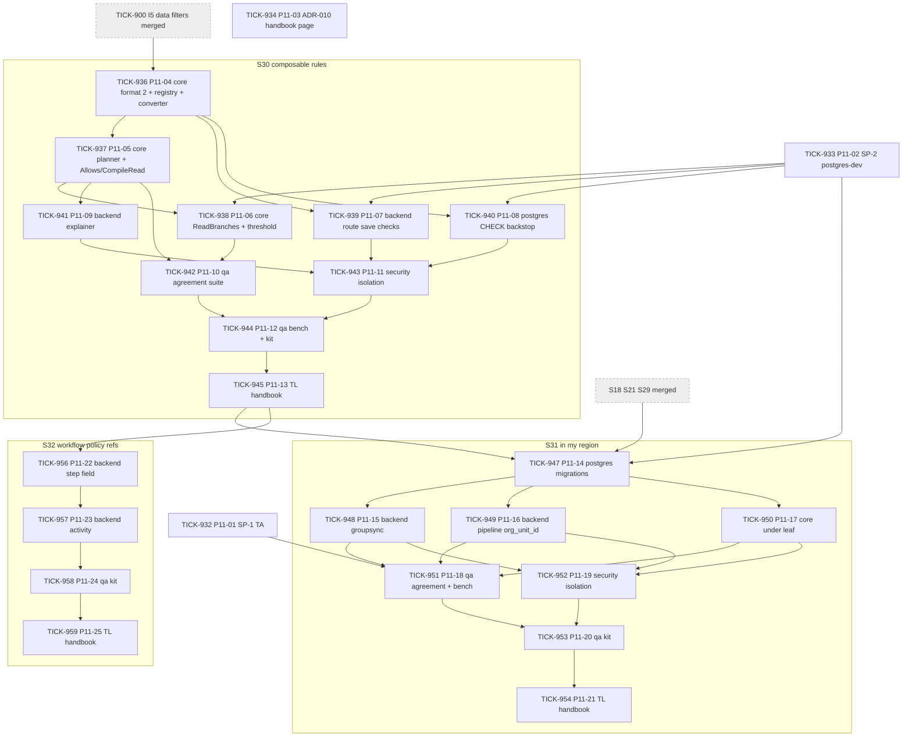
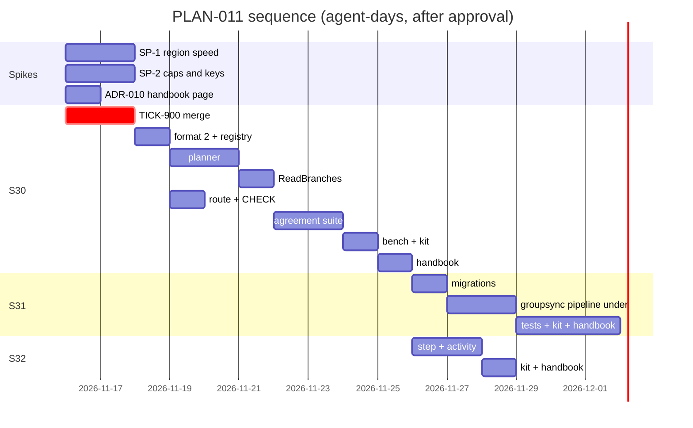

# PLAN-011: ADR-010 composable access rules

## Summary

**What ships, and in what order.** Two spikes, the ADR-010 handbook page and three stories under Epic 06 (TICK-9). Everything is created in `backlog`. Stories are assigned to the Technical Lead; tasks to the Delivery squad with a role label, except the spikes, which go to their named owners.

| Order | Issue | What | ADR-010 |
|---|---|---|---|
| 1 | TICK-932 P11-01 SP-1 | Region-access speed: `org_unit_id = ANY(S)` on the 800k bench. **Starts on plan approval** | D7, R1 |
| 1 | TICK-933 P11-02 SP-2 | Save-time CHECK cost at the caps, the `ReadBranches` total-branch threshold, final caps, and the `org_unit_members` keys and grants. **Starts on plan approval** | D4, D6, D7, R6 |
| 1 | TICK-934 P11-03 | ADR-010 handbook summary page `docs/handbook/src/adr/adr-010.md`. **Starts on plan approval** | publication rule |
| 2 | TICK-935 **S30** | Named conditions and AND/OR/NOT policies, save-time checks, explainer `Policy`/`Trace`, format-1 read conversion, the I5 agreement suite for the new tree. **Waits for TICK-900 (I5 data-filter fix) to merge**, and its cap and threshold tasks wait for SP-2 | D1-D6, D10-D12 |
| 3 | TICK-946 **S31** | "In my region": `under` leaf, `org_unit_members`, `org_units.deleted_at`, `records.org_unit_id`. **Waits for S30, SP-1 and SP-2**, and for S18, S21 and S29 to merge (shared files) | D7, D8 |
| 3 | TICK-955 **S32** | Workflow `condition` steps can test a named policy. **Waits for S30**, and for S29 (shared `internal/workflow/interp`) | D9 |

**Not on the Milestone 1 critical path.** No issue here carries `milestone-1`, and nothing here blocks an M1 story. S30 starts only after TICK-900 merges, as TICK-931 asks.

**The one risk that matters most:** S30 rewrites the planner that every list and every single-record read goes through. A wrong fold or a three-valued term would silently widen or narrow access (I5). The defence is the agreement suite (TICK-942 P11-10) with its seven mutants, run before S30 can be accepted, plus format-1 equivalence: every stored S10 document must produce the same branches and the same SQL as today, up to the SP-2 threshold (D12, D6).

**Second risk:** SP-2 lowers a cap below what a real tenant document needs (R2). The D6 check below says that cannot happen for any document stored today; SP-2 re-runs it with its threshold.

## D6 check at planning (done)

Run by the Technical Lead on 2026-11-15, read-only (`default_transaction_read_only=on`, superuser so RLS does not hide rows), on the `nava` database of the only populated stack (`nava-s18`, the S18 acceptance stack; there are no production tenants yet). For the newest `acl_versions` row of every (tenant, entity type), it counts the worst-case read branches for any caller: per read-granting rule, `max(1 if groups or users are named, requester + assignee + shared)`, summed.

| Tenants | Documents (newest per entity type) | Max total branches | Max read rules in one document |
|---|---|---|---|
| 2 | 4 | **4** | 4 |

**Result:** no published document has more than 4 total branches. Today's per-policy distribution limit is 16, and SP-2 cannot set the threshold below the largest stored document without D6 failing, so SP-2's report must state its threshold against this number. The query is in TICK-933 P11-02's body and is re-run twice: by SP-2 with the measured threshold, and in S30's acceptance kit (TICK-944 P11-12) on the fresh stack. *Limit:* this covers dev and acceptance data only. When a real tenant exists, the query runs before S30 ships to it (owner: Technical Lead).

## Decisions this plan makes

| # | Decision |
|---|---|
| **D-11-1** | **Three stories, split by what a person can try.** S30 composition (no `under`), S31 regions, S32 workflow references. S31 and S32 need S30's planner code, so they wait for S30 to merge into `main`. `under` is in S31, not S30: it needs three migrations, groupsync and write-pipeline changes that overlap three open stories (files table), and S30 must not wait for them. |
| **D-11-2** | **Spikes are standalone tasks under TICK-9**, targeting `main`, with no story (branching exception "task with no parent story"). SP-1 goes to the Technical Architect, SP-2 to the Postgres & Data Modeling Specialist, as ADR-010 names them. Neither changes runtime code: SP-1 writes `bench/acl-perf/region/` and `docs/quality/acl-perf-region.md`; SP-2 writes `docs/data/acl-format2-caps.md` and a bench script. |
| **D-11-3** | **D4 needs SP-2 first.** The two tasks that ship caps (TICK-939 P11-07 route checks, TICK-940 P11-08 PL/pgSQL CHECK) and the threshold task (TICK-938 P11-06) depend on SP-2. The parser, planner and explainer do not, so S30 starts without waiting for SP-2. If SP-2 lowers a cap, the ADR keeps its numbers as maxima and the plan uses SP-2's; no ADR erratum is needed unless SP-2 wants a cap *higher* than D4 (then the Solution Architect decides). The caps in force are the **published** limits (ADR-010 Competitive Gate, CP-SF-02 item 2): they go in the access route's OpenAPI description (TICK-939) and the S30 handbook page (TICK-945), not only in SP-2's report. |
| **D-11-4** | **Wire format (contract C1).** `PUT /api/v1/entity-types/{key}/access` accepts `rules` as either today's format-1 array or the format-2 object; it always stores format 2 (D12). `GET` always returns format 2. This is a response-shape change for existing clients of `GET`, so the OpenAPI document marks `rules` as `oneOf` on the request and the format-2 object on the response, and the S30 kit shows a stored format-1 document read back as format 2. |
| **D-11-5** | **Expression JSON (contract C2).** A node is an object with exactly one key, from the closed set in D3. `under` is `{"under": {"of": "caller"}}` (the caller's live units) or `{"under": {"of": [<org unit id>, ...]}}`. Any other key, or two keys, is `unknown_key`. In S30, `under` is in the grammar and refused as `not_available` until S31 ships its renderers, so the D11 registry test stays green. |
| **D-11-6** | **"Primary org unit" (D8) does not exist today.** S31 defines it: `org_unit_members` carries `is_primary`, at most one live row per (tenant, principal) (partial unique index). Groupsync sets it from the IdP user attribute `nava_primary_org_unit` (a group path); if that attribute is absent and the user is in exactly one live unit, that unit; otherwise none, so the ticket's `org_unit_id` stays NULL and `under` is false (fails closed). SP-2 confirms the keys. *Solution Architect: say CHANGES if D8 meant something else by "primary".* |
| **D-11-7** | **Workflow reference shape (contract C4).** `condition` steps gain a test `{"policy": {"entity_type": "<key>", "name": "<policy>"}, "who": "requester" or "assignee", "op": "read" or "write"}`: true when that principal of the record is granted `op` by that policy on the record. Resolved in an activity against the current version (D9). `entity_type` must be the record's own entity type: TICK-956 refuses a mismatch at definition save whenever the workflow's entity type is known (`entity_type_mismatch`), and TICK-957 returns false at run time when the record's type differs, counted and audited as a missing reference. A missing entity type or policy denies (the test is false), counts `authz_policy_ref_missing_total`, and writes an audit entry. It is a new step field, so S32 adds it to `internal/configsurface/testdata/inventory.json` (ADR-008 D12, additive). Publish-time refusal of a reference to a missing policy is R5's trigger, not part of v1. |
| **D-11-8** | **Isolation tasks.** S31 has a Security & Multi-Tenancy Reviewer task, as TICK-931 requires (org-unit membership, tombstones, `records.org_unit_id`). S30 also gets one: D4's tenant-id check is a new tenant wall on publish, and the explainer is cross-tenant reachable. S32 does not: it reads policies through the S30 code inside the run's tenant, and its kit carries the cross-tenant case. |
| **D-11-9** | **Agreement suite placement.** The new cases extend `internal/tenancy/isolation/i5_*` after TICK-900 merges (TICK-900 changes `i5_agreement_isolation_test.go`). The `under` mutants (`under_direct_only`, `under_ignores_tombstone`) are in S31; the other five in S30. |
| **D-11-11** | **Plan verdict CHANGES, folded (Solution Architect, 2026-11-15).** (1) D4's tenant-id check runs in the database too: a CHECK cannot read other tables, so TICK-940 adds a `BEFORE INSERT` trigger on `acl_versions` that looks up every group and user id filtered by `NEW.tenant_id` explicitly and raises `check_violation` with `foreign_id`; TICK-947 extends it to org-unit ids; SP-2 (TICK-933) measures CHECK + trigger against R6. (2) The workflow policy test's `entity_type` must match the record's (D-11-7). Non-blocking, also folded: published caps (D-11-3); a cross-tenant `nava_primary_org_unit` case in TICK-952; SP-1 adds `records.org_unit_id` in the bench database only. D-11-5, D-11-6 and D-11-7 accepted. No ADR erratum. |
| **D-11-10** | **No grooming meeting** (as D-9-9). The acceptance criteria are RFC-022 §5 CI-1..CI-11, already reviewed by the Technical Architect, and the open design choices are answered here (D-11-4 to D-11-7). The Solution Architect's plan verdict is the check. A readiness Goldfish runs on each task before it is released. |

## Interface contracts

| # | Contract | Producer → consumers |
|---|---|---|
| **C1** | Access route wire format (D-11-4); problems on 422 extend today's `invalid_access_policy` list, each with `pointer` (JSON pointer into the request body) and `code` from: `unknown_key`, `invalid_name`, `duplicate_name`, `unresolved_ref`, `ref_cycle`, `child_count`, `depth_exceeded`, `policy_leaves_exceeded`, `policies_exceeded`, `document_leaves_exceeded`, `foreign_id`, `not_available`. | TICK-939 P11-07 → TICK-940 P11-08 (same codes from the CHECK's error detail), TICK-943 P11-11, TICK-944 P11-12 |
| **C2** | Expression JSON and the `authz.Document` Go type (`Conditions []Condition`, `Policies []NamedPolicy`, `Masks` unchanged), `authz.Decode(raw) (Document, error)` converting format 1 on read; the node registry `authz.Kinds()` with `SQLSafe`. | TICK-936 P11-04 → everything in S30, S31, S32 |
| **C3** | `plan` returns `[]plannedPolicy` each with `(tree, err)`; `Allows` returns `(policy string, trace []TraceStep, ok bool)`. `authz_policy_invalid_total{entity_type}`. | TICK-937 P11-05 → TICK-938 P11-06, TICK-941 P11-09, TICK-942 P11-10, TICK-950 P11-17 |
| **C4** | Workflow `condition` policy test (D-11-7); `entity_type` equals the record's entity type, else 422 `entity_type_mismatch` at save and false at run time. | TICK-956 P11-22 → TICK-957 P11-23, TICK-958 P11-24 |
| **C5** | `org_unit_members (tenant_id, org_unit_id, principal_id, is_primary)`, `org_units.deleted_at`, `records.org_unit_id`, keys and grants as SP-2 reports them. | TICK-933 P11-02 → TICK-947 P11-14 → TICK-948 P11-15, TICK-949 P11-16, TICK-950 P11-17 |
| **C6** | SP-2 report `docs/data/acl-format2-caps.md`: final caps (each ≤ D4), total-branch threshold, CHECK insert cost at caps, D6 query result against the threshold. | TICK-933 P11-02 → TICK-938 P11-06, TICK-939 P11-07, TICK-940 P11-08 |

## Task graph



`A13 --> B14` and `A13 --> C22` stand for "S30 merged into `main`".

| Task | Role | Outcome | Depends on | Estimate (agent-days) |
|---|---|---|---|---|
| TICK-932 P11-01 SP-1 | Technical Architect | p95 of the support-agent list with `ANY(S)`, S = 10 / 100 / 1,000 / 10,000 | none | 1-1.5 |
| TICK-933 P11-02 SP-2 | `postgres-dev` | caps, threshold, CHECK cost, C5 keys and grants | none | 1-2 (guess: CHECK cost at 1,024 leaves is unmeasured) |
| TICK-934 P11-03 | Technical Lead | `adr-010.md` page, build clean | none | 0.5 |
| TICK-936 P11-04 | `core-dev` | format-2 decode, registry, format-1 converter | TICK-900 merged | 1 |
| TICK-937 P11-05 | `core-dev` | tree planner, two renderings, void-on-invalid | TICK-936 P11-04 | 1-1.5 |
| TICK-938 P11-06 | `core-dev` | `ReadBranches` on trees, threshold fallback | TICK-937 P11-05, TICK-933 P11-02 | 0.5-1 |
| TICK-939 P11-07 | `backend-dev` | route save checks, 422 table, format-2 GET | TICK-936 P11-04, TICK-933 P11-02 | 1 |
| TICK-940 P11-08 | `postgres-dev` | PL/pgSQL CHECK for format 2 | TICK-936 P11-04, TICK-933 P11-02 | 1 |
| TICK-941 P11-09 | `backend-dev` | explainer `Policy` and `Trace` | TICK-937 P11-05 | 0.5 |
| TICK-942 P11-10 | `qa` | agreement suite: depth 4, NULLs, caps, 5 mutants | TICK-937 P11-05, TICK-938 P11-06 | 1-1.5 |
| TICK-943 P11-11 | `security` | cross-tenant publish, explainer, fail-closed | TICK-939 P11-07, TICK-940 P11-08, TICK-941 P11-09 | 0.5-1 |
| TICK-944 P11-12 | `qa` | 800k bench, kit, D6 re-run on fresh stack | TICK-942 P11-10, TICK-943 P11-11 | 1 |
| TICK-945 P11-13 | Technical Lead | S30 handbook | all S30 | 0.5 |
| TICK-947 P11-14 | `postgres-dev` | three migrations, grants, isolation registry | S30 merged, TICK-933 P11-02, S18/S21/S29 merged | 1 |
| TICK-948 P11-15 | `backend-dev` | groupsync members, primary, tombstones, metric | TICK-947 P11-14 | 1-1.5 |
| TICK-949 P11-16 | `backend-dev` | pipeline sets `org_unit_id` on create | TICK-947 P11-14 | 0.5-1 |
| TICK-950 P11-17 | `core-dev` | `under` leaf, set S, 10,000 cap | TICK-947 P11-14 | 1 |
| TICK-951 P11-18 | `qa` | `under` mutants, sync resilience, bench | TICK-948 P11-15..TICK-950 P11-17, TICK-932 P11-01 | 1 |
| TICK-952 P11-19 | `security` | org-unit isolation tests | TICK-948 P11-15..TICK-950 P11-17 | 1 |
| TICK-953 P11-20 | `qa` | S31 kit | TICK-951 P11-18, TICK-952 P11-19 | 0.5-1 |
| TICK-954 P11-21 | Technical Lead | S31 handbook | all S31 | 0.5 |
| TICK-956 P11-22 | `backend-dev` | `condition` policy test parses and validates | S30 merged, S29 merged | 0.5-1 |
| TICK-957 P11-23 | `backend-dev` | activity against current version; missing denies | TICK-956 P11-22 | 1 |
| TICK-958 P11-24 | `qa` | S32 kit incl. revocation reaches a running workflow | TICK-957 P11-23 | 0.5-1 |
| TICK-959 P11-25 | Technical Lead | S32 handbook | all S32 | 0.5 |

**Critical path:** TICK-900 merged → TICK-936 P11-04 → TICK-937 P11-05 → TICK-938 P11-06 (needs SP-2) → TICK-942 P11-10 → TICK-944 P11-12 → TICK-945 P11-13 → S30 acceptance: **5.5-7.5 agent-days** after TICK-900 merges. SP-2 runs in parallel from approval and must land within ~2 days to stay off the path. S31 then adds 4-5.5 days; S32 2.5-3.5 days, in parallel with S31 when S29 has merged.



## Files per story (overlap check, 2026-11-15)

| Story | Expected files | Overlap with open work |
|---|---|---|
| SP-1, SP-2 | new `bench/acl-perf/region/`, `docs/quality/acl-perf-region.md`; new `docs/data/acl-format2-caps.md`, `docs/data/acl-format2-caps/` | None. |
| TICK-934 P11-03 | `docs/handbook/src/adr/adr-010.md`, `docs/handbook/src/adr/index.md`, `nav.yaml` | TICK-930 (ADR-009 page) edits the same index and nav: cut after TICK-930 merges, or rebuild on conflict (generated lists, as D-8-5). |
| S30 | `internal/authz/*` (acl, explain, policycheck, publish, aclstore, new `expr*.go`), `internal/server/access.go`, `api/` (access schema only), one new `db/migrations/*_acl_rules_valid_format2.sql`, `internal/tenancy/isolation/i5_*`, `docs/quality/acl-agreement.md`, `bench/acl-perf/`, `docs/acceptance/S30/`, Bruno `S30`, handbook | `i5_*` with TICK-900: waits for TICK-900 merged. `api/` with S29 (`api/` entity-type and records paths): S30 edits only the access schema; the Technical Lead re-checks when S29 is cut. No other open branch touches `internal/authz` (checked against S18, S21, TICK-900, TICK-912, S28). |
| S31 | `db/migrations/` (three new files), `db/grants.yaml`, `internal/tenancy/isolation/registry.go` and `testdata/seed.sql`, `internal/groupsync/apply.go`, `internal/records/pipeline/pipeline.go`, `internal/authz/` (`under`), `cmd/nava-groupsync` (metric), docs, handbook | `pipeline.go`, `registry.go`, `seed.sql` with S18 (TICK-669) and S21 (TICK-739); `grants.yaml`, `pipeline` and `registry.go` with S29 (TICK-915). Waits for those to merge or stay unstarted. |
| S32 | `internal/workflow/def/` (`def.go`, `schema.json`), `internal/workflow/interp/`, `internal/workflowdefs/` (validation), `internal/configsurface/testdata/inventory.json`, docs, handbook | `internal/workflow/interp` with S29: waits for S29 merged or unstarted. |

Before cutting each story branch the Technical Lead re-checks these lists against every open story branch.

## ADR coverage

| ADR-010 item | Where |
|---|---|
| D1 allow-only, NOT inside expressions | TICK-937 P11-05; mutant `not_unguarded` in TICK-942 P11-10 |
| D2 document shape, arrays, names, same-transaction publish and audit | TICK-936 P11-04, TICK-939 P11-07 |
| D3 closed grammar, `unknown_key` | TICK-936 P11-04, TICK-939 P11-07, TICK-940 P11-08 |
| D4 save-time checks, both layers, SP-2 first | TICK-933 P11-02, TICK-939 P11-07, TICK-940 P11-08 (structural CHECK + tenant-id trigger, D-11-11), TICK-947 P11-14 (org-unit ids in the trigger), TICK-943 P11-11 (tenant ids) |
| D5a two-valued leaves, NULL false; `shared` with no caller id | TICK-937 P11-05; mutant `shared_nil_caller`; NULL generation in TICK-942 P11-10 |
| D5b invalid voids the policy, metric | TICK-937 P11-05; mutant `invalid_leaf_false`; TICK-943 P11-11 fail-closed |
| D6 one planner, branches, SP-2 threshold, planning check | TICK-937 P11-05, TICK-938 P11-06; check above; re-run in TICK-933 P11-02, TICK-944 P11-12 |
| D7 `under`, tombstones, `org_unit_members`, `records.org_unit_id`, 10,000 cap, subtree metric | TICK-932 P11-01, TICK-933 P11-02, TICK-947 P11-14, TICK-948 P11-15, TICK-950 P11-17; mutants in TICK-951 P11-18; TICK-952 P11-19 |
| D8 who sets `org_unit_id` | TICK-949 P11-16 (D-11-6) |
| D9 workflow references, current version, missing denies | TICK-956 P11-22, TICK-957 P11-23, TICK-958 P11-24 |
| D10 explainer `Policy` and `Trace`, `RuleID` kept one release | TICK-941 P11-09 |
| D11 registry, build test | TICK-936 P11-04 |
| D12 format-1 on read, converter kept | TICK-936 P11-04; equivalence in TICK-942 P11-10; see Migration |
| D13 exclusions | Not planned (see cut) |
| API test scenarios | TICK-939 P11-07 (PUT, GET), TICK-941 P11-09 (explainer), TICK-943 P11-11 |
| CI-1..CI-11 (RFC-022 §5) | TICK-942 P11-10, TICK-944 P11-12, TICK-951 P11-18, TICK-936 P11-04 (registry) |
| R1, R6 | SP-1, SP-2 |
| R7, R8 alerts | TICK-937 P11-05 and TICK-948 P11-15 emit the metrics; alert rules in TICK-944 P11-12 and TICK-953 P11-20 kits name the thresholds |
| Handbook summary page | TICK-934 P11-03 |

## Migration (D12)

Stored `acl_versions` rows are never rewritten. `authz.Decode` converts format 1 on every read, including history read by the explainer and audit. The format-1 converter and its tests stay **for as long as any stored format-1 row exists**. Removing it is a future task, gated on this query returning zero on every environment:

```sql
SELECT count(*) FROM acl_versions WHERE jsonb_typeof(rules) = 'array';
```

Stored rows are immutable, so in practice that means never, unless a retention ADR purges old versions. Recorded as a deferral with that trigger (owner: Technical Lead). The PL/pgSQL CHECK (TICK-940 P11-08) keeps accepting format 1 so existing rows stay valid, and the route refuses to *store* format 1 (it converts first).

## The cut

| Cut | Why | Trigger to revisit | Owner |
|---|---|---|---|
| Conditions on JSON `data` fields (`field` leaf) | D13: after TICK-900 is green | TICK-900 merged and a tenant asks | Solution Architect (new ADR amendment) |
| Publish-time refusal to remove a policy a workflow references | R5: needs workflow definitions to index their references | First R5 incident, or `authz_policy_ref_missing_total` > 0 | Technical Lead |
| Closure table or extra index for `under` | R1: only if SP-1 is above 150 ms p95 | SP-1 result | Technical Architect |
| Removing the format-1 converter | D12 | Query above returns zero everywhere | Technical Lead |
| Admin UI for building conditions | Not in ADR-010; the API is the surface | A UI story is prioritised by the human | Human (product) |
| Removing explainer `RuleID` | D10 keeps it one release | Next release after S30 | Technical Lead |

Nothing that enforces an invariant is cut: the agreement suite, the save-time checks at both layers, the isolation tasks and fail-closed behaviour are all in.

## Release

On `PLAN VERDICT: APPROVED`:
1. Release TICK-932 P11-01, TICK-933 P11-02 and TICK-934 P11-03 to `todo` (they target `main`).
2. Move the three stories from `backlog` to `todo` (no run started). Their tasks stay in `backlog`; each task moves only when its `Depends on:` line is done.
3. S30 goes `in_progress` when TICK-900 merges: cut `TICK-935/composable-access-rules` from `main`, release TICK-936 P11-04.
4. S31 and S32 start (branch cut, first task released) only after S30 merges and their overlapping stories (files table) have merged.
5. Set TICK-931 `done`.
