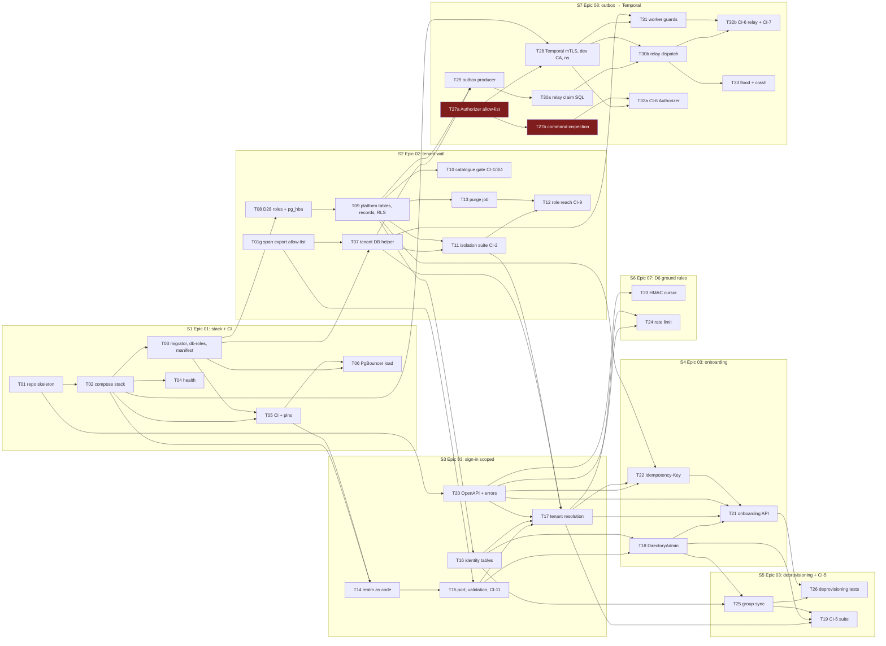
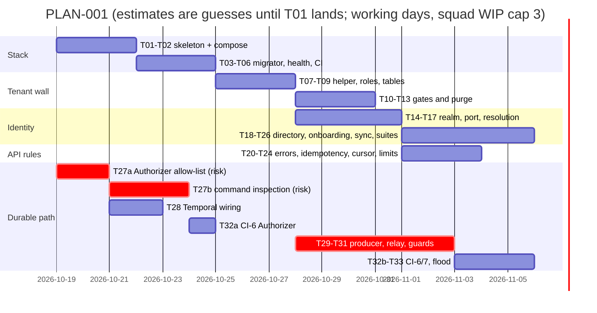

# PLAN-001: Platform foundation (ADR-001)

## Summary

**What ships:** the parts of Milestone 1 that ADR-001 binds. That is the local stack and CI (Epic 01), the tenant wall with every system-actor role (Epic 02, D28), Keycloak identity behind the identity port (Epic 03, D26), the API ground rules (Epic 07's D6 conventions), and the outbox → Temporal path with the custom Authorizer (Epic 08, D22).

**PLAN-001 done is not Milestone 1 done.** The records path (Epics 04, 05, 06, 07 records, 09) is PLAN-002.

**Order:** skeleton → roles and tables → (identity ‖ Temporal Authorizer) → outbox relay → adversarial suites. 7 stories, 36 tasks (grooming split T27, T30 and T32).

**The one risk that matters most:** the custom Temporal server build (T27a allow-list, T27b command inspection; R7). It is the only piece nobody on the team has shipped, and D22 has no fallback. T27a starts on day 1, in parallel with the skeleton. T32a proves it end to end as soon as T28 and T27b land, before the relay exists.

**Repository:** connected (`Navaladi2019/TicketingSystem`). T01 lands on the default branch unless nava names another.

## Scope and the cut

| In PLAN-001 | ADR-001 source | Epic |
|---|---|---|
| Compose stack, CI, pins | Fixed inputs, §3 pins | 01 (TICK-4) |
| All D28 roles, `db/grants.yaml`, platform tables, minimal `records`, RLS + 10-entry allow-list, CI-1..4, CI-9, purge | I1, I3, D28, A.3 | 02 (TICK-5) |
| Realm-as-code, `IdentityResolver`, `OperatorResolver`, `DirectoryAdmin`, onboarding, group sync, CI-5, CI-11 | I2, D26, A.1, A.4 identity port | 03 (TICK-6) |
| OpenAPI 3.1 skeleton, RFC 9457 errors, HMAC cursors, `Idempotency-Key`, per-tenant rate limits | D6, I7 | 07 (TICK-10), ground rules only |
| Custom Temporal server, mTLS, outbox producer, relay, worker guards, CI-6, CI-7, flood test | I6, I7, I9, D22, A.2 | 08 (TICK-11) |

**Cut, said out loud — deferred to PLAN-002 (records path):**
- **Epic 04** metadata engine, **Epic 05** write pipeline, **Epic 06** ACL layer, **Epic 07** record endpoints and ETag/`If-Match`, **Epic 09** workflow interpreter.
- *Why:* none of them has an open design question, and all of them build on code PLAN-001 creates (DB helper, identity, error contract, outbox producer). Grooming them against a codebase that does not exist yet produces tasks that will be rewritten.
- *What is not lost:* every ADR-001 contract they need is pinned here as an interface (below). The parts of CI-8 and CI-10 that need records are tracked as backlog issues now (TICK-87, TICK-88).
- **PLAN-002's first story** carries the Epic 06 150 ms list measurement (ADR-001 D25): if it needs an expression index, the D25 governance work it pulls in is not small (CTO, TICK-83).
- **Trigger to write PLAN-002:** story S2 (tenant wall) merged. Expected in week 2.
- Isolation, determinism and idempotency work is **not** cut. Coverage of every ADR test:

| ADR test | Tasks | Status |
|---|---|---|
| CI-1, CI-3, CI-4 | T10 (+ T03, T08 unit tests) | full |
| CI-2 | T11 (+ T07 PgBouncer test, T17 forged-tenant paths) | full |
| CI-5 | T19 (+ T15, T17, T18 unit tests) | full |
| CI-6 | T32a (certificate, network, Authorizer), T32b (relay, worker) | full |
| CI-7 | T32b | full |
| CI-8 | T22, T23 | partial → TICK-87 (byte-identical 404, 412, masked-field filter) |
| CI-9 | T12 (+ T08, T09 onboarding cases); `nava_relay` tested against the real `records` table | full |
| CI-10 | T29 (depth limit) | partial → TICK-88 (audit row, cycle check) |
| CI-11 | T15 (import rule, admin-API/claims lint, contract harness); T17, T18, T19 fill the harness | full |

## Decisions this plan makes

| # | Decision |
|---|---|
| **D-P1** | Scope as above. PLAN-002 covers Epics 04, 05, 06, 07 (records), 09. |
| **D-P2** | `db/grants.yaml` is the single grant source from the first migration. Roles and their attributes are created by the one-shot `db-roles` job (T03), because every role, the migrator included, is `NOCREATEROLE`. Each table's grants ship with the migration that creates it. |
| **D-P3** | Keycloak pinned to **26.8.1** (floor 26.1.3). PostgreSQL an exact `postgres:16.x` tag (floor 15). Temporal server 1.28.4, SDK v1.49.0, Go ≥ 1.26 for platform code; the custom server module is pinned separately (R7). T05 writes these into `docs/pins.md`, superseding Epic 01's Keycloak "26.0" row. |
| **D-P4** | The outbox producer is a library (`outbox.Enqueue`) that the Epic 05 pipeline will call. **I9**'s depth limit is enforced inside `Enqueue` now (`ErrCascadeTooDeep`). The cycle check and the audit row land with Epic 05 (TICK-88), which completes **CI-10**. The depth bound alone already stops any unbounded cascade. |
| **D-P5** | **CI-8** is split. PLAN-001 delivers cross-tenant cursor replay → 400 and idempotency replay (byte-identical) / 409. Byte-identical 404s, stale `If-Match` → 412 and masked-field filter → 400 need records and ACLs (TICK-87). |
| **D-P6** | The identity port is the **only** code that imports a Keycloak client, calls the admin API or reads Keycloak-specific claims. Static tests in T15 fail the build otherwise (CI-11). |
| **D-P7** | Initial cascade depth limit: **8** (platform config). PLAN-002 confirms or changes it. |
| **D-P8** | Relay maximum redelivery age **24 h** (first attempt → `dead_at`). The worker's applied-signal-id window is **48 h**, satisfying A.2's "window longer than max redelivery age". |
| **D-P9** | Deprovisioning bound: **10 min** = access-token lifetime 5 min + group-sync interval 5 min. Tested in T26. |
| **D-P10** | Review standard. A Security reviewer on top of the squad's normal reviewer, plus an adversarial test, for any change under: `internal/tenancy`, `internal/identity`, `internal/outbox`, the relay and worker-guard packages, the auth middleware, `cursor` and idempotency, `cmd/nava-purge`, `cmd/nava-groupsync`, the operator onboarding handler, `temporal-server/`, `db/` (including `pg_hba.conf`), the realm export, the compose network files, the CI workflow, the isolation registry and the `set_config` lint config. The list lives in `docs/delivery/review-paths.yaml` and a CI step flags matching PRs (T05). Security-role tasks get a second reviewer: Postgres Specialist for T10–T12, Principal Software Engineer for T19, T26, T32a, T32b. Removing or skipping a registered isolation test, or editing the RLS allow-list, also needs CTO sign-off. Principal Software Engineer changes are reviewed by the Technical Lead. |
| **D-P11** | Onboarding path (from grooming): `binding_onboard` gets `WITH CHECK (tenant_id IN provisioning tenants)`; `tenants_activate` lets `nava_onboard` move only its own tenant `provisioning → active` (tests `app.tenant_id`, so the allow-list stays at 10). Operator onboarding idempotency is the provisioning row itself: tenant id = UUIDv5(operator principal + `Idempotency-Key`). |
| **D-P12** | Operator identity: realm role `nava-operator`, assignable only by the platform service account, audience `nava-operator-api`, resolved by `OperatorResolver` (T14, T15). |
| **D-P13** | Group sync is poll and diff: `ChangesSince` returns a full snapshot plus a digest cursor. `nava-groupsync` runs an in-process 5-minute ticker and takes a transaction-scoped advisory lock per tenant. |
| **D-P14** | Relay tests run on every PR, asserted in poll cycles and row counts. Only the claim-latency benchmark is nightly, and it reports without gating (QA). |
| **D-P15** | **ADR-001 erratum E1** (CTO ruling, TICK-83). TA-B3's continue-as-new clause cannot fire: the command has no workflow-id field. E1 replaces it, in A.2 and in the Annex B CI-6 row, with stronger rules tied to the task token: deny continue-as-new with a missing or mismatched `nava-tenant` header or a `cron_schedule`; deny child/signal/cancel targets outside namespace `nava` or another tenant's prefix; deny an undecodable task token or unprefixed id; deny every command type not on T27b's written allow-list (Nexus today). I6, I7 and D22 are unchanged, so this is an erratum, not an amendment. |
| **D-P16** | Tenant tables are discovered fail-closed: every platform-schema table is a tenant table unless `db/global-tables.yaml` lists it (empty in M1); `tenants` keyed on `id`; materialized views fail the gate (T10, T11). The `nava-operator` Temporal identity is read-only plus `TerminateWorkflowExecution` and `AddSearchAttributes`, deny by default (T27a). |

## Interface contracts (written before either side starts)

```go
// internal/tenancy — T07. The only Go code where set_config('app.tenant_id') may appear (lint, PG-N1).
func InTenantTx(ctx context.Context, pool *pgxpool.Pool, tenantID uuid.UUID, fn func(pgx.Tx) error) error
// Returns ErrNoTenant for uuid.Nil; never opens a transaction without a tenant. Rolls back and re-raises if fn panics.

// internal/identity — T15 (port, sentinels, contract harness), T17 (resolver), T18 (directory)
var ErrTenantUnresolved = errors.New("tenant_unresolved") // → 401 tenant_unresolved
var ErrInvalidToken     = errors.New("invalid_token")     // → 401 invalid_token
type Principal struct { TenantID, PrincipalID uuid.UUID; Groups []uuid.UUID; IdPAlias string }
type IdentityResolver interface { Resolve(ctx context.Context, rawAccessToken string) (Principal, error) }
type Operator struct { PrincipalID string }
type OperatorResolver interface { ResolveOperator(ctx context.Context, rawAccessToken string) (Operator, error) } // aud nava-operator-api
type DirectoryAdmin interface {
    CreateTenantOrg(ctx context.Context, tenantID uuid.UUID, alias string, domains []string) (orgID string, err error)
    InviteUser(ctx context.Context, tenantID uuid.UUID, email string) error   // rejects foreign-IdP-federated users
    DisableUser(ctx context.Context, tenantID, principalID uuid.UUID) error
    SetGroupMembers(ctx context.Context, tenantID, groupID uuid.UUID, members []uuid.UUID) error
    ChangesSince(ctx context.Context, tenantID uuid.UUID, cursor string) (DirectoryChanges, string, error) // poll and diff
}
type DirectoryChanges struct { Unchanged bool; Users []DirectoryUser; Groups, OrgUnits []DirectoryGroup } // full T18 shape in TICK-73

// internal/outbox — T29
type Target interface{ isTarget() } // sealed: TargetStart, TargetSignal
type Entry struct { Kind string; KindVersion int; DedupeKey string; RecordID uuid.UUID
    Target Target; Causation Causation; Payload json.RawMessage /* references only, CI-7 */ }
type Causation struct { OriginID uuid.UUID; Depth int16 }
func Enqueue(ctx context.Context, tx pgx.Tx, e Entry) (outboxID uuid.UUID, err error)
// Locks the records row, bumps its version, sets target_seq. ErrCascadeTooDeep (I9). Dedupe conflict → existing id, nil.
// Signal with no open workflow_ref → ErrNoOpenWorkflow. ErrCascadeCycle: PLAN-002 (TICK-88).
```

- **Errors (T20):** RFC 9457 `application/problem+json` with `type`, `title`, `status`, `code`, `detail`, `instance`. Codes live in `api/errors.yaml`; a contract test fails on any response whose `code` is not registered. First codes: `tenant_unresolved`, `invalid_token`, `idempotency_key_reuse`, `invalid_cursor`, `rate_limited`, `not_found`, `validation_failed`.
- **`db/grants.yaml` (T03 format, T08 roles, T09/T16 tables):** per role: `attributes`, `database`, `schemas`, `tables` (privilege → columns), `functions`. Example in TICK-54. The applier revokes and logs any extra grant; T10 asserts the catalogue equals it (CI-4).
- **Workflow id (T30b):** `t:<outbox.tenant_id>:<target_key>`, built only by the relay. Children use T31's prefixed id builder.
- **Temporal identities (T27a, T28):** `nava-relay`, `nava-core`, `nava-worker`, `nava-operator`, `temporal-system`, each a certificate CN from the dev CA that T28's `make dev-ca` generates. T27a outputs image `nava/temporal-server:dev`.
- **Relay metric (T30a → T33):** `outbox_relay_rows_scanned`, histogram per tenant per poll. **Crash seam (T30b → T33):** test hook between claim and `StartWorkflow`.

## Task graph



**Critical path:** T01 → T02 → T03 → T08 → T09 → T29 → T30a → T30b → T32b (9 tasks deep; the T30 split adds one step but each half fits one run). T27a → T28 runs alongside and must finish before T30b; T27b → T32a gives the R7 proof early.

## Sequence



**Estimates:** each task 0.5–1.5 agent-days; total 32–42 agent-days; 4–5 calendar weeks with the WIP cap of 3. *Assumption:* CI runners can start Keycloak and Temporal containers (QA: yes, on a standard 2 vCPU / 7 GB runner; startup time is the cost). *Guesses:* T27b (could be 2× if command decoding needs server internals; the split keeps T28 off that risk) and T30a (fair claim SQL is spiked, the backoff interaction is not).

## Stories and tasks

| Story | Epic | Tasks | The human tries it by |
|---|---|---|---|
| S1 Local stack starts healthy and CI gates every PR | 01 | T01–T06 | `docker compose up`, then `GET /healthz` |
| S2 A query without the right tenant returns nothing | 02 | T07–T13 | running `make isolation` and reading the report |
| S3 A tenant user signs in and is scoped to their tenant only | 03 | T14–T17 | signing in as `alice@tenant-a.test`, calling `GET /api/v1/me` |
| S4 An operator onboards a tenant and its admin signs in | 03 | T18, T21 | `POST /api/v1/operator/tenants`, then signing in as the new admin |
| S5 Group changes and deprovisioning take effect within 10 minutes | 03 | T19, T25, T26 | removing a user from a group in Keycloak and watching `GET /api/v1/me`; `make identity-attacks` |
| S6 API ground rules on the first endpoints | 07 | T20, T22–T24 | replaying a request with the same `Idempotency-Key` |
| S7 A committed outbox row runs exactly one tenant-scoped workflow | 08 | T27a–T33 | `make demo-outbox`, then the operator Temporal UI |

**Multica issues.** Stories: S1 TICK-43 · S2 TICK-44 · S3 TICK-45 · S4 TICK-46 · S5 TICK-47 · S6 TICK-48 · S7 TICK-49.

| Task | Issue | Role | Task | Issue | Role | Task | Issue | Role |
|---|---|---|---|---|---|---|---|---|
| T01 | TICK-50 | core-dev | T13 | TICK-68 | backend-dev | T25 | TICK-78 | backend-dev |
| T02 | TICK-51 | backend-dev | T14 | TICK-57 | backend-dev | T26 | TICK-82 | security |
| T03 | TICK-54 | postgres-dev | T15 | TICK-63 | core-dev | T27a | TICK-53 | core-dev |
| T04 | TICK-55 | backend-dev | T16 | TICK-69 | postgres-dev | T27b | TICK-84 | core-dev |
| T05 | TICK-56 | qa | T17 | TICK-72 | core-dev | T28 | TICK-59 | backend-dev |
| T06 | TICK-60 | qa | T18 | TICK-73 | backend-dev | T29 | TICK-70 | core-dev |
| T07 | TICK-61 | core-dev | T19 | TICK-75 | security | T30a | TICK-74 | core-dev |
| T08 | TICK-62 | postgres-dev | T20 | TICK-52 | backend-dev | T30b | TICK-85 | core-dev |
| T09 | TICK-64 | postgres-dev | T21 | TICK-81 | backend-dev | T31 | TICK-65 | core-dev |
| T10 | TICK-66 | security | T22 | TICK-76 | backend-dev | T32a | TICK-79 | security |
| T11 | TICK-67 | security | T23 | TICK-58 | backend-dev | T32b | TICK-86 | security |
| T12 | TICK-71 | security | T24 | TICK-77 | backend-dev | T33 | TICK-80 | qa |

**Added after grooming:** T01g (TICK-105, `core-dev`): the span export filter becomes an allow-list (TICK-94 item 3). It blocks T07 and T15.

**Carry-forward (backlog, PLAN-002):** TICK-87 rest of CI-8 · TICK-88 rest of CI-10.

**Released first on APPROVED** (`Depends on: none`): T01 (TICK-50) and T27a (TICK-53). T27a is a separate Go module, so the riskiest unknown starts on day 1.

## Residual owners carried from ADR-001

| Residual | Where this plan handles it |
|---|---|
| R1 histories unencrypted | T32b (CI-7 payload schema) |
| R2 migrator / backup power | T03 (one-shot direct job, `db-roles` job), T08 (`pg_hba` reject), T10 (post-run catalogue check) |
| R7 custom Temporal build | T27a (separate module, allow-list CI test), T27b (command inspection), T32a (end-to-end) |
| R8 worker certificate reach | T31 (`set_config` only in helper, guards, prefixed child ids), T32a, T32b |
| R9 head-of-line blocking | T30a (successor backoff, 200-row cap, `outbox_relay_rows_scanned`), T33 (all-heads-backing-off flood) |

## Grooming record (TICK-83, round 1)

All six participants posted CONCERN; every concern was a task-text fix, and all are applied in the task issues. Splits: T27 → T27a/T27b (Principal Software Engineer), T30 → T30a/T30b (Principal Software Engineer, optional split taken because QA's crash hook and metric grew it), T32 → T32a/T32b (Security). T19 moved from S3 to S5 (it needs T25). New edges: T03 → T05, T05 → T14, T20 → T17, T11 → T17, T25 → T19. Round 2: CTO AGREE (E1 ruled), Senior Software Engineer AGREE (`idempotency_keys` notes folded into T09/T22), Security two text fixes taken: the `nava-operator` list is explicit read-only plus two named calls (T27a), and T10/T11 discover tenant tables fail-closed (`db/global-tables.yaml`, empty in M1; materialized views fail the gate); plus a two-provisioning-tenants binding test in T09. Security supports E1 and notes the header check is defence in depth; the namespace check and deny-unlisted are the control. Dissent: none recorded.

## Open items

| Item | Owner |
|---|---|
| PLAN-002 (records path) once S2 merges, first story carrying the D25 measurement | Technical Lead |
