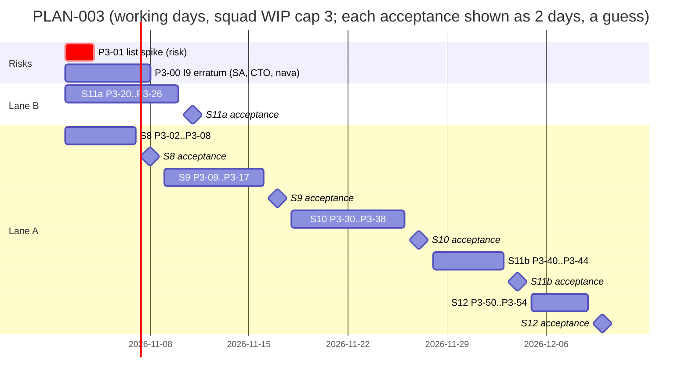

# PLAN-003: Records path (ADR-001 part 2)

## Summary

**What ships:** the part of Milestone 1 that PLAN-001 deferred (D-P1). A tenant admin publishes versioned entity types (Epic 04). Records are written through one pipeline with schema validation, defaults, numbering, optimistic concurrency and audit (Epic 05). ACL rules compile into the list query and agree with the single-record check, with field masks (Epic 06). The records API exposes all of it (Epic 07, records part). A versioned workflow definition runs on Temporal through one deterministic interpreter (Epic 09). The carry-forwards TICK-87 (rest of CI-8) and TICK-88 (rest of CI-10) close here. When PLAN-003 is done, every ADR-001 Annex B test is full.

**Two lanes (D-3-1):**
- **Lane A, records:** S8 entity types → S9 records → S10 access rules → S11b workflows on records → S12 comments and links. Serial, because each story needs the previous one's code and they share `db/grants.yaml`, `api/errors.yaml`, the OpenAPI bundle and the isolation registry.
- **Lane B, interpreter:** S11a runs from day 1 in parallel. It touches none of lane A's files.

**Size:** 6 stories, 44 tasks. 25 are on the board now (S8, S9, S11a, the spike and the erratum request). The 19 tasks of S10, S11b and S12 are listed below and are created when the previous lane-A story merges (D-3-8), because they key off code that does not exist yet.

**The one risk that matters most:** the Epic 06 list target (p95 ≤ 150 ms at 800k records, one large tenant among many small). If it needs an expression index, ADR-001 D25 governance (operator-approved, audited DDL) becomes M1 work, and that is not small (CTO, TICK-83). **Spike P3-01 (TICK-339) measures it on day 1**, before any records code exists.

**Found while writing this plan, and fixed in the task text before grooming:**
1. **Record events would go dead in the relay (D-3-14).** P3-10 enqueued `record.created` / `record.updated` on every write. The relay uses an outbox row's `kind` as the workflow type, and no such workflow exists, so the D9 allow-list would deny every start, and every record write would make a row that dies after 24 h with an alert. The pipeline now calls an `EventSink` port, a no-op until S11b enqueues `nava.interpreter` starts for matching definitions.
2. **The interpreter, as written, puts record data and definitions into Temporal history (D-3-15).** P3-22 returned a record snapshot and the definition from activities. The worker guard (TICK-216/TICK-245) refuses any activity argument or result that is not a UUID-only object, so the workflow would fail, and if it did not, it would break R1. Now the workflow sees only step ids, and conditions and writes run in activities. One typed exception is needed for the step result (step kind, timer seconds). That is new task P3-26, a worker-guard change Security reviews, and it blocks P3-22.
3. **ADR-001 I9's cycle rule rejects Epic 09's demo (D-3-16).** As worded ("the origin seen again on the same record"), a workflow writing back to the incident that started it is a cycle. P3-00 (TICK-361) asks the Solution Architect for an erratum, which the CTO rules on. TICK-88 waits on it. It starts on day 1 and needs to be ruled before S9's last tasks start, in about week 2.
4. **Worker Versioning cannot be switched on (D-3-17).** P3-23 asked for build-id versioning on the interpreter worker. `SetWorkerDeploymentCurrentVersion` and `UpdateWorkerVersioningRules` are denied to every identity in `temporal-server/authz/policy.go`, and allowing them is an ADR-001 amendment. Interpreter changes use `workflow.GetVersion` plus the replay gate, which meets Epic 09's AC. This is a cut (below).

## Scope and the cut

| In PLAN-003 | ADR-001 source | Epic |
|---|---|---|
| Entity types as JSON Schema 2020-12, immutable versions, compatibility classes, seed templates | I8 (no DDL) | 04 (TICK-7) |
| Records columns, numbering counter, one write pipeline, audit, history | I4, I7, I8, I9 | 05 (TICK-8) |
| Comments, work notes, links | I4 | 05 and 07 (S12) |
| ACL rules → SQL and Go evaluator, agreement suite, field masks, explainer, list benchmark | I5, D25 trigger | 06 (TICK-9) |
| Record endpoints, ETag/`If-Match`, list/filter/sort/page, CI-2 forged-payload path, CI-8 rest | D6, I4, I5 | 07 (TICK-10), records part |
| Workflow definition format v1, interpreter, triggers, replay gate, idempotent activities, CI-10 rest | I6, I7, I9, D22 | 09 (TICK-12) |

**Cut, said out loud:**

| Cut | Why | Trigger to revisit |
|---|---|---|
| **ACL conditions on `data` fields.** M1 rule conditions use fixed columns (`state`, `requester_id`, `assignee_id`, `assignment_group_id`) and explicit shares (D-3-2). | Fixed columns are B-tree indexed and have no schema-version defaults, so the defaults-versus-ACL disagreement (TICK-2 inconsistency 1) cannot arise in a rule, and the 150 ms target needs no expression index. The same disagreement **does** arise in list filters on `data` fields, and the agreement suite (P3-32) covers it there. Epic 06's AC "an ACL references a defaulted field" is met through filters and masks, not rule conditions. | A story needs a rule on a `data` field. It then reuses the filter's field expression. |
| **Sort and range filters on `data` fields.** Sort is on fixed columns plus `created_at` / `updated_at`; `data` filters are equality and `in`. | Range and sort on JSONB need expression indexes: D25 work. | P3-01 shows them cheap, or a story needs them. Either way through D25. |
| **Temporal Worker Versioning (build-id routing)** (D-3-17). | Its write APIs are denied by the Authorizer; enabling them amends ADR-001 A.2. | The first interpreter change `GetVersion` cannot express, or the first production deploy with in-flight runs across a breaking worker change. |
| **Forcing a breaking schema change.** Refused with 422, never forced. | Forcing needs a backfill job, which belongs with change sets (Epic 28). | Epic 28 planning. |
| **Record deletion; editing or deleting comments.** | Not in any epic's scope. `records` has no `DELETE` policy, and audit purge is D23. | A product story asks for it. |
| **Expressions in workflow conditions.** v1 compares literals. | Epic 10 owns the expression language. | Epic 10. |

**Never cut:** isolation (every new table's RLS and grants, P3-07, P3-37, TICK-87), determinism (P3-22, P3-23, P3-24, P3-26), idempotency (P3-14, P3-24, P3-43), cascade bounds (TICK-88).

**ADR test coverage after PLAN-003:**

| ADR test | Before | PLAN-003 tasks | After |
|---|---|---|---|
| CI-1, CI-3, CI-4, CI-9 | full | every table task registers its tables (fail-closed discovery catches a miss) | full |
| CI-2 | full | P3-14: the forged-payload path asserts "refused or stored under tenant A only" (TICK-10 carry-forward, D-P10 sign-off) | full |
| CI-6, CI-7 | full | P3-21 (D9 entry), P3-26 (typed step result), P3-42 (per-kind key allow-list, AR-041) | full |
| CI-8 | partial | P3-14 / P3-15 (404, 412 behaviour), TICK-87 = P3-16 (registers both), P3-37 (masked-filter case) | **full after S10** |
| CI-10 | partial | TICK-88 = P3-12 (audit row, cycle check per the erratum) | **full after S9** |
| CI-11 | full | none | full |

## Decisions this plan makes

| # | Decision |
|---|---|
| **D-3-1** | **Two lanes.** Lane A (S8 → S9 → S10 → S11b → S12) is serial: each story branch is created from `main` after the previous story merges. Lane B (S11a) runs in parallel from day 1; its files (`internal/workflow/`, `temporal-server/`, `cmd/nava-worker/`, `internal/workerguard/` for P3-26, `make/workflow.mk`, `deploy/compose/test/cases/interpreter.sh`) overlap no lane-A story. `docs/delivery/review-paths.yaml` gets one appended line from each; whichever merges second rebases. |
| **D-3-2** | **Fixed columns** are `number`, `state`, `requester_id`, `assignee_id`, `assignment_group_id`. A schema property maps to one through the definition's `FixedColumns`. Everything else is in `data jsonb`. ACL conditions and sorts use fixed columns only (cut above). P3-01 decides the index set. |
| **D-3-3** | **Tenant admin = member of the tenant's platform group `admins`** (`/t/<tenant>/admins`), created at onboarding and kept by group sync. `authz.RequireTenantAdmin` is the only check. No Keycloak realm role, because CI-11 forbids Keycloak claims outside the adapter. Open to the Technical Architect in grooming. |
| **D-3-4** | **Published entity-type versions are immutable:** no runtime role has `UPDATE` or `DELETE` on `entity_definition_versions`. Reads return the stored bytes. |
| **D-3-5** | **Compatibility classes.** *Compatible:* add an optional property, add a `default`, widen an `enum`. *Needs backfill:* add a `required` property that has a `default` (old rows read with it; no rewrite). *Breaking:* change a `type`, narrow an `enum` / `maxLength` / `pattern`, add a `required` property without a default, remove a property, change `FixedColumns`, or any keyword change the classifier does not know (fail closed). Breaking → `422 schema_breaking_change` with the offending paths. |
| **D-3-6** | **One write pipeline,** `internal/records/pipeline`, `Pipeline.Write` the only entry. A static test (P3-13) fails the build when any other package writes the record tables. The listed exception is `outbox.Enqueue`, which bumps `records.version` under the row lock (D-P4). |
| **D-3-7** | **Interim authorization in S9:** `TenantMemberAuthorizer` lets any principal of the tenant read and write the tenant's records. The tenant wall (RLS) is unchanged, so no cross-tenant path opens. S10 replaces it behind the same interface, and S11b depends on S10, so no workflow runs on the interim. Recorded as AR-S9-01, closed by S10. |
| **D-3-8** | **Rolling creation:** S10's, S11b's and S12's tasks (listed below) are created and groomed when the previous lane-A story merges. Their outlines and contracts are fixed here, so the cut is visible now. |
| **D-3-9** | **Numbering:** `record_counters(tenant_id, entity_definition_id, next)`, incremented with `UPDATE … RETURNING` in the write transaction. A rollback rolls the counter back, so failed writes leave no gap. No sequences (I8). Format `<prefix><7 digits>`, growing past 7 as needed. |
| **D-3-10** | **Concurrency on the API:** `ETag: W/"<version>"`. `PATCH` is JSON merge patch on `data`, with `state` top-level. `If-Match` is required: missing → `428 if_match_required`, stale → `412 version_conflict`. An unreadable, other-tenant or missing record gets one byte-identical `404 not_found`. |
| **D-3-11** | **One interpreter workflow type**, `nava.interpreter`, on task queue `nava-interpreter`, added to the D9 allow-list in one policy PR (P3-21). One type for every definition, so A1's RS5 trigger ("a type per definition") does not fire. |
| **D-3-12** | **Definition versions are pinned by the start payload** (`definition_id`, `definition_version_id`, `record_id`: UUIDs only). An in-flight run never sees a later version. Interpreter code changes use `workflow.GetVersion`; the replay gate (P3-23) fails CI on the changes that break recorded histories. |
| **D-3-13** | **Idempotent activity writes:** each `update_record` step writes with key `wf:<workflow id>:<step id>`. The pipeline stores it on the audit row with `UNIQUE (tenant_id, idempotency_key)`; a replay finds the row and returns the earlier result. HTTP writes keep the existing `Idempotency-Key` middleware. |
| **D-3-14** | **No generic record events in the outbox.** The relay starts the workflow type named by `kind`, so a `record.created` row would be denied by D9 and go dead. The pipeline calls an `EventSink` port in the write transaction instead: a no-op in S9; in S11b it enqueues one `nava.interpreter` start per published definition whose trigger matches, and a `record.changed` signal to each open `nava.interpreter` `workflow_ref` of the record. `Enqueue` and the relay get a per-kind payload key allow-list then (AR-041 trigger). |
| **D-3-15** | **Reference-only interpreter.** The workflow holds only UUIDs: definition version, record, step ids (UUIDv5 of the step key, P3-20). Activity `Step(definition_version_id, record_id, step_id, signal_id?)` evaluates conditions, performs `update_record` and returns the next step. Definitions and record values never enter workflow code or history. The step result is the one new typed exception in the worker guard (P3-26): `{next_step_id: uuid, kind: enum, wait_seconds: int 1..2592000, signal_kind: enum}`, nothing else, as `RunInput` and `Delivery` are today. |
| **D-3-16** | **I9 cycle rule needs an erratum** (P3-00, TICK-361, Solution Architect; the CTO rules; nava signs). Proposed reading: a cycle is the same `(origin, record, trigger)` seen twice in one causation chain, where trigger is the workflow definition that fired. The depth limit **8** (D-P7) is confirmed; the demo uses depth 1. TICK-88 depends on the ruling. If it is not ruled when TICK-88 is next, TICK-88 ships the depth audit row only and the cycle check moves to S11b; CI-10 then goes full there. |
| **D-3-17** | **Worker Versioning is cut** (above). P3-23 documents how an incompatible interpreter change ships: a new `GetVersion` branch, or a new workflow type through a D9 policy PR while old runs drain. |
| **D-3-18** | **JSON Schema library:** `github.com/santhosh-tekuri/jsonschema/v6` v6.0.3, promoted from indirect (kin-openapi pulls it). Draft 2020-12 only. No remote or file `$ref` loader (no network, no SSRF). P3-03 adds the `docs/pins.md` row. |
| **D-3-19** | **TICK-87 is split.** P3-16 (TICK-87) registers the byte-identical 404 and the 412 as CI-8 cases in S9. The masked-field filter case needs S10's masks and lands in P3-37. |
| **D-3-20** | **Review standard:** D-P10 applies unchanged. New `security` paths appended to `review-paths.yaml` by the task that creates them: `internal/metadata/` (P3-03), `internal/authz/` (P3-04), `internal/records/` (P3-10), `internal/workflow/` (P3-22). The agreement suite (P3-32) gets Security and Postgres reviewers. The Technical Lead reviews Principal Software Engineer changes. |
| **D-3-21** | **Carried triggers.** AR-042 (no panic values from data) and AR-044 (`navalint` check that only `internal/workerguard` uses the guard failure types) fire with the first feature workflow: P3-26 covers both. TODO-010 does not fire (no update handlers; signals only). TODO-013 does not fire: P3-22 sets no summaries or static details, and its review checks that. |

## Interface contracts (written before either side starts)

```go
// internal/metadata — P3-03 (pure Go, no DB or network import)
type Definition struct {
    Key          string            // ^[a-z][a-z0-9_]{1,40}$
    Schema       json.RawMessage   // JSON Schema 2020-12
    NumberPrefix string            // ^[A-Z]{2,6}$
    FixedColumns map[string]string // schema property -> state | requester_id | assignee_id | assignment_group_id
    States       StateModel        // Initial, States, Transitions{From, To}
}
func Compile(d Definition) (*Compiled, error)                         // ErrInvalidDefinition{Paths}
func Classify(prev, next *Compiled) (Compat, []string, error)         // Compatible | NeedsBackfill | Breaking
func (c *Compiled) Validate(data map[string]any) []FieldError
func (c *Compiled) ApplyDefaults(data map[string]any) map[string]any  // missing keys only, never mutates input

// internal/authz — P3-04 (admin), P3-10 (interim), P3-31 (rules), P3-33 (masks), P3-35 (explainer)
func RequireTenantAdmin(p identity.Principal, adminGroupID uuid.UUID) error // ErrForbidden
type Authorizer interface {                                        // S9 shape; S10 widens it, keeping CanWrite
    CanWrite(ctx context.Context, p identity.Principal, entity string, before, after map[string]any) error
}
// S10 adds, in the same package: CanRead (Go single-record check), Predicate (SQL WHERE fragment + args),
// Mask (read and write masks), Explain. P3-31's contract is written before S10 starts.

// internal/records/pipeline — P3-10, P3-11, P3-12
type Command struct {
    Op Op; EntityKey string; RecordID uuid.UUID; ExpectedVersion int64
    Data map[string]any; Actor identity.Principal; Source Source // user | rule | workflow | function | ai | system
    Causation outbox.Causation; IdempotencyKey string             // system writers (D-3-13)
}
type Result struct{ RecordID uuid.UUID; Number string; Version int64; SchemaVersion int }
type EventSink interface { RecordChanged(ctx context.Context, tx pgx.Tx, ev Event) error } // D-3-14; NoopSink in S9
func New(a authz.Authorizer, defs DefinitionReader, sink EventSink, clock Clock) *Pipeline
func (p *Pipeline) Write(ctx context.Context, tx pgx.Tx, cmd Command) (Result, error)
// Errors: ErrValidation{Fields}, ErrVersionConflict, ErrIllegalTransition{From, To}, ErrUniqueViolation{Field},
// authz.ErrForbidden, outbox.ErrCascadeTooDeep, ErrCascadeCycle (P3-12).

// internal/workflow — P3-20 (format), P3-22 (workflow), P3-26 (guard exception)
func Parse(b []byte) (*Definition, error) // format "nava.workflow/v1"; ErrInvalidDefinition{Paths}
type StartInput struct { DefinitionID, DefinitionVersionID, RecordID uuid.UUID }         // via outbox payload
type StepResult struct { NextStepID uuid.UUID; Kind StepKind; WaitSeconds int32; SignalKind SignalKind } // D-3-15
type RecordWriter interface { Write(ctx context.Context, tenantID, recordID uuid.UUID, stepKey string, set map[string]any) error }
type DefinitionStore interface { Load(ctx context.Context, tenantID, versionID uuid.UUID) (*Definition, error) } // activity side only
```

**Tables.** Every table is a tenant table: `tenant_id` first in every key and index, `ENABLE` + `FORCE` RLS, one policy per command `TO nava_app, nava_worker` testing `app.tenant_id` (no allow-list entry), grants in `db/grants.yaml` in the same migration, no `DELETE` grant, timestamp migration versions.
- S8 (P3-02): `entity_definitions`, `entity_definition_versions` (immutable).
- S9 (P3-09): `records` gains `entity_definition_id, schema_version, number, state, requester_id, assignee_id, assignment_group_id, created_by, created_at, updated_at, data, causation_origin_id, causation_depth`; `audit_log` (with `idempotency_key`, D-3-13); `record_counters`.
- S10 (P3-30): `acl_versions(tenant_id, entity_definition_id, version, rules, masks, published_by, published_at)`, `record_shares`.
- S11b (P3-40): `workflow_definitions`, `workflow_definition_versions` (immutable, step ids derived from step keys (P3-20)).
- S12 (P3-50): `comments(… visibility public | internal …)`, `record_links`.

**HTTP.** All under `/api/v1`, one `api/paths/<area>.yaml` per area, writes mounted `authn → ratelimit → idempotency`, every route in the isolation suite.

| Route | Story | Who |
|---|---|---|
| `GET /entity-types`, `GET /entity-types/{key}`, `GET /entity-types/{key}/versions/{n}`; `POST /entity-types`, `POST /entity-types/{key}/versions` | S8 | read: tenant users; publish: admin |
| `POST /records/{entity}`, `GET /records/{entity}/{id}`, `PATCH /records/{entity}/{id}`, `GET …/history` | S9 | per authorizer |
| `GET /records/{entity}` (filter, sort, cursor, count); `GET`, `PUT /entity-types/{key}/access`; `GET /access/explain` | S10 | list per ACL; access and explainer: admin |
| `POST /workflow-definitions/{key}/versions`, `GET /workflow-definitions/{key}` | S11b | admin |
| `GET`, `POST /records/{entity}/{id}/comments`; `GET`, `POST …/links` | S12 | per ACL; work notes hidden from requesters |

New error codes are added to `api/errors.yaml` by the task that first returns them: `schema_breaking_change`, `invalid_definition` (S8); `if_match_required`, `version_conflict`, `illegal_transition`, `unique_violation` (S9); `masked_field`, `field_not_writable` (S10); `workflow_definition_invalid` (S11b).

## Task graph

```mermaid
flowchart LR
  P301[P3-01 spike: 800k list p95]:::risk
  P300[P3-00 I9 cycle erratum]:::risk
  subgraph S8[S8 TICK-333 entity types]
    P302[P3-02 tables]-->P305[P3-05 endpoints]
    P303[P3-03 metadata]-->P305
    P304[P3-04 admins group]-->P305
    P305-->P306[P3-06 seed templates]
    P305-->P307[P3-07 isolation + no DDL]
    P306-->P308[P3-08 kit]
    P307-->P308
  end
  subgraph S9[S9 TICK-335 records]
    P309[P3-09 tables]-->P310[P3-10 pipeline core]
    P310-->P311[P3-11 numbering, states, unique]
    P310-->P312[P3-12 TICK-88 CI-10]
    P310-->P313[P3-13 single-writer test]
    P310-->P314[P3-14 create, read, CI-2]
    P314-->P315[P3-15 patch, history]
    P315-->P316[P3-16 TICK-87 CI-8 404/412]
    P311-->P317[P3-17 kit]
    P312-->P317
    P313-->P317
    P316-->P317
  end
  subgraph S10[S10 TICK-336 access, created when S9 merges]
    P330[P3-30 ACL tables]-->P331[P3-31 compiler + evaluator]
    P331-->P332[P3-32 agreement suite]
    P331-->P333[P3-33 masks]
    P333-->P334[P3-34 list]
    P331-->P335[P3-35 admin + explainer]
    P334-->P336[P3-36 perf]
    P334-->P337[P3-37 attacks + CI-8 mask]
    P335-->P337
    P332-->P338[P3-38 kit]
    P336-->P338
    P337-->P338
  end
  subgraph S11a[S11a TICK-334 interpreter, lane B]
    P320[P3-20 format v1]-->P322[P3-22 interpreter]:::risk
    P321[P3-21 D9 policy]-->P322
    P326[P3-26 guard: typed step result]-->P322
    P322-->P323[P3-23 replay gate]
    P322-->P324[P3-24 version + crash]
    P323-->P325[P3-25 kit]
    P324-->P325
  end
  subgraph S11b[S11b TICK-337 workflows on records]
    P340[P3-40 definition tables]-->P341[P3-41 publish + DB store]
    P341-->P342[P3-42 EventSink + kind allow-list]
    P342-->P343[P3-43 RecordWriter via pipeline]
    P343-->P344[P3-44 kit]
  end
  subgraph S12[S12 TICK-338 comments, links]
    P350[P3-50 tables]-->P351[P3-51 pipeline ops]-->P352[P3-52 endpoints]
    P352-->P353[P3-53 isolation + visibility]-->P354[P3-54 kit]
  end
  P308-->P309
  P301-->P309
  P300-->P312
  P317-->P330
  P338-->P340
  P325-->P340
  P344-->P350
  classDef risk fill:#7f1d1d,color:#fff
```



An edge from a kit (`P3-08`, `P3-17`, `P3-25`, `P3-38`, `P3-44`) to the next story means "that story accepted and merged into `main`". P3-01 → P3-09 is real: P3-09 creates the index set the spike chooses.

**Critical path (lane A):** P3-02/03/04 → P3-05 → P3-07 → P3-08 → *S8 accepted* → P3-09 → P3-10 → P3-14 → P3-15 → P3-16 → P3-17 → *S9 accepted* → P3-30 → P3-31 → P3-33 → P3-34 → P3-37 → P3-38 → *S10 accepted* → P3-40 → P3-41 → P3-42 → P3-43 → P3-44 → *S11b accepted* → S12. About 25 tasks deep, plus five human acceptances. Lane B (7 tasks) finishes well inside S9.

## Sequence



**Estimates:** each task 0.5–1.5 agent-days; 45–60 agent-days in total; **8–10 calendar weeks** with the WIP cap of 3, most of it lane A's serial chain. *Assumptions:* PLAN-001's helpers (`InTenantTx`, `outbox.Enqueue`, idempotency middleware, isolation registry, Bruno collection) take the new tables and routes without harness changes, and each acceptance takes about 2 working days. *Guesses:* P3-31 (the compiler could be 2× if shares and groups need a different join shape than P3-01 measured), P3-22 (a reference-only interpreter is new ground), and every acceptance wait. The schedule moves mostly with acceptance turnaround, which is outside the squad.

## Stories and tasks

| Story | Issue | Epic | The human tries it by |
|---|---|---|---|
| S8 A tenant admin publishes an incident type and reads every version | TICK-333 | 04 | Bruno `S8 entity types` as `admin@tenant-a`, `agent@tenant-a`, `agent@tenant-b` |
| S9 An agent logs an incident, updates it, sees its history; a stale update is refused | TICK-335 | 05, 07 | Bruno `S9 records` |
| S10 A service-desk agent sees only their group's incidents; masked fields never leak | TICK-336 | 06, 07 | Bruno `S10 access` |
| S11a The workflow interpreter runs a definition on Temporal | TICK-334 | 09 | interpreter demo + Temporal UI |
| S11b Creating an incident starts a workflow that waits a minute and sets its state | TICK-337 | 09 | Bruno `S11b workflows` |
| S12 Agents comment, write internal work notes, and link records | TICK-338 | 05, 07 | Bruno `S12 comments` |

**On the board now** (all `backlog`):

| Task | Issue | Role | Task | Issue | Role |
|---|---|---|---|---|---|
| P3-00 erratum | TICK-361 | Solution Architect | P3-12 CI-10 | TICK-88 | core-dev |
| P3-01 spike | TICK-339 | postgres-dev | P3-13 single writer | TICK-356 | qa |
| P3-02 | TICK-340 | postgres-dev | P3-14 | TICK-357 | backend-dev |
| P3-03 | TICK-341 | core-dev | P3-15 | TICK-358 | backend-dev |
| P3-04 | TICK-342 | backend-dev | P3-16 CI-8 | TICK-87 | security |
| P3-05 | TICK-343 | backend-dev | P3-17 kit | TICK-359 | qa |
| P3-06 | TICK-344 | backend-dev | P3-20 | TICK-347 | core-dev |
| P3-07 | TICK-345 | security | P3-21 | TICK-348 | security |
| P3-08 kit | TICK-346 | qa | P3-22 | TICK-349 | core-dev |
| P3-09 | TICK-353 | postgres-dev | P3-23 | TICK-350 | qa |
| P3-10 | TICK-354 | core-dev | P3-24 | TICK-351 | qa |
| P3-11 | TICK-355 | core-dev | P3-25 kit | TICK-352 | qa |
| | | | P3-26 guard exception | TICK-362 | core-dev |

**Created when the previous lane-A story merges (D-3-8):**

| Task | Role | Outcome |
|---|---|---|
| P3-30 | postgres-dev | `acl_versions` and `record_shares` with RLS, grants, isolation registration |
| P3-31 | core-dev | Rule model, SQL compiler and Go evaluator for read and write; group and user references resolve only inside the caller's tenant |
| P3-32 | qa | Randomized agreement suite: SQL list and Go check agree on every record, including null, absent, defaulted and type-changed fields |
| P3-33 | core-dev | Masks on write (`field_not_writable`) and read (one shaping layer); filter, sort, count and aggregate on a masked field → `400 masked_field` |
| P3-34 | backend-dev | `GET /records/{entity}`: filter, sort, keyset cursor and count under ACL; 10k paging with concurrent inserts, no duplicates or gaps |
| P3-35 | backend-dev | ACL admin routes and the explainer: admin only, own tenant, never shows a field the admin cannot read |
| P3-36 | qa | List p95 ≤ 150 ms at 800k and single read p95 ≤ 50 ms, as a perf job or a documented run |
| P3-37 | security | Attacks: foreign group id in a rule grants nothing, 404 oracle, mask oracle by filter, sort, count and aggregate, explainer cross-tenant; CI-8 masked-filter case |
| P3-38 | qa | S10 acceptance kit, verified on a fresh stack |
| P3-40 | postgres-dev | `workflow_definitions` and versions tables, immutable versions |
| P3-41 | backend-dev | Publish route (`workflow_definition_invalid`), DB `DefinitionStore` |
| P3-42 | core-dev | `EventSink`: trigger-matched `nava.interpreter` starts, `record.changed` signals, per-kind payload key allow-list in `Enqueue` and the relay |
| P3-43 | backend-dev | `RecordWriter` adapter through the pipeline (`Source=workflow`, D-3-13 key), `CloseWorkflowRef`; tenant B's records start no tenant A workflow |
| P3-44 | qa | S11b acceptance kit, verified on a fresh stack |
| P3-50 | postgres-dev | `comments` and `record_links` tables |
| P3-51 | core-dev | Pipeline ops for comment, work note and link, each audited once |
| P3-52 | backend-dev | Comment and link endpoints; work notes hidden from requesters in lists and by id |
| P3-53 | security | Isolation and visibility attacks on comments and links |
| P3-54 | qa | S12 acceptance kit, verified on a fresh stack |

**Released first on APPROVED** (`Depends on: none`): P3-00, P3-01, P3-02, P3-03, P3-04 (lane A) and P3-20, P3-21, P3-26 (lane B).

## Residuals and carried items

| Item | Where this plan handles it |
|---|---|
| R1 histories unencrypted | D-3-15 (reference-only interpreter), P3-26, P3-42 |
| R8 worker certificate reach | P3-43: activities use `InTenantTx` only |
| R9 head-of-line blocking | P3-42: `record.changed` signals queue per target; P3-24 covers a signal behind a long timer |
| AR-023 a policy PR per workflow type | D-3-11 |
| AR-041 per-kind payload keys | P3-42 |
| AR-042, AR-044 | P3-26 |
| AR-S9-01 interim tenant-member authorization | D-3-7; closed by S10 |
| TODO-010, TODO-013 | Not triggered (D-3-21) |

## Grooming record

Pending: grooming meeting on this plan. Participants: CTO, Principal Software Engineer, Senior Software Engineer, Postgres & Data Modeling Specialist, Quality, Testing & CI Advisor, Security & Multi-Tenancy Reviewer, Technical Architect (D-3-3, D-3-15, D-3-16, D-3-17).

## Open items

| Item | Owner |
|---|---|
| Grooming round 1; fold the outcome into the tasks | Technical Lead |
| nava: APPROVED / CHANGES | nava |
| I9 cycle erratum (P3-00) | Solution Architect; the CTO rules |
| P3-01 result folded into P3-09 and S10's grooming | Technical Lead |
