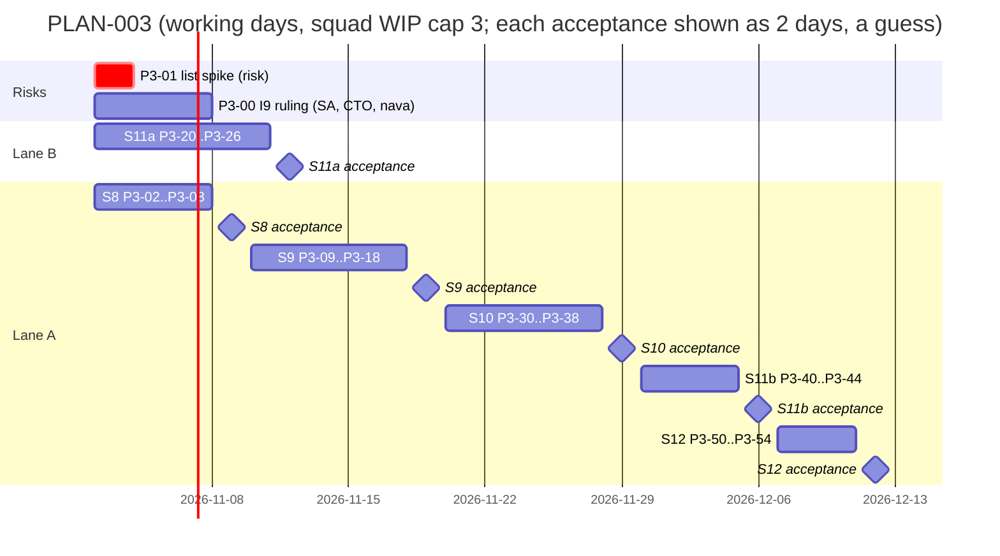

# PLAN-003: Records path (ADR-001 part 2)

## Summary

**What ships:** the part of Milestone 1 that PLAN-001 deferred (D-P1). A tenant admin publishes versioned entity types (Epic 04). Records are written through one pipeline with schema validation, defaults, numbering, optimistic concurrency and audit (Epic 05). ACL rules compile into the list query and agree with the single-record check, with field masks (Epic 06). The records API exposes all of it (Epic 07, records part). A versioned workflow definition runs on Temporal through one deterministic interpreter (Epic 09). The carry-forwards TICK-87 (rest of CI-8) and TICK-88 (rest of CI-10) close here. When PLAN-003 is done, every ADR-001 Annex B test is full.

**Two lanes (D-3-1):**
- **Lane A, records:** S8 entity types → S9 records → S10 access rules → S11b workflows on records → S12 comments and links. Serial, because each story needs the previous one's code and they share `db/grants.yaml`, `api/errors.yaml`, the OpenAPI bundle and the isolation registry.
- **Lane B, interpreter:** S11a runs from day 1 in parallel. It touches none of lane A's files.

**Size:** 6 stories, 47 tasks. 28 are on the board now (S8, S9, S11a, the spike and the erratum request). The 19 tasks of S10, S11b and S12 are listed below and are created when the previous lane-A story merges (D-3-8), because they key off code that does not exist yet.

**The one risk that matters most:** the Epic 06 list target (p95 ≤ 150 ms at 800k records, one large tenant among many small). If it needs an expression index, ADR-001 D25 governance (operator-approved, audited DDL) becomes M1 work, and that is not small (CTO, TICK-83). **Spike P3-01 (TICK-339) measures it on day 1**, before any records code exists.

**Two lines for nava, each a decision of yours (CTO, TICK-363):**
- **Scope change:** Epic 06's AC "an ACL references a defaulted field" is met through list filters and field masks, not through rule conditions (rule conditions use fixed columns only in M1; see the cut). Accepting an AC met a different way is your call.
- **Date:** the date depends on acceptance turnaround; each extra day per story adds a week across lane A.

**Found while writing this plan, and fixed in the task text before grooming** (all four confirmed by the CTO and the Principal Software Engineer against the code in TICK-363):
1. **Record events would go dead in the relay (D-3-14).** The relay uses an outbox row's `kind` as the workflow type (`internal/relay/dispatch.go:246`), so a `record.created` row would be denied by D9. The pipeline calls an `EventSink` port instead.
2. **The interpreter, as written, put record data and definitions into Temporal history (D-3-15).** It is now reference-only, with one typed guard allowance, `workerguard.Directive` (P3-26).
3. **ADR-001 I9's cycle rule rejects Epic 09's demo (D-3-16).** P3-00 (TICK-361) asks the Solution Architect for an erratum or amendment; the CTO rules. TICK-88 waits on it, with a fallback.
4. **Worker Versioning cannot be switched on (D-3-17).** A versioned poll is denied (D9b+), and so are the versioning write APIs. This is a cut.

## Scope and the cut

| In PLAN-003 | ADR-001 source | Epic |
|---|---|---|
| Entity types as JSON Schema 2020-12, immutable versions, compatibility classes, seed templates | I8 (no DDL) | 04 (TICK-7) |
| Records columns, numbering counter, one write pipeline, audit, history | I4, I7, I8, I9 | 05 (TICK-8) |
| Comments, work notes, links | I4 | 05 and 07 (S12) |
| ACL rules → SQL and Go evaluator, agreement suite, field masks, explainer, list benchmark | I5, D25 trigger | 06 (TICK-9) |
| Record endpoints, ETag/`If-Match`, list/filter/sort/page, CI-2 forged-payload path, CI-8 rest | D6, I4, I5 | 07 (TICK-10), records part |
| Workflow definition format v1, interpreter, triggers, replay gate, idempotent activities, CI-10 rest | I6, I7, I9, D22 | 09 (TICK-12) |

**Cut, said out loud** (all four accepted by the CTO in TICK-363; none touches isolation, determinism or idempotency):

| Cut | Why | Trigger to revisit |
|---|---|---|
| **ACL conditions on `data` fields.** M1 rule conditions use fixed columns (`state`, `requester_id`, `assignee_id`, `assignment_group_id`) and explicit shares (D-3-2). | Fixed columns are B-tree indexed and have no schema-version defaults, so the defaults-versus-ACL disagreement (TICK-2 inconsistency 1) cannot arise in a rule, and the 150 ms target needs no expression index. The same disagreement **does** arise in list filters on `data` fields, and the agreement suite (P3-32) covers `data` equality and `in` filters on null, absent, defaulted and type-changed fields. Epic 06's AC "an ACL references a defaulted field" is met through filters and masks, not rule conditions: **a scope change put to nava in the summary.** | A story needs a rule on a `data` field. It then reuses the filter's field expression. |
| **Sort and range filters on `data` fields.** Sort is on fixed columns plus `created_at` / `updated_at`; `data` filters are equality and `in`. | Range and sort on JSONB need expression indexes: D25 work. | P3-01 shows them cheap, or a story needs them. Either way through D25. |
| **Temporal Worker Versioning (build-id routing)** (D-3-17). | A versioned poll is denied (D9b+), and its write APIs are denied to every platform identity; enabling them amends ADR-001 A.2. | The first interpreter change `GetVersion` cannot express, or the first production deploy with in-flight runs across a breaking worker change. |
| **Forcing a breaking schema change.** Refused with 422, never forced. | Forcing needs a backfill job, which belongs with change sets (Epic 28). | Epic 28 planning. |
| **Record deletion; editing or deleting comments.** | Not in any epic's scope. `records` has no `DELETE` policy, and audit purge is D23. | A product story asks for it. |
| **Expressions in workflow conditions.** v1 compares literals. | Epic 10 owns the expression language. | Epic 10. |

**D25 escalation (CTO, TICK-360).** D25 indexed-attribute governance is out of PLAN-003 unless the measurements say otherwise. *Trigger:* P3-01 measures p95 > 150 ms for an ACL-shaped list (including the OR-combined predicate, query (d)), **or** P3-36 misses 150 ms on the list or 50 ms on a single read with the real compiled ACL SQL. In either case the Technical Lead escalates to the CTO. The target is not relaxed and no expression index is added without that escalation. A count-only miss falls back to a capped count and does not escalate.

**Schedule overrun (CTO, TICK-360 and TICK-363).** 8–10 weeks is accepted as the estimate, and no more scope is cut to shorten it. If lane A runs past 9 weeks, S12 is the first deferral, decided by nava, and it moves whole with P3-53's leak tests. S10 and S11b are never the cut.

**Never cut:** isolation (every new table's RLS and grants, P3-07, P3-18, P3-37, TICK-87), determinism (P3-22a, P3-23, P3-24, P3-26), idempotency (P3-14, P3-24, P3-43), cascade bounds (TICK-88).

**ADR test coverage after PLAN-003:**

| ADR test | Before | PLAN-003 tasks | After |
|---|---|---|---|
| CI-1, CI-3, CI-4, CI-9 | full | every table task registers its tables (fail-closed discovery catches a miss) | full |
| CI-2 | full | P3-18: the forged-payload path on `POST /api/v1/records/incident` asserts "refused or stored under tenant A only" with an RLS-bypassing read (TICK-10 carry-forward, CTO D-P10 sign-off); P3-07 for entity types | full |
| CI-6, CI-7 | full | P3-21 (D9 entry), P3-26 (the one typed `Directive` allowance and its negatives), P3-22a (references-only payloads), P3-23 (R1 walk over every committed history), P3-42 (per-kind key allow-list, AR-041) | full |
| CI-8 | partial | P3-14 / P3-15 (404, 412 behaviour), TICK-87 = P3-16 (registers both), P3-37 (masked-filter case) | **full after S10** |
| CI-10 | partial | TICK-88 = P3-12 (audit row, cycle check per the TICK-361 ruling); P3-44 gate under the fallback | **full after S9 (S11b under the D-3-16 fallback)** |
| CI-11 | full | none | full |

## Decisions this plan makes

| # | Decision |
|---|---|
| **D-3-1** | **Two lanes.** Lane A (S8 → S9 → S10 → S11b → S12) is serial: each story branch is created from `main` after the previous story merges. Lane B (S11a) runs in parallel from day 1; its files (`internal/workflow/`, `temporal-server/`, `cmd/nava-worker/`, `internal/workerguard/` for P3-26, `make/workflow.mk`, `deploy/compose/test/cases/interpreter.sh`) overlap no lane-A story. `docs/delivery/review-paths.yaml` gets one appended line from each; whichever merges second rebases. |
| **D-3-2** | **Fixed columns** are `number`, `state`, `requester_id`, `assignee_id`, `assignment_group_id`, `created_by`, `created_at`, `updated_at`. A schema property maps to one through the definition's `FixedColumns`, and a mapped property lives **only** in its column, never also in `data`; a read merges it back into the payload (Postgres, TICK-360). Everything else is in `data jsonb`. Every reference column has a **composite FK that includes `tenant_id`**, because Postgres FK checks ignore RLS (Security, TICK-360): `records (tenant_id, requester_id \| assignee_id \| created_by) → principals`, `records (tenant_id, assignment_group_id) → groups`, `audit_log (tenant_id, record_id) → records`, `entity_definition_versions (tenant_id, published_by) → principals`. ACL conditions and sorts use fixed columns only (cut above). P3-01 decides the index set. |
| **D-3-3** | **Tenant admin = member of the tenant's onboarded `admins` group, identified by id, never by path** (Security, Technical Architect; TICK-363 replaces TICK-360's path match). Onboarding creates the group and records its platform id in `tenant_admin_group(tenant_id PK, group_id)`: RLS and `FORCE`, a composite FK to `groups(tenant_id, id)`, written only by the onboarding role. Two entry points in `internal/authz`: `RequireTenantAdmin(ctx, store, p)` and `RequireTenantAdminTx(ctx, tx, p)`, which runs inside the caller's `InTenantTx` (P3-05a/05b use the `Tx` variant). Each reads the row for `p.TenantID` and checks `slices.Contains(p.Groups, group_id)`. Neither ever reads `groups.path` (ADR-002 §1.4: no authorization decision keys on a path). A missing row denies, and nothing re-creates the group. No Keycloak realm role: CI-11 forbids Keycloak claims outside the adapter. *Confirmed in grooming; no RFC.* **AR-S8-01 (Low):** revocation takes effect at the next group sync, because the resolver re-reads `principal_groups` on every request. |
| **D-3-4** | **Published entity-type versions are immutable, and stored byte-identical.** No runtime role has `UPDATE` or `DELETE` on `entity_definition_versions`; `nava_app` may update only `current_version` and `updated_at` on `entity_definitions`. Each version row has an `id uuid` (the interpreter and P3-41 name it). The schema is stored as Postgres **`json`, not `jsonb`**: `jsonb` reorders keys, drops duplicates and rewrites whitespace (checked on `postgres:16.10`, Postgres, TICK-360). `CHECK (schema_sha256 = sha256(convert_to(schema::text, 'UTF8')))`; Go reads `schema` as `[]byte`. P3-03 rejects duplicate keys, so Go and Postgres never read different values. The version GET returns `schema_sha256`. |
| **D-3-5** | **Compatibility classes, fail-closed.** *Compatible:* add an optional property (with or without a default), widen an `enum`. *Needs backfill:* add a `required` property that has a `default`; **add a `default` to an existing property** (old rows start reading it, and S10's `COALESCE` ACL result changes for them; Technical Architect, TICK-360). *Breaking:* change a `type`; narrow an `enum`; add a `required` property without a default; remove a property; change `FixedColumns`; **change an existing default**; **add or remove `x-nava-unique`**; and anything the classifier cannot prove compatible, such as widening `maxLength` or dropping `pattern` (fail closed). Adding or removing a state or transition follows the same fail-closed rule. Breaking → `422 schema_breaking_change` with the offending paths. Backfill jobs are not in M1. |
| **D-3-6** | **One write pipeline,** `internal/records/pipeline`, `Pipeline.Write` the only entry. A static test (P3-13) fails the build when any other package writes the record tables. Every write bumps `records.version` **exactly once**, in the same `UPDATE` that checks `ExpectedVersion`; `outbox` gets an `Enqueue` variant that takes the already-bumped version and does not bump it again (Principal Software Engineer, Postgres; TICK-360). `pipeline.New` takes a `TxRunner` so a rejected cascade can be audited after the caller's transaction rolls back (D-3-7a, TICK-363). |
| **D-3-7** | **Interim authorization in S9:** `TenantMemberAuthorizer` lets any principal of the tenant read and write the tenant's records. The tenant wall (RLS) is unchanged, so no cross-tenant path opens, and the `EventSink` is a no-op until S11b, so no workflow runs on it. Recorded as AR-S9-01, accepted by the CTO with two conditions: P3-31 **deletes** `TenantMemberAuthorizer`, guarded by an `arch_test` that fails if it is defined or referenced anywhere in the module (QA's whole-module version); and TICK-335's acceptance text says "never ship a release with S9 and without S10". |
| **D-3-7a** | **A rejected cascade is audited on the runner** (TICK-88, Principal Software Engineer; TICK-363). The depth and cycle checks run before any statement in the caller's transaction. On a rejection, the pipeline writes exactly one `cascade_rejected` audit row on its `TxRunner` and returns the typed error, so the row survives the caller's rollback. |
| **D-3-8** | **Rolling creation:** S10's, S11b's and S12's tasks (listed below) are created and groomed when the previous lane-A story merges. Their outlines and contracts are fixed here, so the cut is visible now. |
| **D-3-9** | **Numbering:** `record_counters(tenant_id, entity_definition_id, next)`, FK to `entity_definitions`. One statement, `INSERT … VALUES (…, 2) ON CONFLICT (tenant_id, entity_definition_id) DO UPDATE SET next = record_counters.next + 1 RETURNING next - 1`, runs in the write transaction as the **last statement before the audit and outbox inserts**, so no onboarding or publish step creates counter rows and the lock window is short (Postgres, TICK-360). A rollback rolls the counter back: 50 concurrent creates get 1..50, and a rolled-back create's number is reused. No sequences (I8). Format `<prefix><7 digits>`, growing past 7 as needed. *Trigger to revisit:* create p95 > 50 ms in P3-36. |
| **D-3-10** | **Concurrency on the API:** `ETag: W/"<version>"`. `PATCH` takes `application/merge-patch+json`: `Command.Data` on an update is a **JSON Merge Patch (RFC 7396)** applied inside the pipeline; `null` removes a key, arrays are replaced whole, and `state` is top-level. After the patch the pipeline applies defaults and validates, so `null` on a required field **with** a default is refilled and accepted, and without one gives `422 validation_failed` (Principal Software Engineer, TICK-363). `If-Match` is required, and `If-Match: *` is treated as missing. Order: `404` → `428 if_match_required` → `412 version_conflict` (current ETag in the `ETag` header and in `detail`) → `422`. An unreadable, other-tenant or missing record, or an unknown entity type key, gets one byte-identical `404 not_found`; 404 bodies leave out `instance`. |
| **D-3-11** | **One interpreter workflow type**, `nava.interpreter`, **on the existing `nava-tq` queue** (no new queue: the relay hard-codes `nava-tq`, `internal/relay/dispatch.go:29`; Technical Architect, Security; TICK-360). Added to the D9 allow-list in one policy PR (P3-21). One type for every definition, so A1's RS5 trigger ("a type per definition") does not fire. Only the relay sends signals in S11a. |
| **D-3-12** | **The definition version is pinned at start, and workflow code holds only references and directives.** The relay starts `nava.interpreter` with an `outbox.Delivery` whose payload is `{definition_version_id, record_id}`, both UUIDs. The workflow never reads "latest", so a v2 publish cannot change a running v1. Conditions and branches are evaluated inside the **`NextStep`** activity, which reads the definition and the record in `InTenantTx` under the `nava-tenant` header and returns a `workerguard.Directive` (D-3-15). **`ApplyStep`** performs `update_record` and loads `set` itself. Each activity takes **one** UUID-only `StepRef` struct (an optional id is omitted, never `null`), and both are **regular activities, never local** (`internal/workerguard/results.go:51`) (TICK-363). The Temporal signal name is one fixed constant. History growth: P3-22a continues as new on `GetContinueAsNewSuggested()`, carrying the current step in `RunInput.Refs`. **Interpreter code changes are guarded by `workflow.GetVersion` plus the replay gate over the recorded histories (P3-23). Worker versioning is not used (D-3-17).** **AR-S11a-01 (Low):** the order of directives shows which branch a condition took (one derived bit per step), and `TimerStarted` shows wait durations; neither is a tenant literal (Security). |
| **D-3-13** | **Idempotent activity writes:** each `update_record` step writes through the pipeline as a system actor (`source = workflow`, causation from the triggering outbox row) with key `wf:<workflow id>:<step id>`. The pipeline stores the key on the **primary audit row only**; any other row from the same write carries `NULL` (Postgres, TICK-363). `UNIQUE (tenant_id, idempotency_key) WHERE idempotency_key IS NOT NULL`; a replay finds the row and returns the earlier result. The relay's `target_key` for an interpreter start is `interp:<uuidv5(outbox_id, definition_id)>`, so a workflow id never repeats under `REJECT_DUPLICATE` (S11b inherits it). HTTP writes keep the existing `Idempotency-Key` middleware. |
| **D-3-14** | **No generic record events in the outbox.** The relay starts the workflow type named by `kind`, so a `record.created` row would be denied by D9 and go dead. The pipeline calls an `EventSink` port in the write transaction instead: a no-op in S9; in S11b it enqueues one `nava.interpreter` start per published definition whose trigger matches. P3-42 signals only the open refs that are **waiting on `record_changed`**, and never the run whose own write caused the change (Technical Architect, TICK-363). `Enqueue` and the relay get a per-kind payload key allow-list then (AR-041 trigger). |
| **D-3-15** | **Reference-only interpreter with one typed guard allowance: `workerguard.Directive{Step, Kind, WaitSeconds, Signal, Next, OnTimeout}`** (TICK-360, tightened in TICK-363). It lives in `internal/workerguard` next to `RunInput`, so `interp` imports `workerguard`, never the reverse. `Kind` is the closed enum `timer`, `wait_signal`, `update_record`, `end` (`NextStep` resolves `condition`/`branch` itself and returns the first step that needs action). The guard matches it **by Go type**, checks the **encoded bytes** as `deliveryOK` does (so a custom `MarshalJSON` is refused), decodes with unknown fields rejected, takes the enum values from the Go constants only, and enforces the **per-kind table** below; any other combination is refused. `WaitSeconds` and the step graph come only from the published definition, never from a record field. Activity failures use only allowed failure types with fixed messages; anything else stays `ErrTypeOpaque`. Owned by the Security & Multi-Tenancy Reviewer as a D-P10 path (P3-26). R1/CI-7 is narrowed by one closed type, not loosened. **Step ids are random UUIDv4** (TICK-363): `AssignStepIDs(def, prev)`, a pure function in P3-20 using `uuid.New()` (crypto/rand), keeps `prev`'s id for an unchanged key and draws a new one for a new key. P3-41 calls it at publish and stores the map in the immutable version row; a step id supplied in a publish body is refused. S11a's fixtures commit fixed ids (`fixture-v2` reuses `fixture-v1`'s), so replay holds. *Technical Lead extension:* signal ids follow the same rule (assigned by `AssignStepIDs`, one per distinct signal name, stored in the same map), since a uuidv5 over an author-chosen name has the same word-list exposure the step-id decision removed. |
| **D-3-16** | **I9 cycle rule needs an erratum or amendment** (P3-00, TICK-361, Solution Architect; **the CTO rules**; nava signs). Open questions handed to the CTO (TICK-363): does the check run on writes or on interpreter starts, and does a cycle reject the write or suppress the re-start with an audit row? The Technical Architect expects the answer to make it an amendment. Security's condition: the cycle key and the depth come only from causation stored under the writer's RLS, never from an outbox payload. The depth limit **8** (D-P7) is confirmed. TICK-88 writes its cycle test to the ruling. **Fallback (accepted by the CTO, may not slip further):** if it is not ruled when TICK-88 is next, TICK-88 ships the depth audit row only and the cycle check moves to S11b; P3-44 then has the AC "the CI-10 cycle case is a named PASS", and S11b does not go to acceptance without it. |
| **D-3-17** | **Worker Versioning is cut** (above). The primary reason: a **versioned poll is itself denied** (D9b+, `checkUnversioned`, `temporal-server/authz/authorizer.go:497-510`). Second, `UpdateWorkerVersioningRules`, `SetWorkerDeploymentCurrentVersion` and the related calls are denied to every platform identity (`policy.go:146-153`; `System`, the server's own certificate, is exempt and no deploy tool can use it). P3-23 documents how an incompatible interpreter change ships (a new `GetVersion` branch, or a new workflow type through a D9 policy PR while old runs drain) and the three deploy rules: (a) stop old interpreter workers before new ones start, for any change that needs `GetVersion`; (b) never roll back across a recorded `GetVersion`; (c) delete a `GetVersion` branch only when no open run that started before it remains. |
| **D-3-18** | **JSON Schema library:** `github.com/santhosh-tekuri/jsonschema/v6` v6.0.3, promoted from indirect to direct (not a new dependency). Draft 2020-12 only. v6 installs a `FileLoader` by default, so P3-03 calls `UseLoader(denyAll)` and creates **one new `Compiler` per `Compile` call**, so tenant A's `$id` can never satisfy tenant B's `$ref` (Security, TICK-363). P3-03 adds the `docs/pins.md` row. |
| **D-3-19** | **TICK-87 is split.** P3-16 (TICK-87) registers the byte-identical 404 and the 412 as CI-8 cases in S9. The masked-field filter case needs S10's masks and lands in P3-37. |
| **D-3-20** | **Review standard:** D-P10 applies unchanged. New `security` paths appended to `review-paths.yaml` by the task that creates them: `internal/metadata/` (P3-03), `internal/authz/` (P3-04), `internal/records/` (P3-10), `internal/workflow/` (P3-22a), `internal/workerguard/` stays (P3-26). P3-04 also fixes two existing entries: `internal/onboarding/` becomes `internal/onboard/`, and `internal/groupsync/` is added (Security, TICK-363). The agreement suite (P3-32) gets Security and Postgres reviewers. The Technical Lead reviews Principal Software Engineer changes. |
| **D-3-21** | **Carried triggers.** AR-042 (no panic values from data) and AR-044 (`navalint` check that only `internal/workerguard` uses the guard failure types) fire with the first feature workflow: P3-26 covers both. TODO-010 does not fire (no update handlers; signals only). TODO-013 does not fire: P3-22a sets no summaries or static details, and its review checks that. |
| **D-3-22** | **Uniqueness under concurrency:** before the uniqueness check, on create and on any update that changes a unique field, the pipeline takes `pg_advisory_xact_lock(hashtextextended(tenant_id ‖ entity_definition_id ‖ field ‖ canonical value, 0))`, then runs a plain `SELECT` (Principal Software Engineer, Postgres; TICK-360). It is released at commit, so it is safe under PgBouncer transaction pooling; a hash collision only adds waiting. No JSONB unique index (D25). |
| **D-3-23** | **Determinism lint:** `workflowcheck` is added to `make lint` for `internal/workflow/...`, pinned as its own module `go.temporal.io/sdk/contrib/tools/workflowcheck` with a `docs/pins.md` row; `forbidigo` rules banning `time.Now` and `math/rand` in `internal/workflow/interp` stay as a second layer (Technical Architect, TICK-360). |

## Interface contracts (written before either side starts)

```go
// internal/metadata — P3-03 (pure Go, no DB or network import)
type Definition struct {
    Key          string            // ^[a-z][a-z0-9_]{1,40}$
    Schema       json.RawMessage   // JSON Schema 2020-12, stored byte-identical (D-3-4)
    NumberPrefix string            // ^[A-Z]{2,6}$; set at create, never changes (stored on entity_definitions)
    FixedColumns map[string]string // schema property -> state | requester_id | assignee_id | assignment_group_id
    States       StateModel        // Initial, States, Transitions{From, To}
}
func Compile(d Definition) (*Compiled, error)                         // ErrInvalidDefinition{Paths}; UseLoader(denyAll), new Compiler per call
func Classify(prev, next *Compiled) (Compat, []string, error)         // Compatible | NeedsBackfill | Breaking (D-3-5)
func (c *Compiled) Validate(data map[string]any) []FieldError         // FieldError.Code = the failing keyword
func (c *Compiled) ApplyDefaults(data map[string]any) map[string]any  // top-level only in v1; missing keys only, never mutates input
func (c *Compiled) UniqueFields() []string                            // properties marked x-nava-unique

// internal/authz — P3-04 (admin), P3-10 (interim), P3-31 (rules), P3-33 (masks), P3-35 (explainer)
type AdminGroupStore interface { AdminGroupID(ctx context.Context, tenantID uuid.UUID) (uuid.UUID, error) } // reads tenant_admin_group
func RequireTenantAdmin(ctx context.Context, store AdminGroupStore, p identity.Principal) error // ErrForbidden; missing row denies
func RequireTenantAdminTx(ctx context.Context, tx pgx.Tx, p identity.Principal) error          // same, inside the caller's InTenantTx
type Authorizer interface {                                        // S9 shape; S10 widens it, keeping CanWrite
    CanWrite(ctx context.Context, p identity.Principal, entity string, before, after map[string]any) error
}

// internal/records/pipeline — P3-10, P3-11, P3-12
type Command struct {
    Op Op; EntityKey string; RecordID uuid.UUID; ExpectedVersion int64
    Data map[string]any // Create: full data; Update: JSON Merge Patch (D-3-10)
    Actor identity.Principal; Source Source // user | rule | workflow | function | ai | system
    Causation outbox.Causation; IdempotencyKey string             // system writers (D-3-13)
}
type Result struct{ RecordID uuid.UUID; Number string; Version int64; SchemaVersion int }
type EventSink interface { RecordChanged(ctx context.Context, tx pgx.Tx, ev Event) error } // D-3-14; NoopSink in S9
type DefinitionReader interface { // implemented by P3-05a's store
    Version(ctx context.Context, tx pgx.Tx, entityKey string, version int) (*metadata.Compiled, error)
    Current(ctx context.Context, tx pgx.Tx, entityKey string) (*metadata.Compiled, int, error)
}
func New(a authz.Authorizer, defs DefinitionReader, sink EventSink, tx TxRunner, clock Clock) *Pipeline // TxRunner: D-3-7a
func (p *Pipeline) Write(ctx context.Context, tx pgx.Tx, cmd Command) (Result, error)
// Errors: ErrValidation{Fields}, ErrVersionConflict, ErrIllegalTransition{From, To}, ErrUniqueViolation{Field},
// authz.ErrForbidden, outbox.ErrCascadeTooDeep, ErrCascadeCycle (P3-12).

// internal/workerguard — P3-26 (the one typed allowance, D-3-15)
type Directive struct {
    Step        uuid.UUID  `json:"step"`
    Kind        Kind       `json:"kind"`                 // timer | wait_signal | update_record | end
    WaitSeconds int32      `json:"wait_seconds"`
    Signal      *uuid.UUID `json:"signal,omitempty"`     // omitted, never null
    Next        *uuid.UUID `json:"next,omitempty"`
    OnTimeout   *uuid.UUID `json:"on_timeout,omitempty"`
}

// internal/workflow — P3-20 (format), P3-22a (workflow)
func Parse(b []byte) (*Definition, error)                                  // "nava.workflow/v1"; validates keys only
func AssignStepIDs(def *Definition, prev map[string]uuid.UUID) map[string]uuid.UUID // uuid.New(); keeps prev for unchanged keys
type StepRef struct {                                                      // the one argument of NextStep and ApplyStep
    DefinitionVersionID uuid.UUID  `json:"definition_version_id"`
    RecordID            uuid.UUID  `json:"record_id"`
    Step                uuid.UUID  `json:"step"`
    Signal              *uuid.UUID `json:"signal,omitempty"`             // omitted, never null
}
// NextStep(ctx, StepRef) (workerguard.Directive, error)  — regular activity
// ApplyStep(ctx, StepRef) error                          — regular activity; loads `set` itself
type RecordWriter interface { Write(ctx context.Context, tenantID, recordID uuid.UUID, stepID uuid.UUID, set map[string]any) error }
type RecordReader interface { Read(ctx context.Context, tenantID, recordID uuid.UUID) (map[string]any, error) } // activity side only
type DefinitionStore interface { Load(ctx context.Context, tenantID, versionID uuid.UUID) (*Definition, error) } // activity side only
```

**`Directive` per kind** (the guard enforces exactly these; anything else is refused):

| Kind | `Step` | `Next` | `WaitSeconds` | `Signal` | `OnTimeout` |
|---|---|---|---|---|---|
| `timer` | non-nil | non-nil | 1..2592000 | omitted | omitted |
| `wait_signal` | non-nil | non-nil | 1..2592000 (the timeout) | non-nil | non-nil |
| `update_record` | non-nil | non-nil | 0 | omitted | omitted |
| `end` | non-nil | omitted | 0 | omitted | omitted |

**Tables.** Every table is a tenant table: `tenant_id` first in every key and index, `ENABLE` + `FORCE` RLS, one policy per command `TO nava_app, nava_worker` testing `app.tenant_id` (no allow-list entry), grants in `db/grants.yaml` in the same migration, no `DELETE` grant, timestamp migration versions, composite FKs that include `tenant_id` (D-3-2). Later `CHECK` constraints are added `NOT VALID`, then validated.
- S8 (P3-02): `entity_definitions(… number_prefix …, UNIQUE (tenant_id, number_prefix))`, `entity_definition_versions(tenant_id, id uuid, definition_id, version, schema json, schema_sha256, fixed_columns, states, compat, published_by, published_at)` (immutable). (P3-04): `tenant_admin_group(tenant_id PK, group_id)`.
- S9 (P3-09): `records` gains `entity_definition_id, schema_version, number, state, requester_id, assignee_id, assignment_group_id, created_by, created_at, updated_at, data, causation_origin_id, causation_depth` (`created_at`/`updated_at` `NOT NULL DEFAULT now()`, all-or-none CHECK); `audit_log` (with `idempotency_key`, D-3-13); `record_counters`.
- S10 (P3-30): `acl_versions(tenant_id, entity_definition_id, version, rules, masks, published_by, published_at)`, `record_shares`.
- S11b (P3-40): `workflow_definitions`, `workflow_definition_versions` (immutable, with the step-id map assigned at publish, D-3-15).
- S12 (P3-50): `comments(… visibility public | internal …)`, `record_links`.

**HTTP.** All under `/api/v1`, one `api/paths/<area>.yaml` per area, writes mounted `authn → ratelimit → idempotency`, every route in the isolation suite. Records routes check in this order: authn → entity type (unknown gives the same 404) → record → authorizer → validation.

| Route | Story | Who |
|---|---|---|
| `GET /entity-types`, `GET /entity-types/{key}`, `GET /entity-types/{key}/versions/{n}` (with `schema_sha256`); `POST /entity-types` (P3-05a); `POST /entity-types/{key}/versions` (P3-05b) | S8 | read: tenant users; create and publish: admin |
| `POST /records/{entity}`, `GET /records/{entity}/{id}`, `PATCH /records/{entity}/{id}`, `GET …/history` | S9 | per authorizer |
| `GET /records/{entity}` (filter, sort, cursor, count); `GET`, `PUT /entity-types/{key}/access`; `GET /access/explain` | S10 | list per ACL; access and explainer: admin |
| `POST /workflow-definitions/{key}/versions`, `GET /workflow-definitions/{key}` | S11b | admin |
| `GET`, `POST /records/{entity}/{id}/comments`; `GET`, `POST …/links` | S12 | per ACL; work notes hidden from requesters |

New error codes are added to `api/errors.yaml` by the task that first returns them: `schema_breaking_change`, `invalid_definition`, `entity_type_exists`, `number_prefix_taken` (S8); `if_match_required`, `version_conflict`, `illegal_transition`, `unique_violation` (S9); `masked_field`, `field_not_writable` (S10); `workflow_definition_invalid` (S11b).

**Workflow definition v1 (P3-20):** JSON, validated by `internal/workflow/def/schema.json`. At most 200 steps, each with a unique author key and a `type`: `condition`, `branch`, `timer`, `wait_signal`, `update_record`, `end`. Edges are `next`, `then`, `else`, `cases[].next`, `default` and `on_timeout`; `end` has no out-edge; the validator checks unknown ids, cycles and reachability over all of them. Durations are `PnDTnHnMnS` only, parsed by hand, bounded to 1s–30d for `timer` and the `wait_signal` timeout, and are literals of the definition, never a record field reference. `field` is a JSON Pointer; `eq` compares decoded JSON values; a missing field equals nothing (the `NextStep` contract). The `update_record.set` check against the entity schema is a publish-time check in P3-41.

## Task graph

```mermaid
flowchart LR
  P301[P3-01 spike: 800k list p95]:::risk
  P300[P3-00 I9 cycle erratum / amendment]:::risk
  subgraph S8[S8 TICK-333 entity types]
    P302[P3-02 tables]-->P305a[P3-05a reads + create]
    P303[P3-03 metadata]-->P305a
    P304[P3-04 admin group id]-->P305a
    P305a-->P305b[P3-05b publish versions]
    P305b-->P306[P3-06 seed templates]
    P305b-->P307[P3-07 isolation + no DDL]
    P306-->P308[P3-08 kit]
    P307-->P308
  end
  subgraph S9[S9 TICK-335 records]
    P309[P3-09 tables]-->P310[P3-10 pipeline core]
    P310-->P311[P3-11 numbering, states, unique]
    P310-->P312[P3-12 TICK-88 CI-10]
    P310-->P313[P3-13 single-writer test]
    P310-->P314[P3-14 create, read]
    P314-->P318[P3-18 CI-2 forged payload]:::risk
    P314-->P315[P3-15 patch, history]
    P311-->P315
    P315-->P316[P3-16 TICK-87 CI-8 404/412]
    P311-->P317[P3-17 kit]
    P312-->P317
    P313-->P317
    P315-->P317
    P316-->P317
    P318-->P317
  end
  subgraph S10[S10 TICK-336 access, created when S9 merges]
    P330[P3-30 ACL tables]-->P331[P3-31 compiler + evaluator]
    P331-->P332[P3-32 agreement suite]
    P331-->P333[P3-33 masks]
    P333-->P334[P3-34 list]
    P331-->P335[P3-35 admin + explainer]
    P334-->P336[P3-36 perf]
    P334-->P337[P3-37 attacks + CI-8 mask]
    P335-->P337
    P332-->P338[P3-38 kit]
    P336-->P338
    P337-->P338
  end
  subgraph S11a[S11a TICK-334 interpreter, lane B]
    P320[P3-20 format v1 + AssignStepIDs]-->P322a[P3-22a interpreter]:::risk
    P326[P3-26 guard: Directive]:::risk-->P322a
    P322a-->P322b[P3-22b worker registration + relay start]
    P321[P3-21 D9 policy]-->P322b
    P322a-->P323[P3-23 replay gate]
    P322b-->P323
    P322a-->P324[P3-24 version + crash]
    P322b-->P324
    P323-->P325[P3-25 kit]
    P324-->P325
  end
  subgraph S11b[S11b TICK-337 workflows on records]
    P340[P3-40 definition tables]-->P341[P3-41 publish + step ids + DB store]
    P341-->P342[P3-42 EventSink + kind allow-list]
    P342-->P343[P3-43 RecordWriter via pipeline]
    P343-->P344[P3-44 kit]
  end
  subgraph S12[S12 TICK-338 comments, links]
    P350[P3-50 tables]-->P351[P3-51 pipeline ops]-->P352[P3-52 endpoints]
    P352-->P353[P3-53 isolation + visibility]-->P354[P3-54 kit]
  end
  P308-->P309
  P301-->P309
  P305a-->P310
  P300-->P312
  P317-->P330
  P338-->P340
  P325-->P340
  P344-->P350
  classDef risk fill:#7f1d1d,color:#fff
```



An edge from a kit (`P3-08`, `P3-17`, `P3-25`, `P3-38`, `P3-44`) to the next story means "that story accepted and merged into `main`". P3-01 → P3-09 is real: P3-09 creates the index set the spike chooses. P3-05a → P3-10 is real: P3-05a owns `DefinitionReader`.

**Critical path (lane A):** P3-02/03/04 → P3-05a → P3-05b → P3-07 → P3-08 → *S8 accepted* → P3-09 → P3-10 → P3-14 → P3-15 → P3-16 → P3-17 → *S9 accepted* → P3-30 → P3-31 → P3-33 → P3-34 → P3-37 → P3-38 → *S10 accepted* → P3-40 → P3-41 → P3-42 → P3-43 → P3-44 → *S11b accepted* → S12. About 26 tasks deep, plus five human acceptances. Lane B (9 tasks) finishes well inside S9.

## Sequence



**Estimates:** each task 0.5–1.5 agent-days; 47–62 agent-days in total; **8–10 calendar weeks** with the WIP cap of 3, most of it lane A's serial chain (accepted by the CTO, TICK-363). *Assumptions:* PLAN-001's helpers (`InTenantTx`, `outbox.Enqueue`, idempotency middleware, isolation registry, Bruno collection) take the new tables and routes without harness changes, and each acceptance takes about 2 working days. *Guesses:* P3-31 (the compiler could be 2× if shares and groups need a different join shape than P3-01 measured), P3-22a (a reference-only interpreter is new ground), and every acceptance wait. **The date depends on acceptance turnaround; each extra day per story adds a week across lane A.**

## Stories and tasks

| Story | Issue | Epic | The human tries it by |
|---|---|---|---|
| S8 A tenant admin publishes an incident type and reads every version | TICK-333 | 04 | Bruno `S8 entity types` as `admin@tenant-a`, `agent@tenant-a`, `agent@tenant-b` |
| S9 An agent logs an incident, updates it, sees its history; a stale update is refused | TICK-335 | 05, 07 | Bruno `S9 records` |
| S10 A service-desk agent sees only their group's incidents; masked fields never leak | TICK-336 | 06, 07 | Bruno `S10 access` |
| S11a The workflow interpreter runs a definition on Temporal | TICK-334 | 09 | interpreter demo + Temporal UI |
| S11b Creating an incident starts a workflow that waits a minute and sets its state | TICK-337 | 09 | Bruno `S11b workflows` |
| S12 Agents comment, write internal work notes, and link records | TICK-338 | 05, 07 | Bruno `S12 comments` |

**On the board now** (all `backlog`):

| Task | Issue | Role | Depends on |
|---|---|---|---|
| P3-00 erratum / amendment | TICK-361 | Solution Architect | none |
| P3-01 spike | TICK-339 | postgres-dev | none |
| P3-02 definition tables | TICK-340 | postgres-dev | none |
| P3-03 metadata | TICK-341 | core-dev | none |
| P3-04 admin group id | TICK-342 | backend-dev | none |
| P3-05a reads + create, `DefinitionReader` | TICK-343 | backend-dev | P3-02, P3-03, P3-04 |
| P3-05b publish versions | TICK-365 | backend-dev | P3-05a |
| P3-06 seed templates | TICK-344 | backend-dev | P3-05b |
| P3-07 isolation + no DDL | TICK-345 | security | P3-05a, P3-05b |
| P3-08 S8 kit | TICK-346 | qa | P3-06, P3-07 |
| P3-09 records tables | TICK-353 | postgres-dev | S8 merged, P3-01 |
| P3-10 pipeline core | TICK-354 | core-dev | P3-09, P3-05a |
| P3-11 numbering, states, unique | TICK-355 | core-dev | P3-10 |
| P3-12 CI-10 | TICK-88 | core-dev | P3-10, P3-00 (fallback) |
| P3-13 single writer | TICK-356 | qa | P3-10 |
| P3-14 create + read | TICK-357 | backend-dev | P3-10 |
| P3-15 patch + history | TICK-358 | backend-dev | P3-14, P3-11 |
| P3-16 CI-8 | TICK-87 | security | P3-15 |
| P3-17 S9 kit | TICK-359 | qa | P3-11, P3-12, P3-13, P3-15, P3-16, P3-18 |
| P3-18 CI-2 forged payload | TICK-366 | security | P3-14 |
| P3-20 format v1 + `AssignStepIDs` | TICK-347 | core-dev | none |
| P3-21 D9 policy | TICK-348 | security | none |
| P3-22a interpreter workflow | TICK-349 | core-dev | P3-20, P3-26 |
| P3-22b worker registration + relay start | TICK-367 | core-dev | P3-22a, P3-21 |
| P3-23 replay gate | TICK-350 | qa | P3-22a, P3-22b |
| P3-24 pinning + crash | TICK-351 | qa | P3-22a, P3-22b |
| P3-25 S11a kit | TICK-352 | qa | P3-23, P3-24 |
| P3-26 guard: `Directive` | TICK-362 | security | none |

**Created when the previous lane-A story merges (D-3-8):**

| Task | Role | Outcome |
|---|---|---|
| P3-30 | postgres-dev | `acl_versions` and `record_shares` with RLS, grants, isolation registration |
| P3-31 | core-dev | Rule model, SQL compiler and Go evaluator for read and write; group and user references resolve only inside the caller's tenant. **Deletes `TenantMemberAuthorizer`**, with an `arch_test` that fails if it is defined or referenced anywhere in the module (CTO, QA; TICK-363) |
| P3-32 | qa | Randomized agreement suite: SQL list and Go check agree on every record, including `data` equality and `in` filters on null, absent, defaulted and type-changed fields |
| P3-33 | core-dev | Masks on write (`field_not_writable`) and read (one shaping layer, which also covers history `before`, `after` and `changed[]`); filter, sort, count and aggregate on a masked field → `400 masked_field`. The pipeline authorise stage moves from the stub to `authz` |
| P3-34 | backend-dev | `GET /records/{entity}`: filter, sort, keyset cursor and count under ACL; 10k paging with concurrent inserts, no duplicates or gaps |
| P3-35 | backend-dev | ACL admin routes and the explainer: admin only (`RequireTenantAdminTx`), own tenant, never shows a field the admin cannot read |
| P3-36 | qa | List p95 ≤ 150 ms at 800k and single read p95 ≤ 50 ms, as a perf job or a documented run; a miss triggers the D25 escalation |
| P3-37 | security | Attacks: foreign group id in a rule grants nothing, 404 oracle, mask oracle by filter, sort, count and aggregate, history `before`/`after`/`changed[]` masked, explainer cross-tenant; CI-8 masked-filter case |
| P3-38 | qa | S10 acceptance kit, verified on a fresh stack |
| P3-40 | postgres-dev | `workflow_definitions` and versions tables, immutable versions, holding the step-id map |
| P3-41 | backend-dev | Publish route (`workflow_definition_invalid`; admin via `RequireTenantAdminTx`), calls `AssignStepIDs` and stores the map in the immutable version row, refuses a client-supplied step id, checks `update_record.set` against the entity schema; DB `DefinitionStore` |
| P3-42 | core-dev | `EventSink`: trigger-matched `nava.interpreter` starts (`target_key` per D-3-13), `record.changed` signals only to refs waiting on `record_changed` and never to the run whose own write caused the change, per-kind payload key allow-list in `Enqueue` and the relay; the cycle check if the TICK-361 ruling puts it on starts |
| P3-43 | backend-dev | `RecordWriter` adapter through the pipeline (`Source=workflow`, D-3-13 key), `CloseWorkflowRef`; tenant B's records start no tenant A workflow |
| P3-44 | qa | S11b acceptance kit, verified on a fresh stack. Includes the P3-24 crash case against the real `pipeline.Write`, and, under the D-3-16 fallback, the AC "the CI-10 cycle case is a named PASS in the isolation report" |
| P3-50 | postgres-dev | `comments` and `record_links` tables |
| P3-51 | core-dev | Pipeline ops for comment, work note and link, each audited once |
| P3-52 | backend-dev | Comment and link endpoints; work notes hidden from requesters in lists and by id |
| P3-53 | security | Isolation and visibility attacks on comments and links |
| P3-54 | qa | S12 acceptance kit, verified on a fresh stack |

**Released first on APPROVED** (`Depends on: none`): P3-00, P3-01, P3-02, P3-03, P3-04 (lane A) and P3-20, P3-21, P3-26 (lane B). The Security & Multi-Tenancy Reviewer asks the CTO for D-P10 sign-off on P3-18 and P3-26 when each is released, not at merge.

### Which tests need a real dependency (QA, TICK-360)

| Real dependency | Tasks, and the risk that needs it |
|---|---|
| **Postgres** (`integration` tag) | P3-02, P3-04, P3-09: RLS, `FORCE`, grants, immutable versions (CI-1/CI-4), the composite-FK `Denied` path, `json` + sha256, `relfilenode` unchanged. P3-05b: the 50-way publish race. P3-06: seeding twice. P3-10: the transaction, SIGKILL mid-write, two concurrent updates. P3-11: counter upsert and uniqueness under concurrency, through PgBouncer. P3-12, P3-16, P3-18. |
| **Keycloak** (stack case) | P3-04: admin membership reaching `/me` through group sync, with a bounded poll, not a sleep. Kits P3-08 and P3-17: real tokens for both tenants. |
| **Temporal** (stack case) | P3-22b: relay starts `nava.interpreter` under the real Authorizer. P3-24: the crash test. P3-25: the kit. |
| **None** (`task test`) | P3-03, P3-20, P3-13, P3-23 (the replayer needs no server), P3-26, and pinning in P3-24. |

## Residuals and carried items

| Item | Where this plan handles it |
|---|---|
| R1 histories unencrypted | D-3-15 (reference-only interpreter, v4 step ids), P3-26, P3-23 (R1 walk), P3-42 |
| R8 worker certificate reach | P3-43: activities use `InTenantTx` only |
| R9 head-of-line blocking | P3-42: `record.changed` signals only to waiting refs; P3-24 covers a signal behind a long timer |
| AR-023 a policy PR per workflow type | D-3-11 |
| AR-041 per-kind payload keys | P3-42 |
| AR-042, AR-044 | P3-26 |
| **AR-S8-01** admin revocation lag = one group-sync cycle (Low) | D-3-3; register row added |
| AR-S9-01 interim tenant-member authorization | D-3-7; closed by S10 (P3-31 deletes it) |
| **AR-S11a-01** directive order and `TimerStarted` show branch and wait (Low) | D-3-12; register row added |
| TODO-010, TODO-013 | Not triggered (D-3-21) |

## Grooming record

Two grooming meetings ran on the same task tree, because two Technical Lead runs opened competing plan PRs (#293 and #294). **#293 is the single plan PR; #294 is closed as superseded.** Both outcomes are applied here; where they differ, TICK-363 wins.

| Meeting | Rounds | Result | Outcome comment |
|---|---|---|---|
| **TICK-360** (against #294's numbering, mapped onto this plan) | 2 | All seven AGREE. No dissent; nothing cut. New tasks P3-05b, P3-18, P3-22b; P3-26 becomes the `Directive` rule. | TICK-360, Outcome (13:16) |
| **TICK-363** (against this plan) | 2 | All seven AGREE (the Technical Architect's AGREE was conditional on the TICK-88 AC and the TICK-361 questions; both are in). No dissent; nothing cut. | TICK-363, Outcome (13:22) |

Participants in both: CTO, Technical Architect, Principal Software Engineer, Senior Software Engineer, Postgres & Data Modeling Specialist, Security & Multi-Tenancy Reviewer, Quality, Testing & CI Advisor. Facilitator: Technical Lead.

**Where TICK-363 overrode TICK-360:** D-3-3 (admin by stored group id, not path); step ids (random v4 at publish, not run-time uuidv5); activity arguments (one `StepRef` struct, regular activities only); the per-kind `Directive` table and encoded-bytes check; continue-as-new and P3-42's signal fan-out; D-3-17's primary reason (denied versioned poll); TICK-88's `TxRunner`.

**The one reversal:** during TICK-363 round 2 the facilitator briefly reversed step ids back to uuidv5; all three round-2 replies (Technical Architect, Security, Principal Software Engineer) settled on v4, and the Outcome withdrew the reversal. v4 stands.

**Numbering map, #294 → this plan:** D-3-15 (#294 `Directive`) → D-3-15; D-3-16 (#294 merge patch, single version bump) → D-3-10 and D-3-6; D-3-17 (#294 `json` storage) → D-3-4; D-3-14 (#294 review standard) → D-3-20; #294's P3-35 (perf) → P3-36; #294's P3-36 (attacks, history shaping) → P3-33 and P3-37; #294's TICK-346 "four criteria" does not apply (S8 here has five).

## Open items

| Item | Owner |
|---|---|
| nava: APPROVED / CHANGES on TICK-332 (including the two lines above) | nava |
| I9 ruling (P3-00, TICK-361): writes or starts, reject or suppress, erratum or amendment | Solution Architect writes; the CTO rules; nava signs |
| CTO D-P10 sign-off on P3-18 and P3-26 | Security & Multi-Tenancy Reviewer asks the CTO on each task when released |
| Hand-off if only the explicit `tenant_id = $1` variant meets 150 ms in P3-01 (the repository then always sends it) | Postgres & Data Modeling Specialist → Security & Multi-Tenancy Reviewer |
| D25 escalation if P3-01 or P3-36 misses | Technical Lead → CTO |
| Groom S10 tasks when S9 merges; S11b when S10 merges; S12 when S11b merges | Technical Lead |
| P3-01 result folded into P3-09 and S10's grooming | Technical Lead |
