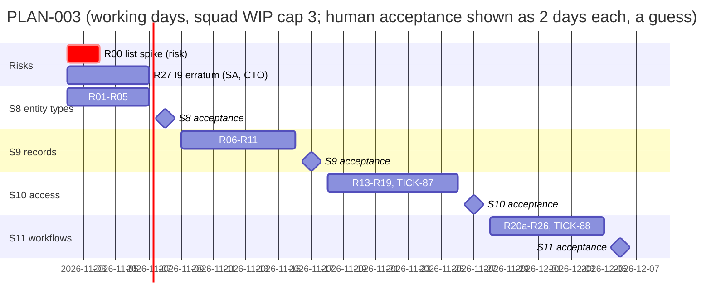

# PLAN-003: Records path (ADR-001 part 2)

## Summary

**What ships:** the part of Milestone 1 that PLAN-001 deferred (D-P1). A tenant admin publishes versioned entity types (Epic 04). Records are written through one pipeline with schema validation, defaults, numbering, optimistic concurrency and audit (Epic 05). ACL rules compile into the list query and agree with the single-record check, with field masks (Epic 06). The records API exposes all of it (Epic 07, records part). A versioned workflow definition runs on Temporal through a deterministic interpreter (Epic 09). The carry-forwards TICK-87 (rest of CI-8) and TICK-88 (rest of CI-10) close here.

**When PLAN-003 is done, every ADR-001 Annex B test is full** and Milestone 1's platform scope is code-complete.

**Order:** spike R00 (day 1, in parallel) → S8 entity types → S9 records and pipeline → S10 access rules → S11 workflows. 4 stories, 32 tasks: 30 implementation tasks (TICK-87 and TICK-88 among them), the spike R00 and the erratum request R27.

**The one risk that matters most:** the Epic 06 list target (p95 ≤ 150 ms at 800k records, one large tenant among many small). If it needs an expression index, ADR-001 D25 governance (operator-approved, audited DDL) becomes M1 work, and that is not small (CTO, TICK-83). **Spike R00 measures it on day 1**, against the exact table shape this plan pins, before any S10 code exists.

**Second risk, found while planning:** ADR-001 I9's cycle rule, as worded ("the origin seen again on the same record"), rejects Epic 09's own demo: creating an incident (origin O) starts a workflow that writes back to the same incident with origin O. **D-R12** asks the Solution Architect for an erratum, which the CTO rules on. It blocks only TICK-88, in the last story, so it has about four weeks.

**What nava needs to decide (besides APPROVED):** D-R1. The four stories are serial, because the owner's branching rule forbids two open stories touching the same file and S10 and S11 both edit `db/grants.yaml`, `api/errors.yaml` and the isolation registry. Splitting those three registries into per-story files first (one task, like merge-safety D4–D7) would let S10 and S11 run side by side and save about a week. I recommend staying serial; reply `CHANGES: parallel S10/S11` to get the split instead.

## Scope and the cut

| In PLAN-003 | ADR-001 source | Epic |
|---|---|---|
| Entity types as JSON Schema 2020-12, immutable versions, compatibility classification, seed templates | I8 (no DDL) | 04 (TICK-7) |
| Records table, numbering counter, one write pipeline, audit, history, comments, work notes, links | I4, I7, I8, I9 | 05 (TICK-8) |
| ACL rules → SQL and Go evaluator, agreement suite, field masks, explainer, list benchmark | I5, D25 trigger | 06 (TICK-9) |
| Record endpoints, ETag/`If-Match`, list/filter/sort/page, CI-2 forged-payload path, CI-8 rest | D6, I4, I5 | 07 (TICK-10), records part |
| Workflow definition format v1, interpreter, triggers, replay gate, idempotent activities, CI-10 rest | I6, I7, I9, D22 | 09 (TICK-12) |

**Cut, said out loud:**

| Cut | Why | Trigger to revisit |
|---|---|---|
| **ACL conditions on `data` fields.** M1 rule conditions reference fixed columns (`requester_id`, `assignee_id`, `assignment_group_id`, `state`) and explicit shares only (D-R3). | Fixed columns are indexed and have no schema-version defaults, so the defaults-versus-ACL disagreement (TICK-2 inconsistency 1) cannot arise in a rule, and the 150 ms target needs no expression index. The same disagreement **does** arise in list filters on `data` fields, and the agreement suite covers it there. Epic 06's AC "an ACL references a defaulted field" is met through filters and masks, not rule conditions. | A story that needs a rule on a `data` field. It then reuses the filter's field expression (D-R3). |
| **Sort on `data` fields.** Sort is on fixed columns plus `created_at` / `updated_at`. Filters on `data` fields are equality and `in` only, through one GIN index. | Range and sort on JSONB need expression indexes, which is D25 work. | R00 shows it is cheap, or a story needs it. Either way it goes through D25. |
| **Temporal Worker Versioning (build-id routing).** Interpreter changes use `workflow.GetVersion` plus the replay gate (D-R13). | Its APIs are not on the Authorizer allow-list; adding them is an ADR-001 amendment. The epic's AC (replay test catches a determinism break) is met without it. | The first interpreter change `GetVersion` cannot express, or the first production deploy with in-flight executions across a breaking worker change. |
| **Override for breaking schema changes.** A breaking publish is rejected (409), never forced. | Forcing needs a backfill job, which belongs with change sets (Epic 28). | Epic 28 planning. |
| **Record deletion, comment edit and delete.** | Not in any epic's scope. `records` has no `DELETE` policy today, and audit purge is D23. | A product story asks for it. |

**Never cut:** isolation (R02/R06/R13 RLS and grants, R19, TICK-87), determinism (R21, R24, R25), idempotency (R10, R23, R25), cascade bounds (TICK-88).

**ADR test coverage after PLAN-003:**

| ADR test | Before | PLAN-003 tasks | After |
|---|---|---|---|
| CI-1, CI-3, CI-4, CI-9 | full | R02, R06, R13, R20a register their tables (fail-closed discovery already catches a miss) | full |
| CI-2 | full | R10: forged-payload path asserts "refused or stored under tenant A only" (TICK-10 carry-forward, D-P10 sign-off) | full |
| CI-6, CI-7 | full | R21 (D9 policy entry), R22 (per-kind key allow-list, AR-041) | full |
| CI-8 | partial | R10 (404, 412 behaviour), R15 (masked filter 400), TICK-87 (registers all three) | **full** |
| CI-10 | partial | TICK-88 (audit row, cycle check, after D-R12) | **full** |
| CI-11 | full | none | full |

## Decisions this plan makes

| # | Decision |
|---|---|
| **D-R1** | **Stories are serial: S8 → S9 → S10 → S11.** Each needs the previous one's code, and S10 and S11 both edit the shared registries. Each story branch is created from `main` after the previous story merges. The spike R00 and the erratum request (R27) run outside the stories from day 1. *Offered to nava:* split the registries first and run S10 ‖ S11 (see Summary). |
| **D-R2** | **Spike R00 runs first and gates S10's shape.** It loads 800k records (one tenant with 400k, 400 tenants with 1k each) in the R06 table shape, and measures p95 of a list query with a compiled ACL predicate on fixed columns, a GIN equality filter on `data`, sort on a fixed column, keyset paging and a capped count. **Pass** (p95 ≤ 150 ms, no expression index): S10 proceeds as written. **Fail:** the Technical Lead escalates D25 to the Architecture squad that day; S8 and S9 continue; R16 and R18 wait for the ruling. Spike code is not merged; the report is posted on its issue and folded into this plan. |
| **D-R3** | **ACL rule conditions use fixed columns and explicit shares only** (cut above). `data`-field filters and masks go through one function, `records.FieldExpr(field, schemaVersions)`, which returns `COALESCE(data->'f', <default for the row's schema_version>)`. The SQL compiler and the Go evaluator both use the same per-version default table, so they cannot drift. |
| **D-R4** | **Fixed columns:** `number`, `state`, `title`, `requester_id`, `assignee_id`, `assignment_group_id`. A schema property maps to one with `"x-nava-column": "<name>"`. Everything else lives in `data jsonb`. |
| **D-R5** | **Tenant admin = member of the tenant's `tenant-admins` group.** Onboarding creates `/t/<tenant>/tenant-admins`, stores its id in `tenants.admin_group_id` and adds the invited admin. `authz.IsTenantAdmin(p)` checks `p.Groups` against that id. No new claim, no new role (I2: the group comes from group sync, under RLS). |
| **D-R6** | **Until S10 ships, record authorization is tenant-admin only.** S9's interim `authz` implementation allows tenant admins and gives everyone else the uniform 404. It fails closed; S10 replaces it behind the same interface. |
| **D-R7** | **JSON Schema library:** `github.com/santhosh-tekuri/jsonschema/v6` v6.0.3, promoted from indirect (kin-openapi already pulls it). Draft 2020-12 only. Remote `$ref` is refused by a loader that serves nothing (no network fetch, SSRF). `format` is asserted. R03 adds the `docs/pins.md` row. |
| **D-R8** | **Compatibility classes.** *Compatible:* add an optional property, add an enum value, widen a constraint, add a state or transition. *Needs backfill:* add a required property **with** a default (old rows read with the default; no rewrite). *Breaking:* remove or rename a property, change its type, add a required property without a default, narrow a constraint, remove a state that records hold, change a fixed-column mapping or the number prefix. Breaking → `409 schema_breaking_change` with the list of changes. |
| **D-R9** | **Numbering** uses `record_counters(tenant_id, entity_type_id, next)`, incremented by `UPDATE … RETURNING` in the write transaction. A rollback rolls the counter back, so there are no gaps from failed writes. Creates of one type in one tenant serialize on that row; R18 measures it. Format `<prefix><7 digits>`, for example `INC0001234`. |
| **D-R10** | **Updates are JSON merge patch (RFC 7396)** with a required `If-Match`. Missing → `428 precondition_required`. Stale → `412 version_conflict`. ETag is the strong `"<version>"`. Every pipeline writer passes `ExpectedVersion`, workflow activities included; they re-read and retry (G4). |
| **D-R11** | **Idempotency for system writers:** `record_audit` has `UNIQUE (tenant_id, idempotency_key)` where it is not null. A workflow activity writes with key `wf:<workflow id>:<step id>`; a replay finds the row and returns the earlier result. HTTP writes keep the existing `Idempotency-Key` middleware. |
| **D-R12** | **I9 cycle rule needs an erratum.** As worded it rejects a workflow writing back to the record that started it, which is Epic 09's demo. Proposed reading for the Solution Architect to write up and the CTO to rule on: a cycle is the same `(origin, record, trigger)` seen twice in one causation chain, where trigger is the workflow definition that fired. R27 asks for it; TICK-88 depends on R27. **Depth limit 8 (D-P7) is confirmed:** the demo uses depth 1. |
| **D-R13** | **One interpreter workflow type**, `nava.interpreter`, on task queue `nava-interpreter`, added to the D9 allow-list in one policy PR with Security review (AR-023's trigger "a type per definition" does not fire). The start payload carries `definition_version_id` and `record_id`, so an in-flight execution keeps its definition version. Interpreter code changes use `workflow.GetVersion`; the replay gate (R24) catches the ones that do not. |
| **D-R14** | **Workflow definition format v1:** JSON, `"format": "nava.workflow/v1"`, a DAG of steps keyed by id. Step types: `trigger` (on `record.created` / `record.updated` with a fixed-column condition), `condition`, `branch`, `timer`, `wait_for_signal`, `update_record`. The JSON Schema is `api/schemas/workflow-definition-v1.json`; it is additive within v1. This is the port the canvas (Epic 12) writes to. |
| **D-R15** | **Two outbox kinds in M1:** `interpreter` (start) and `record.changed` (signal to every open `interpreter` `workflow_ref` of the record, payload `{record_id, version}`). `wait_for_signal` waits for `record.changed` and checks its condition in an activity. `Enqueue` and the relay gain a per-kind payload key allow-list (AR-041 trigger). |
| **D-R16** | **Review standard:** D-P10 applies unchanged. R03 adds `internal/metadata/`, R07a `internal/records/`, R09 `internal/authz/` and R21 `internal/interpreter/` to the `security` list in `review-paths.yaml`. The agreement suite (R14b) gets Security and Postgres reviewers. The Technical Lead reviews Principal Software Engineer changes. |
| **D-R17** | **TICK-87 moves under S10** and registers the three CI-8 cases once the masked-field filter exists. R10 builds the 404 and 412 behaviour with unit tests; TICK-87 makes CI-8 full in the isolation report. |
| **D-R18** | **Carried triggers.** AR-042 (no panic values from data) and AR-044 (`navalint` check that only `internal/workerguard` uses the guard failure types) fire with the first feature workflow: R26. TODO-010 does not fire (no update handlers; signals only). TODO-013 does not fire: R21 must not set summaries or static details, and its review checks that. |

## Interface contracts (written before either side starts)

```go
// internal/metadata — R03 (model, classifier), R04 (endpoints)
type Definition struct {
    Key          string          // ^[a-z][a-z0-9_]{1,31}$, unique per tenant
    Version      int             // 1, 2, ...; immutable once published
    Schema       json.RawMessage // JSON Schema 2020-12, stored byte-identical
    NumberPrefix string          // ^[A-Z]{2,5}$
    States       StateModel
}
type StateModel struct { Initial string; Transitions map[string][]string }
type Class int // Compatible, NeedsBackfill, Breaking
func Classify(prev, next Definition) (Class, []Change, error)
type Store interface {
    Publish(ctx context.Context, tx pgx.Tx, d Definition) (int, error) // ErrInvalidSchema, ErrBreakingChange
    Get(ctx context.Context, tx pgx.Tx, key string, version int) (Definition, error) // version 0 = latest
    Defaults(ctx context.Context, tx pgx.Tx, entityTypeID uuid.UUID) (DefaultTable, error) // per schema_version, D-R3
}

// internal/authz — R09 (interface + interim), R14a (rules), R15 (masks), R17 (explainer)
type Op string // "read", "create", "update"
type Decision struct { Allowed bool; Rule string /* rule id, for the explainer */ }
type Authorizer interface {
    Check(ctx context.Context, tx pgx.Tx, p identity.Principal, op Op, r RecordFacts) (Decision, error)
    Predicate(ctx context.Context, tx pgx.Tx, p identity.Principal, op Op, entityTypeID uuid.UUID) (Predicate, error) // SQL fragment + args
    Mask(ctx context.Context, tx pgx.Tx, p identity.Principal, entityTypeID uuid.UUID) (Mask, error)
}
func IsTenantAdmin(ctx context.Context, tx pgx.Tx, p identity.Principal) (bool, error) // D-R5

// internal/records — R07a (pipeline), R07b (checks), R10/R16 (read paths), TICK-88 (cycle)
type Source string // "user", "rule", "workflow", "function", "ai", "system"
type Actor struct { Principal identity.Principal; Source Source; IdempotencyKey string /* system writers, D-R11 */ }
type Pipeline interface { // the only writer of records, record_audit, record_comments, record_links
    Create(ctx context.Context, tx pgx.Tx, a Actor, in CreateInput) (Record, error)
    Update(ctx context.Context, tx pgx.Tx, a Actor, in UpdateInput) (Record, error) // in.ExpectedVersion required
    AddComment(ctx context.Context, tx pgx.Tx, a Actor, in CommentInput) (Comment, error) // Visibility: public | internal
    Link(ctx context.Context, tx pgx.Tx, a Actor, in LinkInput) error
}
type EventSink interface { RecordChanged(ctx context.Context, tx pgx.Tx, ev Event) error } // in-transaction; S11 implements
// Errors: ErrNotFound (uniform: other tenant, unreadable, missing), ErrVersionConflict, *ValidationError{Fields},
// ErrStateTransition, ErrUniqueViolation, ErrForbiddenField, outbox.ErrCascadeTooDeep, ErrCascadeCycle (TICK-88).
```

**Tables (R02, R06, R13, R20a).** Every table is a tenant table: `tenant_id` first in every key and index, `ENABLE` + `FORCE` RLS, one policy per command `TO nava_app, nava_worker`, grants in `db/grants.yaml` in the same migration, no `DELETE` grant. Timestamp migration versions (merge-safety D3).
- `entity_types(tenant_id, id, key, latest_version)`, `entity_type_versions(tenant_id, entity_type_id, version, schema, number_prefix, states, class, published_by, published_at)`; `UNIQUE (tenant_id, key)`.
- `records` gains `entity_type_id, schema_version, number, state, title, requester_id, assignee_id, assignment_group_id, data jsonb, created_at, created_by, updated_at, updated_by, causation_origin, causation_depth`; `UNIQUE (tenant_id, entity_type_id, number)`; indexes per R00's result; one GIN `(data jsonb_path_ops)`. Existing rows (demo and test only) stay valid: new columns are nullable for them, `NOT NULL` is enforced by a `CHECK … NOT VALID` on new rows.
- `record_counters`, `record_audit(tenant_id, id, record_id, version, actor_id, source, op, changes, causation_origin, causation_depth, idempotency_key, created_at)`, `record_comments`, `record_links`.
- `acl_versions(tenant_id, entity_type_id, version, rules, masks, published_by, published_at)`, `record_shares(tenant_id, record_id, principal_id | group_id)`.
- `workflow_definitions`, `workflow_definition_versions(…, definition jsonb, …)`.

**HTTP (R04, R10, R11, R16, R17, R20b).** All under `/api/v1`, one `api/paths/<area>.yaml` per area, every route registered with the isolation suite.

| Route | Who | Notes |
|---|---|---|
| `GET /entity-types`, `GET /entity-types/{key}`, `GET /entity-types/{key}/versions/{version}` | any tenant principal | schema returned byte-identical |
| `POST /entity-types/{key}/versions` | tenant admin | 201 + version; 409 `schema_breaking_change`; 422 `invalid_schema` |
| `POST /records/{type}`, `GET /records/{type}` | per ACL | list: `filter[<field>]=`, `sort=`, `cursor=`, `limit=`; 400 `masked_field` |
| `GET /records/{type}/{id}`, `PATCH /records/{type}/{id}` | per ACL | ETag; 428 / 412 (D-R10); uniform 404 |
| `GET /records/{type}/{id}/history`, `…/comments` (GET, POST), `…/links` (GET, POST) | per ACL | work notes = `visibility: internal` |
| `GET`, `PUT /entity-types/{key}/access` | tenant admin | rules + masks, versioned |
| `GET /access/explain?record=&principal=` | tenant admin | own tenant only; never shows a field the admin cannot read |
| `POST /workflow-definitions/{key}/versions`, `GET /workflow-definitions/{key}` | tenant admin | v1 format, D-R14 |

New error codes in `api/errors.yaml`: `schema_breaking_change`, `invalid_schema`, `precondition_required`, `version_conflict`, `state_transition_invalid`, `unique_violation`, `masked_field`, `forbidden_field`, `forbidden` (admin endpoints only), `workflow_definition_invalid`.

**Temporal (R21–R23).** Workflow id stays `t:<tenant>:<target_key>` with `target_key = interpreter:<outbox id>`, built by the relay. Activities: `LoadDefinition`, `EvaluateCondition`, `UpdateRecord` (pipeline, `Source=workflow`, key `wf:<workflow id>:<step id>`), `CloseWorkflowRef`. All I/O in activities; timers are `workflow.NewTimer`; no summaries (TODO-013).

## Task graph

```mermaid
flowchart LR
  R00[R00 spike: 800k list p95]:::risk
  R27[R27 erratum: I9 cycle rule]:::risk
  subgraph S8[S8 Epic 04: entity types]
    R01[R01 tenant-admins group]
    R02[R02 entity type tables]
    R03[R03 metadata model + classifier]
    R04[R04 entity type endpoints]
    R05[R05 seed templates]
    R02-->R03-->R04
    R01-->R04
    R03-->R05
    R01-->R05
  end
  subgraph S9[S9 Epic 05 + 07: records]
    R06[R06 records tables]
    R07a[R07a pipeline core]
    R07b[R07b uniqueness + state checks]
    R08[R08 single-writer static test]
    R09[R09 authz interface + interim]
    R10[R10 record endpoints, ETag, CI-2 path]
    R11[R11 comments, notes, links]
    R06-->R07a
    R09-->R07a
    R07a-->R07b
    R07a-->R08
    R07a-->R10
    R07b-->R10
    R10-->R11
  end
  subgraph S10[S10 Epic 06: access rules]
    R13[R13 ACL + share tables]
    R14a[R14a rule compiler + evaluator]
    R14b[R14b agreement suite]
    R15[R15 field masks]
    R16[R16 list query]
    R17[R17 ACL admin + explainer]
    R18[R18 perf: 150 ms list, 50 ms read]
    R19[R19 access isolation attacks]
    T87[TICK-87 CI-8 full]
    R13-->R14a-->R14b
    R14a-->R15
    R14a-->R16
    R15-->R16
    R14a-->R17
    R15-->R17
    R16-->R18
    R16-->R19
    R17-->R19
    R15-->T87
    R16-->T87
  end
  subgraph S11[S11 Epic 09: workflows]
    R20a[R20a workflow definition tables]
    R20b[R20b format v1 + publish]
    R21[R21 interpreter + D9 policy]:::risk
    R22[R22 triggers + outbox kinds]
    R23[R23 activities, idempotent writes]
    R24[R24 replay gate]
    R25[R25 version + crash tests]
    R26[R26 AR-042 / AR-044 checks]
    T88[TICK-88 CI-10 full]
    R20a-->R20b-->R21
    R20b-->R22
    R21-->R23
    R22-->R23
    R21-->R24
    R23-->R25
    R24-->R25
    R21-->R26
    R22-->T88
    R23-->T88
  end
  R04-->R06
  R00-->R16
  R11-->R13
  R27-->T88
  R19-->R20a
  classDef risk fill:#7f1d1d,color:#fff
```



Edges between stories stand for "story merged into `main`" (D-R1): R06 starts when S8 is on `main`, R13 when S9 is, R20a when S10 is.

**Critical path:** R02 → R03 → R04 → *S8 accepted* → R06 → R07a → R07b → R10 → R11 → *S9 accepted* → R13 → R14a → R15 → R16 → R19 → *S10 accepted* → R20a → R20b → R21 → R23 → R25 → *S11 accepted*. 17 tasks plus four human acceptances. R00 must report before R16 starts (about week 3); R27 must close before TICK-88 (about week 5).

## Sequence



**Estimates:** each task 0.5–1.5 agent-days; total 30–42 agent-days; **6–8 calendar weeks** with WIP 3 and serial stories. *Assumptions:* the PLAN-001 helpers (`InTenantTx`, `outbox.Enqueue`, idempotency middleware, isolation registry) take the new tables and routes without harness changes, and each human acceptance takes about 2 working days. *Guesses:* R14a (the compiler could be 2× if shares and groups need a different join shape than R00 measured), R21 (the D9 policy PR needs an image rebuild and the CI-6 suite re-run), and every acceptance wait.

## Stories and tasks

| Story | Epic | Tasks | The human tries it by |
|---|---|---|---|
| **S8** A tenant admin publishes an entity type and its versions | 04 | R01–R05 | as `admin@tenant-a.test`: `POST /api/v1/entity-types/incident/versions` twice, read both back, try a breaking change; as `bob@tenant-b.test`, fail to see them |
| **S9** An admin creates, updates and reads the history of an incident | 05, 07 | R06–R11 | as `admin@tenant-a.test`: create an incident (gets `INC0000001`), update with a stale `If-Match` (412), add a comment and a work note, read `/history`; as `alice@tenant-a.test`, get 404 (interim, D-R6) |
| **S10** Agents see only the records their access rules allow | 06, 07 | R13–R19, TICK-87 | as the admin, set "assignment group in my groups" plus a mask on `cost`; as `alice` (in `/service-desk`), list and see only her group's incidents and no `cost`; filter on `cost` → 400; ask the explainer why |
| **S11** Creating an incident starts a workflow that changes it a minute later | 09 | R20a–R26, TICK-88 | as the admin, publish a workflow "on create, wait 1 minute, set state to `in_progress`"; create an incident; see the change in `/history` with source `workflow`; publish v2 while v1 waits, and see v1 finish on v1 |

**Expected files per story** (checked for overlap before each story starts; D-R1 makes them serial anyway):

| Story | Packages and files |
|---|---|
| S8 | `internal/metadata/`, `internal/onboard/` (admin group, seeds), `internal/identity/` (`IsTenantAdmin` helper only if needed), `api/paths/entity-types.yaml`, `internal/server/entity_types.go`, migrations, `db/grants.yaml`, `api/errors.yaml`, isolation registry, `docs/pins.md` |
| S9 | `internal/records/`, `internal/authz/` (interface + interim), `api/paths/records.yaml`, `internal/server/records*.go`, `tools/navalint/` (R08), migrations, `db/grants.yaml`, `api/errors.yaml`, isolation registry, `cmd/nava-core/records.go` |
| S10 | `internal/authz/`, `internal/records/list.go`, `internal/records/mask*.go`, `api/paths/access.yaml`, `internal/server/access.go`, `bench/records-list/`, migrations, `db/grants.yaml`, `api/errors.yaml`, isolation registry |
| S11 | `internal/interpreter/`, `internal/records/events.go` (the `EventSink`), `cmd/nava-worker/`, `temporal-server/authz/policy.go` + golden, `internal/outbox/` (kind allow-list), `internal/relay/`, `api/schemas/workflow-definition-v1.json`, `api/paths/workflow-definitions.yaml`, `tools/navalint/` (R26), migrations, `db/grants.yaml`, `api/errors.yaml`, isolation registry |

**Multica issues** are listed on TICK-332 once created (stories under their epics, tasks under their stories, all `backlog`).

| Task | Role | Outcome |
|---|---|---|
| R00 | postgres-dev | Report: p95 of the D-R2 list query at 800k records, with the index set that achieves it, or the measured gap |
| R01 | backend-dev | Onboarding creates `tenant-admins`, sets `tenants.admin_group_id`, adds the admin; `IsTenantAdmin` true for them, false for others; dev seed makes `admin@tenant-a.test` an admin |
| R02 | postgres-dev | `entity_types` and `entity_type_versions` exist with RLS, grants and isolation registration |
| R03 | core-dev | `metadata.Classify` and `Store.Publish` per D-R7/D-R8; schema stored byte-identical; no DDL on publish |
| R04 | backend-dev | The four entity-type routes, admin-gated publish, no-DDL test, isolation registration |
| R05 | backend-dev | Onboarding publishes `incident` (INC), `request` (REQ), `change` (CHG) v1 |
| R06 | postgres-dev | `records` extended, `record_counters`, `record_audit`, `record_comments`, `record_links`, with indexes from R00 |
| R07a | core-dev | `records.Pipeline` Create/Update: authorize → defaults → schema → commit + audit + counter, one transaction; stale version → `ErrVersionConflict` |
| R07b | core-dev | Uniqueness and state-transition checks with typed errors, nothing committed on failure |
| R08 | qa | A `navalint` check fails the build when any package other than `internal/records` writes the record tables |
| R09 | core-dev | `authz.Authorizer` interface and the interim admin-only implementation (D-R6) |
| R10 | backend-dev | Create, read (ETag), patch (`If-Match`, 428/412), history; uniform 404; CI-2 forged-payload path changed (D-P10 sign-off) |
| R11 | backend-dev | Comments, work notes and links through the pipeline, each audited |
| R13 | postgres-dev | `acl_versions` and `record_shares` with RLS, grants, isolation registration |
| R14a | core-dev | Rule model, SQL compiler and Go evaluator for read/create/update; tenant-scoped group and user references |
| R14b | qa | Randomized agreement suite: SQL list and Go check agree on every record, including null, absent, defaulted and type-changed fields |
| R15 | core-dev | Masks on write (`forbidden_field`) and read (one shaping layer); filter, sort, count and aggregate on a masked field → 400 |
| R16 | backend-dev | `GET /records/{type}`: filter, sort, keyset cursor, count under ACL; 10k paging with concurrent inserts, no duplicates or gaps |
| R17 | backend-dev | ACL admin routes and the explainer, admin-only, own tenant, mask-respecting |
| R18 | qa | Perf job or documented run: list p95 ≤ 150 ms at 800k, single read p95 ≤ 50 ms, create throughput per type |
| R19 | security | Attacks: foreign group id in a rule grants nothing; 404 oracle; mask oracle by filter, sort, count; explainer cross-tenant |
| TICK-87 | security | CI-8 byte-identical 404, 412 and masked-filter 400 registered; report shows CI-8 full |
| R20a | postgres-dev | `workflow_definitions` and versions tables with RLS, grants, isolation registration |
| R20b | core-dev | v1 format JSON Schema, DAG validation (no cycles, reachable steps), publish route |
| R21 | core-dev | `nava.interpreter` workflow executing all six step types deterministically; D9 policy entry |
| R22 | core-dev | Pipeline `EventSink` enqueues `interpreter` starts and `record.changed` signals; per-kind key allow-list in `Enqueue` and the relay |
| R23 | backend-dev | Activities; `UpdateRecord` via the pipeline with D-R11 keys; `CloseWorkflowRef` |
| R24 | qa | CI replay gate over recorded histories in `testdata`; a deliberate determinism break turns it red |
| R25 | qa | v2 published while v1 waits on a timer → v1 completes on v1; worker crash mid-activity → side effect applied once |
| R26 | backend-dev | `navalint` check for AR-044; review rule for AR-042 written into `review-standard-core.md` |
| TICK-88 | core-dev | `ErrCascadeCycle` per R27's ruling; one audit row per rejected cascade; report shows CI-10 full |
| R27 | Solution Architect | ADR-001 erratum (md + html under `docs/adr/`) defining the I9 cycle (D-R12), ruled by the CTO, signed by nava |

**Released first on APPROVED** (`Depends on: none`): R00, R01, R02 and R27.

## Residuals and carried items

| Item | Where this plan handles it |
|---|---|
| R1 histories unencrypted | D-R15: payloads stay references; R22 adds the per-kind allow-list |
| R8 worker certificate reach | R23: activities use `InTenantTx` only; R26 |
| R9 head-of-line blocking | R22: `record.changed` signals queue per target; R25 includes a signal behind a long timer |
| AR-023 a policy PR per workflow type | D-R13: one type for every definition |
| AR-041 per-kind payload keys | R22 |
| AR-042, AR-044 | R26 |
| TODO-010, TODO-013 | Not triggered (D-R18) |

## Grooming record

Pending: grooming meeting on this plan (participants: CTO, Principal Software Engineer, Senior Software Engineer, Postgres & Data Modeling Specialist, Quality, Testing & CI Advisor, Security & Multi-Tenancy Reviewer, Technical Architect).

## Open items

| Item | Owner |
|---|---|
| Grooming round 1, fold outcome into the tasks | Technical Lead |
| nava: APPROVED / CHANGES, and the D-R1 serial-versus-parallel choice | nava |
| I9 cycle erratum (R27) | Solution Architect; CTO rules |
| R00 result folded into R06 and R16 | Technical Lead |
