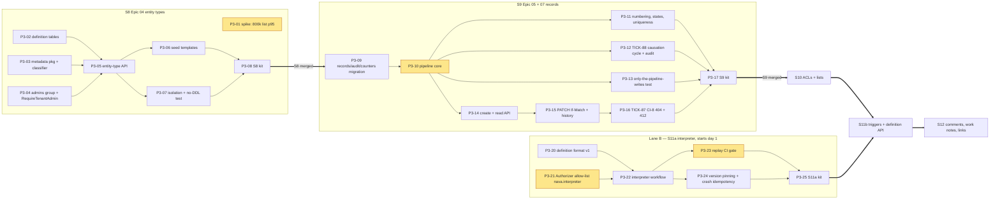
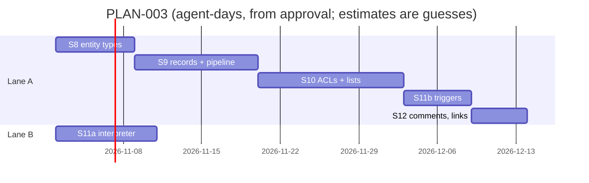

# PLAN-003: Records path (ADR-001, Milestone 1 completion)

## Summary

**What ships:** the rest of Milestone 1 that PLAN-001 deferred (D-P1):
- **Epic 04:** versioned entity types.
- **Epic 05:** the one write pipeline with audit, numbering and causation.
- **Epic 06:** ACLs compiled to SQL, plus field masks.
- **Epic 07:** the record endpoints.
- **Epic 09:** the deterministic workflow interpreter.

When it is done, a seeded agent can drive an incident through its whole life over the API, a workflow reacts to it, and every ADR-001 acceptance test (CI-1 to CI-11) is **full**. Today CI-8 and CI-10 are partial.

**Order:** two lanes.
- **Lane A (records):** S8 entity types → S9 records and pipeline → S10 ACLs and lists → S11b workflow triggers → S12 comments and links.
- **Lane B (interpreter):** S11a starts on day 1, in parallel with S8. It touches none of lane A's files.

**The one risk that matters most:** Epic 06's agreement between the SQL-compiled list and the Go single-record check (I5), on rows written under older schema versions with defaulted fields. If they disagree, a role sees records it should not, or loses records it should see. The second risk is the 150 ms list target (ADR-001 D25). If it needs an expression index, D25 governance enters Milestone 1. So the measurement runs **first** (P3-01), on synthetic data, before any records code exists.

**Repository:** `Navaladi2019/TicketingSystem`. Story branches follow `docs/delivery/branching-strategy.md`.

## Scope and the cut

| In PLAN-003 | ADR-001 source | Epic | Story |
|---|---|---|---|
| Entity types: JSON Schema 2020-12, immutable versions, compatibility classification, seed templates, no DDL | I8, I1 | 04 (TICK-7) | S8 |
| Write pipeline, records, per-tenant numbering, state model, audit in the same transaction, optimistic concurrency, causation cycle check | I4, I8, I9 | 05 (TICK-8) | S9 |
| Record create, read, update and history endpoints, ETag/`If-Match`, byte-identical 404 | D6, I4, I5, I7 | 07 (TICK-10) | S9 |
| ACL rules compiled to SQL, Go evaluator, agreement suite, field masks, list/filter/sort/page, explainer, 150 ms and 50 ms measurements | I5, D25 | 06 (TICK-9), 07 list | S10 |
| Workflow definition format, interpreter, replay gate, definition pinning, idempotent activities | I6, I7, D22 | 09 (TICK-12) | S11a, S11b |
| Comments (public), work notes (internal), links between records | I4, I5 | 05, 07 | S12 |
| Carry-forwards: rest of CI-8 (TICK-87), rest of CI-10 (TICK-88) | Annex B | — | S9, S10 |

**Cut, said out loud:**
- **Tasks for S10, S11b and S12 are listed below but not created as issues yet.** All three build on S9's code (records shape, pipeline). Grooming them now would produce tasks that get rewritten, which is the reasoning behind PLAN-001 D-P1. *Trigger:* S9's story PR merges into `main`. *Owner:* Technical Lead. Their stories exist now so the order is visible.
- **No GraphQL, search, exports, calculated fields or custom functions.** These are Epics 10, 15, 23 and 24, as the epics already say.
- **D25 indexed-attribute governance is out of PLAN-003, unless P3-01 says otherwise.** *Trigger:* P3-01 measures p95 > 150 ms for an ACL-shaped list on fixed-column predicates. In that case the Technical Lead escalates to the CTO before S10 is groomed, and does not quietly cut the target.
- Isolation, determinism and idempotency work is **not** cut. Coverage:

| ADR test | Tasks | Status after PLAN-003 |
|---|---|---|
| CI-8 | P3-16 / TICK-87 (byte-identical 404, 412), P3-36 (masked-field filter → 400) | full |
| CI-10 | P3-12 / TICK-88 (cycle, audit row for a rejected cascade, depth limit confirmed) | full |
| CI-1, CI-4 | P3-02, P3-09 and every new-table task: RLS and `FORCE`, grants from the manifest, no allow-list entry | stays full |
| CI-2 | P3-07, P3-14 (forged-payload path on `POST /records`), P3-36 | stays full |
| CI-6, CI-7 | P3-21 (allow-list), P3-22 (references-only interpreter payloads) | stays full |

## Decisions this plan makes

| # | Decision |
|---|---|
| **D-3-1** | **Two lanes, five stories plus one split story.** Lane A is serial, because every story in it changes `api/openapi.yaml`, the generated `api/api.gen.go`, `db/grants.yaml` and the isolation registry. The story-independence rule forbids running those stories in parallel, and generated code cannot be union-merged. Lane B (S11a) touches only `internal/workflow/`, `temporal-server/` policy and `cmd/nava-worker`, so it runs alongside lane A. |
| **D-3-2** | **ACL-relevant attributes are fixed columns on `records`:** `number`, `state`, `requester_id`, `assignee_id`, `assignment_group_id`, `created_by`, `created_at`, `updated_at`. Tenant-defined fields live in `data jsonb`. The entity type's mapping says which schema property maps to which fixed column. *Why:* the common ACL predicates ("requester is me", "assignment group in my groups") then hit B-tree indexes led by `tenant_id` without any expression index, so D25 is avoided by design. P3-01 checks this. |
| **D-3-3** | **Tenant admin = member of the tenant's `admins` platform group.** Onboarding creates the group and puts the first admin in it. Group sync keeps it current. Handlers check it only through `authz.RequireTenantAdmin(Principal)`. The Keycloak realm role `tenant-admin` is installation-wide and would mean reading a Keycloak claim outside the adapter (CI-11), so it is not used. This holds until Epic 06's rules can express admin rights. *Flagged for the Technical Architect in grooming:* if they object, it becomes a short RFC that gates only P3-04 and P3-05. |
| **D-3-4** | **Entity type and workflow definition versions are immutable rows.** `nava_app` has `INSERT` and `SELECT` on the version tables, and no `UPDATE` or `DELETE`. The grants enforce immutability, and CI-4 tests it. Publishing writes version N+1 and moves `current_version` in the same transaction. |
| **D-3-5** | **Compatibility classes:** `compatible` (adds optional fields, adds a default, widens an enum) publishes. `needs_backfill` (adds a required field that has a default) publishes, and old rows read with the default (I4 defaults-on-read). `breaking` (type change, narrowing, removing a required field, changing a fixed-column mapping) is rejected with `422 schema_breaking_change` and the list of offending paths. Backfill jobs are not in Milestone 1. |
| **D-3-6** | **Every record write goes through one pipeline function.** The signature is `pipeline.Write(ctx, tx, Command)`. An architecture test fails if any other package issues `INSERT`, `UPDATE` or `DELETE` on `records`, `audit_log`, `record_counters`, `comments` or `record_links` (P3-13). The authorise stage is an interface. S9 ships a stub ("tenant member may write"), and S10 replaces it with `authz` without changing the signature. |
| **D-3-7** | **A rejected cascade is audited in its own transaction.** The rejected write rolls back. The pipeline then opens a new `InTenantTx` that writes only one `audit_log` row (`action = cascade_rejected`, with the causation details). This is how "rejected with a typed error and an audit entry" (I9) and "nothing else written" (TICK-88) both hold. |
| **D-3-8** | **The cascade depth limit stays at 8** (D-P7 confirmed). It is platform configuration. P3-12 tests it at 8 and at 9. |
| **D-3-9** | **Numbering uses a counter table, not sequences (I8).** `UPDATE record_counters … RETURNING` runs in the write transaction. A rollback returns the number, so there are no gaps from rollbacks. Two concurrent creates serialise on one row per (tenant, entity type). That is acceptable at Milestone 1 load. *Trigger to revisit:* create p95 > 50 ms in the P3-35 benchmark. |
| **D-3-10** | **Every update carries `If-Match`.** A missing `If-Match` gets `428 if_match_required`, and a stale one gets `412 version_conflict` (D6, I4). The ETag is `W/"<version>"`. |
| **D-3-11** | **One workflow type for every definition: `nava.interpreter`.** The definition is data that the interpreter loads by `(definition_id, version)` through an activity, so one policy PR adds the type once (P3-21). The A1 RS5 trigger ("Epic 09 needing a type per definition") is **not** hit. Recorded for the A1 owner. |
| **D-3-12** | **The definition version is pinned at start.** The relay starts `nava.interpreter` with a reference payload `{definition_id, version, record_id}` (references only, CI-7). The workflow never reads "latest". A v2 publish cannot change a running v1. Interpreter code changes are guarded by worker build-id versioning plus a replay test over recorded histories in `internal/workflow/testdata/histories/` (P3-23). |
| **D-3-13** | **Workflow writes go through the pipeline as a system actor.** `source = workflow`, the causation comes from the triggering outbox row, and the idempotency key is `(workflow_id, step_id)`. So a replayed activity re-runs the pipeline and gets the stored result, not a second write (I7). |
| **D-3-14** | **Review standard as D-P10.** New security paths are added to `docs/delivery/review-paths.yaml` by the task that creates them: `internal/records/pipeline/`, `internal/authz/`, `internal/workflow/`, and the `temporal-server/` policy. Principal Software Engineer (`core-dev`) changes are reviewed by the Technical Lead, plus the Security & Multi-Tenancy Reviewer on those paths. |

## Interface contracts (written before either side starts)

```go
// internal/metadata — P3-03 (pure Go), stored by P3-02, served by P3-05
type Definition struct {
    Key          string          // "incident"; ^[a-z][a-z0-9_]{1,40}$
    Schema       json.RawMessage // JSON Schema 2020-12; stored byte-identical
    NumberPrefix string          // "INC"; ^[A-Z]{2,6}$
    FixedColumns map[string]string // schema property -> fixed column (D-3-2)
    States       StateModel      // {initial, states[], transitions[{from,to}]}
}
type Compat int // Compatible, NeedsBackfill, Breaking
func Compile(d Definition) (*Compiled, error)                    // ErrInvalidDefinition with paths
func Classify(prev, next *Compiled) (Compat, []string, error)    // offending JSON paths for Breaking
func (c *Compiled) ApplyDefaults(data map[string]any) map[string]any // fills missing only, never overwrites

// internal/records/pipeline — P3-10, P3-11, P3-12
type Source string // user | rule | workflow | function | ai
type Command struct {
    Op              Op // Create | Update
    EntityKey       string
    RecordID        uuid.UUID  // Update only
    ExpectedVersion int64      // Update only; stale → ErrVersionConflict
    Data            map[string]any
    Actor           identity.Principal
    Source          Source
    Causation       outbox.Causation
}
type Result struct { RecordID uuid.UUID; Number string; Version int64; SchemaVersion int }
func Write(ctx context.Context, tx pgx.Tx, cmd Command) (Result, error)
// Errors: ErrValidation (field errors), ErrVersionConflict, ErrIllegalTransition,
// ErrUniqueViolation, ErrForbidden, outbox.ErrCascadeTooDeep, outbox.ErrCascadeCycle.
type Authorizer interface { // S9 stub, S10 authz
    CanWrite(ctx context.Context, p identity.Principal, entity string, before, after map[string]any) error
}
```

- **Tables (P3-02, P3-09)**, all with `tenant_id` first, RLS and `FORCE`, and FKs that include `tenant_id`:
  - `entity_definitions(tenant_id, id, key, current_version)`
  - `entity_definition_versions(tenant_id, definition_id, version, schema, schema_sha256, number_prefix, fixed_columns, states, compat, published_by, published_at)`
  - `records` gains `entity_definition_id`, `schema_version`, `number`, `state`, the D-3-2 fixed columns, `data jsonb`, `causation_origin_id` and `causation_depth`
  - `record_counters(tenant_id, entity_definition_id, next)`
  - `audit_log(tenant_id, id, record_id, action, actor_id, source, before, after, causation_origin_id, causation_depth, at)`, `INSERT` and `SELECT` only
- **Endpoints**, all `/api/v1`, all mounted `authn → ratelimit → idempotency` for writes (R2 tripwire):

| Method | Path | Notes |
|---|---|---|
| GET, POST | `/entity-types` | POST is admin only |
| GET | `/entity-types/{key}` | |
| POST | `/entity-types/{key}/versions` | Publish: 201 + `version`; `422 schema_breaking_change`. Admin only. |
| GET | `/entity-types/{key}/versions/{n}` | Byte-identical schema |
| POST | `/records/{entity}` | 201, `ETag`, `Location` |
| GET | `/records/{entity}/{id}` | `ETag`; defaults applied on read |
| PATCH | `/records/{entity}/{id}` | `If-Match` required (D-3-10) |
| GET | `/records/{entity}/{id}/history` | Audit rows, cursor-paged |
| GET | `/records/{entity}` | S10: filter, sort, cursor, `total` |

- **New error codes** (`api/errors.yaml`): `schema_breaking_change`, `invalid_definition`, `version_conflict`, `if_match_required`, `illegal_transition`, `unique_violation`, `cascade_too_deep`, `cascade_cycle`, `masked_field` (S10), `field_not_writable` (S10).
- **Workflow definition v1 (P3-20):** JSON, validated by `internal/workflow/def/schema.json`:
  - `trigger`: `{on: record.created | record.updated, entity}`
  - `steps[]`, each with a unique `id` and a `type`. The types are `condition`, `branch`, `timer` (ISO-8601 duration), `wait_signal` (name, timeout) and `update_record` (`set` map).
  - `next` edges. The graph must be acyclic. This is the port the Epic 12 canvas will write to.

## Task graph



**Critical path:** P3-01 (spike) and S8 → S9 (P3-09 → P3-10 → P3-14 → P3-15) → S10 (compiler and agreement suite) → S11b → S12. Lane B finishes well before S11b needs it.



**Estimates** are in calendar days with the squad at three tasks in progress, and they include acceptance. They are guesses anchored on PLAN-001 (S2 to S7 took 1.5 to 2.5 weeks each):

| Story | Estimate |
|---|---|
| S8 | 5–8 |
| S9 | 9–13 |
| S10 | 10–15 |
| S11a | 6–10 |
| S11b | 5–8 |
| S12 | 4–6 |

Lane A totals **about 7–9 weeks**. The biggest uncertainty is S10's agreement suite.

## Stories and tasks

Roles: `core-dev` (Principal Software Engineer), `backend-dev` (Senior Software Engineer), `postgres-dev`, `qa`, `security`.

### S8 — A tenant admin publishes an incident type and reads every version (Epic 04)

**Acceptance (the human):**
- As `admin@tenant-a`, publish a change to `incident` with Bruno and get version 2.
- Read version 1 and version 2 back byte-identical.
- A type change on a field is refused with `schema_breaking_change` and names the field.
- `agent@tenant-b` cannot see tenant A's types.

**Files:**
- `db/migrations/<ts>_entity_definitions.sql`, `db/grants.yaml`
- `internal/metadata/`, `internal/authz/admin.go`, `internal/onboard/` (seed templates, `admins` group)
- `api/paths/entity-types.yaml`, `api/openapi.yaml` (refs), `api/api.gen.go`, `internal/server/entitytypes.go`
- `internal/tenancy/isolation/entitytype_paths.go`, plus one line in `registry.go`
- `bench/records-list/`, `docs/data/records-list-bench.md`, the Bruno collection

| Task | Role | Depends on | Outcome |
|---|---|---|---|
| P3-01 | `postgres-dev` | none | Spike, which runs first. The D25 question is answered with numbers: p95 of the ACL-shaped list at 800k rows (one tenant with 400k, 399 small), with and without a JSONB expression index. |
| P3-02 | `postgres-dev` | none | The definition tables exist with RLS, `FORCE`, manifest grants and immutable versions (D-3-4). |
| P3-03 | `core-dev` | none | `internal/metadata` compiles definitions and classifies compatibility (D-3-5). |
| P3-04 | `backend-dev` | none | The `admins` group is seeded at onboarding, and `RequireTenantAdmin` exists (D-3-3). |
| P3-05 | `backend-dev` | P3-02, P3-03, P3-04 | The entity-type endpoints publish N+1 and read versions byte-identical. |
| P3-06 | `backend-dev` | P3-05 | A new tenant gets `incident`, `request` and `change` at version 1, idempotently. |
| P3-07 | `security` | P3-05 | Entity-type routes are in the isolation suite. A publish changes no catalogue object (no-DDL test). |
| P3-08 | `qa` | P3-06, P3-07 | The S8 acceptance kit, verified on a fresh stack. |

### S9 — An agent logs an incident, updates it, sees its history, and a stale update is refused (Epics 05, 07)

**Acceptance (the human):**
- As `agent@tenant-a`, create an incident and get `INC0000001` with an ETag.
- Update it with that ETag.
- Update again with the old ETag and get `412 version_conflict`.
- Open the history and see two audit rows naming the agent and `source=user`.
- A create missing a required field returns field errors and creates nothing.

**Files:**
- `db/migrations/<ts>_records_pipeline.sql`, `db/grants.yaml`
- `internal/records/` (`pipeline/`, `store/`)
- `internal/outbox/` (cycle check only)
- `api/paths/records.yaml`, `api/openapi.yaml`, `api/api.gen.go`, `api/errors.yaml`, `internal/server/records.go`
- `internal/tenancy/isolation/records_paths.go`, plus `registry.go` (the CI-2 forged-payload path)
- `docs/delivery/review-paths.yaml`, the Bruno collection

| Task | Role | Depends on | Outcome |
|---|---|---|---|
| P3-09 | `postgres-dev` | S8 merged | `records` extended additively. `audit_log` and `record_counters` exist with RLS, `FORCE` and grants. `audit_log` is append-only. |
| P3-10 | `core-dev` | P3-09 | `pipeline.Write` runs authorise (stub), defaults, schema, commit with version check, audit and outbox event, all in one transaction. A kill mid-write leaves neither the record nor the audit row. Of two concurrent updates, exactly one wins. |
| P3-11 | `core-dev` | P3-10 | Counter-table numbering (D-3-9), state transitions from the state model, uniqueness checks. |
| P3-12 = TICK-88 | `core-dev` | P3-10 | `ErrCascadeCycle`, plus an audit row for a rejected cascade in its own transaction (D-3-7). Depth 8 confirmed (D-3-8). CI-10 is full. |
| P3-13 | `qa` | P3-10 | An architecture test fails when any package other than `internal/records/pipeline` writes the record tables. |
| P3-14 | `backend-dev` | P3-10 | `POST` and `GET /records/{entity}[/{id}]`: idempotent create, ETag, defaults on read, byte-identical 404. The CI-2 forged-payload path is tightened (Epic 07 carry-forward, CTO D-P10 sign-off). |
| P3-15 | `backend-dev` | P3-14 | `PATCH` with `If-Match` (428/412) and `GET …/history`. |
| P3-16 = TICK-87 (part) | `security` | P3-15 | CI-8 cases: byte-identical 404 (other tenant and missing) and stale `If-Match` → 412, registered as `CI-8`. |
| P3-17 | `qa` | P3-11, P3-12, P3-13, P3-16 | The S9 acceptance kit, verified on a fresh stack. |

### S10 — A service-desk agent sees only their group's incidents, and masked fields never leak (Epic 06, Epic 07 list)

Tasks are created when S9 merges.

**Acceptance (the human):**
- `agent@tenant-a` in `/service-desk` lists incidents and sees only those assigned to the group, with a matching `total`.
- Opening a record outside the group returns the same 404 as a missing id.
- Filtering on a masked field returns `400 masked_field`.
- The admin explainer names the rule that granted access.

| Task | Role | Outcome |
|---|---|---|
| P3-30 | `postgres-dev` | Versioned ACL rule-set tables. Group and user references resolve only inside the tenant. |
| P3-31 | `core-dev` | The rule model and the compiler to parameterised SQL. Defaulted JSONB fields are compiled with `COALESCE` to the version's default. |
| P3-32 | `core-dev` | The Go evaluator, plus a randomised agreement suite between SQL and Go. It covers null, absent and defaulted values, and a field whose type changed between versions. **Highest-risk task.** |
| P3-33 | `core-dev` | Field masks on write (`field_not_writable`) and read (one shaping layer). The pipeline authorise stage moves from the stub to `authz`. |
| P3-34 | `backend-dev` | `GET /records/{entity}` with filter, sort, cursor and `total`. 10k records page through with no duplicates or gaps under concurrent inserts. |
| P3-35 | `postgres-dev` | Measured list p95 ≤ 150 ms at 800k and single-read p95 ≤ 50 ms, documented, in a nightly job that reports (D-P14). |
| P3-36 | `security` | Adversarial suite: the masked-field oracle (filter, sort, count, aggregate), the same response for unreadable, other-tenant and missing records, a rule naming another tenant's group grants nothing, and the CI-8 masked filter → 400 (the rest of TICK-87). |
| P3-37 | `backend-dev` | The admin-only, own-tenant explainer, which never shows a value the admin cannot read. |
| P3-38 | `qa` | The S10 kit. |

### S11a — The interpreter runs a definition on Temporal: timer, branch, signal (Epic 09, part 1, lane B)

**Acceptance (the human):** run the interpreter demo with the fixture definition. In the Temporal UI it waits on a timer, takes the branch, waits for a signal and completes. Publishing fixture v2 while v1 waits leaves v1 finishing on v1.

**Files:**
- `internal/workflow/` (`def/`, `interp/`, `testdata/histories/`)
- `temporal-server/` policy, `cmd/nava-worker/main.go`
- `make/workflow.mk`, `deploy/compose/test/cases/interpreter.sh`
- `docs/delivery/review-paths.yaml` (append-only line; merges second rebases)

| Task | Role | Depends on | Outcome |
|---|---|---|---|
| P3-20 | `core-dev` | none | The definition format v1 with its JSON Schema, plus a validator (acyclic, unique step ids, known types). |
| P3-21 | `security` | none | The Authorizer allows `nava.interpreter` and the `nava-interpreter` queue for `nava-relay` (start) and `nava-worker` (poll, complete). The CI allow-list test is updated, and the image rebuilt. |
| P3-22 | `core-dev` | P3-20, P3-21 | The `nava.interpreter` workflow. All I/O is in activities, and `update_record` goes through a `RecordWriter` port (a fake in S11a). Payloads are references only. |
| P3-23 | `qa` | P3-22 | Replay CI gate over recorded histories. A deliberately non-deterministic change makes it fail. |
| P3-24 | `qa` | P3-22 | Tests: v2 published while v1 waits on a timer, and v1 completes on v1. An activity replayed after a worker kill applies once. |
| P3-25 | `qa` | P3-23, P3-24 | The S11a kit. |

### S11b — Creating an incident starts a workflow that waits a minute and sets its state (Epic 09, part 2)

Tasks are created when S10 merges.

| Task | Role | Outcome |
|---|---|---|
| P3-40 | `postgres-dev` | Workflow definition tables (immutable versions, D-3-4). |
| P3-41 | `backend-dev` | Admin-only definition publish and read endpoints. |
| P3-42 | `core-dev` | The pipeline enqueues `TargetStart` for each matching published definition, in the commit transaction. The causation is carried. |
| P3-43 | `core-dev` | The real `RecordWriter`, writing through the pipeline as a system actor (D-3-13). |
| P3-44 | `qa` | The demo end to end (Epic 09 AC4), plus the S11b kit. |

### S12 — Agents comment, write internal work notes, and link records (Epics 05, 07)

Tasks are created when S11b merges.

| Task | Role | Outcome |
|---|---|---|
| P3-50 | `postgres-dev` | `comments` (with `visibility`: public or internal) and `record_links`. |
| P3-51 | `core-dev` | Pipeline commands for comments and links, audited. Work notes are readable only with the `work_notes:read` ACL. |
| P3-52 | `backend-dev` | Comment and link endpoints. |
| P3-53 | `security` | Isolation and work-note leak tests. |
| P3-54 | `qa` | The S12 kit. |

## Issue map

Plan issue: TICK-332. Every task is in `backlog`, assigned to the Delivery squad, and labelled `plan-003` plus its role.

| Story | Issue |
|---|---|
| S8 | TICK-333 |
| S11a | TICK-334 |
| S9 | TICK-335 |
| S10 | TICK-336 |
| S11b | TICK-337 |
| S12 | TICK-338 |

| Task | Issue |
|---|---|
| P3-01 | TICK-339 |
| P3-02 | TICK-340 |
| P3-03 | TICK-341 |
| P3-04 | TICK-342 |
| P3-05 | TICK-343 |
| P3-06 | TICK-344 |
| P3-07 | TICK-345 |
| P3-08 | TICK-346 |
| P3-20 | TICK-347 |
| P3-21 | TICK-348 |
| P3-22 | TICK-349 |
| P3-23 | TICK-350 |
| P3-24 | TICK-351 |
| P3-25 | TICK-352 |
| P3-09 | TICK-353 |
| P3-10 | TICK-354 |
| P3-11 | TICK-355 |
| P3-13 | TICK-356 |
| P3-14 | TICK-357 |
| P3-15 | TICK-358 |
| P3-17 | TICK-359 |
| P3-12 | TICK-88 |
| P3-16 | TICK-87 |

## Invariant coverage

| Invariant | Enforced by |
|---|---|
| I1 tenant wall | P3-02, P3-09, P3-30, P3-40, P3-50 (RLS, `FORCE`, `tenant_id`-led keys); P3-07, P3-36, P3-53 (isolation) |
| I2 tenant source | Handlers take the tenant only from `Principal`; the forged-payload path is tightened in P3-14 |
| I4 one pipeline, optimistic concurrency | P3-10, P3-13, P3-15, P3-16 |
| I5 one authorization layer | P3-32 (agreement), P3-33 (masks), P3-36 |
| I6 deterministic, versioned | P3-22, P3-23, P3-24, D-3-12 |
| I7 idempotent side effects | P3-14 (idempotent create), P3-24, D-3-13 |
| I8 no tenant DDL, counter numbering | P3-07 (no-DDL test), P3-11 (D-3-9) |
| I9 bounded cascades | P3-12 |

## Owners of open items

| Item | Owner |
|---|---|
| Grooming (D-3-3 challenge, P3-01 method) | Technical Lead facilitates; Technical Architect, Postgres Specialist, Security Reviewer |
| Escalation if P3-01 misses 150 ms | Technical Lead → CTO |
| Groom S10 tasks when S9 merges | Technical Lead |
| Groom S11b tasks when S10 merges, and S12 tasks when S11b merges | Technical Lead |
| CTO D-P10 sign-off on the P3-14 registry change | Security & Multi-Tenancy Reviewer asks the CTO on the task |
