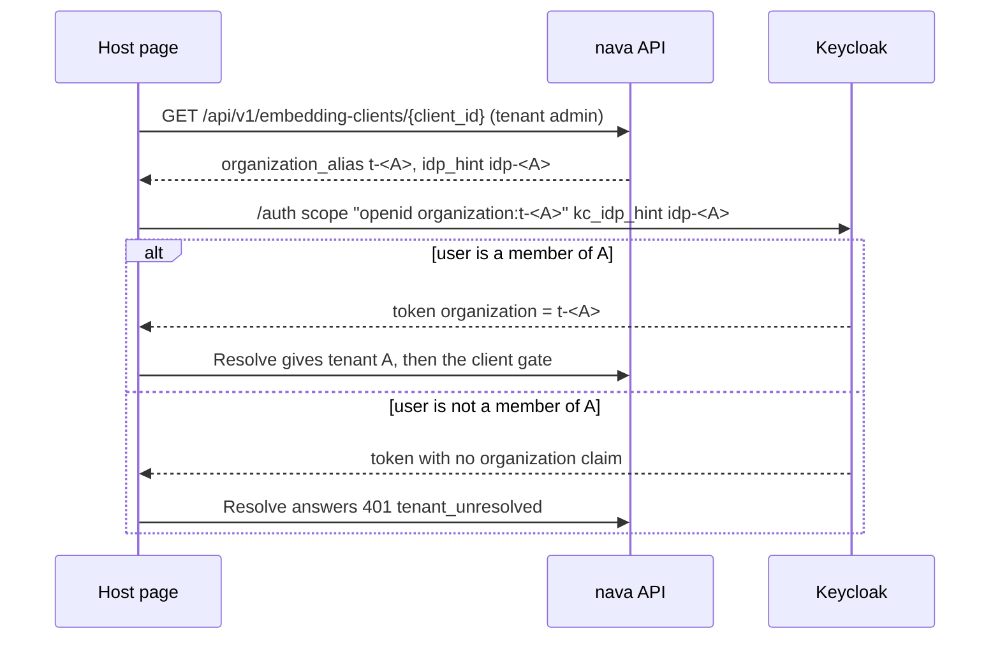

Status: **ACCEPTED**, 2026-11-14, by the Solution Architect under the merge policy (TICK-792, PR #644). The Technical Architect's critique round 1 had no blocking findings, so no CTO tie-break was needed; no dissent. **Nothing in this ADR is delivered on `main` yet:** it is accepted but not implemented. Normative text: [ADR-007-embedding-widget-and-sdk.md](../../../../docs/adr/ADR-007-embedding-widget-and-sdk.md); explainer: [ADR-007-explained.html](../../../../docs/adr/ADR-007-explained.html). Sources: [rfc/](../../../../docs/adr/ADR-007/rfc) (RFC-017 rev 1 and the critique). The delivery plan (PLAN-008, `docs/delivery/plan-adr-007.md`) is not on `main` yet.

*Summary. The normative text is the linked `.md`.*

## What is on main

| Part of the ADR | State |
|---|---|
| Everything: the host-app registry and tenant opt-in, the client gate, CORS, audit envelope v2, client sub-buckets, the widget, the TypeScript SDK, the two endpoints | **Accepted, not implemented. Nothing is on `main`.** |

## Decision

*Paraphrases: "Decision".* Other applications ("host apps") embed the platform with ordinary Keycloak realm tokens that pass the unchanged D26 resolver, so the tenant still comes only from `(iss, organization.id)` (ADR-001 I2). A tenant opts in to each host app and its browser origins; the token's `azp` names the host app, which can refuse a request but never chooses a tenant. No token exchange, no "on behalf of" header, no iframe in v1.

| # | One line |
|---|---|
| D1 | A host app is a realm client (public + PKCE or confidential) with the `nava-api` audience; sign-in is a top-level redirect; `Resolve` stays byte-identical. |
| D2 | Operator registers the client in `embedding_client_registry`; a tenant admin enables it in the RLS table `embedding_client`; a client gate returns 403 `client_not_enabled` otherwise. |
| D3 | CORS is the outermost middleware on every response; an `Origin` outside `allowed_origins` gets 403 `origin_not_allowed`. |
| D4 | Machine-to-machine is `client_credentials` for a service account in exactly one organization, a `kind = integration` principal under normal ACLs. |
| D5 | Audit envelope v2 adds `via_client_id` and `envelope_version` to the hashed bytes (amends ADR-004 R1); verifiers accept v1 and v2. |
| D6 | A per-`(tenant, ClientID)` rate sub-bucket at `rate_limit_share` (default 50 %) of the tenant bucket, reserved atomically with it. |
| D7 | Widget v1 is the web component `<nava-records>`, one SRI-pinned ES module; the host supplies `getToken()`, the widget never logs in or stores the token. |
| D8 | The widget renders the published JSON Schema with no `eval`, a fixed set of field kinds and SHOW/HIDE rules; validation and masks stay on the server. |
| D9 | Widget v1 scope is list, view and create (with a per-submission `Idempotency-Key`). |
| D10 | SDK v1 is TypeScript, generated from `api/openapi.bundled.yaml` plus a thin hand-written layer; CI fails on drift. |
| D11 | SDK major = API major; `Nava-SDK: ts/<version>` is diagnostic only, never trusted. |
| D12 | A second SDK language waits for the first host that cannot use TypeScript or REST. |
| D13 | `POST /api/v1/operator/embedding-clients` (operator) and `PUT /api/v1/embedding-clients/{client_id}` (tenant admin), both audited. |

## Spikes that gate the plan

*Paraphrases: "Spikes that gate the plan"; pass conditions in RFC-017 rev 1 §7.*

| Spike | Gates | If it fails |
|---|---|---|
| S1 host-client token passes unchanged `Resolve`; no prompt on top-level redirect | D1 | Token refused: amendment. Prompt shown: accepted UX cost. **Ran (TICK-806): FAIL, which triggered [Amendment A1](#amendment-a1-embedding-clients-always-name-the-organization); passes with A1's rules (S1 + S1b).** |
| S2 service account as org member, sync row, `Resolve` | D4 | The already-decided D4 fallback (hardcoded-claim mapper). |
| S3 renderer in a shadow root under strict CSP | D8 | JSONForms with a custom rule evaluator, then a hand-written renderer. |
| S4 CORS on 200/401/403/429 in three engines; p95 of the D2 lookup | D3, D2 budget | Fix middleware order; the measured p95 becomes the budget. |

Test list: RFC-017 §8, CI-E1 to CI-E13.

## Options that lost

*Paraphrases: "Rejected options".* RFC 8693 token exchange; a trusted host backend with `X-On-Behalf-Of`; host-signed user assertions (RFC 7523); an iframe widget; hand-written SDKs; a CORS allow-list on preflight; overloading `source_ref`; GraphQL for the widget.

## Accepted risks

*Paraphrases: "Residuals".*

| # | Residual | Owner |
|---|---|---|
| RR1 | Host-page JavaScript can read the user's 5-minute, `nava-api`-only token. | Security reviewer |
| RR2 | A leaked M2M client secret acts as that integration principal in its one tenant. | Technical Lead |
| RR3 | No origin check for requests without an `Origin` header (server callers). | Solution Architect |
| RR4 | Rate sub-buckets are per replica. | Technical Lead |

## Amendment A1: embedding clients always name the organization

Status: **ACCEPTED**, 2026-11-14, by the Solution Architect (TICK-843, PR #655). Technical Architect critique round 1 had no blocking items; Security approved F1 on re-check; the CTO ruled on the fixtures and on spike S1b. No dissent. **Accepted, not implemented:** the `GET` endpoint and the two response members land with TICK-815. Normative text: [ADR-007-A1-org-alias-mandatory.md](../../../../docs/adr/ADR-007-A1-org-alias-mandatory.md); explainer: [ADR-007-A1-explained.html](../../../../docs/adr/ADR-007-A1-explained.html). Sources: RFC-018 in [rfc/](../../../../docs/adr/ADR-007/rfc), spikes S1 and S1b in [spikes/](../../../../docs/adr/ADR-007/spikes). Amends D1 and D13.

*Paraphrases: "Context", "Decision", "Tests", "Residuals".*

**Why.** Spike S1 failed: on a user's first sign-in through a tenant's identity provider (the `kc_idp_hint` broker path), Keycloak 26.8.1 brokers before its organization picker runs, so a token requested with bare scope `organization` carries no `organization` claim and the unchanged `Resolve` answers 401 `tenant_unresolved`. No token resolved to a wrong tenant: a correctness and UX gap, not an isolation gap.

**Decision.** Every authorization request from an embedding client carries `organization:<alias>` for the tenant the host acts for, and should carry `kc_idp_hint` of the same tenant. `Resolve`, `realm-nava.json` and `nava-web` do not change. The alias is a hint, not a trust input: the tenant still comes only from the signed `organization.id` (ADR-001 I2).

| # | One line |
|---|---|
| D1-A1.1 | Embedding clients MUST request `organization:<alias>`; bare `organization` is not supported for them. |
| D1-A1.2 | They SHOULD also send `kc_idp_hint=<idp alias>` of the same tenant (no prompt with a live IdP session). |
| D1-A1.3 | `GET` and `PUT /api/v1/embedding-clients/{client_id}` return the read-only pair `organization_alias = t-<uuid>` and `idp_hint = idp-<uuid>`, derived from `Principal.TenantID` alone; no table is read. SDK and kit helpers take the response object, not two strings. |
| D1-A1.4 | Alias the user cannot use: (a) no hint, the realm sign-in form, no code; (b) with the hint, a token with no `organization` claim and 401 `tenant_unresolved`; (c) an alias naming no org, `error=invalid_scope`, no code. Never a token for a tenant the user is not in. |
| D1-A1.5 | No hint and only an IdP session: Keycloak's username form once (FAIL-UX, not a resolution failure). |
| D1-A1.6 | A claimless token gets 401 from the unchanged `Resolve`: the fail-closed backstop, not a supported path. |
| D1-A1.7 | D13 gains `GET /api/v1/embedding-clients/{client_id}`: tenant admin only, role gate before any lookup, the same 404 for a not-enabled and an unknown `client_id`, audited. `PUT` with either read-only member answers 400 `unknown_field`. |

**How a host gets the pair.** The tenant admin's `GET` (or `PUT`) at opt-in returns `{organization_alias, idp_hint}`; the host sends both on its top-level redirect to Keycloak.

**Tests.** CI-E2 is restated; CI-E14a-d (Keycloak behaviour on seeded fixtures, plus the invariant that no token names a non-member org), CI-E15 (two-org user) and CI-E16 (cross-tenant isolation of the `GET`/`PUT` pair, onboarded tenants) are added. Seed tenants are not renamed; kits use tenants created through onboarding.

**Accepted risks.** Indexed in [accepted-risks.md](../../../../docs/security/accepted-risks.md) as AR-TICK-843-01 to -05.

| # | Residual | Owner |
|---|---|---|
| RR-A1-1 (AR-TICK-843-01) | No-hint path only: a brokered user is stranded on Keycloak's sign-in form with no way back to the host. | Technical Lead |
| RR-A1-2 (AR-TICK-843-02) | `nava-web` keeps bare `organization`; a multi-org user's first brokered sign-in gets 401 (fail-closed). | Solution Architect |
| RR-A1-3 (AR-TICK-843-03) | A brokered user resolves in a second org only if that org's binding lists the brokering IdP. Not new. | Solution Architect |
| RR-A1-4 (AR-TICK-843-04) | Without `kc_idp_hint`, a username prompt once. | Technical Lead |
| RR-A1-6 (AR-TICK-843-05) | Dev seed tenants do not follow the derived names, so the pair names no org for them (`invalid_scope`, fails closed). | Technical Lead |

RR-A1-5 was withdrawn: S1b showed a new user signing in with a wrong alias still joins the org linked to their IdP.
