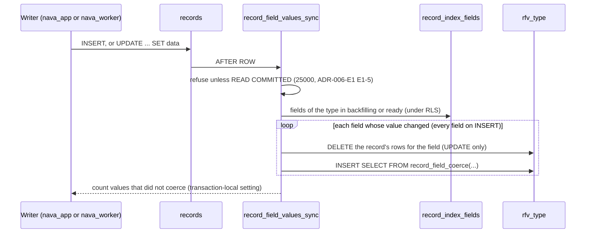

**Built on the story branch `TICK-739/filterable-fields` (S21), not yet on
`main`.** The normative notes are
[field-index.md](../../../data/field-index.md) (tables, P7-01, TICK-741) and
[field-index-trigger.md](../../../data/field-index-trigger.md) (coercion and
trigger, P7-02, TICK-742, with the E1-5 guard from TICK-979). This page is a
summary.

A tenant field marked `x-nava-filterable` gets its values copied into one of
four typed **side tables**. `records.data` stays the only source of truth
(ADR-006 D1): the side rows are derived from it, in the same transaction, and
can always be rebuilt. No DDL runs per tenant or per field (I8).

## Tables

| Table | One row per | Key | Notes |
|---|---|---|---|
| `record_index_fields` (the registry) | flagged field of a type | `(tenant_id, id)`; unique `(tenant_id, entity_definition_id, field_key)` | `value_type` (`text`, `num`, `ts`, `bool`), `state` (`backfilling`, `ready`, `removing`), `progress` 0–100, `requested_version` |
| `rfv_text` | value of a text field | `(tenant_id, record_id, field_id, ord)` | `value text COLLATE "C"`, at most 2,000 bytes |
| `rfv_num` | value of a number field | same | `value double precision`, never `numeric` (R3) |
| `rfv_ts` | value of a date or date-time field | same | `value timestamptz` |
| `rfv_bool` | value of a boolean field | same | `value boolean` |

`ord` is the position in a top-level array, or 0 for a scalar. Each side table
has exactly two B-trees, both led by `tenant_id`: the primary key (the
trigger's per-record DELETE and the filter's `record_id = r.id` probe) and
`rfv_<t>_value (tenant_id, field_id, value, record_id)` (the filter's index
condition). Extended MCV statistics on `(tenant_id, field_id)`, and on
`(tenant_id, field_id, value)` for `text` and `bool` (target 10,000 for bool,
R12), give the planner per-tenant estimates.

Both foreign keys are `NO ACTION`: a record cannot be deleted while it has side
rows, and a registry row cannot be deleted while side rows remain.

These tables are not yet in the [schema snapshot](schema.md): the snapshot is
written by the integration suite on `main`, and the story is not merged.

## Why the value types

Under forced RLS, PostgreSQL pushes a comparison below the tenant policy as an
index condition only when its operator is **leakproof**. The `=`, `<`, `<=`,
`>` and `>=` operators of `text` (under `COLLATE "C"`), `float8`,
`timestamptz` and `bool` are leakproof; `numeric`'s are not. That is why `num`
is `double precision`. `TestP701LeakproofCatalog` pins the catalogue and fails
on any `numeric` column here.

## RLS and grants (ADR-006 D14)

All five tables are `ENABLE` and `FORCE` row-level security, with one policy
per command and role, each using exactly the canonical tenant predicate.

| Table | `nava_app` | `nava_worker` |
|---|---|---|
| `rfv_text`, `rfv_num`, `rfv_ts`, `rfv_bool` | SELECT, INSERT, DELETE | SELECT, INSERT, DELETE |
| `record_index_fields` | SELECT, INSERT, UPDATE (`state`, `progress`, `requested_version`, `updated_at`) | SELECT, UPDATE (`state`, `progress`, `updated_at`), DELETE |

No role may UPDATE a side table: the trigger and the backfill rewrite a value
as DELETE then INSERT. No role may change a registry row's tenant, id, type,
key or value type. `TestP701Grants` pins the exact grant set. The tenant
boundary is proven by `TestP701TenantIsolationAndKeys` and by the S21 attack
rows (see [the S21 story page](../stories/s21.md#attack-paths)).

All five tables are `exempt` in `db/audited-tables.yaml`: the side tables are
derived from audited `records.data` writes, and every registry change a user
makes is the audited entity-type publish in the same transaction.

## Coercion: `record_field_coerce`

One SQL function, `record_field_coerce(v jsonb, value_type text)`, decides
what is stored. The trigger and the backfill both call it; Go never
re-implements it. It returns one row per value that coerces and **no row** for
anything else, so a bad value never fails a write (ADR-006 D5).

| `value_type` | Coerces | Does not coerce (examples) |
|---|---|---|
| `text` | a JSON string of at most 2,000 bytes | numbers, booleans, objects, longer strings |
| `num` | a JSON number that is a finite `float8` | `1e400`, `"1"`, `"NaN"` |
| `bool` | a JSON boolean | `"true"`, `1` |
| `ts` | RFC 3339 date-time with an explicit offset, or `YYYY-MM-DD` (00:00 UTC) | no offset, `+0100`, `01/02/2026`, `2026-02-30` |

`null`, an absent key, a nested array, an object, and array elements past ord
32,767 give no row for any type. The function pins `search_path`, `TimeZone`
and `DateStyle`, so the result does not depend on the session
(`TestP702CoerceRulesAcrossSessions`, 58 cases in four sessions, both roles).

## The records trigger

- `records_field_values_sync` is `AFTER INSERT OR UPDATE OF data ... FOR EACH
  ROW`, `SECURITY INVOKER`, so it sees exactly what the writer sees under RLS.
  It reads only the registry, `NEW` and `OLD`; never a side table.
- `records_field_values_purge` (`BEFORE DELETE`) clears all four tables for the
  record, so the `NO ACTION` FKs pass.
- A `removing` field is skipped; its rows belong to the removal workflow (S22).
- **READ COMMITTED only (TICK-979).** The first statement refuses a write at
  any other isolation level with SQLSTATE `25000`, naming ADR-006-E1. The
  backfill's [snapshot barrier](../workflows/field-index-backfill.md) is sound
  only when the trigger's registry read takes a fresh snapshot, so a
  REPEATABLE READ or SERIALIZABLE write is refused instead of slipping past it.
  `TestP705cRecordsWriteRequiresReadCommitted` (26 assertions go red with the
  guard removed) and `TestP705cRecordsTriggerCatalog` (the trigger stays AFTER
  ROW and is the only one reading the registry) prove it.
- `TestP702TriggerMatchesRecompute` runs 400 random operations per writer role
  over two tenants and then requires the side tables to equal a recompute from
  `records.data`, both ways. `TestP702AuditBytesUnchanged` shows the audit rows
  and chain are byte-identical with and without flagged fields.

**`nava_migrator` sees no registry row.** A future data migration that writes
`records` as the migrator indexes nothing and must run the backfill afterwards.

## The uncoerced counter

A value that does not coerce is counted, not raised (ADR-006 R5). The trigger
adds the count to a transaction-local setting, `nava.field_index_uncoerced`;
`tenancy.InTenantTx` reads it in the same batch as `COMMIT`, and only after the
commit succeeds the pipeline adds it to
`nava_field_index_uncoerced_total{entity_definition}`. A rolled-back
transaction counts nothing. Only writes to a type that flags a field register
the read, so other writes keep their statement budget. The backfill counts the
values it skips on the same counter (TICK-974). The label is the type's opaque
id: no tenant, no value. See [traces, logs and
metrics](../operations/observability.md).

## Related

- [Records](records.md), whose `data` column is the source.
- [Field-index backfill](../workflows/field-index-backfill.md): how a field
  flagged after data exists reaches `ready`.
- [ADR-006](../adr/adr-006.md) and the [S21 story](../stories/s21.md).
