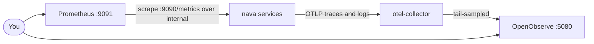

Every nava service emits three signals. Locally, all of them land in two browser UIs that `task stack:up` starts (profile `operator`).

| Signal | Leaves the service as | Lands in | Open it at |
|---|---|---|---|
| Traces | OTLP/HTTP push to `otel-collector`, tail-sampled | OpenObserve, Traces view | `http://127.0.0.1:5080` |
| Logs | `slog` lines on stdout, and OTLP to `otel-collector` | OpenObserve, Logs view, stream `default`; also `docker compose logs` | same |
| Metrics | Prometheus text on the admin listener `:9090/metrics` | Prometheus, scraped over `internal` | `http://127.0.0.1:9091` |

Log in to OpenObserve with `OPENOBSERVE_USER` and `OPENOBSERVE_PASSWORD`. Both have dev-only defaults; see `.env.example`.



## Find one request

Every signal carries the same ids:

| From | To | Link |
|---|---|---|
| Client | Everything | The `X-Request-Id` response header is `request_id` in the logs and `nava.request_id` on the span. An error body's `instance` is `urn:nava:request:<id>` |
| Log line | Trace | `trace_id` and `span_id` on every request log line |
| Metric | Trace | Exemplars on duration buckets carry a `trace_id` (Prometheus runs with exemplar storage on) |

In OpenObserve's Logs view, in the SQL box:

```
request_id = '<request id>'          -- one request
trace_id = '<32-hex trace id>'       -- one trace
severity = 'ERROR'                   -- by level
```

Free text: type a word in the search box, or `match_all('timeout')`. Expand a log line and choose **View Trace** to open its trace. In the Traces view, pick service `nava-core` and the time range.

**Why is this request slow?** Open its trace. The spans show each database round trip and each call to Keycloak or Temporal with its duration. The P3-36 work on the [benchmarks page](../benchmarks/index.md) reads creates exactly this way.

## Sampling

The Collector keeps 10 % of ordinary traces (`OTEL_TAIL_SAMPLE_PERCENT`). Errors and requests slower than 500 ms are always kept. Set `OTEL_TAIL_SAMPLE_PERCENT=100` when you start the stack to keep everything.

If OpenObserve is not running (a stack without the `operator` profile), the Collector logs a failed export for each batch, drops it after 5 s of retries and stays healthy.

## Metrics and alerts

- **Targets.** Prometheus, Status > Targets, job `nava`: the admin listeners of nava-core, nava-worker, nava-relay, nava-groupsync, nava-purge and nava-onboard. A target that is down means the service is down or its admin listener is unreachable.
- **Labels are bounded.** Metrics carry the HTTP method, status, route pattern (never the raw path), scheme, protocol and `error.type`. Tenant and user ids are never labels: to find the tenant, follow the log line.
- **Alert rules** live in `deploy/compose/prometheus/rules/`. There is no Alertmanager locally, so a firing alert shows on Prometheus's Alerts page.

| Alert | Fires when | Where to look |
|---|---|---|
| `AuditSealLag` (warning) | An audit entry has been unsealed for more than 600 s | `audit_seal_failures_total` and the nava-worker `audit seal failed` log line, which names the tenant |
| `AuditDeadLineage` (critical) | A seal lineage is more than 10 minutes overdue | The nava-purge `audit seal lineage dead` log line. Recovery is `POST /api/v1/audit/chain:reseed` |
| `AuditDeadLineageCheckDown` (warning) | The dead-lineage check has reported nothing for 5 minutes | The nava-purge `audit dead lineage check failed` log line: a lost grant, a dropped policy or a renamed column |

## What is never in telemetry

Spans carry no client values or personal data. Logs carry no raw path, query, headers, client IP or tokens. The full list of controls and known gaps is in [observability-notes.md](../../../architecture/observability-notes.md).
